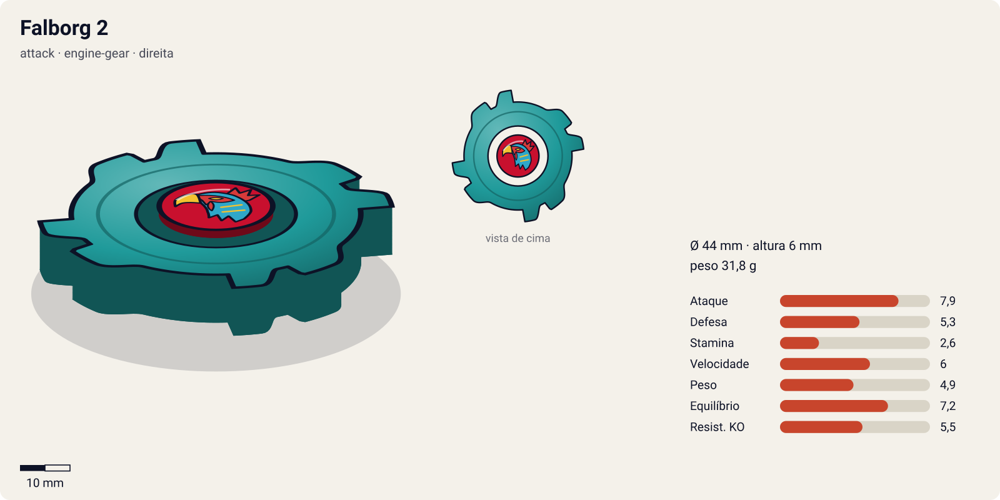
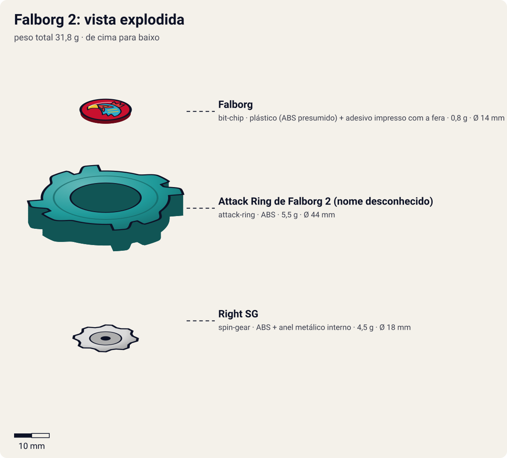
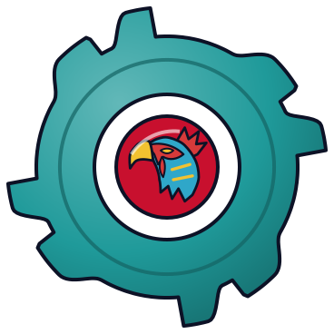

# Falborg 2 (ファルボーグ2 / Farubōgu 2)

<!-- auto:inicio (gerado por npm run build:research; não edite este bloco) -->

| Ficha | |
|---|---|
| Dono | [Bryan Kuznetsov (Boris Kuznetsov / ボリス・クズネツォーフ)](../../README.md) |
| Tipo · sistema · rotação | attack · engine-gear · direita |
| Montada | Ø 44 mm · altura 6 mm · **31,8 g** (soma das peças) |
| Fera bit | [Falborg](../../../../feras-bit/falborg/) |
| Lançador | [EZ Shooter (Easy Shooter, rotação direita)](../../../../lancadores/ez-shooter/) |
| Ripcord | [winder-padrao](../../../../lancadores/ripcords/winder-padrao/) |

### Peças

| Camada | Peça | Material | Ø mm | Altura mm | Peso g | Estrelas Takara (A / D / S) | Desenho |
|---|---|---|---|---|---|---|---|
| Bit Chip | [Falborg](../../../../pecas/bit-chip/falborg/) | plástico (ABS presumido) + adesivo impresso com a fera | 14 estimado | 8 estimado | 0,8 estimado | — | [ver](pecas/bit-chip.svg) |
| Attack Ring | [Attack Ring de Falborg 2 (nome desconhecido)](../../../../pecas/attack-ring/falborg-2-ar-hipotetico/) | ABS | 44 estimado | 6 estimado | 5,5 estimado | — | [ver](pecas/attack-ring.svg) |
| Spin Gear / Core | [Right SG](../../../../pecas/spin-gear/right-sg/) | ABS + anel metálico interno | 18 estimado | 10 estimado | 4,5 estimado | — | [ver](pecas/spin-gear.svg) |

Fonte de cada medida em subscrito (wiki, comunidade, estimado). Detalhes em cada ficha de peça.

### Atributos

| Atributo | Brinquedo (calculado) | Ajuste anime | Jogo |
|---|---|---|---|
| Ataque | 5,9 | +2 | **7,9** |
| Defesa | 5,3 | — | **5,3** |
| Stamina | 2,6 | — | **2,6** |
| Velocidade | 5 | +1 | **6** |
| Peso | 4,9 | — | **4,9** |
| Equilíbrio | 7,2 | — | **7,2** |
| Resistência a KO | 5,5 | — | **5,5** |

Calculado por `src/beyblade/stats.js` a partir de: contato smash (recoil 0,5). Modelo em [docs/BEYBLADES.md](../../../../../docs/BEYBLADES.md).

### Fera bit em cima da bey

 

Sons: [invocacao](../../../../feras-bit/falborg/sons/invocacao.wav) · [rugido](../../../../feras-bit/falborg/sons/rugido.wav) · [ataque](../../../../feras-bit/falborg/sons/ataque.wav). Animações: [invocação](../../../../feras-bit/falborg/invocacao.svg) · [ataque](../../../../feras-bit/falborg/ataque.svg).

Fotos de referência (terceiros, só para estudo)

[anime-2.jpg](referencia/anime-2.jpg) · [anime.jpg](referencia/anime.jpg) · [imagem.jpg](referencia/imagem.jpg) · [manga.jpg](referencia/manga.jpg)

<!-- auto:fim -->

Outras imagens: [anime.jpg](referencia/anime.jpg) e [anime-2.jpg](referencia/anime-2.jpg) (Falborg 2 girando no anime, G-Rev ep. 35), [manga.jpg](referencia/manga.jpg) (versão do mangá, Spin Gear).

> **Bey exclusiva de anime/mangá**: não há brinquedo oficial. A Beyblade Wiki só confirma **Bit Chip Falborg** e **Right SG**; Attack Ring, Weight Disk e Blade Base estão **em branco** na infobox. A wiki diz ainda que no mangá ela é Spin Gear, mas **no anime é Engine Gear** (trivia da página); a infobox, contraditoriamente, lista "Spin Gear System / Right SG". A imagem principal é um frame do anime.

| Campo | Valor |
|---|---|
| Dono | Bryan Kuznetsov (Boris Kuznetsov no JP) |
| Código do produto | nenhum (não lançada) |
| Sistema | Anime: Engine Gear System (segundo a trivia da wiki); mangá: Spin Gear System |
| Rotação | Direita (Right SG/EG segundo a wiki) |
| Fera Bit (Bit-Beast) | Falborg, falcão de vento |
| Série / temporada | G-Revolution (2003) no anime; arco final da S1 no mangá |
| Primeira aparição (anime) | G-Rev ep. 35 "Pros and Ex-cons" (JP: おまえに会えてよかったぜ) |
| Antecessora → Sucessora | [Falborg](../falborg/) → nenhuma no anime. No mangá: Falborg MS |

## Formato e geometria
- Silhueta de cima ([imagem.jpg](referencia/imagem.jpg)): quadrado arredondado com 4 garras → simetria de 4 lados, mais contatos e mais equilíbrio que a Falborg original (2 asas).
- Perfil ([anime.jpg](referencia/anime.jpg)): corpo largo e baixo em degraus, base cônica.
- Distribuição de peso: não confirmada; o Engine Gear costuma concentrar massa no centro e aumentar a altura.

Análise das peças:
- Bit chip [Falborg](../../../../pecas/bit-chip/falborg/): falcão azul/amarelo sobre fundo vermelho no anime.
- [Attack Ring de Falborg 2 (nome desconhecido)](../../../../pecas/attack-ring/falborg-2-ar-hipotetico/): pelo frame do anime, anel quadrangular verde-azulado (teal) com 4 blocos/garras laterais em vermelho e amarelo, cantos chanfrados; tipo ataque, 4 contatos (estimativa visual).
- [Right SG](../../../../pecas/spin-gear/right-sg/) (wiki) / Engine Gear no anime (trivia): o EG é um motor de corda que libera rotação extra no meio da luta, dando explosão de velocidade para as investidas.
- Weight Disk e Blade Base: **não confirmados**. Pelos frames, base cônica teal em camadas com ponta central fina (estimativa: semi-flat de ataque).

Fotos das peças: **não existem** (bey não lançada); só frames do anime e um quadro do mangá.

## Comportamento na arena
- **Movimento**: agressivo; investidas diretas (estilo de Bryan).
- **Ataque**: alto; o especial atravessa a bey adversária.
- **Defesa**: média; foi severamente danificada por Apollon (Garland).
- **Stamina**: média (estimativa).
- **Pontos fortes**: golpe único devastador; vence recrutas da BEGA com facilidade.
- **Pontos fracos**: perdeu para Garland (Apollon), mesmo em 2 contra 1 com Spencer.
- **Gimmick**: Engine Gear no anime (não confirmado em detalhe).

## No anime
- **Especial**: **Stroblitz Attack** (dub EN): surge um feixe branco ofuscante mirando a bey adversária; no impacto o feixe atravessa a bey e pode **estilhaçá-la em vários pedaços**. Nome JP: **não confirmado**.
- **Batalhas**:
  - G-Rev ep. 28: treino contra Kai; derrota (a wiki não diz qual bey; provavelmente Falborg 2, mas a própria wiki diz que ela só é "mostrada pela primeira vez" no ep. 35 → **não confirmado**).
  - G-Rev ep. 35: com Tala e Spencer vs. BEGA Training Squad (Orca/Manta/Crab Diver): vitória.
  - G-Rev ep. 35: com Spencer vs. Garland (Apollon): derrota; Falborg 2 e Seaborg 2 muito danificadas pelo *Radiant Thunder*; Bryan e Spencer desmaiam.
- **Substituição**: nenhuma no anime (Bryan não batalha mais).

## Mecânica no jogo
- **Movimento (IA)**: "agressivo": investidas diretas no adversário, voltando a uma órbita média entre elas.
- **Gimmick (Engine Gear, passivo)**: 1 vez por luta, quando o RPM cai a ~40%, o EG solta: +20% de velocidade e +8% de RPM por 3 s.
- **Especial**: *Stroblitz Attack*. Carga de 0,8 s e depois feixe/dash em linha reta que **atravessa** o adversário: dano 2,2× o ataque; se o adversário estiver abaixo de 30% de RPM, perde 15% a mais (quebra). Se errar, Falborg 2 fica 1 s exposta. Custo 100 de energia, recarga 20 s. Visual: o feixe branco do [ataque de Falborg](../../../../feras-bit/falborg/ataque.svg) (Stroblitz Attack), depois das lâminas de vento.
- **Física**: massa relativa 1,1; raio 1,0; atrito da ponta 0,55; restituição 0,65.

## Ajuste do anime

| Atributo | Delta | Justificativa (episódio/batalha) |
|---|---|---|
| Ataque | +2 | Stroblitz Attack atravessa e estilhaça beys; vence o BEGA Training Squad com Tala e Spencer (ep. 35). |
| Velocidade | +1 | Investidas diretas com o Engine Gear do anime (ep. 35). |

Resultado esperado: bey de chefe ofensiva da equipe russa em G-Rev, que vence recrutas da BEGA mas perde para Apollon de Garland mesmo em 2 contra 1 (ep. 35); por isso sem bônus de defesa ou resistência.

Nota para o coordenador: só 3 peças estão registradas (bit chip, AR hipotético `falborg-2-ar-hipotetico` e Right SG); faltam WD e base e a ponta é `null`. A Stamina 2,6 e o peso de 31,8 g do brinquedo calculado vêm dessa montagem incompleta (o INDICE lista o sistema como engine-gear, mas a peça registrada é um Right SG). Não compensei isso no ajuste.

## Fontes
- https://beyblade.fandom.com/wiki/Falborg_2
- https://beyblade.fandom.com/wiki/Stroblitz_Attack
- https://beyblade.fandom.com/wiki/Falborg_MS (sucessora só no mangá)
- https://beyblade.fandom.com/wiki/Beyblade:_G-Revolution_-_Episode_35
- https://beyblade.fandom.com/wiki/Beyblade_G-Revolution_-_Episode_28
- https://beyblade.fandom.com/wiki/Bryan_Kuznetsov
- https://ja.wikipedia.org/wiki/爆転シュート_ベイブレード_(アニメ)
