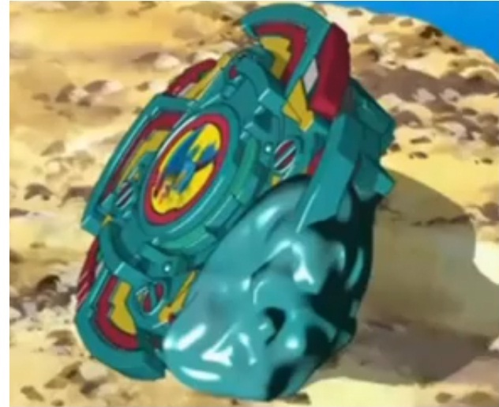

# Falborg 2 (ファルボーグ2 / Farubōgu 2)

Outras imagens: [anime.jpg](anime.jpg) e [anime-2.jpg](anime-2.jpg) (Falborg 2 girando no anime, G-Rev ep. 35), [manga.jpg](manga.jpg) (versão do mangá, Spin Gear).

> **Bey exclusiva de anime/mangá** — não há brinquedo oficial. A Beyblade Wiki só confirma **Bit Chip Falborg** e **Right SG**; Attack Ring, Weight Disk e Blade Base estão **em branco** na infobox. A wiki diz ainda que no mangá ela é Spin Gear, mas **no anime é Engine Gear** (trivia da página) — a infobox, contraditoriamente, lista "Spin Gear System / Right SG". A imagem principal é um frame do anime (não existe foto de brinquedo).

| Campo | Valor |
|---|---|
| Dono | Bryan Kuznetsov (Boris Kuznetsov no JP) |
| Código do produto | nenhum (não lançada) |
| Tipo | Attack |
| Sistema | Anime: Engine Gear System (segundo trivia da wiki); Mangá: Spin Gear System |
| Rotação | Direita (Right SG/EG segundo a wiki) |
| Fera Bit (Bit-Beast) | Falborg — falcão de vento |
| Série / temporada | G-Revolution (2003) no anime; arco final da S1 no mangá |
| Primeira aparição (anime) | G-Rev ep. 35 "Pros and Ex-cons" (JP: おまえに会えてよかったぜ) |
| Antecessora → Sucessora | Falborg → nenhuma no anime. No mangá: Falborg MS |

## 1. Peças (de cima para baixo)

| Camada | Peça | Descrição física | Função em batalha |
|---|---|---|---|
| Bit Chip | Falborg | Chip com o falcão (azul/amarelo sobre fundo vermelho no anime) | identidade / fera bit |
| Attack Ring (AR) | não confirmado | Pelo frame do anime: anel quadrangular verde-azulado (teal) com 4 blocos/garras laterais em vermelho e amarelo, cantos chanfrados | Ataque (Attack type); 4 contatos (estimativa visual) |
| Weight Disk (WD) | não confirmado | — | — |
| Spin Gear / Core | Right SG (wiki) / Engine Gear no anime (trivia) | Engine Gear: motor de corda que libera rotação extra no meio da batalha | Explosão de velocidade para investidas |
| Support Part / Sub Ring | — | — | — |
| Blade Base (BB) | não confirmado | Pelos frames: base cônica teal em camadas, ponta central fina | Tipo de ponta não confirmado (frames sugerem ponta estreita; estimativa: semi-flat de ataque) |

Fotos das peças: **não existem** (bey não lançada). Apenas frames do anime e um quadro do mangá.

## 2. Formato e geometria
- Silhueta de cima (frame `imagem.jpg`): forma quadrada arredondada com 4 garras → simetria de 4 lados, mais contatos e mais equilíbrio que a Falborg original (2 asas).
- Perfil (frames `anime*.jpg`): corpo largo e baixo em degraus, base cônica.
- Distribuição de peso: não confirmada; Engine Gear costuma concentrar massa no centro e aumentar a altura.

## 3. Comportamento na arena
- **Movimento**: agressivo; investidas diretas (estilo de Bryan).
- **Ataque**: alto — especial atravessa a bey adversária.
- **Defesa**: média; foi severamente danificada por Apollon (Garland).
- **Stamina**: média (estimativa).
- **Pontos fortes**: golpe único devastador; vence recrutas da BEGA facilmente.
- **Pontos fracos**: perdeu para Garland (Apollon), mesmo em 2 contra 1 com Spencer.
- **Gimmick**: Engine Gear no anime (não confirmado em detalhe).

## 4. No anime
- **Especial**: **Stroblitz Attack** (dub EN) — surge um feixe branco ofuscante mirando a bey adversária; no impacto o feixe atravessa a bey e pode **estilhaçá-la em vários pedaços**. Nome JP: **não confirmado**.
- **Batalhas**:
  - G-Rev ep. 28 — treino contra Kai; derrota (a wiki não diz qual bey; provavelmente Falborg 2, mas a própria wiki diz que ela só é "mostrada pela primeira vez" no ep. 35 → **não confirmado**).
  - G-Rev ep. 35 — com Tala e Spencer vs. BEGA Training Squad (Orca/Manta/Crab Diver): vitória.
  - G-Rev ep. 35 — com Spencer vs. Garland (Apollon): derrota; Falborg 2 e Seaborg 2 muito danificadas pelo *Radiant Thunder*; Bryan e Spencer desmaiam.
- **Substituição**: nenhuma no anime (Bryan não batalha mais).

## 5. Tradução para o jogo
Valores 1–10 (ver `pesquisa-bakuten/_template/BRIEF-AGENTES.md` → "Escala de atributos"). **Todos estimativas** (peças não documentadas).

| Atributo | Valor | Justificativa |
|---|---|---|
| Ataque | 8 | Attack type; Stroblitz Attack capaz de estilhaçar beys |
| Defesa | 5 | 4 garras dão mais estabilidade que a Falborg original; ainda assim foi destruída por Apollon |
| Stamina | 6 | Engine Gear dá fôlego extra; tempo de batalha curto no anime |
| Velocidade | 8 | Estilo de investida de Bryan + liberação do EG |
| Peso | 7 | Engine Gear tende a pesar mais que Spin Gear (estimativa) |
| Equilíbrio | 6 | Simetria de 4 lados, mas EG alto |
| Burst/Knockout-resist | 5 | Agressiva, arrisca auto-knockout; resistiu pouco a Garland |

- **Movimento em IA**: "agressivo" — investidas diretas; ao ativar o Engine Gear (~40% da batalha), ganha boost de velocidade por 3 s.
- **Especiais (no jogo)**:
  - *Stroblitz Attack* — carga de 0,8 s e depois um feixe/dash em linha reta que **atravessa** o adversário: dano 2,2× ataque e chance de "quebra" (perda de 15% de rotação extra) se o adversário estiver abaixo de 30% de rotação. Custo 100, cooldown 20 s. Se errar, fica 1 s exposto.
  - *Engine Gear (passivo)* — 1× por batalha, boost +20% de velocidade e +8% de rotação.
- **Física sugerida**: massa relativa 1,1; raio relativo 1,0; atrito da ponta 0,55; restituição 0,65.

Os mesmos dados ficam em `dados.json`.

## 6. Fontes
- https://beyblade.fandom.com/wiki/Falborg_2
- https://beyblade.fandom.com/wiki/Stroblitz_Attack
- https://beyblade.fandom.com/wiki/Falborg_MS (sucessora só no mangá)
- https://beyblade.fandom.com/wiki/Beyblade:_G-Revolution_-_Episode_35
- https://beyblade.fandom.com/wiki/Beyblade_G-Revolution_-_Episode_28
- https://beyblade.fandom.com/wiki/Bryan_Kuznetsov
- https://ja.wikipedia.org/wiki/爆転シュート_ベイブレード_(アニメ)
