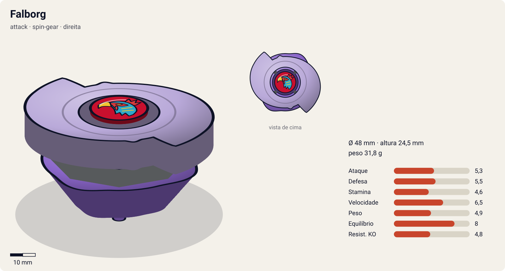
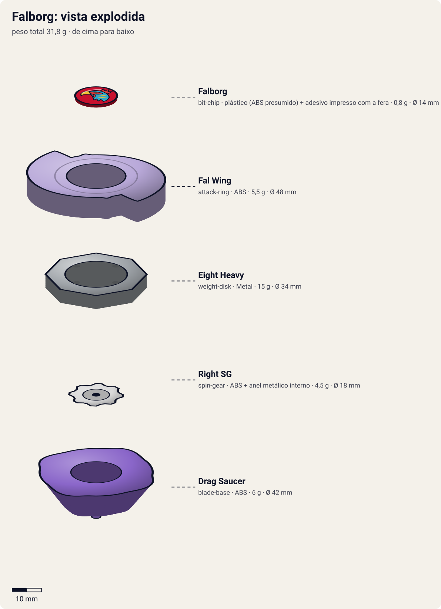
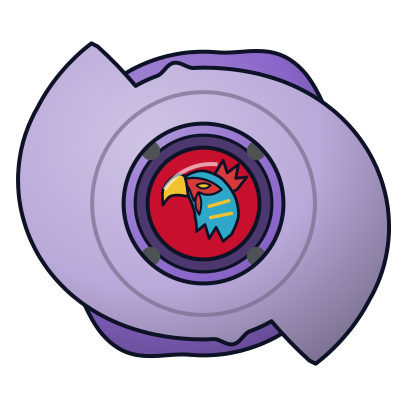

# Falborg (ファルボーグ / Farubōgu)

<!-- auto:inicio (gerado por npm run build:research; não edite este bloco) -->

| Ficha | |
|---|---|
| Dono | [Bryan Kuznetsov (Boris Kuznetsov / ボリス・クズネツォーフ)](../../README.md) |
| Tipo · sistema · rotação | attack · spin-gear · direita |
| Montada | Ø 48 mm · altura 24,5 mm · **31,8 g** (soma das peças) |
| Fera bit | [Falborg](../../../../feras-bit/falborg/) |
| Lançador | [EZ Shooter (Easy Shooter, rotação direita)](../../../../lancadores/ez-shooter/) |
| Ripcord | [winder-padrao](../../../../lancadores/ripcords/winder-padrao/) |

### Peças

| Camada | Peça | Material | Ø mm | Altura mm | Peso g | Estrelas Takara (A / D / S) | Desenho |
|---|---|---|---|---|---|---|---|
| Bit Chip | [Falborg](../../../../pecas/bit-chip/falborg/) | plástico (ABS presumido) + adesivo impresso com a fera | 14 estimado | 8 estimado | 0,8 estimado | — | [ver](pecas/bit-chip.svg) |
| Attack Ring | [Fal Wing](../../../../pecas/attack-ring/fal-wing/) | ABS | 48 estimado | 7 estimado | 5,5 estimado | — | [ver](pecas/attack-ring.svg) |
| Weight Disk | [Eight Heavy](../../../../pecas/weight-disk/eight-heavy/) | Metal | 34 estimado | 4,5 estimado | 15 wiki | 0,5 / 3 / 1,5 | [ver](pecas/weight-disk.svg) |
| Spin Gear / Core | [Right SG](../../../../pecas/spin-gear/right-sg/) | ABS + anel metálico interno | 18 estimado | 10 estimado | 4,5 estimado | — | [ver](pecas/spin-gear.svg) |
| Blade Base | [Drag Saucer](../../../../pecas/blade-base/drag-saucer/) | ABS | 42 estimado | 13 estimado | 6 estimado | — | [ver](pecas/blade-base.svg) |

Fonte de cada medida em subscrito (wiki, comunidade, estimado). Detalhes em cada ficha de peça.

### Atributos

| Atributo | Brinquedo (calculado) | Ajuste anime | Jogo |
|---|---|---|---|
| Ataque | 4,3 | +1 | **5,3** |
| Defesa | 5,5 | — | **5,5** |
| Stamina | 4,6 | — | **4,6** |
| Velocidade | 5,5 | +1 | **6,5** |
| Peso | 4,9 | — | **4,9** |
| Equilíbrio | 8 | — | **8** |
| Resistência a KO | 4,8 | — | **4,8** |

Calculado por `src/beyblade/stats.js` a partir de: ponta semi-flat (atrito 0,3), contato smash (recoil 0,6), peso do WD na centro. Modelo em [docs/BEYBLADES.md](../../../../../docs/BEYBLADES.md).

### Fera bit em cima da bey

 

Sons: [invocacao](../../../../feras-bit/falborg/sons/invocacao.wav) · [rugido](../../../../feras-bit/falborg/sons/rugido.wav) · [ataque](../../../../feras-bit/falborg/sons/ataque.wav). Animações: [invocação](../../../../feras-bit/falborg/invocacao.svg) · [ataque](../../../../feras-bit/falborg/ataque.svg).

Fotos de referência (terceiros, só para estudo)

[anime-destruida.jpg](referencia/anime-destruida.jpg) · [anime-fera-bit.jpg](referencia/anime-fera-bit.jpg) · [anime.jpg](referencia/anime.jpg) · [imagem.png](referencia/imagem.png) · [pecas-gba-pecas-e-stats.png](referencia/pecas-gba-pecas-e-stats.png) · [pecas-weight-disk.png](referencia/pecas-weight-disk.png)

<!-- auto:fim -->

Outras imagens: [anime.jpg](referencia/anime.jpg) (ficha "Bit-Beast: Falborg — Stroblitz" do dub EN), [anime-destruida.jpg](referencia/anime-destruida.jpg) (Falborg despedaçada por Driger, ep. 49), [anime-fera-bit.jpg](referencia/anime-fera-bit.jpg) (fera bit Falborg em ação).

> **Bey exclusiva do anime**: nunca foi lançada como brinquedo pela Takara nem pela Hasbro (a página do Bit Chip Falborg na wiki a chama de "unreleased"). A combinação de peças vem da ficha do jogo de Game Boy Advance *Bakuten Shoot Beyblade 2002* ([gba-pecas-e-stats.png](referencia/pecas-gba-pecas-e-stats.png)), reproduzida na infobox da Beyblade Wiki. Nas páginas de episódio da wiki ela aparece também como **"Falborg S"**.

| Campo | Valor |
|---|---|
| Dono | Bryan Kuznetsov (Boris Kuznetsov no JP) |
| Código do produto | nenhum (não lançada) |
| Fera Bit (Bit-Beast) | Falborg, falcão (隼) de vento, fera bit artificial da Abadia Balkov |
| Série / temporada | Bakuten Shoot (2001) |
| Primeira aparição (anime) | S1 ep. 46 "First Strike" (fera bit em destaque no ep. 49 "A Wicked Wind Blows") |
| Antecessora → Sucessora | — → [Falborg 2](../falborg-2/) |

## Formato e geometria
- Silhueta de cima: duas asas em meia-lua que quase fecham um círculo, com dois ganchos opostos → **2 contatos principais**, simetria bilateral (rotacional de 180°).
- Raio grande (asas longas) e perfil relativamente baixo e achatado (ver arte oficial).
- Peso: o Eight Heavy concentra massa no centro → giro rápido, mas menos inércia periférica que um Wide.

Análise das peças:
- [Fal Wing](../../../../pecas/attack-ring/fal-wing/): pelo design do anime, 2 grandes asas em crescente, lilás com faixas vermelhas, cada uma com uma ponta em gancho e detalhe verde; 2 pinos amarelos junto ao centro. Sem página na wiki. Smash (asas longas = grande alcance); provável recoil alto por ter só 2 contatos (estimativa).
- [Eight Heavy](../../../../pecas/weight-disk/eight-heavy/) (15 g): Heavy de 8 lados, massa perto do centro (compacto): mais RPM e peso total.
- [Right SG](../../../../pecas/spin-gear/right-sg/): Spin Gear padrão de rotação direita (sem rolamento nem metal weight).
- [Drag Saucer](../../../../pecas/blade-base/drag-saucer/): sem página na wiki; tipo de ponta **não confirmado**. Pelo comportamento no anime (investidas rápidas, ricochetes na parede) presume-se flat/semi-flat (estimativa).

Fotos das peças (terceiros): [ficha do GBA](referencia/pecas-gba-pecas-e-stats.png) (AR e base), [WD](referencia/pecas-weight-disk.png) (Eight Heavy genérico). Não existem fotos reais das peças (bey não lançada).

## Comportamento na arena
- **Movimento**: agressivo, em órbitas largas perto da borda, com investidas e ricochetes (no ep. 49 Bryan joga Falborg contra a parede de propósito).
- **Ataque**: alto; as asas em gancho cortam o adversário; no anime gera lâminas de vento (鎌鼬 / kamaitachi).
- **Defesa**: baixa a média; poucos pontos de contato, ponta de ataque.
- **Stamina**: média-baixa (SG simples, ponta de ataque).
- **Pontos fortes**: knockouts rápidos, pressão contínua, uso do cenário.
- **Pontos fracos**: perde se o adversário sobreviver ao início (2ª rodada contra Ray: pressa demais = brecha); estrutura frágil (foi despedaçada).
- **Matchups**: vence defensores sem estabilidade (Draciel F dominada em 2x1); perde para attack/balance que contra-atacam no tempo certo (Driger F).
- **Gimmick**: nenhum de brinquedo conhecido; no anime o "gimmick" é o vento invisível.

## No anime
- **Especial**: **Stroblitz** (dub EN; aparece na ficha BBA): Falborg cria um tornado/lâminas de vento invisíveis que cortam a bey adversária e atingem o próprio blader (Ray é ferido sem que o juiz possa punir, pois "o vento é invisível"). Nome JP do golpe: **não confirmado** (a Wikipedia JP descreve só "ataque assassino com kamaitachi").
- **Batalhas**:
  - ep. 46: com Spencer (Seaborg 2), 2 contra 1 em Max (Draciel F); vencem e roubam Draciel.
  - ep. 49: vs. Ray (Driger F): rodada 1 vitória (pedaço do estádio arremessado no estômago de Ray); rodada 2 derrota (pressa); rodada 3 derrota, Driger protege Ray e **despedaça Falborg**.
- **Substituição**: destruída no ep. 49; volta como Falborg 2 em G-Revolution.

## Mecânica no jogo
- **Movimento (IA)**: órbita agressiva perto da borda, com investidas em linha reta para o adversário. Usa ricochete de propósito: cada batida na parede dá +15% de velocidade por 1 s (máx. 1 vez a cada 2 s).
- **Gimmick**: nenhum de brinquedo. Passivo "vento invisível": os projéteis do Stroblitz não mostram trajetória para o jogador adversário (só o brilho no impacto).
- **Especial**: *Stroblitz*. 3 lâminas de vento (projéteis) em leque; cada acerto tira 5% de rotação e empurra o adversário 0,5 raio; custo 100 de energia, recarga 18 s. Visual: [Falborg](../../../../feras-bit/falborg/) sai do tornado da [invocação](../../../../feras-bit/falborg/invocacao.svg) e dispara as lâminas do [ataque](../../../../feras-bit/falborg/ataque.svg).
- **Física**: massa relativa 1,0; raio 1,1 (asas longas); atrito da ponta 0,6 (flat presumido); restituição 0,7.

## Ajuste do anime

| Atributo | Delta | Justificativa (episódio/batalha) |
|---|---|---|
| Ataque | +1 | Stroblitz domina Draciel F no 2x1 (ep. 46) e vence a 1ª rodada contra Driger F, ferindo Ray (ep. 49). |
| Velocidade | +1 | Investidas e ricochetes constantes na parede (ep. 49). |

Resultado esperado: atacante rápida e perigosa de início de luta, que perde 1–2 para Driger F quando o adversário aguenta a pressão; sem bônus de defesa (é despedaçada no ep. 49).

Nota para o coordenador: as peças vêm do jogo de GBA e o tipo de ponta da Drag Saucer não é confirmado; o `semi-flat` do cálculo é estimativa.

## Fontes
- https://beyblade.fandom.com/wiki/Falborg
- https://beyblade.fandom.com/wiki/Bit_Chip_-_Falborg
- https://beyblade.fandom.com/wiki/Weight_Disk_-_Eight_Heavy
- https://beyblade.fandom.com/wiki/Spin_Gear_-_Right_SG
- https://beyblade.fandom.com/wiki/Beyblade_-_Episode_46 , https://beyblade.fandom.com/wiki/Beyblade_-_Episode_49
- https://beyblade.fandom.com/wiki/Bryan_Kuznetsov
- https://ja.wikipedia.org/wiki/爆転シュート_ベイブレード_(アニメ) (seção ロシアチーム（ボーグ）)
