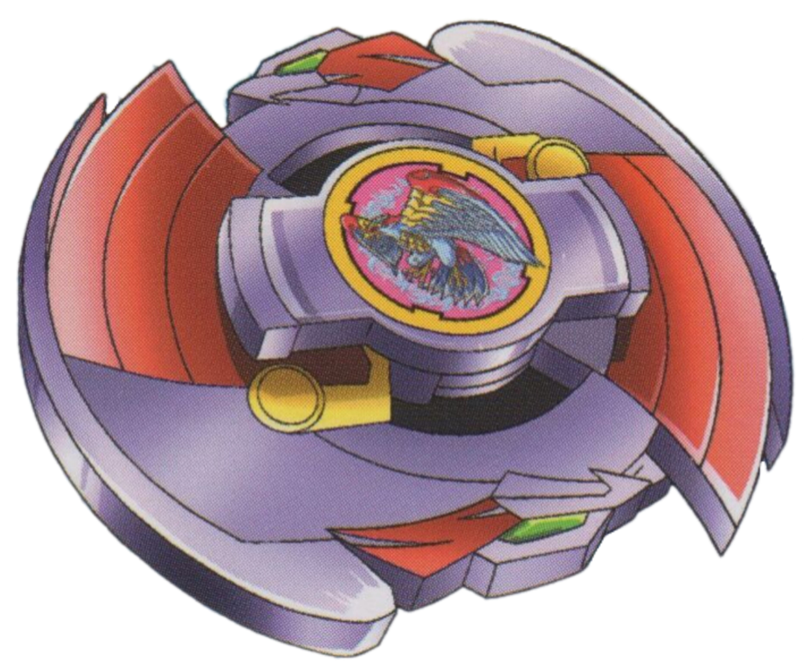

# Falborg (ファルボーグ / Farubōgu)

Outras imagens: [anime.jpg](anime.jpg) (ficha "Bit-Beast: Falborg — Stroblitz" do dub EN), [anime-destruida.jpg](anime-destruida.jpg) (Falborg despedaçada por Driger, ep. 49), [anime-fera-bit.jpg](anime-fera-bit.jpg) (fera bit Falborg em ação).

> **Bey exclusiva do anime** — nunca foi lançada como brinquedo pela Takara nem pela Hasbro (a página do Bit Chip Falborg na wiki a chama de "unreleased"). A combinação de peças abaixo vem da ficha do jogo de Game Boy Advance *Bakuten Shoot Beyblade 2002* (imagem [pecas/gba-pecas-e-stats.png](pecas/gba-pecas-e-stats.png)), reproduzida na infobox da Beyblade Wiki. Nas páginas de episódio da wiki ela aparece também como **"Falborg S"**.

| Campo | Valor |
|---|---|
| Dono | Bryan Kuznetsov (Boris Kuznetsov no JP) |
| Código do produto | nenhum (não lançada) |
| Tipo | Attack |
| Sistema | Spin Gear System |
| Rotação | Direita |
| Fera Bit (Bit-Beast) | Falborg — falcão (隼) de vento, fera bit artificial da Abadia Balkov |
| Série / temporada | Bakuten Shoot (2001) |
| Primeira aparição (anime) | S1 ep. 46 "First Strike" (fera bit em destaque no ep. 49 "A Wicked Wind Blows") |
| Antecessora → Sucessora | — → Falborg 2 |

## 1. Peças (de cima para baixo)

| Camada | Peça | Descrição física | Função em batalha |
|---|---|---|---|
| Bit Chip | Falborg | Chip com o falcão Falborg | identidade / fera bit |
| Attack Ring (AR) | Fal Wing | Pelo design do anime: 2 grandes asas em crescente (simetria bilateral), lilás com faixas vermelhas, cada uma com uma ponta em gancho e detalhe verde; 2 pinos amarelos junto ao centro. Página da peça não existe na wiki | Smash Attack (asas longas = grande alcance de contato); provável recoil alto por ter só 2 contatos (estimativa) |
| Weight Disk (WD) | Eight Heavy | Disco Heavy de 8 lados, 15 g; massa concentrada perto do centro (compacto) | Mais RPM e peso total; bom para combos compactos/attack e defesa |
| Spin Gear (SG) | Right SG | Spin Gear padrão de rotação direita (sem rolamento, sem metal weight) | Rotação direita |
| Support Part / Sub Ring | — | não tem | — |
| Blade Base (BB) | Drag Saucer | Base sem página na wiki; tipo de ponta **não confirmado** | Pelo comportamento no anime (investidas rápidas, ricochetes na parede) presume-se ponta flat/semi-flat — estimativa |

Fotos das peças: [pecas/gba-pecas-e-stats.png](pecas/gba-pecas-e-stats.png) (ficha do jogo GBA com AR e base), [pecas/weight-disk.png](pecas/weight-disk.png) (Eight Heavy genérico). Não existem fotos reais das peças (bey não lançada).

## 2. Formato e geometria
- Silhueta de cima: duas asas em meia-lua que quase fecham um círculo, com dois ganchos opostos → **2 contatos principais**, simetria bilateral (rotacional de 180°).
- Raio grande (asas longas) e perfil relativamente baixo e achatado (ver arte oficial).
- Peso: Eight Heavy concentra massa no centro → giro rápido mas menos inércia periférica que um Wide.

## 3. Comportamento na arena
- **Movimento**: agressivo, em órbitas largas perto da borda, investidas e ricochetes (no ep. 49 Bryan joga Falborg contra a parede de propósito).
- **Ataque**: alto; asas em gancho cortam o adversário; no anime gera lâminas de vento (鎌鼬 / kamaitachi).
- **Defesa**: baixa a média; poucos pontos de contato, ponta de ataque.
- **Stamina**: média-baixa (SG simples, ponta de ataque).
- **Pontos fortes**: knockouts rápidos, pressão contínua, uso do cenário.
- **Pontos fracos**: perde se o adversário sobreviver ao início (2ª rodada contra Ray: pressa demais = brecha); estrutura frágil (foi despedaçada).
- **Matchups**: vence defensores sem estabilidade (Draciel F foi dominado em 2x1); perde para attackers/balance que contra-atacam no tempo certo (Driger F).
- **Gimmick**: nenhum de brinquedo conhecido; no anime o "gimmick" é o vento invisível.

## 4. No anime
- **Especial**: **Stroblitz** (dub EN; aparece na ficha BBA) — Falborg cria um tornado/lâminas de vento invisíveis que cortam a bey adversária e atingem o próprio blader (Ray é ferido sem que o juiz possa punir, pois "o vento é invisível"). Nome JP do golpe: **não confirmado** (a Wikipedia JP descreve apenas "ataque assassino com kamaitachi").
- **Batalhas marcantes**:
  - ep. 46 — com Spencer (Seaborg 2), 2 contra 1 em Max (Draciel F); vencem e roubam Draciel.
  - ep. 49 — vs. Ray (Driger F): rodada 1 vitória (pedaço do estádio arremessado no estômago de Ray); rodada 2 derrota (pressa); rodada 3 derrota — Driger protege Ray e **despedaça Falborg**.
- **Substituição**: destruída no ep. 49; volta como Falborg 2 em G-Revolution.

## 5. Tradução para o jogo
Valores 1–10 (ver `pesquisa-bakuten/_template/BRIEF-AGENTES.md` → "Escala de atributos"). Como a bey não existe fisicamente, **todos os valores são estimativas** baseadas no anime + peças do jogo GBA.

| Atributo | Valor | Justificativa |
|---|---|---|
| Ataque | 8 | Tipo Attack, asas longas com ganchos, domina Ray na 1ª rodada; abaixo das âncoras 10 (Dragoon V2/Galeon 2) |
| Defesa | 4 | Poucos contatos, ponta presumida de ataque; foi destruída por Driger |
| Stamina | 5 | SG simples; no anime luta curta e explosiva |
| Velocidade | 8 | Investidas e ricochetes constantes |
| Peso | 6 | Eight Heavy (15 g) aumenta a massa |
| Equilíbrio | 5 | Simetria bilateral (2 asas) tende a mais wobble que beys trilaterais |
| Burst/Knockout-resist | 5 | Massa central ajuda, mas movimento agressivo arrisca auto-knockout |

- **Movimento em IA**: "órbita agressiva" perto da borda, com investidas em linha reta para o adversário e uso intencional de ricochete na parede (ganho de velocidade).
- **Especiais (no jogo)**:
  - *Stroblitz* — 3 lâminas de vento (projéteis) em leque; cada acerto tira 5% de rotação e empurra o adversário 0,5 raio. Custo 100, cooldown 18 s.
- **Física sugerida**: massa relativa 1,0; raio relativo 1,1 (asas longas); atrito da ponta 0,6 (flat presumido); restituição 0,7.

Os mesmos dados ficam em `dados.json`.

## 6. Fontes
- https://beyblade.fandom.com/wiki/Falborg
- https://beyblade.fandom.com/wiki/Bit_Chip_-_Falborg
- https://beyblade.fandom.com/wiki/Weight_Disk_-_Eight_Heavy
- https://beyblade.fandom.com/wiki/Spin_Gear_-_Right_SG
- https://beyblade.fandom.com/wiki/Beyblade_-_Episode_46 , https://beyblade.fandom.com/wiki/Beyblade_-_Episode_49
- https://beyblade.fandom.com/wiki/Bryan_Kuznetsov
- https://ja.wikipedia.org/wiki/爆転シュート_ベイブレード_(アニメ) (seção ロシアチーム（ボーグ）)
