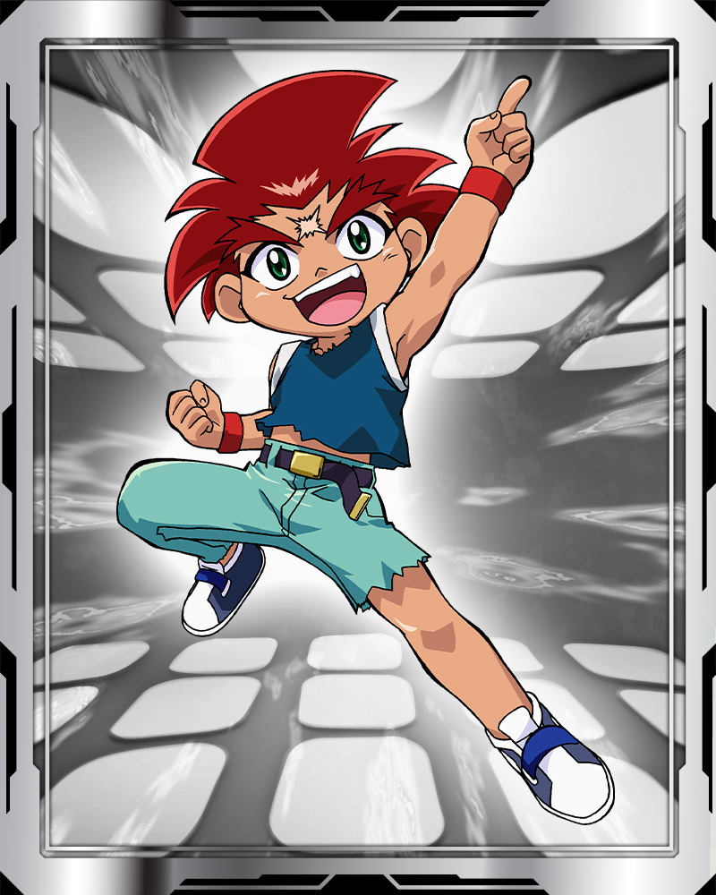
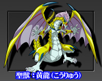

# Daichi Sumeragi (皇大地 / Sumeragi Daichi)

Fera bit: 

| Campo | Valor |
|---|---|
| Nome JP | 皇大地 (Sumeragi Daichi) — "Daichi" = terra, "Sumeragi" = imperador/rei |
| Equipe(s) por temporada | S1: — (não aparece) / V-Force: — (só no filme *Fierce Battle*, onde é aliado temporário/possuído pelos Shadow Bladers) / G-Rev: BBA Revolution (parceiro de Tyson no torneio de duplas) → G Revolutions (BBA vs BEGA / Justice Five) |
| Nacionalidade | Japonês (criado nas montanhas, educado em casa) |
| Idade (aprox.) | 10 anos em G-Revolution (o mais novo da equipe) |
| Fera Bit | Gaia Dragoon / Strata Dragoon (ガイアドラグーン) — o "dragão dourado", quinta fera sagrada (centro) da mitologia das Quatro Feras Sagradas |
| Estilo de batalha | Ataque bruto, explosivo, adaptado a terrenos naturais (água, rochas, floresta); ataques temáticos de ferramentas de corte (serra, lâmina) |
| Dublador(a) JP / EN / PT-BR | Naomi (Nao) Nagasawa / Mary Long / não confirmado |

Aniversário: 30 de junho (Câncer). Aparência: cabelo ruivo-escuro espetado, olhos verdes, cicatriz em X na testa, regata azul rasgada.

## Personalidade e papel na história
- Garoto hiperativo, teimoso, comilão e excessivamente confiante; alívio cômico do grupo (enjoo em aviões, briga constante com Tyson, chama Hilary de "velha").
- Treinou na natureza (montanhas, rios, florestas) porque não havia estádios onde morava. O pai, Daigoro Sumeragi, era lenhador e morreu salvando colegas; deixou-lhe Gaia Dragoon e a promessa de ser o nº 1 do Japão. Por isso todos os ataques da fera remetem a serras e lâminas de corte.
- **Filme *Fierce Battle* (2002, não-canônico)**: desafia Tyson (Dragoon V2) com Gaia Dragoon, perde, e o choque enfraquece o selo das feras sombrias. É capturado/possuído pelos Shadow Bladers (que querem o poder do Dragão Dourado), liberta-se e luta ao lado de Tyson; Gaia Dragoon evolui para Gaia Dragoon V.
- **G-Revolution (2003)**: estreia no ep. 1 desafiando Tyson já com Gaia Dragoon V (ninguém se lembra dele — o filme não é ligado à série). Vira parceiro de Tyson no torneio de duplas; Gaia Dragoon V é destruída contra Mathilda (ep. 17) e Kenny constrói Gaia Dragoon G (ep. 18). Na fase BEGA recebe o Hard Metal System (Gaia Dragoon MS) e perde para Ming-Ming no Justice Five (ep. 43).
- Prodígio com talento enorme mas pouca orientação e experiência — "o Tyson da temporada 1".

## Estilo de luta (como o jogo deve representá-lo)
- **Lançamento típico**: forte e direto, frequentemente para o centro ou contra obstáculos/terreno; grita "Take that!".
- **Agressividade**: muito alta; ataca desde o início, raramente espera. Excesso de confiança: aceita desafios contra adversários muito superiores.
- **Preferências táticas**: aproveita terreno irregular/natural (bônus em arenas "naturais" — floresta, rochas, água); ataques em linha reta e giros que levantam poeira (Vast Hurricane); golpes finais com a "serra" (Cutter).
- **Fraquezas**: impaciência, pouca leitura do adversário; em estádio padrão rende menos que em terreno natural (observação de Kenny no ep. 1).
- Frases: "My name's Daichi. I challenge you! And when I win, I'll be Japan's number one Beyblader!"; "I'm not leaving without a rematch!"

## Beyblades utilizadas no anime (ordem cronológica)
| # | Beyblade | Temporada | Episódio de estreia | Pasta |
|---|---|---|---|---|
| 1 | Gaia Dragoon (Strata Dragoon / "Gaia Dragoon S") | Filme *Fierce Battle* (2002); flashback em G-Rev | Filme; G-Rev ep. 40 (flashback, "Back to Basics") | [gaia-dragoon](beyblades/gaia-dragoon/) |
| 2 | Gaia Dragoon V (Vurst / Strata Dragoon V) | Final do filme + G-Revolution | Filme (evolução no final); G-Rev ep. 1 "New Kid in Town" | [gaia-dragoon-v](beyblades/gaia-dragoon-v/) |
| 3 | Gaia Dragoon G (Great / Strata Dragoon G) | G-Revolution | ep. 18 "Beyblade Like an Egyptian" | [gaia-dragoon-g](beyblades/gaia-dragoon-g/) |
| 4 | Gaia Dragoon MS (Metal Spike / Strata Dragoon MS) | G-Revolution (fase BEGA) | ep. 40 "Back to Basics" (lista da wiki); primeiro especial no ep. 43 | [gaia-dragoon-ms](beyblades/gaia-dragoon-ms/) |

Não incluídas (fora do escopo do anime): Kids Draciel / "A-Dragoon" (só videogames), Gaia Dragoon Around Hunter' (só mangá *Rising*), Bakutenhenkei Gaia Dragoon (só CoroCoro). **Dark Gaia Dragoon** existe como brinquedo (Magnacore, dez/2002) e como design de mangá do especial do filme; a página de desambiguação da wiki diz que Daichi a usou temporariamente no filme, mas a própria página da bey não lista aparição no anime e a página dos Shadow Bladers diz que no filme Daichi usava Gaia Dragoon — não confirmado, portanto não documentada.

## Batalhas marcantes
| Adversário | Episódio | Bey | Resultado |
|---|---|---|---|
| Tyson (Dragoon V2) | Filme | Gaia Dragoon | Derrota (abre o selo das feras sombrias) |
| Shadow Bladers (com Tyson) | Filme | Gaia Dragoon → V | Vitória |
| Tyson | G-Rev 1 | V | Derrota |
| Kai | G-Rev 6 | V | Derrota |
| Tyson (eliminatória) | G-Rev 7 | V | Vitória |
| Kai | G-Rev 13 | V | Vitória (Kai perde de propósito) |
| Tala (estádio Torre de Pisa) | G-Rev 14 | V | Vitória — Vast Cutter destrói o estádio |
| Mathilda | G-Rev 17 | V | Vitória, mas V fica destruída |
| Blader egípcio | G-Rev 18 | G | Vitória (estreia de G) |
| Julia & Raul (com Tyson) | G-Rev 20 / 27 | G | Derrota / Vitória (Twin Tornado Attack, Dragoon Tank) |
| Tala | G-Rev 28 | G | Empate |
| Max | G-Rev 31 | G | Derrota |
| Ming-Ming (Justice Five) | G-Rev 43 | MS | Derrota (Spike Saw) |

## Perfil de IA sugerido para o jogo
- **Agressividade**: 9/10. Avança cedo, procura colisões frontais, persegue o oponente pela arena.
- **Uso de especial**: impulsivo — dispara assim que a barra enche (baixa espera estratégica); 20% de chance de usar cedo demais (personalidade impaciente).
- **Posicionamento**: prefere bordas e rampas para ganhar impulso; em arenas com terreno natural recebe bônus de controle (+10% tração/velocidade sugerido).
- **Moral**: nunca desiste (resistência alta a "pânico"/queda de desempenho quando perdendo), mas subestima adversários fortes (não recua para stamina quando deveria).
- **Duplas**: sinergia com Tyson (especiais combinados Twin Tornado Attack e Dragoon Tank).

## Fontes
- https://beyblade.fandom.com/wiki/Daichi_Sumeragi
- https://beyblade.fandom.com/wiki/Strata_Dragoon (desambiguação)
- https://beyblade.fandom.com/wiki/Gaia_Dragoon
- https://beyblade.fandom.com/wiki/Strata_Dragoon_V
- https://beyblade.fandom.com/wiki/Strata_Dragoon_G
- https://beyblade.fandom.com/wiki/Strata_Dragoon_MS
- https://beyblade.fandom.com/wiki/Dark_Gaia_Dragoon
- https://beyblade.fandom.com/wiki/Shadow_Bladers
- https://beyblade.fandom.com/wiki/Beyblade_The_Movie_-_Fierce_Battle
- Imagens: File:DAICHI_SUMERAGI.jpg, File:Strata_Dragoon_Bit-Beast.jpg (beyblade.fandom.com)
