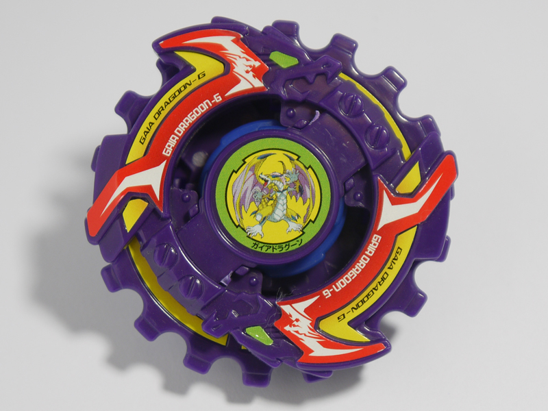

# Gaia Dragoon G / Strata Dragoon G (ガイアドラグーンＧ〈グレート〉 / Gaia Doragūn Gurēto)

Produto/caixa:  — no anime: 

| Campo | Valor |
|---|---|
| Dono | Daichi Sumeragi |
| Código do produto | A-108 (Takara); também lançada pela Hasbro como "Strata Dragoon G" |
| Tipo | Attack |
| Sistema | Engine Gear System |
| Rotação | Direita (Right Engine Gear) |
| Fera Bit (Bit-Beast) | Gaia Dragoon / Strata Dragoon (dragão dourado) |
| Série / temporada | G-Revolution (2003) |
| Primeira aparição (anime) | G-Rev ep. 18 "Beyblade Like an Egyptian" |
| Antecessora → Sucessora | Gaia Dragoon V → Gaia Dragoon MS |

AKA: "Gaia Dragoon Great", "Strata Dragoon Great". Construída por Kenny depois que a V foi destruída contra Mathilda; Daichi relutou em aceitá-la, mas passou a adorá-la por ser superior.

## 1. Peças (de cima para baixo)

| Camada | Peça | Descrição física | Função em batalha |
|---|---|---|---|
| Bit Chip | Strata Dragoon | chip do dragão dourado | identidade / fera bit |
| Attack Ring (AR) | Dragon Saucer (8 g) | AR roxo com 2 dragões em lados opostos; segura um **Sub-AR em forma de engrenagem** com entalhes em todo o perímetro ("saucer") | os entalhes do S-AR "engatam" no adversário (contato tipo serra / spin steal quando travado); o S-AR gira livre, o que no anime vira a lâmina giratória do Great Cutter |
| Weight Disk (WD) | Ten Heavy (16,4 g) | 10 lados, o mais pesado da série Heavy, massa compacta no centro | aumenta RPM e peso total — bom para attack/defesa compacta |
| Engine Gear (EG) | Right Engine Gear (Metal Flat) (11 g) | EG direita com ponta **metal flat** (a versão Semi-Flat com o degrau preenchido) | ao ser liberada, a mola dá uma arrancada de velocidade; ponta metálica = agressiva com stamina razoável |
| Support Part / Sub Ring | — | — | — |
| Blade Base (BB) | Final Clutch Base (Strata Dragoon G Version) (8 g) | base alta com triângulos salientes nas bordas (marcados "FC BASE"); embreagem **Final Clutch** | libera o Engine Gear **quando a bey é atingida** (contra-ataque com arrancada); a altura a deixa vulnerável a upper attack e o movimento após a liberação é pouco controlável |

Fotos: `pecas/attack-ring.jpg`, `pecas/sub-attack-ring.jpg` (Saucer em engrenagem), `pecas/weight-disk.png` (Ten Heavy genérico), `pecas/engine-gear.jpg`, `pecas/blade-base.jpg`, `pecas/montada-lateral.jpg`.

## 2. Formato e geometria
- Vista de cima: quase circular — o S-AR em engrenagem (≈16 dentes) cria um contorno serrilhado contínuo, com os 2 dragões do AR como pontos de contato mais altos. Simetria de 2 lados (AR) + radial (S-AR).
- Peso: Ten Heavy no centro + Engine Gear metálico (11 g) → bey pesada e de alta rotação, inércia concentrada.
- Perfil alto (Final Clutch Base) — vulnerável a upper attack, centro de gravidade mais alto.

## 3. Comportamento na arena
- **Movimento**: início em metal flat; ao ser atingida o Final Clutch solta o Engine Gear → arrancada repentina em linha/órbita agressiva ("contra-golpe"). Depois disso o movimento fica pouco controlável.
- **Ataque**: smash pelos dragões + atrito serrilhado do Saucer; o contra-ataque pós-impacto é o ponto forte.
- **Defesa**: média (peso alto ajuda; altura e travamento do S-AR atrapalham).
- **Stamina**: média — metal flat, mas EG gasta energia na arrancada.
- **Matchups**: castiga attackers que a atingem primeiro (clutch dispara contra eles); perde para upper attackers baixos e para defensoras pesadas e lisas.
- **Gimmick**: Engine Gear + Final Clutch (liberação ao impacto); S-AR de engrenagem livre.

## 4. No anime
- **Especiais**:
  - **Great Cutter** (豪転刃断 *Gōten Hadan*, "lâmina rolante magnífica") — Gaia Dragoon aparece e se transforma numa enorme serra circular de energia em volta do anel Saucer; a bey rola de lado sobre a lâmina e corta estruturas sólidas. No mangá: o sub-anel Saucer acelera e projeta uma barreira serrilhada.
  - **Ultimate Great Cutter** — versão reforçada citada na página do Daichi (sem página própria; detalhes não confirmados).
  - **Twin Tornado Attack** (com Tyson / Dragoon G, ep. 20) — rotações sincronizadas geram dois tornados gigantes; falhou quando Tyson se distraiu (derrota para Julia & Raul).
  - **Dragoon Tank** (com Tyson / Dragoon GT, ep. 27) — as pontas das duas beys se tocam e avançam juntas sobre um anel de energia, expulsando os oponentes; inspirado no Gemini Attack dos irmãos Fernandez.
- **Batalhas marcantes**: blader egípcio (ep. 18, vitória na estreia); Julia & Raul com Tyson (ep. 20 derrota / ep. 27 vitória); Rick (ep. 24, vitória); Hiro com Tyson (ep. 26, vitória); Tala (ep. 28, empate); Max (ep. 31, derrota); banda da Ming-Ming com Tyson e Max (ep. 32, vitória).
- **Substituição**: na fase BEGA o time adota o Hard Metal System → Gaia Dragoon MS.

## 5. Tradução para o jogo
| Atributo | Valor | Justificativa |
|---|---|---|
| Ataque | 8 | dragões + saucer serrilhado + arrancada do EG |
| Defesa | 5 | pesada (Ten Heavy + EG), mas alta e com S-AR que trava |
| Stamina | 5 | metal flat; arrancada consome energia |
| Velocidade | 8 | metal flat + impulso do Engine Gear |
| Peso | 8 | Ten Heavy 16,4 g + EG metálico 11 g |
| Equilíbrio | 5 | centro de gravidade alto (Final Clutch) |
| Burst/Knockout-resist | 5 | peso ajuda; vulnerável a upper |

- **Movimento em IA**: começa em órbita média; **ao receber o primeiro golpe** dispara "clutch" (boost de velocidade +40% por 3 s em direção ao atacante), depois órbita agressiva errática.
- **Especiais (no jogo)**: *Great Cutter* — vira serra rolante por 2,5 s: +70% dano, atravessa obstáculos; custo 100, cooldown 22 s. *Twin Tornado Attack* / *Dragoon Tank* — especiais de dupla com Tyson (modo tag): custo 150 compartilhado, cooldown 35 s.
- **Física sugerida**: massa 1.15, raio 1.0, atrito da ponta 0.45 (metal flat), restituição 0.55.

## 6. Fontes
- https://beyblade.fandom.com/wiki/Strata_Dragoon_G
- https://beyblade.fandom.com/wiki/Attack_Ring_-_Dragon_Saucer
- https://beyblade.fandom.com/wiki/Weight_Disk_-_Ten_Heavy
- https://beyblade.fandom.com/wiki/Engine_Gear_-_Right_Engine_Gear_(Metal_Flat)
- https://beyblade.fandom.com/wiki/Blade_Base_-_Final_Clutch_Base_(Strata_Dragoon_G_Version)
- https://beyblade.fandom.com/wiki/Great_Cutter
- https://beyblade.fandom.com/wiki/Twin_Tornado_Attack
- https://beyblade.fandom.com/wiki/Dragoon_Tank
- https://beyblade.fandom.com/wiki/Daichi_Sumeragi
