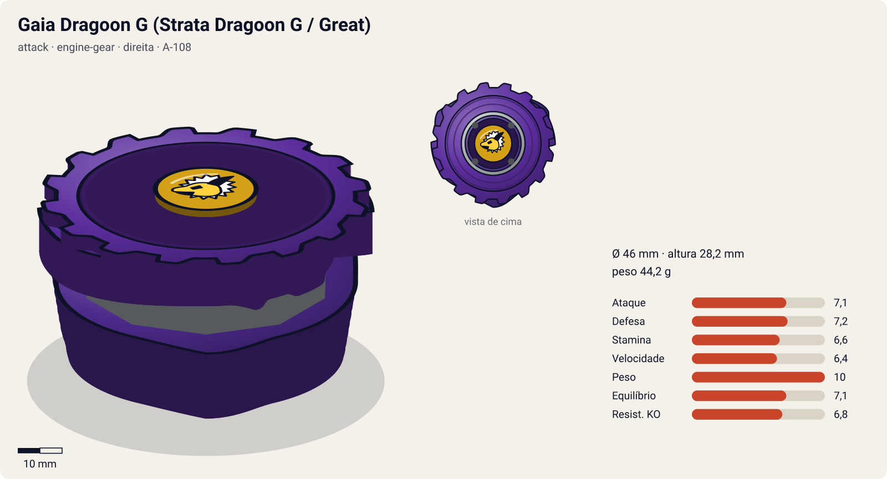
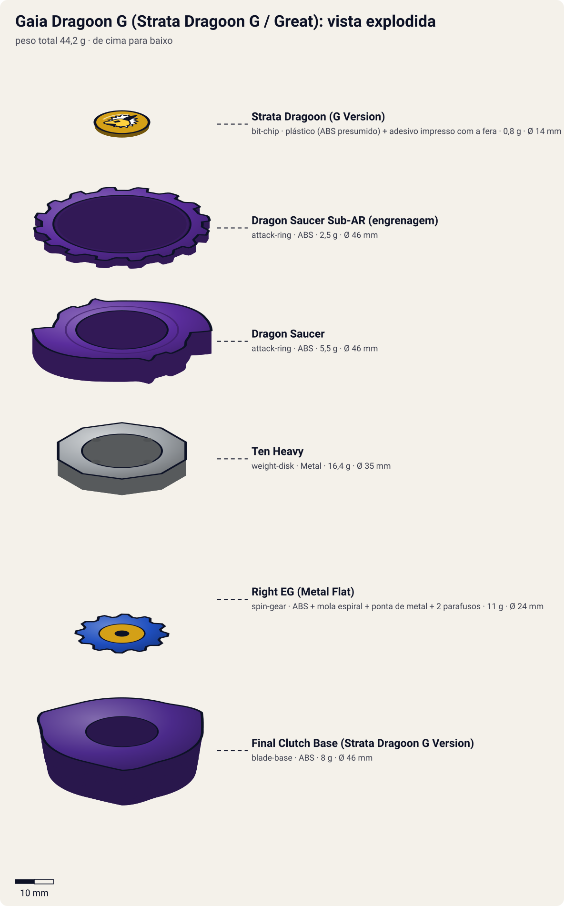
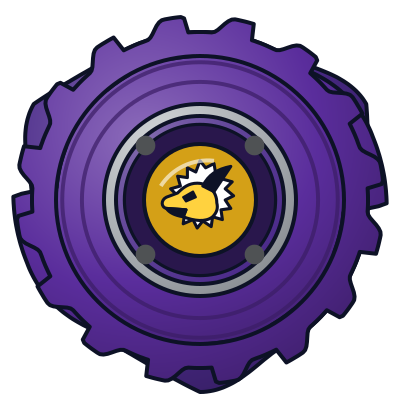
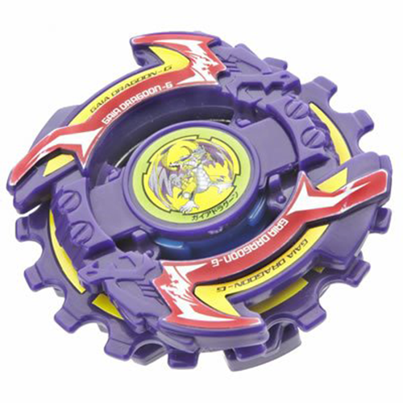
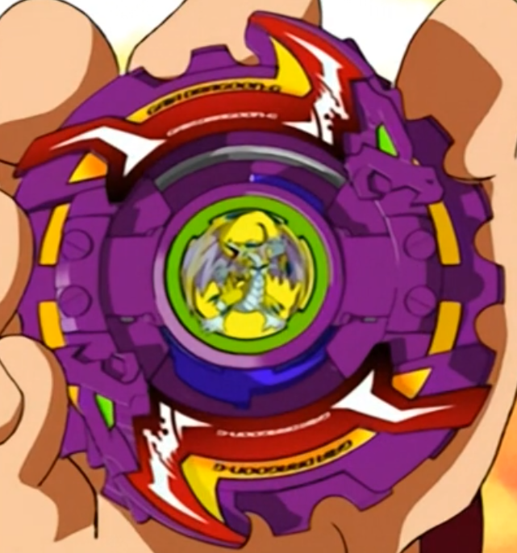

# Gaia Dragoon G / Strata Dragoon G (ガイアドラグーンＧ〈グレート〉 / Gaia Doragūn Gurēto)

<!-- auto:inicio (gerado por npm run build:research; não edite este bloco) -->

| Ficha | |
|---|---|
| Dono | [Daichi Sumeragi (皇大地 / Sumeragi Daichi)](../../README.md) |
| Tipo · sistema · rotação | attack · engine-gear · direita |
| Código do produto | A-108 |
| Montada | Ø 46 mm · altura 28,2 mm · **44,2 g** (soma das peças) |
| Fera bit | [Gaia Dragoon (Strata Dragoon)](../../../../feras-bit/gaia-dragoon/) |
| Lançador | [EZ Shooter (Easy Shooter, rotação direita)](../../../../lancadores/ez-shooter/) |
| Ripcord | [winder-padrao](../../../../lancadores/ripcords/winder-padrao/) |

### Peças

| Camada | Peça | Material | Ø mm | Altura mm | Peso g | Estrelas Takara (A / D / S) | Desenho |
|---|---|---|---|---|---|---|---|
| Bit Chip | [Strata Dragoon (G Version)](../../../../pecas/bit-chip/gaia-dragoon-g/) | plástico (ABS presumido) + adesivo impresso com a fera | 14 estimado | 8 estimado | 0,8 comunidade | — | [ver](pecas/bit-chip.svg) |
| Attack Ring | [Dragon Saucer](../../../../pecas/attack-ring/dragon-saucer/) | ABS | 46 estimado | 6 estimado | 5,5 estimado | 3 / 3 / 2 | [ver](pecas/attack-ring.svg) |
| Attack Ring | [Dragon Saucer Sub-AR (engrenagem)](../../../../pecas/attack-ring/dragon-saucer-sub-ar/) | ABS | 46 estimado | 2 estimado | 2,5 estimado | — | [ver](pecas/attack-ring.svg) |
| Weight Disk | [Ten Heavy](../../../../pecas/weight-disk/ten-heavy/) | Metal | 35 estimado | 4,2 estimado | 16,4 wiki | 1 / 3 / 2 | [ver](pecas/weight-disk.svg) |
| Spin Gear / Core | [Right EG (Metal Flat)](../../../../pecas/spin-gear/right-eg-metal-flat/) | ABS + mola espiral + ponta de metal + 2 parafusos | 24 estimado | 18 estimado | 11 wiki | 1 / 1 / 3 | [ver](pecas/spin-gear.svg) |
| Blade Base | [Final Clutch Base (Strata Dragoon G Version)](../../../../pecas/blade-base/final-clutch-base-strata-dragoon-g/) | ABS | 46 estimado | 16 estimado | 8 wiki | 1 / 2 / 1 | [ver](pecas/blade-base.svg) |

Fonte de cada medida em subscrito (wiki, comunidade, estimado). Detalhes em cada ficha de peça.

### Atributos

| Atributo | Brinquedo (calculado) | Ajuste anime | Jogo |
|---|---|---|---|
| Ataque | 6,1 | +1 | **7,1** |
| Defesa | 7,2 | — | **7,2** |
| Stamina | 6,6 | — | **6,6** |
| Velocidade | 5,4 | +1 | **6,4** |
| Peso | 10 | — | **10** |
| Equilíbrio | 7,1 | — | **7,1** |
| Resistência a KO | 6,8 | — | **6,8** |

Calculado por `src/beyblade/stats.js` a partir de: ponta metal-flat (atrito 0,4), contato smash (recoil 0,6), peso do WD na centro, Engine Gear (clutch). Modelo em [docs/BEYBLADES.md](../../../../../docs/BEYBLADES.md).

### Fera bit em cima da bey

 

Sons: [invocacao](../../../../feras-bit/gaia-dragoon/sons/invocacao.wav) · [rugido](../../../../feras-bit/gaia-dragoon/sons/rugido.wav) · [ataque](../../../../feras-bit/gaia-dragoon/sons/ataque.wav). Animações: [invocação](../../../../feras-bit/gaia-dragoon/invocacao.svg) · [ataque](../../../../feras-bit/gaia-dragoon/ataque.svg).

Fotos de referência (terceiros, só para estudo)

[anime.png](referencia/anime.png) · [imagem-produto.png](referencia/imagem-produto.png) · [imagem.jpg](referencia/imagem.jpg) · [pecas-attack-ring.jpg](referencia/pecas-attack-ring.jpg) · [pecas-blade-base.jpg](referencia/pecas-blade-base.jpg) · [pecas-engine-gear.jpg](referencia/pecas-engine-gear.jpg) · [pecas-montada-lateral.jpg](referencia/pecas-montada-lateral.jpg) · [pecas-sub-attack-ring.jpg](referencia/pecas-sub-attack-ring.jpg) · [pecas-weight-disk.png](referencia/pecas-weight-disk.png)

<!-- auto:fim -->

Produto/caixa:  — no anime: 

| Campo | Valor |
|---|---|
| Dono | Daichi Sumeragi |
| Código do produto | A-108 (Takara); também lançada pela Hasbro como "Strata Dragoon G" |
| Fera Bit (Bit-Beast) | Gaia Dragoon / Strata Dragoon (dragão dourado) |
| Série / temporada | G-Revolution (2003) |
| Primeira aparição (anime) | G-Rev ep. 18 "Beyblade Like an Egyptian" |
| Antecessora → Sucessora | [Gaia Dragoon V](../gaia-dragoon-v/) → [Gaia Dragoon MS](../gaia-dragoon-ms/) |

Outros nomes: "Gaia Dragoon Great", "Strata Dragoon Great". Construída por Kenny depois que a V foi destruída contra Mathilda; Daichi relutou em aceitá-la, mas passou a adorá-la por ser superior.

## Formato e geometria
- Vista de cima: quase circular; o Sub-AR em engrenagem (≈16 dentes) cria um contorno serrilhado contínuo, com os 2 dragões do AR como contatos mais altos. Simetria de 2 lados (AR) + radial (Sub-AR).
- Peso: Ten Heavy no centro + Engine Gear metálico (11 g) → bey pesada, de rotação alta e inércia concentrada.
- Perfil alto (Final Clutch Base): vulnerável a upper, centro de gravidade mais alto.

Análise das peças:
- [Dragon Saucer](../../../../pecas/attack-ring/dragon-saucer/) (8 g): AR roxo com 2 dragões opostos que segura o [Sub-AR em engrenagem](../../../../pecas/attack-ring/dragon-saucer-sub-ar/) com entalhes em todo o perímetro. Os entalhes "engatam" no adversário (contato tipo serra, spin steal quando travado); o Sub-AR gira livre, o que no anime vira a lâmina do Great Cutter.
- [Ten Heavy](../../../../pecas/weight-disk/ten-heavy/) (16,4 g): 10 lados, o mais pesado da série Heavy, massa compacta no centro: mais RPM e peso total.
- [Right EG (Metal Flat)](../../../../pecas/spin-gear/right-eg-metal-flat/) (11 g): Engine Gear direito com ponta metal flat (a Semi-Flat com o degrau preenchido). Solta uma arrancada de velocidade; ponta metálica agressiva com stamina razoável.
- [Final Clutch Base (Strata Dragoon G Version)](../../../../pecas/blade-base/final-clutch-base-strata-dragoon-g/) (8 g): base alta com triângulos nas bordas ("FC BASE"). Solta o Engine Gear **quando a bey é atingida** (contra-ataque com arrancada); a altura a deixa vulnerável a upper e o movimento depois da liberação é pouco controlável.

Fotos das peças (terceiros): [AR](referencia/pecas-attack-ring.jpg), [Sub-AR](referencia/pecas-sub-attack-ring.jpg), [WD](referencia/pecas-weight-disk.png), [Engine Gear](referencia/pecas-engine-gear.jpg), [base](referencia/pecas-blade-base.jpg), [lateral](referencia/pecas-montada-lateral.jpg).

## Comportamento na arena
- **Movimento**: começa em metal flat; ao ser atingida, o Final Clutch solta o Engine Gear → arrancada repentina em linha/órbita agressiva ("contragolpe"). Depois o movimento fica pouco controlável.
- **Ataque**: smash pelos dragões + atrito serrilhado do Saucer; o contra-ataque pós-impacto é o ponto forte.
- **Defesa**: média (o peso ajuda; a altura e o travamento do Sub-AR atrapalham).
- **Stamina**: média: metal flat, mas o EG gasta energia na arrancada.
- **Matchups**: castiga atacantes que a atingem primeiro (o clutch dispara contra eles); perde para upper attackers baixos e defensoras pesadas e lisas.
- **Gimmick**: Engine Gear + Final Clutch (liberação no impacto); Sub-AR de engrenagem livre.

## No anime
- **Especiais**:
  - **Great Cutter** (豪転刃断 *Gōten Hadan*, "lâmina rolante magnífica"): Gaia Dragoon surge e vira uma enorme serra circular de energia em volta do anel Saucer; a bey rola de lado sobre a lâmina e corta estruturas sólidas. No mangá: o sub-anel Saucer acelera e projeta uma barreira serrilhada.
  - **Ultimate Great Cutter**: versão reforçada citada na página do Daichi (sem página própria; detalhes não confirmados).
  - **Twin Tornado Attack** (com Tyson / Dragoon G, ep. 20): rotações sincronizadas geram dois tornados gigantes; falhou quando Tyson se distraiu (derrota para Julia & Raul).
  - **Dragoon Tank** (com Tyson / Dragoon GT, ep. 27): as pontas das duas beys se tocam e avançam juntas sobre um anel de energia, expulsando os oponentes; inspirado no Gemini Attack dos irmãos Fernandez.
- **Batalhas**: blader egípcio (ep. 18, vitória na estreia); Julia & Raul com Tyson (ep. 20 derrota / ep. 27 vitória); Rick (ep. 24, vitória); Hiro com Tyson (ep. 26, vitória); Tala (ep. 28, empate); Max (ep. 31, derrota); banda da Ming-Ming com Tyson e Max (ep. 32, vitória).
- **Substituição**: na fase BEGA o time adota o Hard Metal System → Gaia Dragoon MS.

## Mecânica no jogo
- **Movimento (IA)**: órbita média; depois do clutch, órbita agressiva errática (desvios de ±20°).
- **Gimmick (Final Clutch)**: o Engine Gear solta no **primeiro golpe recebido** com knockback > 1,0×: arrancada de +40% de velocidade por 3 s em direção ao atacante (+1 de velocidade e +0,5 de ataque pelo resto da luta, conforme o modelo). Uma vez por luta. O Sub-AR de engrenagem rouba 1% de RPM por contato de quem gira no sentido oposto.
- **Especiais**:
  - *Great Cutter*: vira serra rolante por 2,5 s: +70% de dano, atravessa obstáculos; custo 100 de energia, recarga 22 s. Visual: o [ataque de Gaia Dragoon](../../../../feras-bit/gaia-dragoon/ataque.svg).
  - *Twin Tornado Attack* (modo dupla, com Tyson): dois tornados sincronizados empurram os oponentes; cancela se o parceiro perder a sincronia; custo 150 compartilhado, recarga 35 s.
  - *Dragoon Tank* (modo dupla, com Tyson): as duas beys avançam unidas em linha reta com +60% de knockback; custo 150 compartilhado, recarga 35 s.
- **Física**: massa 1,15; raio 1,0; atrito da ponta 0,45 (metal flat); restituição 0,55.

## Ajuste do anime

| Atributo | Delta | Justificativa (episódio/batalha) |
|---|---|---|
| Ataque | +1 | Great Cutter vence o blader egípcio (ep. 18) e Rick (ep. 24); empata com Wolborg 4 de Tala (ep. 28). |
| Velocidade | +1 | Contragolpe instantâneo do Engine Gear e Dragoon Tank (ep. 27), que exige acompanhar a Dragoon GT. |

Resultado esperado: atacante pesada que vence a maioria dos rivais de G-Rev, empata com Wolborg 4 e perde para Draciel G no desgaste (ep. 31).

## Fontes
- https://beyblade.fandom.com/wiki/Strata_Dragoon_G
- https://beyblade.fandom.com/wiki/Attack_Ring_-_Dragon_Saucer
- https://beyblade.fandom.com/wiki/Weight_Disk_-_Ten_Heavy
- https://beyblade.fandom.com/wiki/Engine_Gear_-_Right_Engine_Gear_(Metal_Flat)
- https://beyblade.fandom.com/wiki/Blade_Base_-_Final_Clutch_Base_(Strata_Dragoon_G_Version)
- https://beyblade.fandom.com/wiki/Great_Cutter
- https://beyblade.fandom.com/wiki/Twin_Tornado_Attack
- https://beyblade.fandom.com/wiki/Dragoon_Tank
- https://beyblade.fandom.com/wiki/Daichi_Sumeragi
