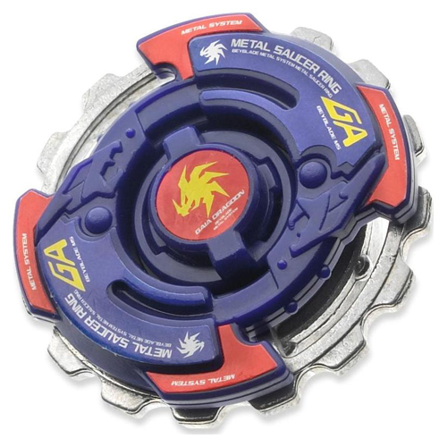
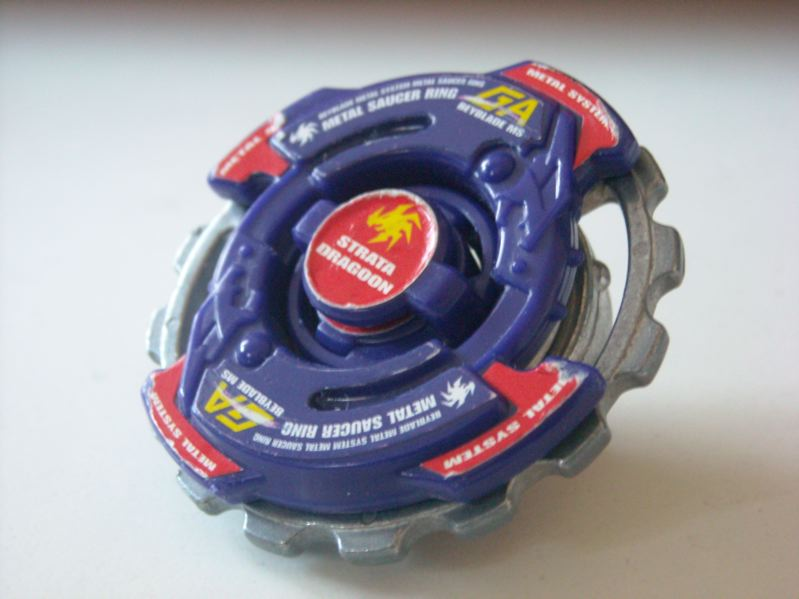

# Gaia Dragoon MS / Strata Dragoon MS (ガイアドラグーンＭＳ〈メタルスパイク〉 / Gaia Doragūn Metaru Supaiku)

Versão Hasbro ("Strata Dragoon"): 

| Campo | Valor |
|---|---|
| Dono | Daichi Sumeragi |
| Código do produto | A-123 (Takara, Starter, ago/2003); Hasbro: "Strata Dragoon MS" |
| Tipo | Attack |
| Sistema | Hard Metal System (HMS) |
| Rotação | Ambas (Dual-Spin — HMS gira para os dois lados) |
| Fera Bit (Bit-Beast) | Gaia Dragoon / Strata Dragoon (emblema no Bit Protector) |
| Série / temporada | G-Revolution (2003), fase BEGA / Justice Five |
| Primeira aparição (anime) | G-Rev ep. 40 "Back to Basics" (segundo a wiki); especial estreia no ep. 43 "Sing Ming Ming Sing!" |
| Antecessora → Sucessora | Gaia Dragoon G → — (no mangá *Rising*: Gaia Dragoon Around Hunter', fora do escopo) |

AKA: "Strata Dragoon Metal Spike". Quarta e última bey de Daichi no anime; foi um dos primeiros HMS lançados.

## 1. Peças (de cima para baixo)

| Camada | Peça | Descrição física | Função em batalha |
|---|---|---|---|
| Bit Chip | Bit Protector – Strata Dragoon | "emblema" de 0,6 g, 18,17 mm de largura, 6,65 mm de altura (1º molde de Bit Protector) | identidade / fera bit; trava o AR |
| Attack Ring (AR) | Metal Saucer (14 g) | forma muito circular; **Metal Frame** com 16 entalhes tipo engrenagem em todo o perímetro + capa de ABS (azul) com 2 saliências | contato serrilhado contínuo; sendo circular e de peso periférico serve também para spin-steal/sobrevivência. Defeito de projeto: o Metal Frame "chacoalha" (corrigido no Advance Balancer) |
| Weight Disk (WD) | Circle Heavy (16,3 g) | disco circular, pesado, com alta distribuição de peso para fora (OWD) | grande inércia: ajuda tanto ataque quanto defesa |
| Spin Gear (SG) / Core | — (HMS não usa SG) | — | — |
| Support Part / Sub Ring | — | — | — |
| Blade Base (BB) → Running Core (RC) | Flat Core | running core totalmente plano (ponta **flat** larga) — o primeiro RC lançado | movimento agressivo decente; superado depois por Grip Flat Core, Metal Flat Core etc. |

Fotos: `pecas/attack-ring.jpg` (Metal Saucer), `pecas/metal-frame.jpg` (frame destacado), `pecas/running-core.jpg` (Flat Core), `pecas/montada-lateral.jpg`, `pecas/montada-inferior.jpg`, `pecas/montada-hasbro.jpg`. Sem foto isolada do Circle Heavy nem do Bit Protector.

## 2. Formato e geometria
- Vista de cima: círculo quase perfeito com contorno de engrenagem metálica (16 dentes) e capa de ABS com 2 lóbulos — contato contínuo, simetria radial.
- Peso: extremamente periférico (Metal Frame + Circle Heavy, ~30 g de metal) → enorme inércia e estabilidade para o tamanho.
- Perfil baixo e compacto (HMS é menor que as beys de plástico) — difícil de ser atingido por upper attack.

## 3. Comportamento na arena
- **Movimento**: Flat Core → órbita agressiva/flower rápido; HMS é mais compacto e denso, colisões são secas.
- **Ataque**: smash serrilhado pelos dentes do Metal Frame; massa alta dá golpes pesados, mas os dentes arredondados geram menos "pegada" que ARs de smash dedicados.
- **Defesa**: boa para um attacker — metal periférico absorve impactos.
- **Stamina**: média-baixa (Flat Core gasta rotação com o movimento).
- **Matchups**: forte contra attackers leves e beys de plástico; perde para HMS de defesa/stamina com bearing core (ex.: Wolborg MS) e para Grip/Metal Flat cores mais rápidos.
- **Gimmick**: metal pesado (Hard Metal), Dual-Spin; o frame serrilhado permite spin-steal quando usado em rotação oposta.

## 4. No anime
- **Especial**: **Spike Saw** (爆狂刃断 *Bakukyō Hadan*, "lâmina frenética") — Gaia Dragoon irrompe do chão e cospe uma rocha flamejante; a rocha se desfaz revelando a Gaia Dragoon MS incandescente (vermelha), que se choca contra o oponente.
- **Batalhas marcantes**: dupla/quarteto contra Lee, Michael, Miguel e Julia (ep. 41, derrota); **vs Ming-Ming no 1º round do Justice Five (ep. 43, derrota)**; com Max vs Tyson (ep. 46, vitória); com Max, Ray e Kenny vs Tyson (ep. 49, derrota) — bey presumida nesses episódios, a wiki não especifica.
- Última bey do Daichi no anime.

## 5. Tradução para o jogo
| Atributo | Valor | Justificativa |
|---|---|---|
| Ataque | 7 | metal pesado e contorno serrilhado, mas Flat Core já ultrapassado |
| Defesa | 6 | massa metálica periférica absorve impacto |
| Stamina | 4 | Flat Core consome rotação |
| Velocidade | 8 | flat + compacta |
| Peso | 8 | Metal Saucer 14 g + Circle Heavy 16,3 g |
| Equilíbrio | 6 | peso periférico estabiliza; frame que chacoalha tira um pouco |
| Burst/Knockout-resist | 6 | densa e baixa |

- **Movimento em IA**: órbita agressiva (flower rápido), procurando colisões frontais repetidas; pode girar para qualquer lado (escolha no lançamento).
- **Especiais (no jogo)**: *Spike Saw* — sai do "subsolo" (breve invulnerabilidade de 0,5 s) e investe incandescente: +90% dano e knockback forte no primeiro contato; custo 100, cooldown 24 s.
- **Física sugerida**: massa 1.2, raio 0.9 (HMS menor), atrito da ponta 0.6 (flat de plástico), restituição 0.5.

## 6. Fontes
- https://beyblade.fandom.com/wiki/Strata_Dragoon_MS
- https://beyblade.fandom.com/wiki/Attack_Ring_-_Metal_Saucer
- https://beyblade.fandom.com/wiki/Weight_Disk_-_Circle_Heavy
- https://beyblade.fandom.com/wiki/Running_Core_-_Flat_Core
- https://beyblade.fandom.com/wiki/Bit_Protector_-_Strata_Dragoon
- https://beyblade.fandom.com/wiki/Spike_Saw
- https://beyblade.fandom.com/wiki/Daichi_Sumeragi
