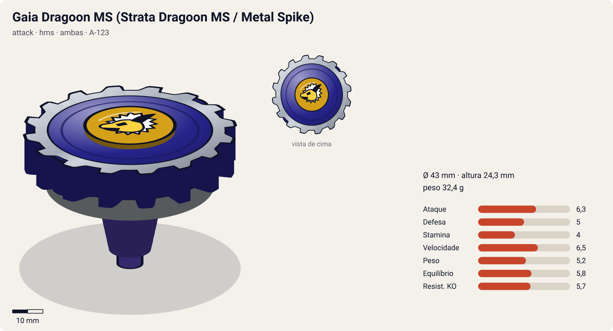
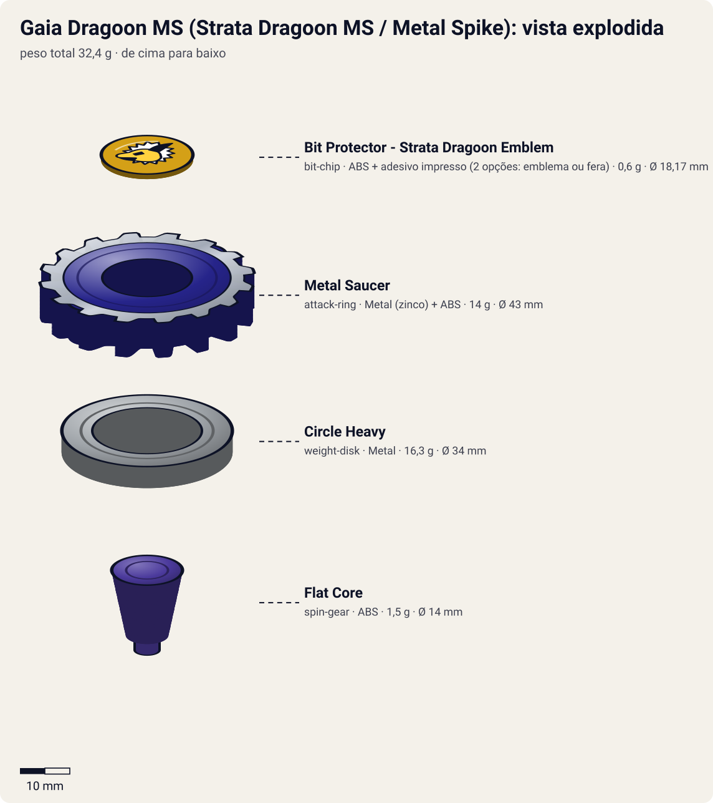

# Gaia Dragoon MS / Strata Dragoon MS (ガイアドラグーンＭＳ〈メタルスパイク〉 / Gaia Doragūn Metaru Supaiku)

<!-- auto:inicio (gerado por npm run build:research; não edite este bloco) -->

| Ficha | |
|---|---|
| Dono | [Daichi Sumeragi (皇大地 / Sumeragi Daichi)](../../README.md) |
| Tipo · sistema · rotação | attack · hms · ambas |
| Código do produto | A-123 |
| Montada | Ø 43 mm · altura 24,3 mm · **32,4 g** (soma das peças) |
| Fera bit | [Gaia Dragoon (Strata Dragoon)](../../../../feras-bit/gaia-dragoon/) |
| Lançador | [Dual Shooter (HMS)](../../../../lancadores/dual-shooter/) |
| Ripcord | [g-winder](../../../../lancadores/ripcords/g-winder/) |

### Peças

| Camada | Peça | Material | Ø mm | Altura mm | Peso g | Estrelas Takara (A / D / S) | Desenho |
|---|---|---|---|---|---|---|---|
| Bit Chip | [Bit Protector - Strata Dragoon Emblem](../../../../pecas/bit-chip/gaia-dragoon-emblem/) | ABS + adesivo impresso (2 opções: emblema ou fera) | 18,2 wiki | 6,7 wiki | 0,6 comunidade | — | [ver](pecas/bit-chip.svg) |
| Attack Ring | [Metal Saucer](../../../../pecas/attack-ring/metal-saucer/) | Metal (zinco) + ABS | 43 estimado | 7 estimado | 14 wiki | 3 / 3 / 2 | [ver](pecas/attack-ring.svg) |
| Weight Disk | [Circle Heavy](../../../../pecas/weight-disk/circle-heavy/) | Metal | 34 estimado | 4,3 estimado | 16,3 wiki | 2 / 2 / 1 | [ver](pecas/weight-disk.svg) |
| Spin Gear / Core | [Flat Core](../../../../pecas/spin-gear/flat-core/) | ABS | 14 estimado | 13 estimado | 1,5 comunidade | 3 / 1 / 1 | [ver](pecas/spin-gear.svg) |

Fonte de cada medida em subscrito (wiki, comunidade, estimado). Detalhes em cada ficha de peça.

### Atributos

| Atributo | Brinquedo (calculado) | Ajuste anime | Jogo |
|---|---|---|---|
| Ataque | 5,3 | +1 | **6,3** |
| Defesa | 5 | — | **5** |
| Stamina | 4 | — | **4** |
| Velocidade | 6,5 | — | **6,5** |
| Peso | 5,2 | — | **5,2** |
| Equilíbrio | 5,8 | — | **5,8** |
| Resistência a KO | 5,7 | — | **5,7** |

Calculado por `src/beyblade/stats.js` a partir de: ponta flat (atrito 0,5), contato survival (recoil 0,3), peso do WD na equilibrado. Modelo em [docs/BEYBLADES.md](../../../../../docs/BEYBLADES.md).

### Fera bit em cima da bey

 

Sons: [invocacao](../../../../feras-bit/gaia-dragoon/sons/invocacao.wav) · [rugido](../../../../feras-bit/gaia-dragoon/sons/rugido.wav) · [ataque](../../../../feras-bit/gaia-dragoon/sons/ataque.wav). Animações: [invocação](../../../../feras-bit/gaia-dragoon/invocacao.svg) · [ataque](../../../../feras-bit/gaia-dragoon/ataque.svg).

Fotos de referência (terceiros, só para estudo)

[imagem.jpg](referencia/imagem.jpg) · [pecas-attack-ring.jpg](referencia/pecas-attack-ring.jpg) · [pecas-metal-frame.jpg](referencia/pecas-metal-frame.jpg) · [pecas-montada-hasbro.jpg](referencia/pecas-montada-hasbro.jpg) · [pecas-montada-inferior.jpg](referencia/pecas-montada-inferior.jpg) · [pecas-montada-lateral.jpg](referencia/pecas-montada-lateral.jpg) · [pecas-running-core.jpg](referencia/pecas-running-core.jpg)

<!-- auto:fim -->

Versão Hasbro ("Strata Dragoon"): 

| Campo | Valor |
|---|---|
| Dono | Daichi Sumeragi |
| Código do produto | A-123 (Takara, Starter, ago/2003); Hasbro: "Strata Dragoon MS" |
| Sistema | Hard Metal System (HMS) |
| Rotação | Ambas (Dual-Spin: o HMS gira para os dois lados) |
| Fera Bit (Bit-Beast) | Gaia Dragoon / Strata Dragoon (emblema no Bit Protector) |
| Série / temporada | G-Revolution (2003), fase BEGA / Justice Five |
| Primeira aparição (anime) | G-Rev ep. 40 "Back to Basics" (segundo a wiki); o especial estreia no ep. 43 "Sing Ming Ming Sing!" |
| Antecessora → Sucessora | [Gaia Dragoon G](../gaia-dragoon-g/) → — (no mangá *Rising*: Gaia Dragoon Around Hunter', fora do escopo) |

Outros nomes: "Strata Dragoon Metal Spike". Quarta e última bey de Daichi no anime; um dos primeiros HMS lançados.

## Formato e geometria
- Vista de cima: círculo quase perfeito com contorno de engrenagem metálica (16 dentes) e capa de ABS com 2 lóbulos; contato contínuo, simetria radial.
- Peso: extremamente periférico (Metal Frame + Circle Heavy, ~30 g de metal) → inércia e estabilidade enormes para o tamanho.
- Perfil baixo e compacto (o HMS é menor que as beys de plástico): difícil de pegar com upper.

Análise das peças:
- [Bit Protector - Strata Dragoon Emblem](../../../../pecas/bit-chip/gaia-dragoon-emblem/): 0,6 g, 18,17 mm de largura, 6,65 mm de altura (1º molde de Bit Protector); trava o AR.
- [Metal Saucer](../../../../pecas/attack-ring/metal-saucer/) (14 g): muito circular; Metal Frame com 16 entalhes tipo engrenagem em todo o perímetro + capa de ABS azul com 2 saliências. Contato serrilhado contínuo; circular e de peso periférico, serve também para spin steal e sobrevivência. Defeito: o Metal Frame "chacoalha" (corrigido no Advance Balancer).
- [Circle Heavy](../../../../pecas/weight-disk/circle-heavy/) (16,3 g): circular, pesado, peso bem para fora; grande inércia que ajuda ataque e defesa.
- [Flat Core](../../../../pecas/spin-gear/flat-core/): Running Core totalmente plano (ponta flat larga), o primeiro RC lançado; movimento agressivo decente, superado depois por Grip Flat Core, Metal Flat Core etc.

Fotos das peças (terceiros): [AR](referencia/pecas-attack-ring.jpg), [Metal Frame](referencia/pecas-metal-frame.jpg), [Running Core](referencia/pecas-running-core.jpg), [lateral](referencia/pecas-montada-lateral.jpg), [por baixo](referencia/pecas-montada-inferior.jpg).

## Comportamento na arena
- **Movimento**: Flat Core → órbita agressiva / flower rápido; o HMS é compacto e denso, as colisões são secas.
- **Ataque**: smash serrilhado pelos dentes do Metal Frame; a massa alta dá golpes pesados, mas os dentes arredondados "pegam" menos que ARs de smash dedicados.
- **Defesa**: boa para um atacante: o metal periférico absorve impactos.
- **Stamina**: média-baixa (o Flat Core gasta rotação com o movimento).
- **Matchups**: forte contra atacantes leves e beys de plástico; perde para HMS de defesa/stamina com bearing core (ex.: Wolborg MS) e para Grip/Metal Flat cores mais rápidos.
- **Gimmick**: metal pesado (Hard Metal), Dual-Spin; o frame serrilhado permite spin steal em rotação oposta.

## No anime
- **Especial**: **Spike Saw** (爆狂刃断 *Bakukyō Hadan*, "lâmina frenética"): Gaia Dragoon irrompe do chão e cospe uma rocha flamejante; a rocha se desfaz e revela a Gaia Dragoon MS incandescente (vermelha), que se choca contra o oponente.
- **Batalhas**: quarteto contra Lee, Michael, Miguel e Julia (ep. 41, derrota); **vs Ming-Ming no 1º round do Justice Five (ep. 43, derrota)**; com Max vs Tyson (ep. 46, vitória); com Max, Ray e Kenny vs Tyson (ep. 49, derrota). Bey presumida nesses episódios; a wiki não especifica.
- Última bey de Daichi no anime.

## Mecânica no jogo
- **Movimento (IA)**: flower rápido em órbita agressiva, com colisões frontais repetidas. Rotação escolhida no lançamento (a IA escolhe a oposta à do rival).
- **Gimmick (dual-spin + frame serrilhado)**: em rotação oposta, cada contato rouba 1,5% de RPM do oponente. O Metal Frame frouxo dá −0,3 de equilíbrio a cada 10 colisões (máx. −1).
- **Especial**: *Spike Saw*. Some no "subsolo" (0,5 s invulnerável) e reaparece incandescente: +90% de dano e knockback forte no 1º contato; custo 100 de energia, recarga 24 s. Visual: a terra se abrindo da [invocação de Gaia Dragoon](../../../../feras-bit/gaia-dragoon/invocacao.svg), com a bey em vermelho incandescente.
- **Física**: massa 1,2; raio 0,9 (HMS menor); atrito da ponta 0,6 (flat de plástico); restituição 0,5.

## Ajuste do anime

| Atributo | Delta | Justificativa (episódio/batalha) |
|---|---|---|
| Ataque | +1 | Spike Saw: investida incandescente que, com Draciel MS, vence Tyson (ep. 46). |

Resultado esperado: atacante HMS mediana; perde para Ming-Ming no Justice Five (ep. 43) e no quarteto do ep. 41, então o ajuste é pequeno.

Nota para o coordenador: o cálculo classificou o contato do Metal Saucer como `survival` (Ataque do brinquedo 5,2, Stamina 3,5). As fontes descrevem um contato serrilhado de smash/engrenagem; conferir `forma.contato` na ficha do Metal Saucer. O Flat Core aparece no catálogo em `spin-gear/flat-core` e também como "Flat Core (Running Core)" em `blade-base/flat-core` (peça duplicada?).

## Fontes
- https://beyblade.fandom.com/wiki/Strata_Dragoon_MS
- https://beyblade.fandom.com/wiki/Attack_Ring_-_Metal_Saucer
- https://beyblade.fandom.com/wiki/Weight_Disk_-_Circle_Heavy
- https://beyblade.fandom.com/wiki/Running_Core_-_Flat_Core
- https://beyblade.fandom.com/wiki/Bit_Protector_-_Strata_Dragoon
- https://beyblade.fandom.com/wiki/Spike_Saw
- https://beyblade.fandom.com/wiki/Daichi_Sumeragi
