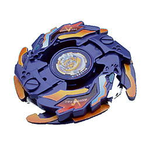

# Gaia Dragoon V / Strata Dragoon V (ガイアドラグーンV〈バースト〉 / Gaia Doragūn Bāsuto)

No filme:  — em G-Revolution: 

| Campo | Valor |
|---|---|
| Dono | Daichi Sumeragi |
| Código do produto | A-78 (Takara) |
| Tipo | Attack |
| Sistema | Magnacore System |
| Rotação | Direita (Neo Right SG) — o AR rende mais smash em rotação esquerda, ver abaixo |
| Fera Bit (Bit-Beast) | Gaia Dragoon / Strata Dragoon (dragão dourado) |
| Série / temporada | Brinquedo 2002 (era V-Force; SG Metal Flat 2 lançada em set/2002); anime: final do filme *Fierce Battle* + G-Revolution (2003) |
| Primeira aparição (anime) | Filme *Fierce Battle* (evolução no final); série: G-Rev ep. 1 "New Kid in Town" |
| Antecessora → Sucessora | Gaia Dragoon → Gaia Dragoon G |

AKA: "Gaia Dragoon Vurst" (anime JP — o "V" se lê *Bāsuto*), "Strata Dragoon Vast" (dublagem EN). A wiki considera esta a primeira bey de Daichi no anime canônico (o filme não é canônico).

## 1. Peças (de cima para baixo)

| Camada | Peça | Descrição física | Função em batalha |
|---|---|---|---|
| Bit Chip | Strata Dragoon (versão V) | chip do dragão dourado | identidade / fera bit |
| Attack Ring (AR) | Dragon Breaker (8 g) | formato oval incomum com 2 conjuntos de pontas: pontas grandes inclinadas + várias pontas menores; **Sub-AR livre** (free-spinning) com 4 pontas | smash attack de golpes pesados (contatos grandes, distribuição de peso agressiva), mas com muito recuo; o smash é maximizado em rotação **esquerda**. O S-AR, por ser grande, trava e atrapalha a bey ao contato em vez de girar livre (diferente do War Lion do Galeon) |
| Weight Disk (WD) | Ten Wide (14 g) | 10 lados, o mais largo/pesado dos "Wide" | peso na periferia → inércia, ajuda stamina e estabilidade |
| Spin Gear (SG) / Core | Neo Right SG (S-MG Core / Magnecore Sul) | SG Neo direita com núcleo magnético | rotação direita; interação magnética com estádios/partes Magnacore |
| Support Part / Sub Ring | — | — | — |
| Blade Base (BB) | SG Metal Flat 2 (5 g) | ponta **metal flat**; altura média; 1 g mais pesada que a SG Flat | ponta metálica = menos atrito → rotação dura mais que uma grip, ainda com movimento agressivo; uma das melhores bases de ataque (smash e upper) da época |

Fotos: `pecas/attack-ring.jpg` (AR + Sub-AR separados), `pecas/weight-disk.jpg` (Ten Wide, foto genérica da peça), `pecas/blade-base.jpg`, `pecas/montada.jpg`, `pecas/montada-lateral.jpg`. Spin Gear: só existe um GIF de 1,6 KB na wiki (abaixo do mínimo) — sem foto.

## 2. Formato e geometria
- Silhueta oval, 2 contatos principais + pontas menores; S-AR de 4 pontas por baixo — perfil "em camadas".
- Peso: WD Ten Wide distribui massa para fora (boa inércia); AR leve (8 g).
- Altura média (SG Metal Flat 2) — permite tanto smash quanto um pouco de upper.

## 3. Comportamento na arena
- **Movimento**: metal flat → padrão agressivo tipo "flower"/órbita ampla, rápido, com stamina razoável para um attacker.
- **Ataque**: smash forte nos contatos grandes do Dragon Breaker; recuo alto exige controle (o magnecore ajuda pouco).
- **Defesa**: média-baixa; o S-AR trava ao ser atingido e transfere impacto para a bey.
- **Stamina**: média (metal flat gasta menos que grip).
- **Matchups**: bom contra stamina/defesa leves; sofre contra defensoras pesadas (recuo) e contra upper attackers mais baixos.
- **Gimmick**: Sub-AR livre (absorção leve de colisão) + Magnecore.

## 4. No anime
- **Especiais**:
  - **Vast Hurricane** (JP: *Burst Hurricane*) — ep. 1: Gaia Dragoon gira em círculos em alta velocidade criando um redemoinho de poeira que arremessa a bey adversária.
  - **Vast Cutter** (JP: *Vurst/Burst Cutter*, 轟転刃断 *Gōten Hadan*, "lâmina estrondosa") — a fera se transforma numa gigantesca serra circular de energia ao redor da bey, que corta construções sólidas.
- **Batalhas marcantes**: vs Tyson (ep. 1, derrota — Kenny nota a vantagem de Daichi em terreno natural); vs Kai (ep. 6, derrota; ep. 13, vitória — Kai perde de propósito); vs Tyson (ep. 7, vitória que o leva à dupla); vs Tala no estádio Torre de Pisa (ep. 14, vitória — o golpe derruba o estádio); vs Mathilda (ep. 17, vitória, mas a bey é **destruída além de reparo**).
- **Substituição**: destruída contra Mathilda; Kenny constrói Gaia Dragoon G (ep. 18).
- No filme é o resultado da evolução de Gaia Dragoon após derrotar as feras sombrias.

## 5. Tradução para o jogo
| Atributo | Valor | Justificativa |
|---|---|---|
| Ataque | 8 | Dragon Breaker: contatos grandes e smash pesado (abaixo de Dragoon V2/Galeon 2 pelo recuo) |
| Defesa | 4 | S-AR trava ao impacto; AR leve |
| Stamina | 5 | metal flat + Ten Wide dão fôlego razoável para attacker |
| Velocidade | 8 | metal flat rápida |
| Peso | 6 | Ten Wide 14 g + magnecore; AR 8 g |
| Equilíbrio | 5 | WD largo estabiliza, mas recuo e S-AR desestabilizam |
| Burst/Knockout-resist | 4 | recuo alto, sofre com defensoras pesadas |

- **Movimento em IA**: órbita ampla agressiva (flower pattern rápido) com investidas na borda; em arenas "naturais" ganha bônus.
- **Especiais (no jogo)**: *Vast Hurricane* — cria redemoinho por 3 s: puxa e empurra o oponente para fora (+50% knockback em área curta), custo 80, cooldown 18 s. *Vast Cutter* — serra de energia: golpe único com +80% dano e chance de quebrar obstáculos da arena, custo 100, cooldown 25 s.
- **Física sugerida**: massa 1.0, raio 1.05, atrito da ponta 0.45 (metal flat), restituição 0.7 (recuo alto).

## 6. Fontes
- https://beyblade.fandom.com/wiki/Strata_Dragoon_V
- https://beyblade.fandom.com/wiki/Attack_Ring_-_Dragon_Breaker
- https://beyblade.fandom.com/wiki/Weight_Disk_-_Ten_Wide
- https://beyblade.fandom.com/wiki/Blade_Base_-_SG_Metal_Flat_2
- https://beyblade.fandom.com/wiki/Vast_Hurricane (Burst Hurricane)
- https://beyblade.fandom.com/wiki/Burst_Cutter (Vast Cutter)
- https://beyblade.fandom.com/wiki/Daichi_Sumeragi
