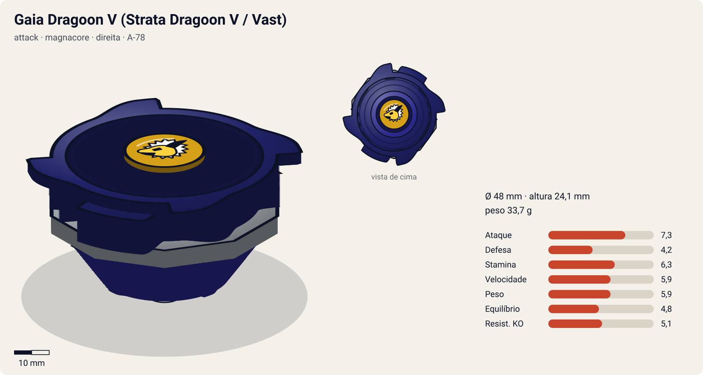
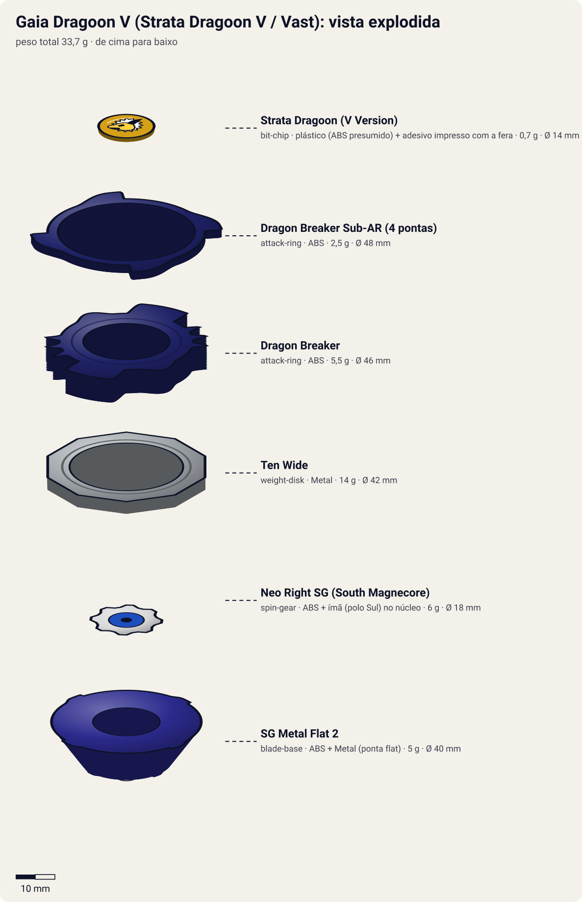
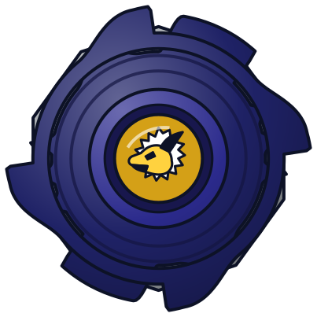
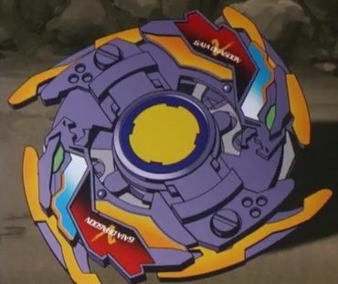
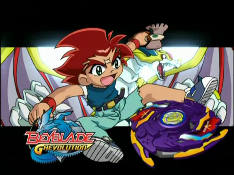

# Gaia Dragoon V / Strata Dragoon V (ガイアドラグーンV〈バースト〉 / Gaia Doragūn Bāsuto)

<!-- auto:inicio (gerado por npm run build:research; não edite este bloco) -->

| Ficha | |
|---|---|
| Dono | [Daichi Sumeragi (皇大地 / Sumeragi Daichi)](../../README.md) |
| Tipo · sistema · rotação | attack · magnacore · direita |
| Código do produto | A-78 |
| Montada | Ø 48 mm · altura 24,1 mm · **33,7 g** (soma das peças) |
| Fera bit | [Gaia Dragoon (Strata Dragoon)](../../../../feras-bit/gaia-dragoon/) |
| Lançador | [EZ Shooter (Easy Shooter, rotação direita)](../../../../lancadores/ez-shooter/) |
| Ripcord | [winder-padrao](../../../../lancadores/ripcords/winder-padrao/) |

### Peças

| Camada | Peça | Material | Ø mm | Altura mm | Peso g | Estrelas Takara (A / D / S) | Desenho |
|---|---|---|---|---|---|---|---|
| Bit Chip | [Strata Dragoon (V Version)](../../../../pecas/bit-chip/gaia-dragoon-v/) | plástico (ABS presumido) + adesivo impresso com a fera | 14 estimado | 8 estimado | 0,7 comunidade | — | [ver](pecas/bit-chip.svg) |
| Attack Ring | [Dragon Breaker](../../../../pecas/attack-ring/dragon-breaker/) | ABS | 46 estimado | 6 estimado | 5,5 estimado | 3 / 2,5 / 2,5 | [ver](pecas/attack-ring.svg) |
| Attack Ring | [Dragon Breaker Sub-AR (4 pontas)](../../../../pecas/attack-ring/dragon-breaker-sub-ar/) | ABS | 48 estimado | 2 estimado | 2,5 estimado | — | [ver](pecas/attack-ring.svg) |
| Weight Disk | [Ten Wide](../../../../pecas/weight-disk/ten-wide/) | Metal | 42 estimado | 3,1 estimado | 14 wiki | 1 / 1,5 / 4 | [ver](pecas/weight-disk.svg) |
| Spin Gear / Core | [Neo Right SG (South Magnecore)](../../../../pecas/spin-gear/neo-right-sg-south-magnecore/) | ABS + ímã (polo Sul) no núcleo | 18 estimado | 10 estimado | 6 wiki | — | [ver](pecas/spin-gear.svg) |
| Blade Base | [SG Metal Flat 2](../../../../pecas/blade-base/sg-metal-flat-2/) | ABS + Metal (ponta flat) | 40 estimado | 13 estimado | 5 wiki | 4 / 1 / 1 | [ver](pecas/blade-base.svg) |

Fonte de cada medida em subscrito (wiki, comunidade, estimado). Detalhes em cada ficha de peça.

### Atributos

| Atributo | Brinquedo (calculado) | Ajuste anime | Jogo |
|---|---|---|---|
| Ataque | 6,3 | +1 | **7,3** |
| Defesa | 4,2 | — | **4,2** |
| Stamina | 6,3 | — | **6,3** |
| Velocidade | 5,9 | — | **5,9** |
| Peso | 5,9 | — | **5,9** |
| Equilíbrio | 4,8 | — | **4,8** |
| Resistência a KO | 5,1 | — | **5,1** |

Calculado por `src/beyblade/stats.js` a partir de: ponta metal-flat (atrito 0,4), contato smash (recoil 0,7), peso do WD na periferia. Modelo em [docs/BEYBLADES.md](../../../../../docs/BEYBLADES.md).

### Fera bit em cima da bey

 

Sons: [invocacao](../../../../feras-bit/gaia-dragoon/sons/invocacao.wav) · [rugido](../../../../feras-bit/gaia-dragoon/sons/rugido.wav) · [ataque](../../../../feras-bit/gaia-dragoon/sons/ataque.wav). Animações: [invocação](../../../../feras-bit/gaia-dragoon/invocacao.svg) · [ataque](../../../../feras-bit/gaia-dragoon/ataque.svg).

Fotos de referência (terceiros, só para estudo)

[anime-grev.png](referencia/anime-grev.png) · [anime.png](referencia/anime.png) · [imagem.jpg](referencia/imagem.jpg) · [pecas-attack-ring.jpg](referencia/pecas-attack-ring.jpg) · [pecas-blade-base.jpg](referencia/pecas-blade-base.jpg) · [pecas-montada-lateral.jpg](referencia/pecas-montada-lateral.jpg) · [pecas-montada.jpg](referencia/pecas-montada.jpg) · [pecas-weight-disk.jpg](referencia/pecas-weight-disk.jpg)

<!-- auto:fim -->

No filme:  — em G-Revolution: 

| Campo | Valor |
|---|---|
| Dono | Daichi Sumeragi |
| Código do produto | A-78 (Takara) |
| Rotação | Direita (Neo Right SG); o AR rende mais smash em rotação esquerda, ver abaixo |
| Fera Bit (Bit-Beast) | Gaia Dragoon / Strata Dragoon (dragão dourado) |
| Série / temporada | Brinquedo 2002 (era V-Force; SG Metal Flat 2 lançada em set/2002); anime: fim do filme *Fierce Battle* + G-Revolution (2003) |
| Primeira aparição (anime) | Filme *Fierce Battle* (evolução no final); série: G-Rev ep. 1 "New Kid in Town" |
| Antecessora → Sucessora | [Gaia Dragoon](../gaia-dragoon/) → [Gaia Dragoon G](../gaia-dragoon-g/) |

Outros nomes: "Gaia Dragoon Vurst" (anime JP; o "V" se lê *Bāsuto*), "Strata Dragoon Vast" (dublagem EN). A wiki considera esta a primeira bey de Daichi no anime canônico (o filme não é canônico).

## Formato e geometria
- Silhueta oval, 2 contatos principais + pontas menores; Sub-AR de 4 pontas por baixo, perfil "em camadas".
- Peso: Ten Wide distribui massa para fora (boa inércia); AR leve (8 g).
- Altura média (SG Metal Flat 2): permite smash e um pouco de upper.

Análise das peças:
- [Dragon Breaker](../../../../pecas/attack-ring/dragon-breaker/) (8 g): formato oval com pontas grandes inclinadas + várias menores. Smash pesado (contatos grandes), mas com muito recoil; o smash rende mais em rotação **esquerda**.
- [Dragon Breaker Sub-AR (4 pontas)](../../../../pecas/attack-ring/dragon-breaker-sub-ar/): livre (free-spinning), mas, por ser grande, trava no contato e atrapalha a bey em vez de girar (diferente do War Lion da Galeon).
- [Ten Wide](../../../../pecas/weight-disk/ten-wide/) (14 g): 10 lados, o mais largo dos "Wide"; peso na periferia → inércia, stamina e estabilidade.
- [Neo Right SG (South Magnecore)](../../../../pecas/spin-gear/neo-right-sg-south-magnecore/): núcleo magnético; interage com estádios e peças Magnacore.
- [SG Metal Flat 2](../../../../pecas/blade-base/sg-metal-flat-2/) (5 g): ponta metal flat, altura média, 1 g mais pesada que a SG Flat. A ponta metálica tem menos atrito que a grip (a rotação dura mais) e mantém o movimento agressivo; uma das melhores bases de ataque (smash e upper) da época.

Fotos das peças (terceiros): [AR + Sub-AR](referencia/pecas-attack-ring.jpg), [WD](referencia/pecas-weight-disk.jpg), [base](referencia/pecas-blade-base.jpg), [montada](referencia/pecas-montada.jpg), [lateral](referencia/pecas-montada-lateral.jpg).

## Comportamento na arena
- **Movimento**: metal flat → padrão agressivo tipo "flower"/órbita ampla, rápido, com stamina razoável para um atacante.
- **Ataque**: smash forte nos contatos grandes do Dragon Breaker; o recoil alto exige controle.
- **Defesa**: média-baixa; o Sub-AR trava ao ser atingido e passa o impacto para a bey.
- **Stamina**: média (metal flat gasta menos que grip).
- **Matchups**: bom contra stamina/defesa leves; sofre contra defensoras pesadas (recoil) e upper attackers mais baixos.
- **Gimmick**: Sub-AR livre (absorção leve de colisão) + Magnecore.

## No anime
- **Especiais**:
  - **Vast Hurricane** (JP: *Burst Hurricane*), ep. 1: Gaia Dragoon gira em círculos em alta velocidade e cria um redemoinho de poeira que arremessa a bey adversária.
  - **Vast Cutter** (JP: *Vurst/Burst Cutter*, 轟転刃断 *Gōten Hadan*, "lâmina estrondosa"): a fera vira uma gigantesca serra circular de energia em volta da bey, que corta construções sólidas.
- **Batalhas**: vs Tyson (ep. 1, derrota; Kenny nota a vantagem de Daichi em terreno natural); vs Kai (ep. 6, derrota; ep. 13, vitória, Kai perde de propósito); vs Tyson (ep. 7, vitória que o leva à dupla); vs Tala no estádio Torre de Pisa (ep. 14, vitória; o golpe derruba o estádio); vs Mathilda (ep. 17, vitória, mas a bey é **destruída além de reparo**).
- **Substituição**: destruída contra Mathilda; Kenny constrói a Gaia Dragoon G (ep. 18).
- No filme é o resultado da evolução de Gaia Dragoon depois de derrotar as feras sombrias.

## Mecânica no jogo
- **Movimento (IA)**: flower rápido em órbita ampla, com investidas perto da borda. Em arenas "naturais" (terra, pedra) ganha +10% de velocidade (vantagem citada por Kenny no ep. 1).
- **Gimmick**: Sub-AR livre absorve 10% do knockback recebido, mas em golpe forte (> 1,5×) trava e o recoil sobe 20%. Magnecore Sul atrai beys de polo Norte a menos de 1/4 do estádio.
- **Especiais**:
  - *Vast Hurricane*: gira em círculos por 3 s criando redemoinho de poeira: puxa o oponente e o empurra para fora (+50% de knockback em área curta); custo 80 de energia, recarga 18 s.
  - *Vast Cutter*: a fera vira serra circular de energia; golpe único com +80% de dano que quebra obstáculos da arena; custo 100, recarga 25 s. Visual: o [ataque de Gaia Dragoon](../../../../feras-bit/gaia-dragoon/ataque.svg) (serra dourada com faíscas e rochas).
- **Física**: massa 1,0; raio 1,05; atrito da ponta 0,45 (metal flat); restituição 0,7 (recoil alto).

## Ajuste do anime

| Atributo | Delta | Justificativa (episódio/batalha) |
|---|---|---|
| Ataque | +1 | Vast Cutter vence Tala e derruba o estádio Torre de Pisa (ep. 14); vence Tyson na eliminatória (ep. 7) e Mathilda (ep. 17). |

Resultado esperado: atacante forte e explosivo que perde para Dragoon V2 e Dranzer V2 em luta direta (ep. 1 e 6) e é frágil: destruída contra Mathilda, por isso sem bônus de defesa.

Nota para o coordenador: o brinquedo calculado tem Stamina 8,1, alta para um atacante de metal flat com AR de recoil alto (a primeira pesquisa dava 5). Vem das estrelas do Dragon Breaker (2,5) + Ten Wide (4) e da inércia do Ten Wide; conferir se faz sentido.

## Fontes
- https://beyblade.fandom.com/wiki/Strata_Dragoon_V
- https://beyblade.fandom.com/wiki/Attack_Ring_-_Dragon_Breaker
- https://beyblade.fandom.com/wiki/Weight_Disk_-_Ten_Wide
- https://beyblade.fandom.com/wiki/Blade_Base_-_SG_Metal_Flat_2
- https://beyblade.fandom.com/wiki/Vast_Hurricane (Burst Hurricane)
- https://beyblade.fandom.com/wiki/Burst_Cutter (Vast Cutter)
- https://beyblade.fandom.com/wiki/Daichi_Sumeragi
