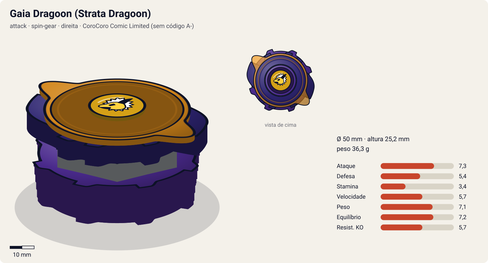
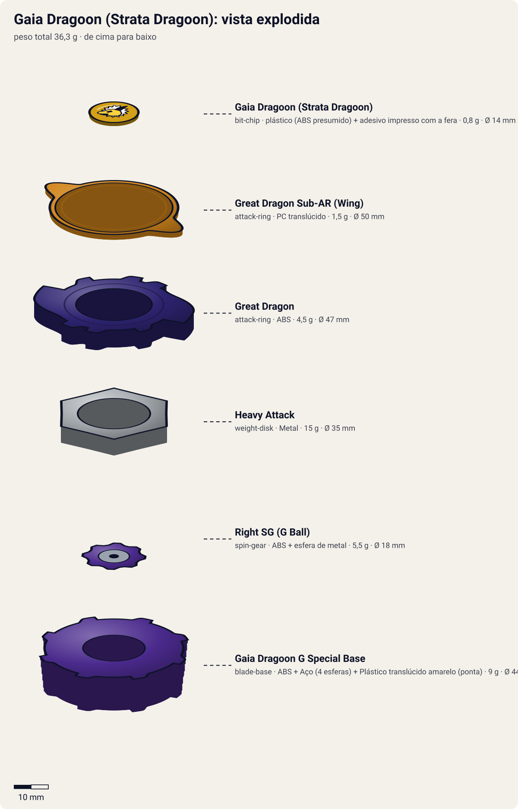
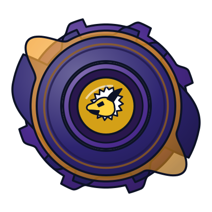
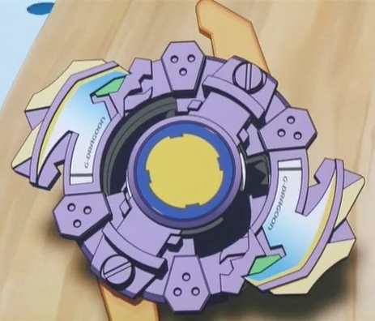
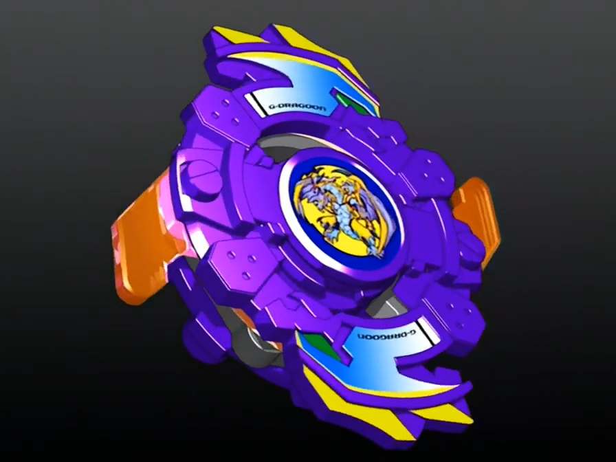

# Gaia Dragoon / Strata Dragoon (ガイアドラグーン / Gaia Doragūn)

<!-- auto:inicio (gerado por npm run build:research; não edite este bloco) -->

| Ficha | |
|---|---|
| Dono | [Daichi Sumeragi (皇大地 / Sumeragi Daichi)](../../README.md) |
| Tipo · sistema · rotação | attack · spin-gear · direita |
| Código do produto | CoroCoro Comic Limited (sem código A-) |
| Montada | Ø 50 mm · altura 25,2 mm · **36,3 g** (soma das peças) |
| Fera bit | [Gaia Dragoon (Strata Dragoon)](../../../../feras-bit/gaia-dragoon/) |
| Lançador | [EZ Shooter (Easy Shooter, rotação direita)](../../../../lancadores/ez-shooter/) |
| Ripcord | [winder-padrao](../../../../lancadores/ripcords/winder-padrao/) |

### Peças

| Camada | Peça | Material | Ø mm | Altura mm | Peso g | Estrelas Takara (A / D / S) | Desenho |
|---|---|---|---|---|---|---|---|
| Bit Chip | [Gaia Dragoon (Strata Dragoon)](../../../../pecas/bit-chip/gaia-dragoon/) | plástico (ABS presumido) + adesivo impresso com a fera | 14 estimado | 8 estimado | 0,8 comunidade | — | [ver](pecas/bit-chip.svg) |
| Attack Ring | [Great Dragon](../../../../pecas/attack-ring/great-dragon/) | ABS | 47 estimado | 5 estimado | 4,5 estimado | 3,5 / 2 / 1,5 | [ver](pecas/attack-ring.svg) |
| Attack Ring | [Great Dragon Sub-AR (Wing)](../../../../pecas/attack-ring/great-dragon-sub-ar/) | PC translúcido | 50 estimado | 1,5 estimado | 1,5 estimado | — | [ver](pecas/attack-ring.svg) |
| Weight Disk | [Heavy Attack](../../../../pecas/weight-disk/heavy-attack/) | Metal | 35 estimado | 4,7 estimado | 15 estimado | 2 / 3 / 1 | [ver](pecas/weight-disk.svg) |
| Spin Gear / Core | [Right SG (G Ball)](../../../../pecas/spin-gear/right-sg-g-ball/) | ABS + esfera de metal | 18 estimado | 10 estimado | 5,5 estimado | — | [ver](pecas/spin-gear.svg) |
| Blade Base | [Gaia Dragoon G Special Base](../../../../pecas/blade-base/gaia-dragoon-g-special-base/) | ABS + Aço (4 esferas) + Plástico translúcido amarelo (ponta) | 44 estimado | 14 estimado | 9 estimado | 4 / 2 / 0,5 | [ver](pecas/blade-base.svg) |

Fonte de cada medida em subscrito (wiki, comunidade, estimado). Detalhes em cada ficha de peça.

### Atributos

| Atributo | Brinquedo (calculado) | Ajuste anime | Jogo |
|---|---|---|---|
| Ataque | 7,3 | — | **7,3** |
| Defesa | 5,4 | — | **5,4** |
| Stamina | 3,4 | — | **3,4** |
| Velocidade | 5,7 | — | **5,7** |
| Peso | 7,1 | — | **7,1** |
| Equilíbrio | 7,2 | — | **7,2** |
| Resistência a KO | 5,7 | — | **5,7** |

Calculado por `src/beyblade/stats.js` a partir de: ponta flat (atrito 0,5), contato smash (recoil 0,8), peso do WD na centro. Modelo em [docs/BEYBLADES.md](../../../../../docs/BEYBLADES.md).

### Fera bit em cima da bey

 

Sons: [invocacao](../../../../feras-bit/gaia-dragoon/sons/invocacao.wav) · [rugido](../../../../feras-bit/gaia-dragoon/sons/rugido.wav) · [ataque](../../../../feras-bit/gaia-dragoon/sons/ataque.wav). Animações: [invocação](../../../../feras-bit/gaia-dragoon/invocacao.svg) · [ataque](../../../../feras-bit/gaia-dragoon/ataque.svg).

Fotos de referência (terceiros, só para estudo)

[anime-grev.png](referencia/anime-grev.png) · [anime.png](referencia/anime.png) · [imagem.jpg](referencia/imagem.jpg) · [pecas-attack-ring.jpg](referencia/pecas-attack-ring.jpg) · [pecas-blade-base-lateral.jpg](referencia/pecas-blade-base-lateral.jpg) · [pecas-blade-base.jpg](referencia/pecas-blade-base.jpg) · [pecas-montada-inferior.jpg](referencia/pecas-montada-inferior.jpg) · [pecas-spin-gear-core.jpg](referencia/pecas-spin-gear-core.jpg) · [pecas-spin-gear.jpg](referencia/pecas-spin-gear.jpg) · [pecas-weight-disk.jpg](referencia/pecas-weight-disk.jpg)

<!-- auto:fim -->

Versão do filme:  — flashback em G-Rev: 

| Campo | Valor |
|---|---|
| Dono | Daichi Sumeragi |
| Código do produto | sem código "A-": brinde/edição limitada CoroCoro Comic (Takara, set/2001, ¥518) |
| Fera Bit (Bit-Beast) | Gaia Dragoon / Strata Dragoon, dragão dourado (5ª fera sagrada, centro/terra) |
| Série / temporada | Brinquedo 2001 (era S1); anime: filme *Fierce Battle* (2002, era V-Force) + flashback em G-Revolution |
| Primeira aparição (anime) | *Beyblade The Movie – Fierce Battle* (2002); G-Rev ep. 40 "Back to Basics" (flashback) |
| Antecessora → Sucessora | — → [Gaia Dragoon V](../gaia-dragoon-v/) |

Chamada às vezes de "Strata Dragoon S" (dublagem/listas de fãs). Exclusiva Takara (sem lançamento Hasbro).

## Formato e geometria
- Silhueta oval com 2 contatos principais (cabeças de dragão), simetria de 2 lados; raio efetivo grande nos dragões, menor nos lados.
- Peso: WD Heavy Attack compacto (centro) + esferas metálicas na base (periferia baixa): inércia moderada.
- Perfil médio; a base tem protuberâncias laterais que encostam no piso quando a bey inclina (perda de estabilidade).

Análise das peças:
- [Great Dragon](../../../../pecas/attack-ring/great-dragon/) + [Sub-AR "wing"](../../../../pecas/attack-ring/great-dragon-sub-ar/) laranja translúcido: roxo, 2 grandes cabeças de dragão salientes em lados opostos → silhueta oval. Smash com muito recoil; fino e propenso a quebrar.
- [Heavy Attack](../../../../pecas/weight-disk/heavy-attack/): hexagonal (série Heavy, como o Six Heavy) com entalhes circulares nos vértices; peso no centro, e os entalhes quase nunca tocam o adversário.
- [Right SG (G Ball)](../../../../pecas/spin-gear/right-sg-g-ball/): casca de SG direita padrão com núcleo exclusivo de 1 esfera metálica e 4 encaixes quadrados que prendem as esferas da base; só funciona com a G Special Base.
- [Gaia Dragoon G Special Base](../../../../pecas/blade-base/gaia-dragoon-g-special-base/): 4 esferas metálicas presas pelo núcleo G Ball; ponta **flat** amarela translúcida. Movimento de ataque, mas instável: a base "raspa" no estádio.

Fotos das peças (terceiros): [AR + Sub-AR](referencia/pecas-attack-ring.jpg), [WD](referencia/pecas-weight-disk.jpg), [SG](referencia/pecas-spin-gear.jpg), [núcleo](referencia/pecas-spin-gear-core.jpg), [base](referencia/pecas-blade-base.jpg), [base lateral](referencia/pecas-blade-base-lateral.jpg), [montada por baixo](referencia/pecas-montada-inferior.jpg).

## Comportamento na arena
- **Movimento**: ponta flat → órbita/ziguezague agressivo, porém errático; perde o controle ao raspar a base.
- **Ataque**: smash pelos dragões salientes; golpes fortes, mas com muito recoil (pode se expulsar sozinha).
- **Defesa**: fraca: AR fino, sem anel de suporte.
- **Stamina**: baixa/média; a base raspando drena rotação.
- **Matchups**: vence defensoras leves e stamina em estádio de borda baixa; perde para defensoras pesadas (recoil) e atacantes estáveis de metal flat.
- **Gimmick**: G Ball, esferas metálicas soltas na base (peso dinâmico); sem uso competitivo segundo a wiki ("comprar só para coleção").

## No anime
- **Filme *Fierce Battle***: presente do pai de Daichi antes de morrer. Daichi desafia Tyson (Dragoon V2) e perde; o choque provoca um terremoto que enfraquece o selo das feras sombrias. Os Shadow Bladers capturam Daichi para usar o poder do "Dragão Dourado"; depois de se libertar ele luta ao lado de Tyson, e Gaia Dragoon evolui para Gaia Dragoon V após a derrota das feras sombrias.
- **G-Rev ep. 40**: flashback; Daichi lança a bey numa árvore e acerta uma colmeia de vespas.
- **Especiais**: a página do Daichi lista "Spike Slash" e "Core Ring Cutter" (Co-Ring Cutter, 光輪刃断 *Kōrin Hadan*, "lâmina-halo") para esta bey; a página do Co-Ring Cutter registra o golpe no mangá/videogame, não no filme: uso no filme **não confirmado**.
- Substituída por evolução (V) no fim do filme.

## Mecânica no jogo
- **Movimento (IA)**: ziguezague agressivo com desvios aleatórios de ±15°, buscando colisões frontais.
- **Gimmick (G Ball)**: a cada colisão forte, 20% de chance de as esferas "baterem" na base: 0,5 s de wobble com −15% de equilíbrio (a base raspa no piso e a bey perde 2% de RPM).
- **Especiais**:
  - *Co-Ring Cutter*: anel-lâmina de energia em volta da bey por 2 s: +40% de dano de contato e +20% de knockback; custo 100 de energia, recarga 20 s. Visual: versão menor da serra dourada do [ataque de Gaia Dragoon](../../../../feras-bit/gaia-dragoon/ataque.svg).
  - *Spike Slash* (opcional): investida curta em linha reta com +25% de dano; custo 60, recarga 12 s.
- **Física**: massa 0,9; raio 1,05 (dragões salientes); atrito da ponta 0,6 (flat); restituição 0,7 (recoil alto).

## Ajuste do anime

| Atributo | Delta | Justificativa (episódio/batalha) |
|---|---|---|
| — | 0 | Usada só no filme (não canônico) e num flashback; perde para Dragoon V2 e não tem especial confirmado no anime. |

Resultado esperado: atacante instável de começo de jogo, inferior às evoluções V e G.

Nota para o coordenador: o brinquedo calculado tem Equilíbrio 7,2, mas a wiki diz "poor stability" (protuberâncias da base raspam no piso). Conferir a estabilidade da ponta registrada na ficha da Gaia Dragoon G Special Base.

## Fontes
- https://beyblade.fandom.com/wiki/Gaia_Dragoon
- https://beyblade.fandom.com/wiki/Attack_Ring_-_Great_Dragon
- https://beyblade.fandom.com/wiki/Weight_Disk_-_Heavy_Attack
- https://beyblade.fandom.com/wiki/Spin_Gear_-_Right_Spin_Gear_(G_Ball)
- https://beyblade.fandom.com/wiki/Blade_Base_-_Gaia_Dragoon_G_Special_Base
- https://beyblade.fandom.com/wiki/Co-Ring_Cutter
- https://beyblade.fandom.com/wiki/Daichi_Sumeragi
- https://beyblade.fandom.com/wiki/Beyblade_The_Movie_-_Fierce_Battle
