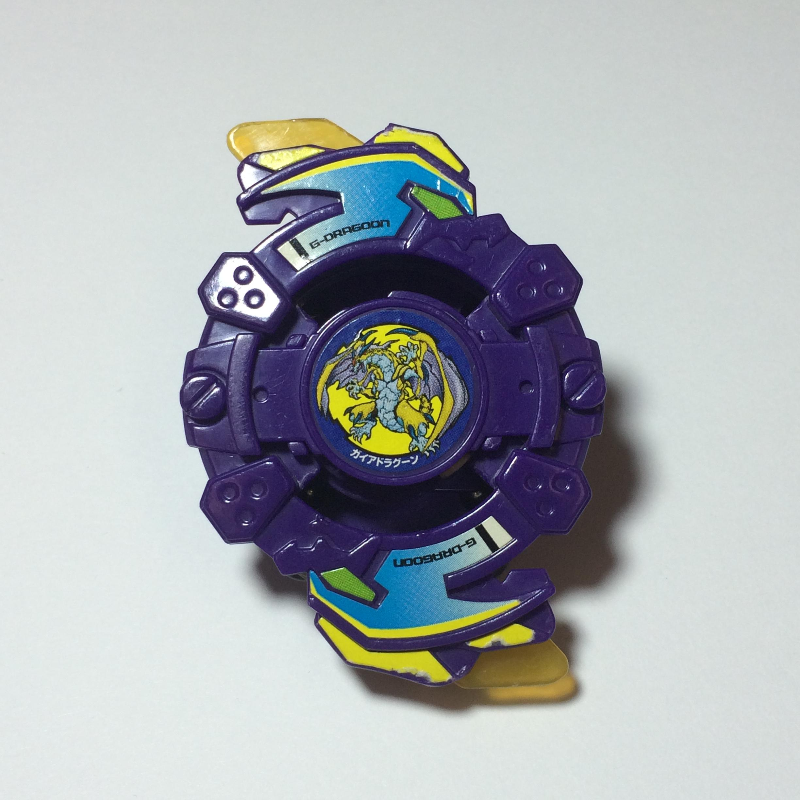

# Gaia Dragoon / Strata Dragoon (ガイアドラグーン / Gaia Doragūn)

Versão do filme:  — flashback em G-Rev: 

| Campo | Valor |
|---|---|
| Dono | Daichi Sumeragi |
| Código do produto | sem código "A-" — brinde/edição limitada CoroCoro Comic (Takara, set/2001, ¥518) |
| Tipo | Attack |
| Sistema | Spin Gear System |
| Rotação | Direita (Right Spin Gear) |
| Fera Bit (Bit-Beast) | Gaia Dragoon / Strata Dragoon — dragão dourado (5ª fera sagrada, centro/terra) |
| Série / temporada | Brinquedo 2001 (era S1); anime: filme *Fierce Battle* (2002, era V-Force) + flashback em G-Revolution |
| Primeira aparição (anime) | *Beyblade The Movie – Fierce Battle* (2002); G-Rev ep. 40 "Back to Basics" (flashback) |
| Antecessora → Sucessora | — → Gaia Dragoon V |

Chamada às vezes de "Strata Dragoon S" (dublagem/listas fan). Exclusiva Takara (sem lançamento Hasbro).

## 1. Peças (de cima para baixo)

| Camada | Peça | Descrição física | Função em batalha |
|---|---|---|---|
| Bit Chip | Gaia Dragoon (Strata Dragoon) | chip com o dragão dourado | identidade / fera bit |
| Attack Ring (AR) | Great Dragon (+ Sub-AR "wing" laranja translúcido) | roxo, 2 grandes cabeças de dragão salientes em lados opostos → silhueta oval; aceita Sub-AR | smash attack com muito recuo; fino e propenso a quebrar |
| Weight Disk (WD) | Heavy Attack | hexagonal (série Heavy, como Six Heavy) com entalhes circulares nos vértices; compacto | peso concentrado no centro; os entalhes quase nunca tocam o adversário |
| Spin Gear (SG) / Core | Right Spin Gear (G Ball) | casca de SG direita padrão; núcleo exclusivo com 1 esfera metálica e 4 encaixes quadrados que prendem as esferas da base | gimmick "G Ball" — só funciona com a G Special Base |
| Support Part / Sub Ring | — | — | — |
| Blade Base (BB) | Gaia Dragoon G Special Base | contém 4 esferas metálicas presas pelo núcleo G Ball; ponta **flat** amarela translúcida; protuberâncias que seguram as esferas | movimento de ataque flat, mas instável e "raspa" no estádio |

Fotos das peças: `pecas/attack-ring.jpg` (AR + S-AR), `pecas/weight-disk.jpg`, `pecas/spin-gear.jpg`, `pecas/spin-gear-core.jpg`, `pecas/blade-base.jpg`, `pecas/blade-base-lateral.jpg`, `pecas/montada-inferior.jpg`.

## 2. Formato e geometria
- Silhueta oval com 2 contatos principais (cabeças de dragão), simetria de 2 lados; raio efetivo grande nos dragões, menor nos lados.
- Peso: WD Heavy Attack compacto (centro) + esferas metálicas na base (periferia baixa) — inércia moderada.
- Perfil médio; base com protuberâncias laterais que encostam no piso quando a bey inclina (perda de estabilidade).

## 3. Comportamento na arena
- **Movimento**: ponta flat → órbita/ziguezague agressivo, porém errático; perde controle ao raspar a base.
- **Ataque**: smash pelos dragões salientes; golpes fortes mas com muito recuo (pode se auto-expulsar).
- **Defesa**: fraca — AR fino, sem anel de suporte.
- **Stamina**: baixa/média; a base raspando drena rotação.
- **Matchups**: vence defensoras leves/stamina em estádio com pouca borda; perde para defensoras pesadas (recuo) e attackers estáveis com metal flat.
- **Gimmick**: G Ball — esferas metálicas soltas na base (efeito de peso dinâmico); sem uso competitivo segundo a wiki ("comprar só para coleção").

## 4. No anime
- **Filme *Fierce Battle***: presente do pai de Daichi antes de morrer. Daichi desafia Tyson (Dragoon V2) e perde; o choque provoca um terremoto que enfraquece o selo das feras sombrias. Os Shadow Bladers capturam Daichi para usar o poder do "Dragão Dourado"; após se libertar ele luta ao lado de Tyson, e Gaia Dragoon evolui para Gaia Dragoon V após a derrota das feras sombrias.
- **G-Rev ep. 40**: flashback — Daichi lança a bey numa árvore e acerta uma colmeia de vespas.
- **Especiais**: a página do Daichi lista "Spike Slash" e "Core Ring Cutter" (Co-Ring Cutter, 光輪刃断 *Kōrin Hadan*, "lâmina-halo") para esta bey; a página do Co-Ring Cutter registra o golpe no mangá/videogame, não no filme — uso no filme **não confirmado**.
- Substituída por evolução (V) ao fim do filme.

## 5. Tradução para o jogo
| Atributo | Valor | Justificativa |
|---|---|---|
| Ataque | 6 | dragões salientes dão smash forte, mas recuo alto e AR frágil |
| Defesa | 3 | AR fino, sem suporte, base instável |
| Stamina | 4 | ponta flat + base que raspa |
| Velocidade | 7 | ponta flat translúcida, movimento agressivo |
| Peso | 5 | WD Heavy Attack (mais leve que Ten Heavy) + esferas metálicas |
| Equilíbrio | 3 | wiki: "poor stability" pelas protuberâncias da base |
| Burst/Knockout-resist | 4 | média-baixa; recuo dos próprios golpes |

- **Movimento em IA**: órbita agressiva irregular (ziguezague com desvios aleatórios ±15°), busca colisões frontais.
- **Especiais (no jogo)**: *Co-Ring Cutter* — anel de energia em forma de lâmina circular ao redor da bey por 2 s; +40% dano de contato e +20% knockback; custo 100, cooldown 20 s. (Opcional) *Spike Slash* — investida curta em linha reta; custo 60, cooldown 12 s.
- **Física sugerida**: massa 0.9, raio 1.05 (dragões salientes), atrito da ponta 0.6 (flat), restituição 0.7 (recuo alto).

Os mesmos dados ficam em `dados.json`.

## 6. Fontes
- https://beyblade.fandom.com/wiki/Gaia_Dragoon
- https://beyblade.fandom.com/wiki/Attack_Ring_-_Great_Dragon
- https://beyblade.fandom.com/wiki/Weight_Disk_-_Heavy_Attack
- https://beyblade.fandom.com/wiki/Spin_Gear_-_Right_Spin_Gear_(G_Ball)
- https://beyblade.fandom.com/wiki/Blade_Base_-_Gaia_Dragoon_G_Special_Base
- https://beyblade.fandom.com/wiki/Co-Ring_Cutter
- https://beyblade.fandom.com/wiki/Daichi_Sumeragi
- https://beyblade.fandom.com/wiki/Beyblade_The_Movie_-_Fierce_Battle
