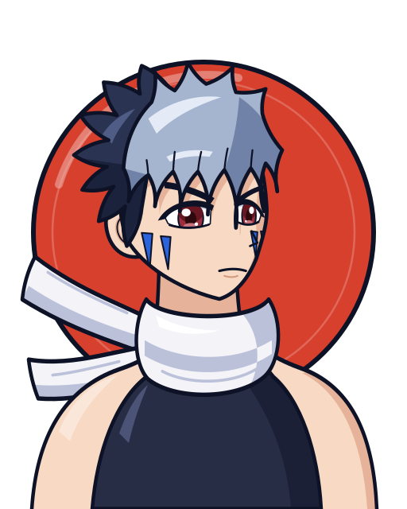
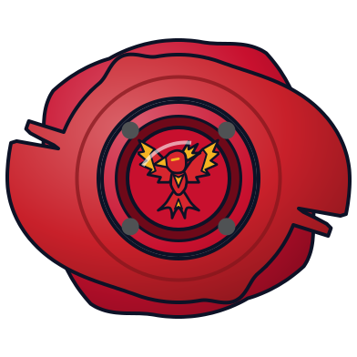
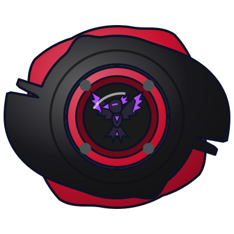
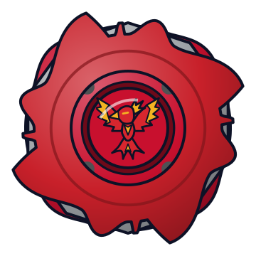
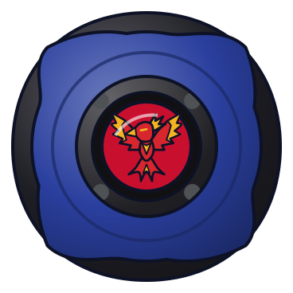
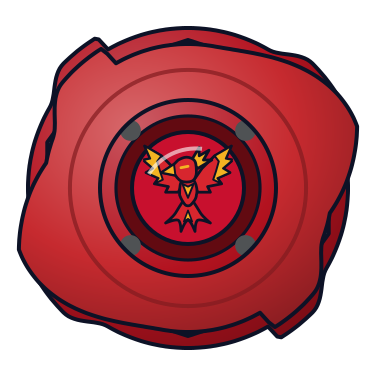
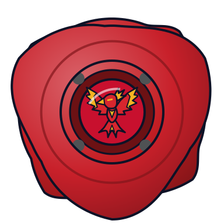

# Kai Hiwatari (火渡カイ / Hiwatari Kai)

Retrato original do jogo ([retrato.svg](retrato.svg)). Sem foto de referência no repositório (download bloqueado; ver "Imagens pendentes").

> **Imagem pendente**: o download de imagens do CDN da Fandom (`static.wikia.nocookie.net`) foi bloqueado por um desafio anti-bot da Cloudflare durante a pesquisa. Os arquivos ainda não estão na pasta; as URLs originais estão em "Imagens pendentes", no fim deste arquivo.

| Campo | Valor |
|---|---|
| Nome JP | 火渡カイ (Hiwatari Kai) |
| Equipe(s) por temporada | S1: Blade Sharks (líder) → Bladebreakers (capitão no dub EN) → Demolition Boys (deserção temporária, eps. 42–45) → Bladebreakers / V-Force: Bladebreakers / G-Rev: BBA Revolution → Blitzkrieg Boys → eliminatórias do BEGA Justice 5 → G Revolutions (5º membro) |
| Nacionalidade | Japonês (herdeiro da Hiwatari Enterprise); criado na Abadia Balkov, na Rússia |
| Idade (aprox.) | JP: 12 / 13 / 14 · EN: 14 / 15 / 16 (S1 / V-Force / G-Rev). A wiki marca como "citation needed" |
| Fera Bit | Dranzer (朱雀 Suzaku): fênix, o Pássaro Vermelhão do Sul, uma das 4 Feras Sagradas, elemento Fogo. Temporária: Black Dranzer (cópia artificial criada pela Biovolt) |
| Estilo de batalha | Balance com foco ofensivo. Todas as beys Dranzer são classificadas como tipo Balance |
| Dublador(a) JP / EN / PT-BR | Urara Takano / David Reale / Bruno Miguel (segundo o MyAnimeList; não confirmado se é a dublagem brasileira ou a portuguesa) |

Aniversário: 1º de agosto (Takao Aoki / *Rising*). Primeira aparição: ep. 1 "The Blade Raider".

## Visual

Padrão do retrato: visual da **temporada 1 (2001)**.

- **S1 (2001)**: cabelo **bicolor**: franja e parte da frente **cinza-azulada clara**, em mechas longas e pontudas (uma desce entre os olhos), e nuca/parte de trás **azul-escura quase preta**, curta e espetada. Olhos castanho-avermelhados (carmim), pele clara, expressão fria (sobrancelhas baixas, boca reta). **Duas marcas triangulares azul-cobalto em cada bochecha** ("pintura de guerra" que lembra dentes de tubarão, herança dos Blade Sharks). **Cachecol branco longo e grosso**, com as pontas voando para trás. Regata escura justa e ombros à mostra; protetores de braço vermelhos e calça larga azul (fora do busto).
- **V-Force (2002)**: sem o cachecol; regata roxa de gola alta com listras vermelhas e botões amarelos, mangas roxas, calça cinza e botas. Olhos azul-acinzentados, franja cinza-escura e nuca quase preta; usa um brinco preto na orelha esquerda e, no colégio, aparece sem as marcas (que se revelam pintadas).
- **G-Revolution (2003)**: o cachecol volta (cheio de pesos, racha o chão quando jogado). Roupa roxa com jaqueta preta de listras vermelhas e botões amarelos, luvas pretas sem dedos; olhos lilás e cabelo ainda mais escuro.
- Elementos obrigatórios no retrato: cabelo bicolor, marcas azuis nas bochechas, cachecol branco longo.

| Uso | Hex |
|---|---|
| Disco de fundo (Dranzer, fênix de fogo; proposta até existir `feras-bit/dranzer/dados.json`) | `#d8402e` (borda `#0d1226`) |
| Franja base / sombra / brilho | `#a5b5d0` / `#7182a8` / `#e4ebf6` |
| Nuca base / sombra | `#2a3352` / `#1a223c` |
| Olhos (íris) | `#9c2f3e` |
| Pele base / sombra | `#f8dac4` / `#e6b39a` |
| Marcas no rosto | `#2a63da` |
| Cachecol base / sombra | `#f3f3f8` / `#bcc1da` |
| Regata | `#272d44` |
| Contorno | `#0d1226` |

## Personalidade e papel na história
- É o deuteragonista e o grande rival de Tyson (Takao). Frio, calado, orgulhoso, solitário e muito disciplinado. Treina sozinho, até em isolamento extremo na Sibéria (G-Rev).
- **S1**: começa como líder tirânico dos Blade Sharks, que quebra as beys de quem perde, e campeão regional que volta para defender o título. Perde a final regional para Tyson e entra nos Bladebreakers. Na Rússia, seduzido pelo poder, deserta para os Demolition Boys e usa a **Black Dranzer** para capturar feras bit (All Starz e White Tigers). No Lago Baikal é derrotado pelos amigos e se redime. Perde a Dranzer para Spencer (ep. 48), mas recusa a Black Dranzer e luta com o próprio espírito.
- **V-Force**: está aposentado num colégio interno, mas a luta contra Dunga (Saint Shields) o traz de volta. É o mais maduro da equipe nesta fase: protege os amigos, sente culpa pelo que aconteceu com Wyatt e forma dupla com Ray no torneio 2x2. Perde a Dranzer para Zeo (ep. 48), que depois é devolvida.
- **G-Revolution**: obcecado em vencer Tyson, deixa a equipe e entra nos Blitzkrieg Boys. Empata e depois perde a final mundial para Tyson por margem mínima. Brooklyn destrói a Dranzer GT. Kai volta com a Dranzer MS, vence Brooklyn quase morrendo (eps. 47–48) e a MS se despedaça. Reaparece vivo no fim (ep. 52, contra Tyson).

## Estilo de luta (como o jogo deve representá-lo)
- **Lançamento típico**: lançamento forte e preciso. Costuma deixar oponentes mais fracos atacarem e se cansarem para depois finalizar "com um floreio". Contra rivais fortes (Tyson, Ray, Max) vai com tudo desde o início.
- **Agressividade**: alta contra rivais, calculista contra o resto. Lê o oponente rápido.
- **Preferências táticas**: ataques aéreos em mergulho (Spin Fire, Spiral Fireball), investidas envoltas em fogo (Flame Saber, Volcano Emission, Blazing Gigs) e prisões em área com penas de fogo (Blazing Gigs Tempest). Sabe usar gimmicks de modo (base Spiral Change, Volcano Change, clutch, engine gear reverso, Manual Change Core).
- **Resiliência**: limiar de dor altíssimo e força de vontade enorme. Levanta toda vez que cai. Sugestão: bônus de "último fôlego" com rotação baixa.
- **Frases de efeito**: "Dranzer! Flame Saber!", "Ha! I invented the word impossible. That's why I'm the champ."

## Beyblades utilizadas no anime (ordem cronológica)
| # | Beyblade | Temporada | Episódio de estreia | Pasta | Miniatura | Lançador | Ripcord |
|---|---|---|---|---|---|---|---|
| 1 | Dranzer S (A-2) | S1 | Ep. 1 "The Blade Raider" (primeira batalha no ep. 2) | [beyblades/dranzer-s](beyblades/dranzer-s/) |  | [Spring Shooter](../../lancadores/spring-shooter/) | — |
| 2 | Dranzer F (A-27) | S1 → início de V-Force | S1 ep. 33 "Last Tangle in Paris" | [beyblades/dranzer-f](beyblades/dranzer-f/) |  | [Dranzer Shooter DX](../../lancadores/dranzer-shooter-dx/) | — |
| 3 | Black Dranzer (A-38) | S1 | Ep. 42 "Drawn to the Darkness" | [beyblades/black-dranzer](beyblades/black-dranzer/) |  | [Dranzer Shooter DX](../../lancadores/dranzer-shooter-dx/) | — |
| 4 | Dranzer V (A-47) | V-Force | V-Force ep. 16 "Team Psykick's New Recruit" | [beyblades/dranzer-v](beyblades/dranzer-v/) |  | [Customize Grip (Gun Metallic / preto) - versão Kai](../../lancadores/customize-grip-kai/) | — |
| 5 | Dranzer V2 (A-81) | V-Force → início de G-Rev | V-Force ep. 43 "Kai's Royal Flush" | [beyblades/dranzer-v2](beyblades/dranzer-v2/) |  | [Customize Grip (Gun Metallic / preto) - versão Kai](../../lancadores/customize-grip-kai/) | — |
| 6 | Dranzer G (A-99) | G-Revolution | G-Rev ep. 11 "The Blame Game" | [beyblades/dranzer-g](beyblades/dranzer-g/) |  | [Customize Grip (Gun Metallic / preto) - versão Kai](../../lancadores/customize-grip-kai/) | — |
| 7 | Dranzer GT (A-117) | G-Revolution | G-Rev ep. 29 "And Then There Were Two" | [beyblades/dranzer-gt](beyblades/dranzer-gt/) |  | [Customize Grip (Gun Metallic / preto) - versão Kai](../../lancadores/customize-grip-kai/) | — |
| 8 | Dranzer MS (A-131) | G-Revolution | G-Rev ep. 42 "When You Wish Upon a Star" | [beyblades/dranzer-ms](beyblades/dranzer-ms/) |  | [Dual Shooter (HMS)](../../lancadores/dual-shooter/) | — |

Fora do escopo, porque não aparecem no anime: Frostic Dranzer / Ultimate Frostic Dranzer e Dranzer Auto Change Balancer (jogo e mangá), Dranzer MF (só no epílogo do mangá; a wiki apenas especula que a Dranzer do ep. 52 "possivelmente" seria uma MF) e as Dranzer da linha Burst (mangá *Rising*). **Não foi encontrado registro de Kai usando uma bey emprestada** (Wolborg ou outra) no anime. Na S1 foi o contrário: Tyson usou a Dranzer F de Kai no Lago Baikal.
Filme *Fierce Battle* (2002): Kai luta contra Tyson e contra os Shadow Bladers. A bey usada não foi confirmada; pela data de lançamento (agosto de 2002, entre as A-47 e A-81), provavelmente é a Dranzer V.

## Batalhas marcantes
- **S1 ep. 2**: vence Tyson (Dragoon Grip Attacker) e depois empata com ele (Dragoon S). É a estreia das feras bit Dranzer e Dragoon.
- **S1 ep. 7**: final regional, perde de 1–2 para Tyson.
- **S1 eps. 37 / 39**: perde e depois vence Johnny McGregor (Salamalyon).
- **S1 eps. 43–45**: com a Black Dranzer, vence os All Starz (4 contra 1), captura feras dos White Tigers e enfrenta Tyson, Ray e Kenny no Lago Baikal até ser parado por Max (Draciel) e pela Dranzer lançada por Tyson.
- **S1 ep. 48**: perde de 0–2 para Spencer (Seaborg 2) e perde a Dranzer.
- **V-Force eps. 5 / 12**: empata com Dunga (Vortex Ape). **Ep. 24**: vence Goki (Cyber Dranzer) com Flame Saber, destruindo a bey. **Ep. 38**: em dupla com Ray, vence Dunga e Joseph. **Ep. 48**: perde para Zeo (Cerberus).
- **G-Rev ep. 23**: vence Ray (Driger G) com a estreia da Blazing Gigs Tempest. **Eps. 29–30**: final mundial contra Tyson (Dragoon GT), empate e depois derrota apertada. **Eps. 41–42**: Brooklyn (Zeus) destrói a Dranzer GT. **Eps. 47–48**: vence Brooklyn com a Spiral Fireball, e a Dranzer MS se despedaça.

## Perfil de IA sugerido para o jogo
- **Agressividade**: 7/10 (sobe para 9 contra "rivais" ou quando a própria rotação passa de 50%; desce para 5 contra oponentes mais fracos, em modo de "deixar cansar").
- **Uso de especial**: guarda o especial para finalizar (gatilho: oponente com rotação abaixo de 40% ou contra-ataque logo depois de levar um golpe forte). Contra rivais, usa cedo.
- **Posicionamento**: alterna entre órbita na borda e mergulhos ao centro. Gosta de investir de cima ou pelo ângulo (ataques aéreos).
- **Traço especial**: "Phoenix" (resiliência). Uma vez por batalha, ao cair abaixo de 10% de rotação, recupera um pouco de estabilidade. Referência: a fênix que renasce, e Kai, que se levanta contra Brooklyn.

## Fontes
- https://beyblade.fandom.com/wiki/Kai_Hiwatari (wikitext via API)
- https://beyblade.fandom.com/wiki/Dranzer_(Bit-Beast)
- https://beyblade.fandom.com/wiki/Black_Dranzer
- https://beyblade.fandom.com/wiki/Dranzer_MF
- https://beyblade.fandom.com/wiki/Beyblade_The_Movie_-_Fierce_Battle
- https://myanimelist.net/character/3241 (dubladores)

## Imagens pendentes (baixar manualmente)
| Arquivo destino | URL (CDN) | Página da wiki |
|---|---|---|
| `foto.jpg` (S1) | https://static.wikia.nocookie.net/beyblade/images/0/05/KaiHiwatari%282000%29.jpg/revision/latest?cb=20230424124057 | https://beyblade.fandom.com/wiki/File:KaiHiwatari%282000%29.jpg |
| `foto-vforce.jpg` | https://static.wikia.nocookie.net/beyblade/images/7/7b/KaiHiwatariVForce.jpg/revision/latest?cb=20230424065233 | https://beyblade.fandom.com/wiki/File:KaiHiwatariVForce.jpg |
| `foto-grevolution.jpg` | https://static.wikia.nocookie.net/beyblade/images/d/d8/Kai_Hiwatari_%28G-Revolution%29.jpg/revision/latest?cb=20230617023309 | https://beyblade.fandom.com/wiki/File:Kai_Hiwatari_%28G-Revolution%29.jpg |
