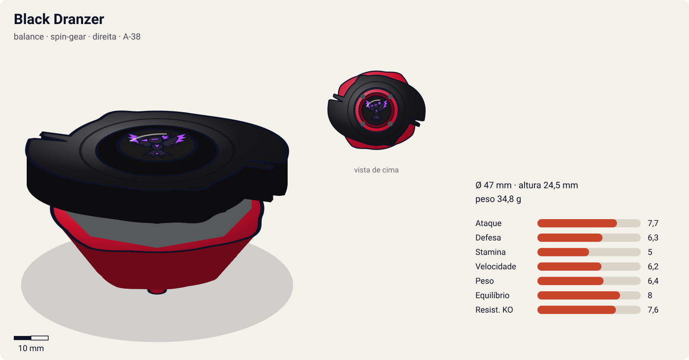
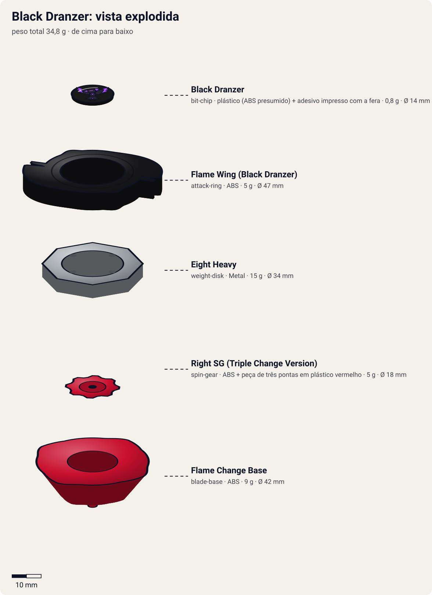

# Black Dranzer (ブラックドランザー / Burakku Doranzā)

<!-- auto:inicio (gerado por npm run build:research; não edite este bloco) -->

| Ficha | |
|---|---|
| Dono | [Kai Hiwatari (火渡カイ / Hiwatari Kai)](../../README.md) |
| Tipo · sistema · rotação | balance · spin-gear · direita |
| Código do produto | A-38 |
| Montada | Ø 47 mm · altura 24,5 mm · **34,8 g** (soma das peças) |
| Fera bit | [Black Dranzer](../../../../feras-bit/black-dranzer/) |
| Lançador | [Dranzer Shooter DX](../../../../lancadores/dranzer-shooter-dx/) |
| Ripcord | [winder-padrao](../../../../lancadores/ripcords/winder-padrao/) |

### Peças

| Camada | Peça | Material | Ø mm | Altura mm | Peso g | Estrelas Takara (A / D / S) | Desenho |
|---|---|---|---|---|---|---|---|
| Bit Chip | [Black Dranzer](../../../../pecas/bit-chip/black-dranzer/) | plástico (ABS presumido) + adesivo impresso com a fera | 14 estimado | 8 estimado | 0,8 comunidade | — | [ver](pecas/bit-chip.svg) |
| Attack Ring | [Flame Wing (Black Dranzer)](../../../../pecas/attack-ring/flame-wing-black-dranzer/) | ABS | 47 estimado | 6 estimado | 5 wiki | 1,5 / 3 / 1,5 | [ver](pecas/attack-ring.svg) |
| Weight Disk | [Eight Heavy](../../../../pecas/weight-disk/eight-heavy/) | Metal | 34 estimado | 4,5 estimado | 15 wiki | 0,5 / 3 / 1,5 | [ver](pecas/weight-disk.svg) |
| Spin Gear / Core | [Right SG (Triple Change Version)](../../../../pecas/spin-gear/right-sg-triple-change-version/) | ABS + peça de três pontas em plástico vermelho | 18 estimado | 12 estimado | 5 wiki | — | [ver](pecas/spin-gear.svg) |
| Blade Base | [Flame Change Base](../../../../pecas/blade-base/flame-change-base/) | ABS | 42 estimado | 14 estimado | 9 wiki | 3 / 2 / 3 | [ver](pecas/blade-base.svg) |

Fonte de cada medida em subscrito (wiki, comunidade, estimado). Detalhes em cada ficha de peça.

### Atributos

| Atributo | Brinquedo (calculado) | Ajuste anime | Jogo |
|---|---|---|---|
| Ataque | 4,7 | +3 | **7,7** |
| Defesa | 6,3 | — | **6,3** |
| Stamina | 5 | — | **5** |
| Velocidade | 5,2 | +1 | **6,2** |
| Peso | 6,4 | — | **6,4** |
| Equilíbrio | 8 | — | **8** |
| Resistência a KO | 5,6 | +2 | **7,6** |

Calculado por `src/beyblade/stats.js` a partir de: ponta semi-flat (atrito 0,3), contato smash (recoil 0,6), peso do WD na centro. Modelo em [docs/BEYBLADES.md](../../../../../docs/BEYBLADES.md).

### Fera bit em cima da bey

 

Sons: [invocacao](../../../../feras-bit/black-dranzer/sons/invocacao.wav) · [rugido](../../../../feras-bit/black-dranzer/sons/rugido.wav) · [ataque](../../../../feras-bit/black-dranzer/sons/ataque.wav). Animações: [invocação](../../../../feras-bit/black-dranzer/invocacao.svg) · [ataque](../../../../feras-bit/black-dranzer/ataque.svg).
<!-- auto:fim -->

| Campo | Valor |
|---|---|
| Dono | Criada pela Biovolt (Boris Balkov), entregue a Kai Hiwatari e depois devolvida a Boris |
| Código do produto | A-38 (Takara, out. 2001, exclusiva do set Bey Ultimate Stadium; Hasbro 2003 avulsa) |
| Tipo | Balance |
| Sistema | Spin Gear System |
| Rotação | Direita |
| Fera Bit (Bit-Beast) | Black Dranzer: fênix negra artificial, cópia da Dranzer criada pela Biovolt |
| Série / temporada | Bakuten Shoot (2001), S1 |
| Primeira aparição (anime) | Ep. 42 "Drawn to the Darkness" (Kai criança já a havia tocado na abadia, em flashback) |
| Antecessora → Sucessora | Bey paralela: Kai volta para a [Dranzer F](../dranzer-f/) |

## Formato e geometria
- Geometria idêntica à da [Dranzer F](../dranzer-f/): 2 espinhos do [Flame Wing (Black Dranzer)](../../../../pecas/attack-ring/flame-wing-black-dranzer/) (simetria de 2), WD [Eight Heavy](../../../../pecas/weight-disk/eight-heavy/) com peso central, perfil alto.
- No brinquedo a diferença é só de cor e chip: o seletor de 3 pontas do [Right SG (Triple Change Version)](../../../../pecas/spin-gear/right-sg-triple-change-version/) é vermelho na Takara e verde na Hasbro, e a [Flame Change Base](../../../../pecas/blade-base/flame-change-base/) é a mesma. A análise das peças (entalhes de smash, upper fraco de 10°, defeito do seletor) está na página da Dranzer F.
- O [bit chip](../../../../pecas/bit-chip/black-dranzer/) traz a fênix negra. No anime, diz-se que o chip "faz a alma do blader cair na escuridão".

## Comportamento na arena
- **Toy**: mesmo comportamento da Dranzer F (smash/upper médio, 3 modos de ponta).
- **Anime**: ataque devastador e controle sobre feras bit. Absorve as feras dos oponentes e usa os golpes delas.
- **Pontos fracos (anime)**: perde força diante das 4 Feras Sagradas. Max (Draciel) defende todos os ataques dela no Lago Baikal.
- **Matchups (anime)**: domina beys sem fera sagrada (All Starz, White Tigers). Perde para o combo Draciel + Dranzer.

## No anime
- **Ataques especiais**:
  - **Black Flame Saber** (ブラックフレイムセイバー). Estreia no ep. 43 "Live and Let Kai!": a fera Black Dranzer sai do chip e ataca a bey inimiga num clarão de luz intensa.
  - **Captura de feras bit**: absorve a fera bit do oponente derrotado. Kai captura 7 feras (todos os All Starz e os White Tigers, menos Galman/Galux) e passa a usar os golpes delas.
- **Batalhas**: ep. 43, vence os All Starz (4 contra 1). Ep. 44, vence Gary, Mariah e Lee. Ep. 45, no Lago Baikal, vence Tyson, Ray e Kenny no primeiro round, mas é parado por Max (Draciel) e derrotado pela Dranzer lançada por Tyson. Depois, Kai lança a Black Dranzer contra o mainframe da Biovolt e o destrói.
- **Destino**: os Demolition Boys destroem a bey e as feras capturadas são liberadas. O chip sobrevive. Voltaire o entrega a Kai antes da luta contra Spencer (ep. 48), mas Kai o remove e luta com a Dranzer.

## Mecânica no jogo
Bey **de chefe** da S1. O brinquedo é igual à Dranzer F; a diferença vem do `ajuste_anime` e da passiva.
- **Movimento (IA)**: órbita agressiva em semi-flat. Em lutas 1 contra N, caça sempre o oponente com **menos rotação** e só troca de alvo quando ele sai do estádio.
- **Gimmick**: Triple Change como na Dranzer F (sem o defeito do seletor: a IA de chefe não sorteia a ponta travada).
- **Especiais** (efeito visual: [fera Black Dranzer](../../../../feras-bit/black-dranzer/ataque.svg), mergulho em chamas negras com clarão violeta):
  - **Black Flame Saber** (custo 100, recarga 25 s): clarão violeta de 0,4 s que **cega** a IA do alvo (ela perde a mira por 1 s), seguido de mergulho com 2,2× de dano que ignora 50% da defesa do alvo.
  - **Absorver Fera Bit** (passiva de chefe, sem custo): ao derrotar um oponente, copia o especial dele para o resto da partida (no máximo 2 copiados). Penalidade: −30% de eficácia (dano e empurrão) contra as 4 Feras Sagradas (Dragoon, Dranzer, Driger, Draciel), refletindo o Lago Baikal.

## Ajuste do anime

| Atributo | Delta | Justificativa (episódio/batalha) |
|---|---|---|
| Ataque | +3 | Vence os 4 All Starz de uma vez (ep. 43) e três White Tigers (ep. 44), capturando as feras; no Lago Baikal vence Tyson, Ray e Kenny no 1º round (ep. 45) |
| Velocidade | +1 | Ataca vários oponentes ao mesmo tempo no 4 contra 1 (ep. 43) |
| Resistência a KO | +2 | Aguenta 4 beys juntas sem sair do estádio (ep. 43) e só cai com Draciel e Dranzer juntas (ep. 45) |

Defesa fica sem ajuste de propósito: a Draciel de Max segura todos os golpes dela e a Dranzer F a derrota (ep. 45). Resultado esperado: chefe que atropela qualquer bey da S1 sem fera sagrada, mas que pode perder para uma defensiva (Draciel) bem lançada ou para Dranzer F + Draciel juntas.

## Fontes
- https://beyblade.fandom.com/wiki/Black_Dranzer
- https://beyblade.fandom.com/wiki/Black_Flame_Saber
- https://beyblade.fandom.com/wiki/Dranzer_F
- https://beyblade.fandom.com/wiki/Kai_Hiwatari
