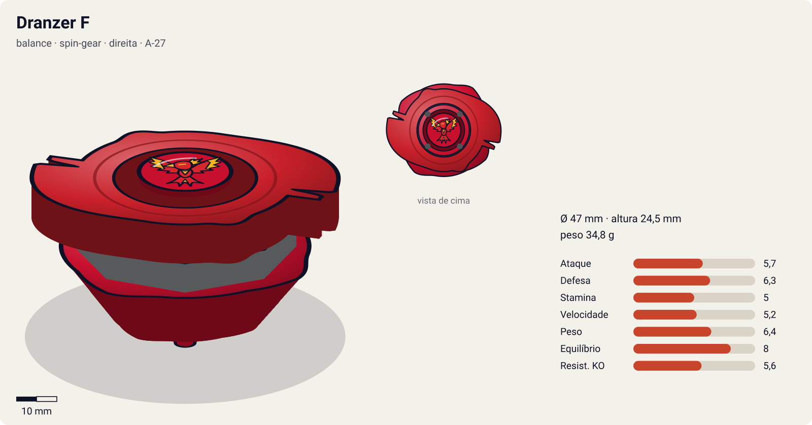
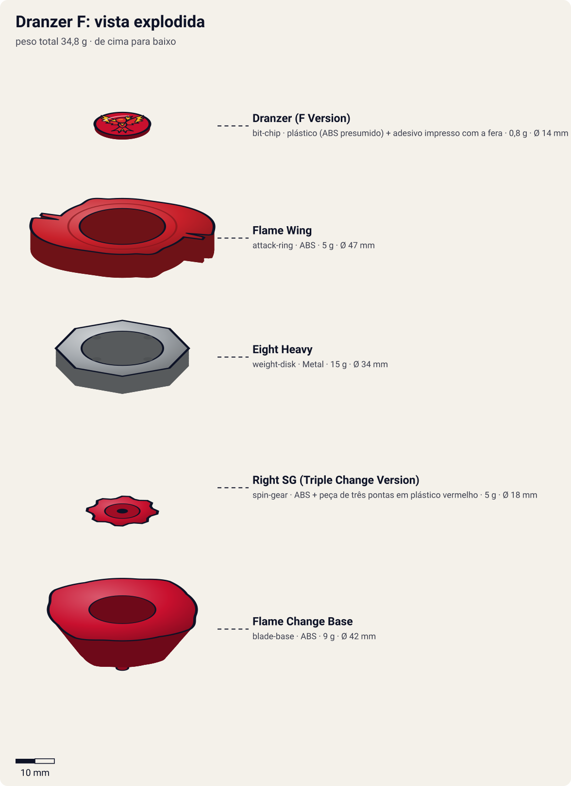

# Dranzer F (ドランザーF / Doranzā Fureimu — "Dranzer Flame")

<!-- auto:inicio (gerado por npm run build:research; não edite este bloco) -->

| Ficha | |
|---|---|
| Dono | [Kai Hiwatari (火渡カイ / Hiwatari Kai)](../../README.md) |
| Tipo · sistema · rotação | balance · spin-gear · direita |
| Código do produto | A-27 |
| Montada | Ø 47 mm · altura 24,5 mm · **34,8 g** (soma das peças) |
| Fera bit | [Dranzer](../../../../feras-bit/dranzer/) |
| Lançador | [Dranzer Shooter DX](../../../../lancadores/dranzer-shooter-dx/) |
| Ripcord | [winder-padrao](../../../../lancadores/ripcords/winder-padrao/) |

### Peças

| Camada | Peça | Material | Ø mm | Altura mm | Peso g | Estrelas Takara (A / D / S) | Desenho |
|---|---|---|---|---|---|---|---|
| Bit Chip | [Dranzer (F Version)](../../../../pecas/bit-chip/dranzer-f/) | plástico (ABS presumido) + adesivo impresso com a fera | 14 estimado | 8 estimado | 0,8 comunidade | — | [ver](pecas/bit-chip.svg) |
| Attack Ring | [Flame Wing](../../../../pecas/attack-ring/flame-wing/) | ABS | 47 estimado | 6 estimado | 5 wiki | 1,5 / 3 / 1,5 | [ver](pecas/attack-ring.svg) |
| Weight Disk | [Eight Heavy](../../../../pecas/weight-disk/eight-heavy/) | Metal | 34 estimado | 4,5 estimado | 15 wiki | 0,5 / 3 / 1,5 | [ver](pecas/weight-disk.svg) |
| Spin Gear / Core | [Right SG (Triple Change Version)](../../../../pecas/spin-gear/right-sg-triple-change-version/) | ABS + peça de três pontas em plástico vermelho | 18 estimado | 12 estimado | 5 wiki | — | [ver](pecas/spin-gear.svg) |
| Blade Base | [Flame Change Base](../../../../pecas/blade-base/flame-change-base/) | ABS | 42 estimado | 14 estimado | 9 wiki | 3 / 2 / 3 | [ver](pecas/blade-base.svg) |

Fonte de cada medida em subscrito (wiki, comunidade, estimado). Detalhes em cada ficha de peça.

### Atributos

| Atributo | Brinquedo (calculado) | Ajuste anime | Jogo |
|---|---|---|---|
| Ataque | 4,7 | +1 | **5,7** |
| Defesa | 6,3 | — | **6,3** |
| Stamina | 5 | — | **5** |
| Velocidade | 5,2 | — | **5,2** |
| Peso | 6,4 | — | **6,4** |
| Equilíbrio | 8 | — | **8** |
| Resistência a KO | 5,6 | — | **5,6** |

Calculado por `src/beyblade/stats.js` a partir de: ponta semi-flat (atrito 0,3), contato smash (recoil 0,6), peso do WD na centro. Modelo em [docs/BEYBLADES.md](../../../../../docs/BEYBLADES.md).

### Fera bit em cima da bey

 

Sons: [invocacao](../../../../feras-bit/dranzer/sons/invocacao.wav) · [rugido](../../../../feras-bit/dranzer/sons/rugido.wav) · [ataque](../../../../feras-bit/dranzer/sons/ataque.wav). Animações: [invocação](../../../../feras-bit/dranzer/invocacao.svg) · [ataque](../../../../feras-bit/dranzer/ataque.svg).
<!-- auto:fim -->

| Campo | Valor |
|---|---|
| Dono | Kai Hiwatari (usada por Tyson Granger por 2 episódios, no Lago Baikal) |
| Código do produto | A-27 (Takara) |
| Tipo | Balance |
| Sistema | Spin Gear System |
| Rotação | Direita |
| Fera Bit (Bit-Beast) | Dranzer (fênix / Suzaku) |
| Série / temporada | Bakuten Shoot (2001), fim da S1, e início de V-Force (2002) |
| Primeira aparição (anime) | S1 ep. 33 "Last Tangle in Paris" |
| Antecessora → Sucessora | [Dranzer S](../dranzer-s/) → [Dranzer V](../dranzer-v/) (variante alternativa: [Black Dranzer](../black-dranzer/)) |

## Formato e geometria
- Vista de cima: 2 espinhos opostos (simetria de 2), raio maior que o da Dranzer S por causa dos espinhos longos do [Flame Wing](../../../../pecas/attack-ring/flame-wing/).
- O WD [Eight Heavy](../../../../pecas/weight-disk/eight-heavy/) concentra o peso no centro: RPM alto e boa estabilidade, mas pouca inércia periférica.
- Perfil alto (o [Right SG (Triple Change Version)](../../../../pecas/spin-gear/right-sg-triple-change-version/) é alto). As rampas ajudam pouco no upper por causa da altura.
- **Por que as peças funcionam assim**:
  - Flame Wing: os 2 espinhos têm **entalhes rombos** na ponta, inclinados para cima (cerca de 10°). Em rotação direita os entalhes dão smash; a rampa de 10° (contra 15° da Upper Dragoon) dá um upper fraco. É frágil: os entalhes quebram com o uso.
  - Triple Change + [Flame Change Base](../../../../pecas/blade-base/flame-change-base/): a peça plástica de 3 pontas, puxada e girada, alterna entre **flat / sharp / semi-flat**. Versátil, mas a peça pode ficar frouxa e travar "entre" duas pontas.

## Comportamento na arena
- **Padrão de movimento**: flat = órbita agressiva; semi-flat = flower moderado; sharp = centro.
- **Ataque**: smash pelos entalhes, com algum upper. Bom golpe isolado, inconsistente no conjunto.
- **Defesa**: média (WD Heavy de 15 g).
- **Stamina**: média. Cai muito se a ponta travar entre dois modos (defeito conhecido do toy).
- **Pontos fortes**: 3 modos de ponta, peso central. **Fracos**: AR frágil, altura, defeito do seletor.
- **Matchups**: vence balance/stamina leves com smash. Perde para upper attackers baixos e para defensores pesados.
- **Gimmick**: Triple Change (seleção manual de 3 pontas).

## No anime
- **Ataques especiais**:
  - **Flame Saber** (斬炎剣 / Fureimu Seibā). Estreia no S1 ep. 48 "Victory in Defeat", contra Spencer (Seaborg 2): mergulho do alto envolto em chamas, batendo no alvo com a ponta. Usado duas vezes, sem sucesso. Frase: "Dranzer! Flame Saber!"
  - **Flame Thrower**: listado na infobox. Descrição não confirmada.
- **Batalhas**: S1 ep. 37 perde para Johnny McGregor e ep. 39 vence Johnny (Europa; bey provável: F, pela data de estreia). No Lago Baikal (ep. 45), Tyson lança a Dranzer abandonada por Kai e, com Max, derrota a Black Dranzer. Ep. 48, perde de 0–2 para Spencer e a fera bit Dranzer é roubada (depois é devolvida). V-Force: ep. 5, empate com Dunga; ep. 11, vence Figel; ep. 12, contra Dunga sem resultado.
- **Substituição**: com a chegada do Magnacore System, Kai passa para a Dranzer V (V-Force ep. 16).

## Mecânica no jogo
- **Movimento (IA)**: modo de ponta escolhido entre rounds.
  - **Semi-flat** (padrão): flower moderado, cruzando o estádio em pétalas e buscando o alvo de lado.
  - **Flat**: órbita agressiva, +15% de velocidade e +20% de perda de rotação.
  - **Sharp**: centro, quase parada.
- **Gimmick**: Triple Change. Opcional: 5% de chance por luta de a ponta "travar" entre dois modos (atrito alto e −20% de stamina naquela luta), refletindo o defeito do toy.
- **Especiais** (efeito visual: [fera Dranzer](../../../../feras-bit/dranzer/ataque.svg), mergulho em chamas):
  - **Flame Saber** (custo 100, recarga 22 s): a bey sobe (intangível por 0,5 s) e mergulha sobre a posição do alvo **no início** do especial, com 2× de dano e 1,8× de empurrão. Se o alvo se mexer mais de 1 raio de bey nesse tempo, o golpe erra (como contra Spencer).
  - **Flame Thrower** (custo 60, recarga 14 s): cone de fogo à frente por 1,5 s; dano contínuo leve e empurrão constante para longe da Dranzer.

## Ajuste do anime

| Atributo | Delta | Justificativa (episódio/batalha) |
|---|---|---|
| Ataque | +1 | Vence Johnny na revanche (ep. 39) e, nas mãos de Tyson, ajuda a parar a Black Dranzer (ep. 45). Não vai além disso: o Flame Saber erra duas vezes e ela perde de 0–2 para Spencer (ep. 48) |

Resultado esperado: uma bey de equilíbrio sólida, que já sai do brinquedo com ataque e defesa medianos; no anime não se destaca o bastante para ganhar mais que um ponto, e deve perder para Seaborg 2 e empatar com Vortex Ape.

## Fontes
- https://beyblade.fandom.com/wiki/Dranzer_F
- https://beyblade.fandom.com/wiki/Attack_Ring_-_Flame_Wing
- https://beyblade.fandom.com/wiki/Flame_Saber
- https://beyblade.fandom.com/wiki/Kai_Hiwatari
