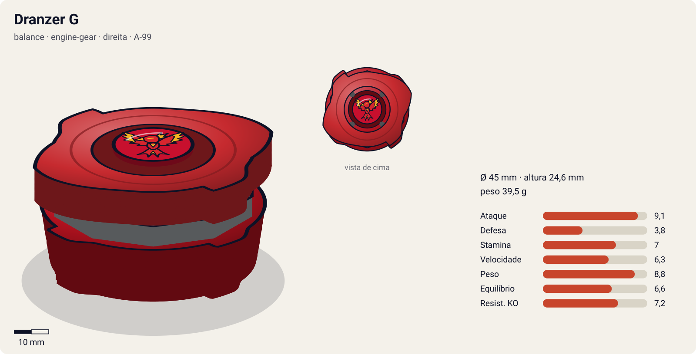
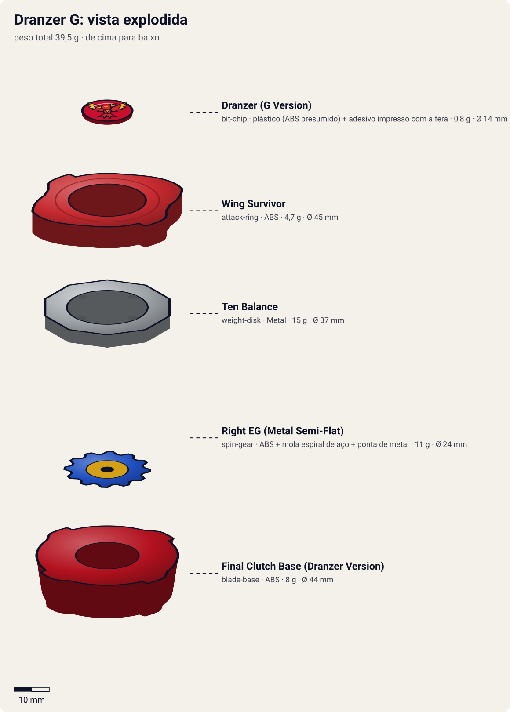

# Dranzer G (ドランザーG〈ギグス〉 / Doranzā Gigusu — "Dranzer Gigs")

<!-- auto:inicio (gerado por npm run build:research; não edite este bloco) -->

| Ficha | |
|---|---|
| Dono | [Kai Hiwatari (火渡カイ / Hiwatari Kai)](../../README.md) |
| Tipo · sistema · rotação | balance · engine-gear · direita |
| Código do produto | A-99 |
| Montada | Ø 45 mm · altura 24,6 mm · **39,5 g** (soma das peças) |
| Fera bit | [Dranzer](../../../../feras-bit/dranzer/) |
| Lançador | [Customize Grip (Gun Metallic / preto) - versão Kai](../../../../lancadores/customize-grip-kai/) |
| Ripcord | [winder-padrao](../../../../lancadores/ripcords/winder-padrao/) |

### Peças

| Camada | Peça | Material | Ø mm | Altura mm | Peso g | Estrelas Takara (A / D / S) | Desenho |
|---|---|---|---|---|---|---|---|
| Bit Chip | [Dranzer (G Version)](../../../../pecas/bit-chip/dranzer-g/) | plástico (ABS presumido) + adesivo impresso com a fera | 14 estimado | 8 estimado | 0,8 comunidade | — | [ver](pecas/bit-chip.svg) |
| Attack Ring | [Wing Survivor](../../../../pecas/attack-ring/wing-survivor/) | ABS | 45 estimado | 6 estimado | 4,7 wiki | 2 / 1 / 3 | [ver](pecas/attack-ring.svg) |
| Weight Disk | [Ten Balance](../../../../pecas/weight-disk/ten-balance/) | Metal | 37 estimado | 3,6 estimado | 15 wiki | 1 / 2 / 3 | [ver](pecas/weight-disk.svg) |
| Spin Gear / Core | [Right EG (Metal Semi-Flat)](../../../../pecas/spin-gear/right-eg-metal-semi-flat/) | ABS + mola espiral de aço + ponta de metal | 24 estimado | 18 estimado | 11 wiki | 3 / 0 / 2 | [ver](pecas/spin-gear.svg) |
| Blade Base | [Final Clutch Base (Dranzer Version)](../../../../pecas/blade-base/final-clutch-base-dranzer/) | ABS | 44 estimado | 15 estimado | 8 estimado | 2 / 0 / 1 | [ver](pecas/blade-base.svg) |

Fonte de cada medida em subscrito (wiki, comunidade, estimado). Detalhes em cada ficha de peça.

### Atributos

| Atributo | Brinquedo (calculado) | Ajuste anime | Jogo |
|---|---|---|---|
| Ataque | 6,1 | +3 | **9,1** |
| Defesa | 3,8 | — | **3,8** |
| Stamina | 7 | — | **7** |
| Velocidade | 5,3 | +1 | **6,3** |
| Peso | 8,8 | — | **8,8** |
| Equilíbrio | 6,6 | — | **6,6** |
| Resistência a KO | 6,2 | +1 | **7,2** |

Calculado por `src/beyblade/stats.js` a partir de: ponta metal-semi-flat (atrito 0,3), contato slope (recoil 0,8), peso do WD na equilibrado, Engine Gear (clutch). Modelo em [docs/BEYBLADES.md](../../../../../docs/BEYBLADES.md).

### Fera bit em cima da bey

 

Sons: [invocacao](../../../../feras-bit/dranzer/sons/invocacao.wav) · [rugido](../../../../feras-bit/dranzer/sons/rugido.wav) · [ataque](../../../../feras-bit/dranzer/sons/ataque.wav). Animações: [invocação](../../../../feras-bit/dranzer/invocacao.svg) · [ataque](../../../../feras-bit/dranzer/ataque.svg).
<!-- auto:fim -->

| Campo | Valor |
|---|---|
| Dono | Kai Hiwatari |
| Código do produto | A-99 (Takara, mar. 2003). Nome de desenvolvimento: "Dranzer X" |
| Tipo | Balance |
| Sistema | Engine Gear System (Type 3: Right EG + Hit Release / Final Clutch) |
| Rotação | Direita |
| Fera Bit (Bit-Beast) | Dranzer (fênix / Suzaku) |
| Série / temporada | G-Revolution (2003) |
| Primeira aparição (anime) | G-Rev ep. 11 "The Blame Game" |
| Antecessora → Sucessora | [Dranzer V2](../dranzer-v2/) → [Dranzer GT](../dranzer-gt/) |

## Formato e geometria
- Vista de cima: asas do [Wing Survivor](../../../../pecas/attack-ring/wing-survivor/) (simetria de 2, estimativa pela foto do toy; não confirmado na wiki).
- O peso do Engine Gear fica no centro e embaixo: centro de massa baixo, mas a bey é **alta** (o EG exige altura), o que atrapalha o contato do AR.
- Perfil alto. Vulnerável a upper attack.
- **Por que as peças funcionam assim**:
  - Wing Survivor: asas com contatos mal angulados e rampas para upper / force smash. Muito recoil e smash fraco; a melhor função é force smash.
  - [Ten Balance](../../../../pecas/weight-disk/ten-balance/): equilíbrio e stamina.
  - [Right EG (Metal Semi-Flat)](../../../../pecas/spin-gear/right-eg-metal-semi-flat/): engrenagem de corda (dá-se corda ao lançar) com ponta **metálica quase flat** (o "semi-flat" se refere ao diâmetro pequeno). Movimento agressivo, boa sobrevivência para uma ponta de ataque e, ao soltar, um **pico de velocidade**.
  - [Final Clutch Base (Dranzer Version)](../../../../pecas/blade-base/final-clutch-base-dranzer/) (Hit Release): alavancas que liberam o EG quando a bey bate na parede ou em outra bey. Os 4 quadrados laterais lembram o SP da V2.

## Comportamento na arena
- **Padrão de movimento**: órbita moderada com a ponta metálica. No primeiro impacto forte, o clutch libera o EG e vem uma **arrancada súbita** (ziguezague/dash).
- **Ataque**: depende da arrancada do EG. O AR desperdiça energia em recoil.
- **Defesa**: média (peso do EG + WD 15 g).
- **Stamina**: média (ponta metálica). O EG não ajuda a stamina.
- **Pontos fortes**: o burst de velocidade pode surpreender. **Fracos**: o burst é incontrolável e pode causar self-KO. Bey alta com AR de recoil.
- **Matchups**: vence balance/stamina que ficam parados (o burst acerta em cheio). Perde para defensores pesados (recoil) e para upper attackers baixos.
- **Gimmick**: Engine Gear + Hit Release (o impacto dispara o motor de corda).

## No anime
- **Ataques especiais**:
  - **Blazing Gigs** (暗殺爆炎 / Bureijingu Gigusu). Estreia no ep. 11 contra Raul (Torch Pegasus): a Dranzer G entra em erupção, as chamas formam uma fênix gigante e ela "dispara" a bey pela boca como projétil. Há chamas **laranja** (normal) e **azuis** (versão mais forte, conforme o nível de Kai).
  - **Blazing Gigs: Zan** (斬), no ep. 16 contra Rick (Rock Bison): versão cortante que fatia a Drop Rock ao meio e o expulsa do estádio. No dub EN aparece só como "Blazing Gigs".
  - **Blazing Gigs Tempest** (ブレイジングギグス・テンペスト). Estreia no ep. 23 contra Ray (Driger G), contra a Gatling Claw Maximum: Kai desenha uma chama com dois dedos, ganha asas de fogo e elas explodem numa chuva de penas flamejantes que cercam e imobilizam o inimigo. Depois a Dranzer surge das penas para uma investida ou mergulho final.
  - **Blazing Gig Punishment**: listado na página de Kai. Descrição não confirmada.
- **Batalhas**: ep. 11, vence Raul. Ep. 13, perde de propósito para Daichi. Ep. 16, vence Max (Draciel G) e Rick. Ep. 18, vence Miguel. Ep. 23, vence Ray.
- **Substituição**: Kai treina na Sibéria e volta com a Dranzer GT (ep. 29).

## Mecânica no jogo
- **Movimento (IA)**: órbita moderada na borda, com aproximações em arco. Depois que o Engine Gear solta, passa a ziguezague curto em direção ao alvo.
- **Gimmick (Engine Gear, Final Clutch)**: o EG fica carregado até o **primeiro impacto** acima de um limiar (bey ou parede). Aí dispara o "Engine Burst": +60% de velocidade por 1,5 s na direção atual e +1,5 de ataque no próximo golpe. Se disparar a menos de 15% do raio da borda, 10% de chance de self-KO. O burst só acontece uma vez por round.
- **Especiais** (efeito visual: [fera Dranzer](../../../../feras-bit/dranzer/ataque.svg); a fênix de fogo da [invocação](../../../../feras-bit/dranzer/invocacao.svg) "dispara" a bey):
  - **Blazing Gigs** (custo 90, recarga 18 s): a bey é lançada como projétil em linha reta (velocidade máxima por 0,8 s, atravessa a distância até o alvo), golpe com 1,8× de dano e 1,8× de empurrão. Com rotação acima de 70%, sai a versão de **chama azul**: +25% de dano.
  - **Blazing Gigs Tempest** (custo 120, recarga 30 s): chuva de penas de fogo num círculo de 3 raios de bey em volta do alvo; o alvo fica com −60% de velocidade por 2 s (não consegue fugir nem usar especial de investida) e, no fim, a Dranzer mergulha com 2× de dano. Se o alvo estiver no meio de um especial de investida, o Tempest o cancela (como a Gatling Claw Maximum no ep. 23).

## Ajuste do anime

| Atributo | Delta | Justificativa (episódio/batalha) |
|---|---|---|
| Ataque | +3 | Fatia a Drop Rock de Rick ao meio com o Blazing Gigs: Zan (ep. 16), vence Raul (ep. 11), Max (ep. 16), Miguel (ep. 18) e Ray (ep. 23) |
| Velocidade | +1 | O Blazing Gigs dispara a bey como projétil (ep. 11) |
| Resistência a KO | +1 | Aguenta a Gatling Claw Maximum da Driger G e vence (ep. 23); não perde nenhuma luta "de verdade" com ela (a derrota para Daichi no ep. 13 é proposital) |

Resultado esperado: bey invicta na primeira metade da G-Rev, acima da Driger G de Ray e da Draciel G de Max. Nota para o coordenador: a Blade Base tem estrela de Defesa desconhecida ("2 / ? / 1") e peso estimado (8 g); o peso de jogo 8,8 depende dessa estimativa.

## Fontes
- https://beyblade.fandom.com/wiki/Dranzer_G
- https://beyblade.fandom.com/wiki/Attack_Ring_-_Wing_Survivor
- https://beyblade.fandom.com/wiki/Blazing_Gigs
- https://beyblade.fandom.com/wiki/Blazing_Gigs_Tempest
- https://beyblade.fandom.com/wiki/Kai_Hiwatari
