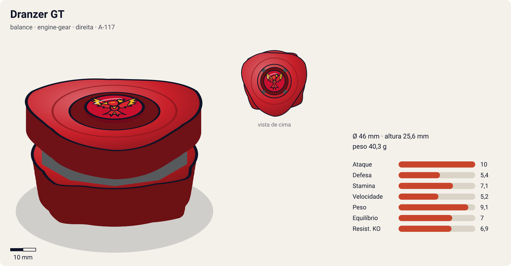
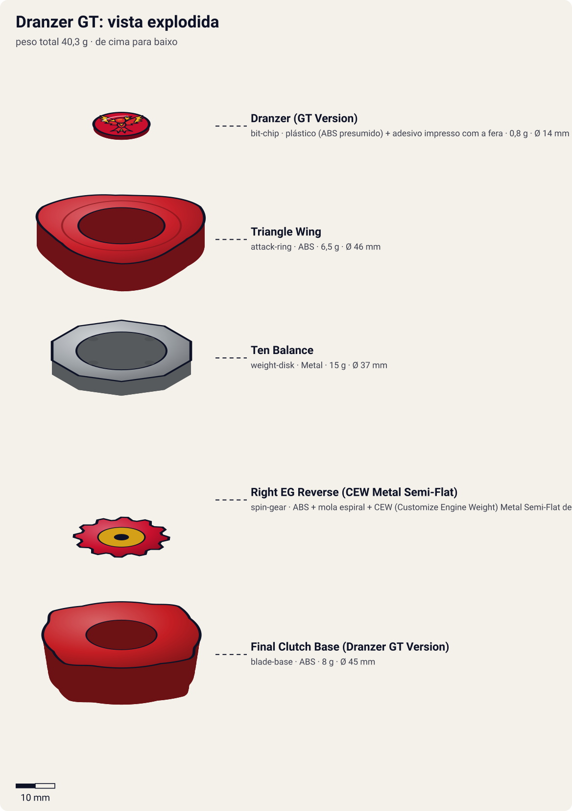

# Dranzer GT (ドランザーGT〈ギグス・ターボ〉 / Doranzā Gigusu Tābo — "Dranzer Gigs Turbo")

<!-- auto:inicio (gerado por npm run build:research; não edite este bloco) -->

| Ficha | |
|---|---|
| Dono | [Kai Hiwatari (火渡カイ / Hiwatari Kai)](../../README.md) |
| Tipo · sistema · rotação | balance · engine-gear · direita |
| Código do produto | A-117 |
| Montada | Ø 46 mm · altura 25,6 mm · **40,3 g** (soma das peças) |
| Fera bit | [Dranzer](../../../../feras-bit/dranzer/) |
| Lançador | [Customize Grip (Gun Metallic / preto) - versão Kai](../../../../lancadores/customize-grip-kai/) |
| Ripcord | [winder-padrao](../../../../lancadores/ripcords/winder-padrao/) |

### Peças

| Camada | Peça | Material | Ø mm | Altura mm | Peso g | Estrelas Takara (A / D / S) | Desenho |
|---|---|---|---|---|---|---|---|
| Bit Chip | [Dranzer (GT Version)](../../../../pecas/bit-chip/dranzer-gt/) | plástico (ABS presumido) + adesivo impresso com a fera | 14 estimado | 8 estimado | 0,8 comunidade | — | [ver](pecas/bit-chip.svg) |
| Attack Ring | [Triangle Wing](../../../../pecas/attack-ring/triangle-wing/) | ABS | 46 estimado | 7 estimado | 6,5 estimado | 4 / 1 / 2 | [ver](pecas/attack-ring.svg) |
| Weight Disk | [Ten Balance](../../../../pecas/weight-disk/ten-balance/) | Metal | 37 estimado | 3,6 estimado | 15 wiki | 1 / 2 / 3 | [ver](pecas/weight-disk.svg) |
| Spin Gear / Core | [Right EG Reverse (CEW Metal Semi-Flat)](../../../../pecas/spin-gear/right-eg-reverse/) | ABS + mola espiral + CEW (Customize Engine Weight) Metal Semi-Flat de metal | 24 estimado | 19 estimado | 10 estimado | 3 / 0 / 0 | [ver](pecas/spin-gear.svg) |
| Blade Base | [Final Clutch Base (Dranzer GT Version)](../../../../pecas/blade-base/final-clutch-base-dranzer-gt/) | ABS | 45 estimado | 15 estimado | 8 estimado | 2 / 2 / 2 | [ver](pecas/blade-base.svg) |

Fonte de cada medida em subscrito (wiki, comunidade, estimado). Detalhes em cada ficha de peça.

### Atributos

| Atributo | Brinquedo (calculado) | Ajuste anime | Jogo |
|---|---|---|---|
| Ataque | 8 | +2 | **10** |
| Defesa | 5,4 | — | **5,4** |
| Stamina | 6,1 | +1 | **7,1** |
| Velocidade | 5,2 | — | **5,2** |
| Peso | 9,1 | — | **9,1** |
| Equilíbrio | 7 | — | **7** |
| Resistência a KO | 6,9 | — | **6,9** |

Calculado por `src/beyblade/stats.js` a partir de: ponta metal-semi-flat (atrito 0,3), contato upper (recoil 0,4), peso do WD na equilibrado, Engine Gear (clutch). Modelo em [docs/BEYBLADES.md](../../../../../docs/BEYBLADES.md).

### Fera bit em cima da bey

 

Sons: [invocacao](../../../../feras-bit/dranzer/sons/invocacao.wav) · [rugido](../../../../feras-bit/dranzer/sons/rugido.wav) · [ataque](../../../../feras-bit/dranzer/sons/ataque.wav). Animações: [invocação](../../../../feras-bit/dranzer/invocacao.svg) · [ataque](../../../../feras-bit/dranzer/ataque.svg).
<!-- auto:fim -->

| Campo | Valor |
|---|---|
| Dono | Kai Hiwatari |
| Código do produto | A-117 (Takara). Nome de desenvolvimento: "Dranzer G2" (Gigusu Tsū) |
| Tipo | Balance |
| Sistema | Engine Gear System (Type 6: Hit Reverse) |
| Rotação | Direita (o Engine Gear interno gira para a **esquerda**: reverso) |
| Fera Bit (Bit-Beast) | Dranzer (fênix / Suzaku) |
| Série / temporada | G-Revolution (2003) |
| Primeira aparição (anime) | G-Rev ep. 29 "And Then There Were Two" |
| Antecessora → Sucessora | [Dranzer G](../dranzer-g/) → [Dranzer MS](../dranzer-ms/) |

## Formato e geometria
- Vista de cima: [Triangle Wing](../../../../pecas/attack-ring/triangle-wing/) simétrico (pelo nome e pela comparação com a Master Dragoon, provavelmente com 3 contatos; não confirmado).
- Peso central e baixo (EG), com perfil alto (exigência do EG).
- Por ser simétrico, o AR funciona nas duas rotações, mas a bey é de rotação direita.
- **Por que as peças funcionam assim**:
  - Triangle Wing: parecido com o da Master Dragoon, porém **mais simétrico**; lembra a Batranzer, mas com rampas. Foi projetado originalmente para uma Trygle. Upper menos eficiente em rotação direita, mas utilizável nas duas rotações.
  - [Ten Balance](../../../../pecas/weight-disk/ten-balance/): equilíbrio.
  - [Right EG Reverse (CEW Metal Semi-Flat)](../../../../pecas/spin-gear/right-eg-reverse/): ao soltar, a engrenagem gira no **sentido oposto** ao da bey. Muda o movimento para ziguezague (contra-ataque surpresa), mas custa rotação. A ponta metálica semi-flat (CEW) é destacável.
  - [Final Clutch Base (Dranzer GT Version)](../../../../pecas/blade-base/final-clutch-base-dranzer-gt/) (Hit Release): clutch que libera o EG **no meio da batalha** (mais tarde que o Instant Release, mais cedo que o Final Clutch), controlando o momento do reverso e reduzindo a perda de rotação.

## Comportamento na arena
- **Padrão de movimento**: órbita no início. Quando o clutch libera o EG reverso, entra em **ziguezague** errático.
- **Ataque**: contra-ataque surpresa na mudança de padrão. O AR dá upper moderado.
- **Defesa**: média (peso).
- **Stamina**: **fraca**. O EG reverso drena rotação ("ainda pior que a maioria dos Engine Gears", segundo a wiki).
- **Pontos fortes**: imprevisibilidade e AR versátil. **Fracos**: perde rotação, é alta e o reverso é "medíocre" no toy.
- **Matchups**: vence attackers que esperam um padrão fixo. Perde para stamina types (outspin).
- **Gimmick**: Reverse Engine Gear (engrenagem contrarrotativa disparada no meio da luta).

## No anime
- **Ataques especiais**:
  - **Blazing Gigs Tempest**: chuva de penas flamejantes que prende o oponente, mais investida (também usada pela Dranzer G). Usada contra Tyson (Dragoon GT), que responde com a Galaxy Turbo Twister.
  - **Reverse Flame Gigs** (também chamado "Blazing Gig Reverse Attack" / "Turbo Reverse Attack"), no ep. 30 contra Tyson: as engrenagens giram ao contrário (Kenny diz que é "fisicamente impossível"), chamas cercam o inimigo e a Dranzer aparece para o golpe. O calor de atrito "derreteria uma bey como queijo". Treinado numa rocha na Sibéria.
  - **Flame Gigs Turbo** / Blazing Gigs Turbo: listado na wiki. Descrição não confirmada.
- **Batalhas**: ep. 29, vence Bryan e Spencer em dupla. Eps. 29–30, final mundial contra Tyson (Dragoon GT): empate e depois derrota por margem mínima. Ep. 38, empata com Garland. Eps. 41–42, Brooklyn (Zeus) vence e **despedaça** a Dranzer GT.
- **Substituição**: destruída por Brooklyn. Os companheiros deixam a Dranzer MS ao lado da cama de Tala para Kai.

## Mecânica no jogo
- **Movimento (IA)**: órbita na borda até o EG soltar. Depois, "Reverse Mode": ziguezague errático (troca de direção a cada 0,6–1 s), sempre puxando para o lado do alvo.
- **Gimmick (Engine Gear reverso, Hit Release)**: o EG solta no **meio da luta**, quando a rotação cai abaixo de 60% ou no primeiro impacto forte depois de 40% do tempo esperado de round (o que vier primeiro). Ao soltar: +40% de dano no próximo golpe, +1 de velocidade e perda de rotação 1,3× mais rápida até o fim do round.
- **Especiais** (efeito visual: [fera Dranzer](../../../../feras-bit/dranzer/ataque.svg), mergulho em chamas):
  - **Reverse Flame Gigs** (custo 110, recarga 26 s): a bey inverte o sentido do deslocamento, fecha um anel de fogo em volta do alvo (raio de 2 beys, dano contínuo leve por 2 s; o alvo que tocar o anel perde 5% de rotação) e termina com um golpe de 2× de dano. Só pode ser usado depois de o EG soltar.
  - **Blazing Gigs Tempest** (custo 120, recarga 30 s): como na [Dranzer G](../dranzer-g/): penas de fogo deixam o alvo com −60% de velocidade por 2 s e a Dranzer mergulha com 2× de dano.

## Ajuste do anime

| Atributo | Delta | Justificativa (episódio/batalha) |
|---|---|---|
| Ataque | +2 | Vence Bryan e Spencer juntos (ep. 29); o Reverse Flame Gigs leva a final mundial contra Tyson a uma decisão apertada (ep. 30) |
| Stamina | +1 | Empata com Tyson e com Garland (eps. 29 e 38): aguenta até o fim contra beys de topo, apesar do EG reverso que drena rotação no brinquedo |

Defesa fica sem ajuste porque a Zeus de Brooklyn a despedaça (eps. 41–42). Resultado esperado: logo abaixo da Dragoon GT de Tyson (perde por margem mínima) e claramente abaixo da Zeus.

## Fontes
- https://beyblade.fandom.com/wiki/Dranzer_GT
- https://beyblade.fandom.com/wiki/Attack_Ring_-_Triangle_Wing
- https://beyblade.fandom.com/wiki/Engine_Gear_-_Right_EG_Reverse
- https://beyblade.fandom.com/wiki/Blade_Base_-_Hit_Release_(Dranzer_GT_Version)
- https://beyblade.fandom.com/wiki/Reverse_Flame_Gigs
- https://beyblade.fandom.com/wiki/Flame_Gigs_Turbo
- https://beyblade.fandom.com/wiki/Blazing_Gigs_Tempest
