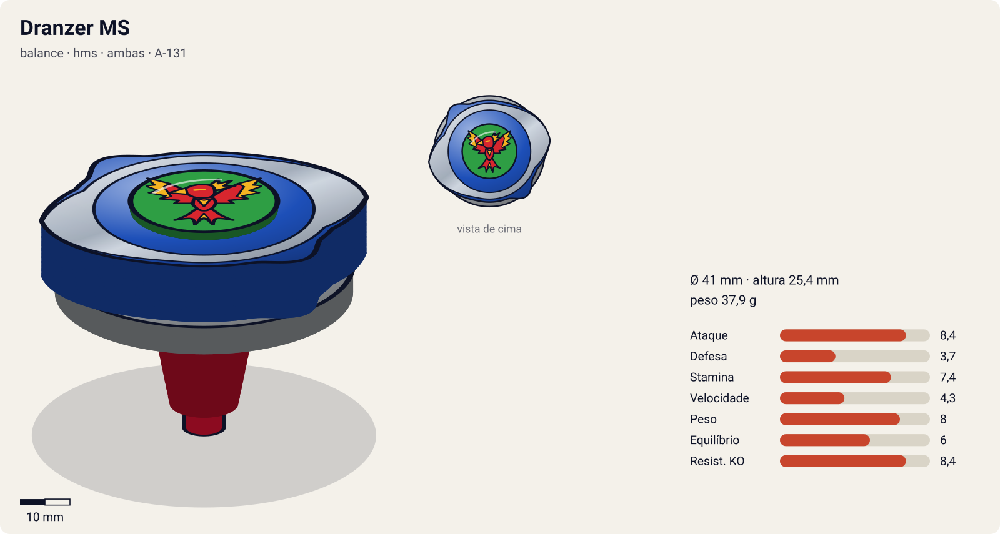
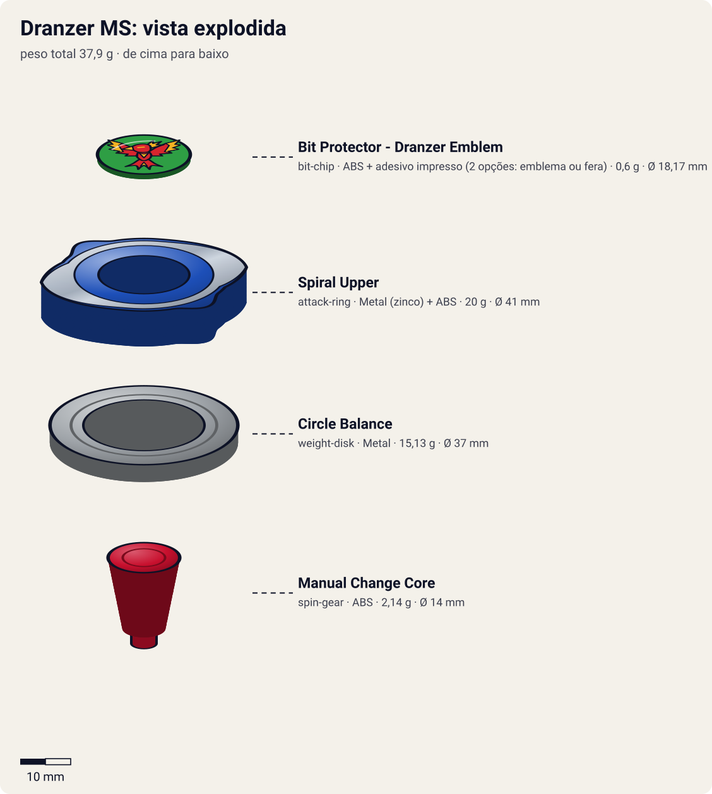

# Dranzer MS (ドランザーMS〈メタルスパイラル〉 / Doranzā Metaru Supairaru — "Dranzer Metal Spiral")

<!-- auto:inicio (gerado por npm run build:research; não edite este bloco) -->

| Ficha | |
|---|---|
| Dono | [Kai Hiwatari (火渡カイ / Hiwatari Kai)](../../README.md) |
| Tipo · sistema · rotação | balance · hms · ambas |
| Código do produto | A-131 |
| Montada | Ø 41 mm · altura 25,4 mm · **37,9 g** (soma das peças) |
| Fera bit | [Dranzer](../../../../feras-bit/dranzer/) |
| Lançador | [Dual Shooter (HMS)](../../../../lancadores/dual-shooter/) |
| Ripcord | [g-winder](../../../../lancadores/ripcords/g-winder/) |

### Peças

| Camada | Peça | Material | Ø mm | Altura mm | Peso g | Estrelas Takara (A / D / S) | Desenho |
|---|---|---|---|---|---|---|---|
| Bit Chip | [Bit Protector - Dranzer Emblem](../../../../pecas/bit-chip/dranzer-emblem/) | ABS + adesivo impresso (2 opções: emblema ou fera) | 18,2 comunidade | 6,7 comunidade | 0,6 comunidade | — | [ver](pecas/bit-chip.svg) |
| Attack Ring | [Spiral Upper](../../../../pecas/attack-ring/spiral-upper/) | Metal (zinco) + ABS | 41 estimado | 8 estimado | 20 wiki | 2 / 2 / 2,5 | [ver](pecas/attack-ring.svg) |
| Weight Disk | [Circle Balance](../../../../pecas/weight-disk/circle-balance/) | Metal | 37 estimado | 3,4 estimado | 15,1 wiki | 1,5 / 1,5 / 2 | [ver](pecas/weight-disk.svg) |
| Spin Gear / Core | [Manual Change Core](../../../../pecas/spin-gear/manual-change-core/) | ABS | 14 estimado | 14 estimado | 2,1 comunidade | 3 / 1 / 3 | [ver](pecas/spin-gear.svg) |

Fonte de cada medida em subscrito (wiki, comunidade, estimado). Detalhes em cada ficha de peça.

### Atributos

| Atributo | Brinquedo (calculado) | Ajuste anime | Jogo |
|---|---|---|---|
| Ataque | 5,4 | +3 | **8,4** |
| Defesa | 4,7 | -1 | **3,7** |
| Stamina | 6,4 | +1 | **7,4** |
| Velocidade | 4,3 | — | **4,3** |
| Peso | 8 | — | **8** |
| Equilíbrio | 6 | — | **6** |
| Resistência a KO | 6,4 | +2 | **8,4** |

Calculado por `src/beyblade/stats.js` a partir de: contato upper (recoil 0,4), peso do WD na equilibrado. Modelo em [docs/BEYBLADES.md](../../../../../docs/BEYBLADES.md).

### Fera bit em cima da bey

 

Sons: [invocacao](../../../../feras-bit/dranzer/sons/invocacao.wav) · [rugido](../../../../feras-bit/dranzer/sons/rugido.wav) · [ataque](../../../../feras-bit/dranzer/sons/ataque.wav). Animações: [invocação](../../../../feras-bit/dranzer/invocacao.svg) · [ataque](../../../../feras-bit/dranzer/ataque.svg).
<!-- auto:fim -->

| Campo | Valor |
|---|---|
| Dono | Kai Hiwatari |
| Código do produto | A-131 (Takara). É a última bey com código "A" |
| Tipo | Balance |
| Sistema | HMS (Hard/Heavy Metal System) |
| Rotação | Ambas (Dual-Spin). No anime: **não confirmado** (provavelmente direita) |
| Fera Bit (Bit-Beast) | Dranzer (fênix / Suzaku) |
| Série / temporada | G-Revolution (2003) |
| Primeira aparição (anime) | G-Rev ep. 42 "When You Wish Upon a Star" |
| Antecessora → Sucessora | [Dranzer GT](../dranzer-gt/) → (Dranzer MF, só no mangá) |

## Formato e geometria
- Vista de cima: o [Spiral Upper](../../../../pecas/attack-ring/spiral-upper/) tem 2 rampas (simetria de 2), em formato espiral.
- **AR metálico pesado (20 g) na periferia**: muita inércia rotacional e golpes pesados. Como na maior parte da HMS, a bey é baixa e compacta.
- A altura do [Manual Change Core](../../../../pecas/blade-base/manual-change-core/) prejudica a eficácia do upper do Spiral Upper (segundo a wiki).
- **Por que as peças funcionam assim**:
  - Spiral Upper: duas partes, uma **moldura metálica "Left Upper"** e uma capa ABS "Spiral Upper", com duas rampas leves. Dá upper moderado em rotação **esquerda** e smash confiável em rotação **direita**.
  - [Circle Balance](../../../../pecas/weight-disk/circle-balance/): disco circular metálico, entre o Circle Heavy e o Circle Wide. Versátil, mediano em tudo.
  - Manual Change Core (Running Core): chave manual entre modo **Attack** (muito agressivo, risco de self-KO) e modo **Endurance** (fica no centro). A versão Takara tem problemas de equilíbrio em baixa rotação; a Hasbro usa ponta semi-flat (mais estável, menos stamina).
  - [Bit Protector Dranzer Emblem](../../../../pecas/bit-chip/dranzer-emblem/): ABS azul, com 2 opções de adesivo (emblema em fundo verde ou a fênix).

## Comportamento na arena
- **Padrão de movimento**: modo Attack = agressivo e rápido (pode se jogar para fora do estádio). Modo Endurance = no centro.
- **Ataque**: smash metálico sólido em rotação direita. Upper moderado em rotação esquerda.
- **Defesa**: boa para o tamanho (metal pesado), mas as estrelas indicam nível mediano.
- **Stamina**: média (★★½ no AR; RC ★★★ em endurance). A versão Takara oscila em baixa rotação.
- **Pontos fortes**: dual-spin + troca de modo entre rounds, sem precisar desmontar. Golpes pesados. **Fracos**: o RC alto atrapalha o upper, a instabilidade da Takara e o modo Attack descontrolado.
- **Matchups**: vence beys plásticas leves e attackers de rotação contrária (AR metálico). Perde para defensores HMS pesados e para stamina com bearing.
- **Gimmick**: Manual Change Core (troca Attack/Endurance entre rounds), herança do conceito da Dranzer S.

## No anime
- **Ataques especiais**:
  - **Spiral Fireball** (único golpe da MS), no ep. 48 "The Beyblading Spirit": a Dranzer se envolve em chamas, sobe acima da arena, fica cercada por uma luz intensa e mergulha contra a bey adversária.
- **Batalhas**: Kai demora a dominar a MS (o bloqueio era ele mesmo). Ep. 46, vence Romero. Eps. 47–48, vence **Brooklyn (Zeus)** no Justice 5 com a Spiral Fireball, levantando-se a cada queda. Depois da luta, cai de joelhos no corredor e a Dranzer MS **se despedaça** (no JP, Tala chora no hospital). Ep. 52: Kai reaparece vivo e luta contra Tyson com a Dranzer "reconstruída" (que bey é essa não foi confirmado).

## Mecânica no jogo
Versão final do Kai.
- **Movimento (IA)**: modo escolhido por round.
  - **Attack**: agressivo, cruza o estádio em linhas retas contra o alvo; 8% de chance de self-KO quando passa a menos de 10% do raio da borda em velocidade máxima.
  - **Endurance**: centro, velocidade baixa; wobble (oscilação de direção) quando a rotação cai abaixo de 25%, refletindo a instabilidade da Takara.
- **Gimmick**:
  - Manual Change Core: troca de modo entre rounds, sem custo.
  - **Dual-spin**: o jogador escolhe o sentido no lançamento. Direita = smash (padrão, +10% de empurrão); esquerda = upper moderado (+20% de dano contra beys de rotação direita e chance de levantar o alvo).
- **Especiais** (efeito visual: [fera Dranzer](../../../../feras-bit/dranzer/ataque.svg), subida e mergulho em chamas, com o clarão da [invocação](../../../../feras-bit/dranzer/invocacao.svg)):
  - **Spiral Fireball** (custo 120, recarga 28 s): salto vertical (intangível por 0,8 s de carga), depois mergulho sobre o alvo com 2,5× de dano e knockback vertical (o alvo perde estabilidade por 1 s). Bônus "Spirit": +30% de dano se a rotação da Dranzer estiver abaixo de 20%.
  - **Traço do Kai "Phoenix"** (do perfil de IA do personagem): uma vez por luta, ao cair abaixo de 10% de rotação, recupera estabilidade e fica com a recarga do Spiral Fireball zerada.

## Ajuste do anime

| Atributo | Delta | Justificativa (episódio/batalha) |
|---|---|---|
| Ataque | +3 | A Spiral Fireball vence a Zeus de Brooklyn, a bey mais forte da G-Rev (eps. 47–48) |
| Stamina | +1 | Continua girando depois de cair várias vezes contra Brooklyn (eps. 47–48) |
| Resistência a KO | +2 | Resiste aos ataques da Zeus até o fim enquanto Kai se levanta a cada queda (eps. 47–48); também vence Romero (ep. 46) |
| Defesa | −1 | Se despedaça logo depois da luta contra Brooklyn (ep. 48): a bey vence, mas não aguenta o dano |

Resultado esperado: versão de chefe, capaz de vencer a Zeus num duelo longo, mas frágil depois de levar muito dano. Suspeitas para o coordenador: o bloco gerado lista o **Manual Change Core duas vezes** (como Spin Gear/Core, 2,1 g, e como Blade Base/Running Core, 3 g), o que parece somar a mesma peça em dobro. Isso pode explicar a **altura de 40,4 mm** (alta demais para uma HMS; a Driger MS dá 25,4 mm), o peso de 40,9 g e o equilíbrio baixo (5,1). O WD Circle Balance também está sem estrelas Takara. Não usei o ajuste para compensar.

## Fontes
- https://beyblade.fandom.com/wiki/Dranzer_MS
- https://beyblade.fandom.com/wiki/Attack_Ring_-_Spiral_Upper
- https://beyblade.fandom.com/wiki/Weight_Disk_-_Circle_Balance
- https://beyblade.fandom.com/wiki/Running_Core_-_Manual_Change_Core
- https://beyblade.fandom.com/wiki/Spiral_Fireball
- https://beyblade.fandom.com/wiki/Dranzer_MF
- https://beyblade.fandom.com/wiki/Kai_Hiwatari
