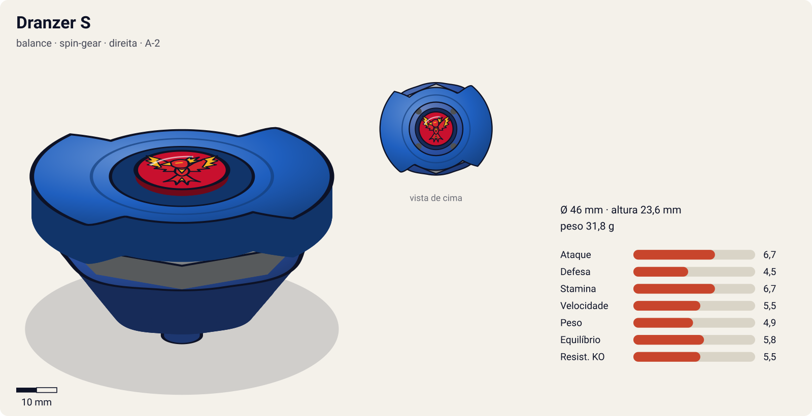
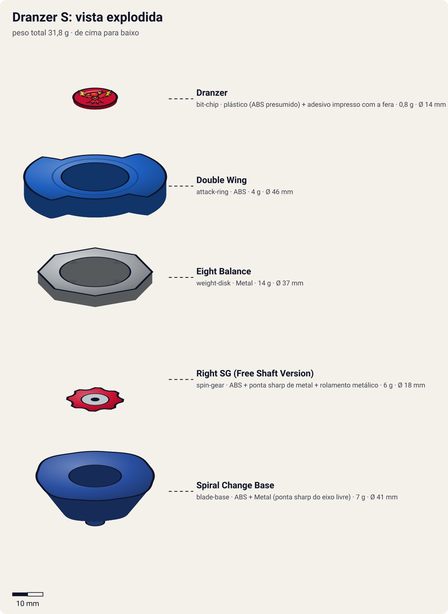

# Dranzer S (ドランザーS / Doranzā Supairaru — "Dranzer Spiral")

<!-- auto:inicio (gerado por npm run build:research; não edite este bloco) -->

| Ficha | |
|---|---|
| Dono | [Kai Hiwatari (火渡カイ / Hiwatari Kai)](../../README.md) |
| Tipo · sistema · rotação | balance · spin-gear · direita |
| Código do produto | A-2 |
| Montada | Ø 46 mm · altura 23,6 mm · **31,8 g** (soma das peças) |
| Fera bit | [Dranzer](../../../../feras-bit/dranzer/) |
| Lançador | [Spring Shooter](../../../../lancadores/spring-shooter/) |
| Ripcord | [winder-padrao](../../../../lancadores/ripcords/winder-padrao/) |

### Peças

| Camada | Peça | Material | Ø mm | Altura mm | Peso g | Estrelas Takara (A / D / S) | Desenho |
|---|---|---|---|---|---|---|---|
| Bit Chip | [Dranzer](../../../../pecas/bit-chip/dranzer-s/) | plástico (ABS presumido) + adesivo impresso com a fera | 14 estimado | 8 estimado | 0,8 comunidade | — | [ver](pecas/bit-chip.svg) |
| Attack Ring | [Double Wing](../../../../pecas/attack-ring/double-wing/) | ABS | 46 estimado | 6 estimado | 4 wiki | 2 / 2 / 2 | [ver](pecas/attack-ring.svg) |
| Weight Disk | [Eight Balance](../../../../pecas/weight-disk/eight-balance/) | Metal | 37 estimado | 3,6 estimado | 14 wiki | 0,5 / 2 / 2,5 | [ver](pecas/weight-disk.svg) |
| Spin Gear / Core | [Right SG (Free Shaft Version)](../../../../pecas/spin-gear/right-sg-free-shaft-version/) | ABS + ponta sharp de metal + rolamento metálico | 18 estimado | 13 estimado | 6 wiki | — | [ver](pecas/spin-gear.svg) |
| Blade Base | [Spiral Change Base](../../../../pecas/blade-base/spiral-change-base/) | ABS + Metal (ponta sharp do eixo livre) | 41 estimado | 14 estimado | 7 wiki | 3 / 2 / 3,5 | [ver](pecas/blade-base.svg) |

Fonte de cada medida em subscrito (wiki, comunidade, estimado). Detalhes em cada ficha de peça.

### Atributos

| Atributo | Brinquedo (calculado) | Ajuste anime | Jogo |
|---|---|---|---|
| Ataque | 4,7 | +2 | **6,7** |
| Defesa | 4,5 | — | **4,5** |
| Stamina | 6,7 | — | **6,7** |
| Velocidade | 5,5 | — | **5,5** |
| Peso | 4,9 | — | **4,9** |
| Equilíbrio | 5,8 | — | **5,8** |
| Resistência a KO | 4,5 | +1 | **5,5** |

Calculado por `src/beyblade/stats.js` a partir de: ponta flat (atrito 0,3), contato smash (recoil 0,7), peso do WD na equilibrado. Modelo em [docs/BEYBLADES.md](../../../../../docs/BEYBLADES.md).

### Fera bit em cima da bey

 

Sons: [invocacao](../../../../feras-bit/dranzer/sons/invocacao.wav) · [rugido](../../../../feras-bit/dranzer/sons/rugido.wav) · [ataque](../../../../feras-bit/dranzer/sons/ataque.wav). Animações: [invocação](../../../../feras-bit/dranzer/invocacao.svg) · [ataque](../../../../feras-bit/dranzer/ataque.svg).
<!-- auto:fim -->

| Campo | Valor |
|---|---|
| Dono | Kai Hiwatari |
| Código do produto | A-2 (Takara, dez. 2000) |
| Tipo | Balance |
| Sistema | Spin Gear System |
| Rotação | Direita |
| Fera Bit (Bit-Beast) | Dranzer (fênix / Suzaku, Pássaro Vermelhão do Sul) |
| Série / temporada | Bakuten Shoot (2001), temporada 1 |
| Primeira aparição (anime) | Ep. 1 "The Blade Raider" (primeira batalha no ep. 2 "Day of the Dragoon") |
| Antecessora → Sucessora | (nenhuma no anime) → [Dranzer F](../dranzer-f/) |

## Formato e geometria
- Vista de cima: o [Double Wing](../../../../pecas/attack-ring/double-wing/) tem 2 asas opostas (simetria de 2 lados). Silhueta compacta e raio pequeno-médio (beys de 2000).
- Peso concentrado no WD octogonal [Eight Balance](../../../../pecas/weight-disk/eight-balance/) (massa intermediária entre Wide e Heavy), sem metal no AR. Inércia moderada. A infobox da wiki dá 31 g para a bey montada, o que bate com a soma das peças do bloco acima.
- Perfil médio-alto por causa do [Right SG (Free Shaft Version)](../../../../pecas/spin-gear/right-sg-free-shaft-version/), cujo casing traz uma ponta metal sharp sobre rolamento metálico (eixo livre). Vulnerável a upper attack de beys baixas.
- **Por que as peças funcionam assim**:
  - Double Wing: smash com as duas asas, mas com muito recoil. A wiki diz que ele foi "projetado para smash em rotação esquerda", embora a bey gire para a direita (inconsistência registrada na primeira pesquisa; provável causa do recoil alto, não confirmada).
  - [Spiral Change Base](../../../../pecas/blade-base/spiral-change-base/): pressionando e girando o fundo, alterna entre **metal sharp** (centro, stamina, defesa fraca) e **plastic flat** (movimento, ataque, ótimo "life after death").

## Comportamento na arena
- **Padrão de movimento**: em modo flat, órbita/flower pattern ágil. Em modo sharp, fica parada no centro.
- **Ataque**: smash com as duas asas. Causa algum dano, mas o recoil a desestabiliza.
- **Defesa**: baixa a média (leve, cerca de 31 g). A ponta sharp tem defesa ruim.
- **Stamina**: boa para a época graças ao eixo livre e à ponta flat com "life after death".
- **Pontos fortes**: versátil (dois modos), boa sobrevivência no fim da luta. **Fracos**: leve, AR com recoil, alta.
- **Matchups**: vence attackers leves da S1 por resistência. Perde para defensores pesados e para upper attack.
- **Gimmick**: Spiral Change Base (troca manual sharp/flat antes da luta).

## No anime
- **Ataques especiais**:
  - **Spin Fire** (estreia no ep. 5 "Unexpected Help"): Dranzer sobe alto no ar, forma fogo na ponta e ataca o oponente de cima, arremessando-o para fora do estádio.
  - **Fire Arrow** (estreia no ep. 7): Dranzer se cobre de fogo e se choca contra o oponente com uma explosão.
  - **Spiral Survivor**: listado na infobox, mas a descrição não foi confirmada.
- **Batalhas**: ep. 2, vitória e depois empate contra Tyson. Ep. 4, vence Kenny (Dizzi) e quebra a mola dele. Ep. 5, vence Max por 2–1. Ep. 7, perde a final regional para Tyson (1–2). Ep. 14, vence Zippy. Ep. 23, vence Miguel (Renegades). Ep. 25, vence Mario.
- **Substituição**: dá lugar à Dranzer F na fase europeia (estreia da F no ep. 33).

## Mecânica no jogo
- **Movimento (IA)**: modo escolhido antes da luta, como na base real.
  - **Flat** (padrão do Kai): órbita/flower de velocidade média, com raio de órbita a ~60% do estádio, aproximações em arco e afastamento depois de cada golpe (o recoil do Double Wing joga a bey para trás).
  - **Sharp**: fica no centro com deriva leve; atrito da ponta cai para ~0,15 (mais stamina, menos velocidade e defesa).
- **Gimmick**: Spiral Change é seleção de modo **entre rounds**, não durante a luta. Eixo livre: a bey perde 15% menos rotação nos choques enquanto estiver acima de 50% de rotação.
- **Especiais** (efeito visual: [fera Dranzer](../../../../feras-bit/dranzer/ataque.svg), subida e mergulho em chamas):
  - **Spin Fire** (custo 100, recarga 22 s): a bey "salta" (ignora colisões por 0,6 s), reaparece sobre o alvo mais próximo e aplica um golpe com 2× de empurrão em direção à borda. Se o alvo estiver a menos de 20% do raio da borda, ring out quase certo.
  - **Fire Arrow** (custo 70, recarga 15 s): investida em linha reta (+50% de velocidade por 1 s) envolta em fogo; ao bater, explosão em área pequena (raio de 1,5 bey) com dano médio e 1,3× de empurrão.

## Ajuste do anime

| Atributo | Delta | Justificativa (episódio/batalha) |
|---|---|---|
| Ataque | +2 | O brinquedo é fraco no ataque (Double Wing com recoil), mas no anime a Dranzer S vence Kenny quebrando a mola dele (ep. 4), vence Max (ep. 5) e tira ring outs com Spin Fire |
| Resistência a KO | +1 | Só perde para Tyson na final regional (ep. 7, 1–2); contra o resto da S1 inicial não é expulsa |

Resultado esperado: a Dranzer S passa a ser a bey mais forte do início da S1, pouco acima de Max e Kenny, mas ainda perde de forma apertada para a Dragoon S de Tyson.

## Fontes
- https://beyblade.fandom.com/wiki/Dranzer_S
- https://beyblade.fandom.com/wiki/Attack_Ring_-_Double_Wing
- https://beyblade.fandom.com/wiki/Weight_Disk_-_Eight_Balance
- https://beyblade.fandom.com/wiki/Spin_Gear_-_Right_SG_(Free_Shaft_Version)
- https://beyblade.fandom.com/wiki/Blade_Base_-_Spiral_Change_Base
- https://beyblade.fandom.com/wiki/Spin_Fire
- https://beyblade.fandom.com/wiki/Fire_Arrow
- https://beyblade.fandom.com/wiki/Kai_Hiwatari (lista de batalhas)
