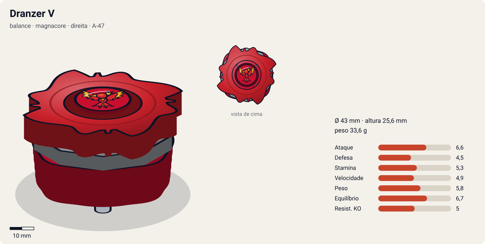
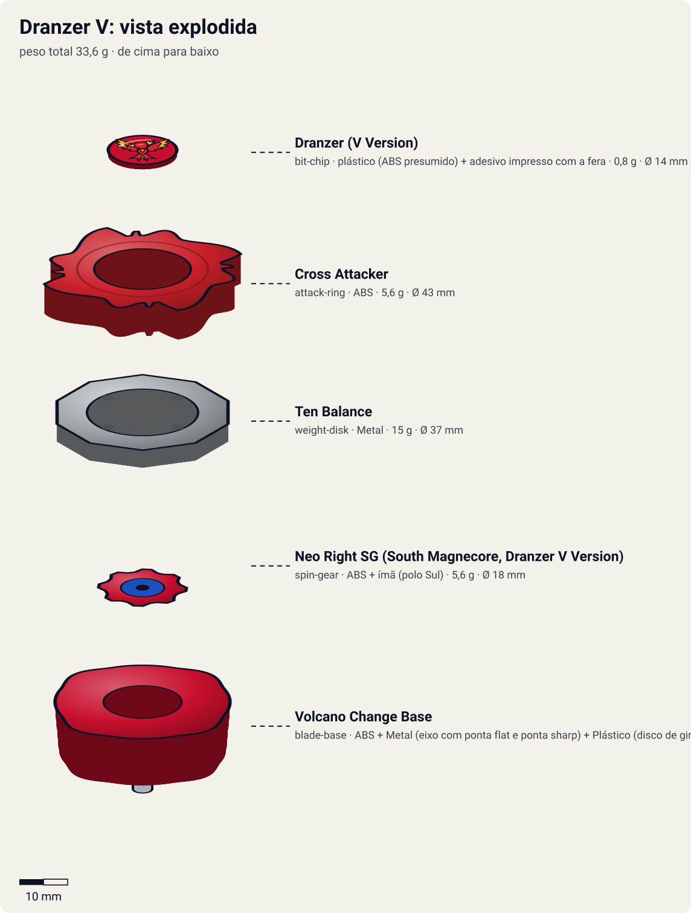

# Dranzer V (ドランザーV / Doranzā Borukēno — "Dranzer Volcano")

<!-- auto:inicio (gerado por npm run build:research; não edite este bloco) -->

| Ficha | |
|---|---|
| Dono | [Kai Hiwatari (火渡カイ / Hiwatari Kai)](../../README.md) |
| Tipo · sistema · rotação | balance · magnacore · direita |
| Código do produto | A-47 |
| Montada | Ø 43 mm · altura 25,6 mm · **33,6 g** (soma das peças) |
| Fera bit | [Dranzer](../../../../feras-bit/dranzer/) |
| Lançador | [Customize Grip (Gun Metallic / preto) - versão Kai](../../../../lancadores/customize-grip-kai/) |
| Ripcord | [winder-padrao](../../../../lancadores/ripcords/winder-padrao/) |

### Peças

| Camada | Peça | Material | Ø mm | Altura mm | Peso g | Estrelas Takara (A / D / S) | Desenho |
|---|---|---|---|---|---|---|---|
| Bit Chip | [Dranzer (V Version)](../../../../pecas/bit-chip/dranzer-v/) | plástico (ABS presumido) + adesivo impresso com a fera | 14 estimado | 8 estimado | 0,8 comunidade | — | [ver](pecas/bit-chip.svg) |
| Attack Ring | [Cross Attacker](../../../../pecas/attack-ring/cross-attacker/) | ABS | 43 estimado | 6 estimado | 5,6 wiki | 2,5 / 1 / 1,5 | [ver](pecas/attack-ring.svg) |
| Weight Disk | [Ten Balance](../../../../pecas/weight-disk/ten-balance/) | Metal | 37 estimado | 3,6 estimado | 15 wiki | 1 / 2 / 3 | [ver](pecas/weight-disk.svg) |
| Spin Gear / Core | [Neo Right SG (South Magnecore, Dranzer V Version)](../../../../pecas/spin-gear/neo-right-sg-south-magnecore-dranzer-v/) | ABS + ímã (polo Sul) | 18 estimado | 9 estimado | 5,6 wiki | — | [ver](pecas/spin-gear.svg) |
| Blade Base | [Volcano Change Base](../../../../pecas/blade-base/volcano-change-base/) | ABS + Metal (eixo com ponta flat e ponta sharp) + Plástico (disco de giro livre) | 40 estimado | 16 estimado | 6,6 wiki | 2 / 2 / 2 | [ver](pecas/blade-base.svg) |

Fonte de cada medida em subscrito (wiki, comunidade, estimado). Detalhes em cada ficha de peça.

### Atributos

| Atributo | Brinquedo (calculado) | Ajuste anime | Jogo |
|---|---|---|---|
| Ataque | 4,6 | +2 | **6,6** |
| Defesa | 4,5 | — | **4,5** |
| Stamina | 5,3 | — | **5,3** |
| Velocidade | 4,9 | — | **4,9** |
| Peso | 5,8 | — | **5,8** |
| Equilíbrio | 6,7 | — | **6,7** |
| Resistência a KO | 5 | — | **5** |

Calculado por `src/beyblade/stats.js` a partir de: ponta metal-flat (atrito 0,2), contato upper (recoil 0,5), peso do WD na equilibrado. Modelo em [docs/BEYBLADES.md](../../../../../docs/BEYBLADES.md).

### Fera bit em cima da bey

 

Sons: [invocacao](../../../../feras-bit/dranzer/sons/invocacao.wav) · [rugido](../../../../feras-bit/dranzer/sons/rugido.wav) · [ataque](../../../../feras-bit/dranzer/sons/ataque.wav). Animações: [invocação](../../../../feras-bit/dranzer/invocacao.svg) · [ataque](../../../../feras-bit/dranzer/ataque.svg).
<!-- auto:fim -->

| Campo | Valor |
|---|---|
| Dono | Kai Hiwatari |
| Código do produto | A-47 (Takara, abr. 2002) |
| Tipo | Balance |
| Sistema | Magnacore System |
| Rotação | Direita |
| Fera Bit (Bit-Beast) | Dranzer (fênix / Suzaku) |
| Série / temporada | V-Force (2002) |
| Primeira aparição (anime) | V-Force ep. 16 "Team Psykick's New Recruit" |
| Antecessora → Sucessora | [Dranzer F](../dranzer-f/) → [Dranzer V2](../dranzer-v2/) |

## Formato e geometria
- Vista de cima: o [Cross Attacker](../../../../pecas/attack-ring/cross-attacker/) tem 4 conjuntos de cabeça de fênix e asa com rampa íngreme, com espinhos minúsculos entre eles (simetria de 4). Raio pequeno (AR compacto).
- Peso concentrado no WD decagonal [Ten Balance](../../../../pecas/weight-disk/ten-balance/), com ponta metálica fina. Rotação estável e boa sobrevivência.
- Perfil relativamente alto (base de 2 partes), compensado por ARs que pendem para baixo.
- **Por que as peças funcionam assim**:
  - Cross Attacker: upper em rotação direita (menor que o da Upper Dragoon, porque as asas são curtas) e smash moderado nas pontas das asas. Inútil em rotação esquerda (recoil).
  - [Neo Right SG (South Magnecore, Dranzer V Version)](../../../../pecas/spin-gear/neo-right-sg-south-magnecore-dranzer-v/): Magnecore polo Sul com o ímã mais alto e a engrenagem encurtada. Isso permite a base mais baixa e mantém a parte inferior da base presa **só pelo ímã**.
  - [Volcano Change Base](../../../../pecas/blade-base/volcano-change-base/): a metade inferior é um eixo metálico com uma ponta **flat** (rotulada "semi-flat", modo Attack) e outra **sharp** (modo Endurance), mais um **disco plástico de giro livre**. No Attack Mode é controlável, tem pouco atrito e bom "life after death" (zombie); no Endurance Mode é muito instável, praticamente inútil.

## Comportamento na arena
- **Padrão de movimento**: no Attack Mode, movimento agressivo mas controlável (ponta metálica flat estreita, pouco atrito). No Endurance Mode, centro instável.
- **Ataque**: upper e smash moderados. Bey bem equilibrada, sem se destacar em nada.
- **Defesa**: média. A ponta flat metálica "segura" a borda (tornado ridge) melhor que outras.
- **Stamina**: surpreendentemente boa no Attack Mode, graças ao disco livre (life after death).
- **Pontos fortes**: fácil de usar, versátil, sobrevive bem. **Fracos**: AR pequeno, recoil das ponteiras metálicas, Endurance Mode fraco.
- **Matchups**: vence stamina leves e attackers mal controlados. Perde para smash attackers de elite e para defensores pesados.
- **Gimmick**: Volcano Change (inverter a parte inferior troca flat/sharp; presa por magnetismo).

## No anime
- **Ataques especiais**:
  - **Flame Saber** (versão V-Force), no ep. 24: investida envolta em chamas que vence Goki (Cyber Dranzer) por destruição da bey.
  - **Volcano Emission** (estreia no V-Force ep. 35): a bey se envolve numa "erupção vulcânica" de chamas e investe contra o alvo.
- **Batalhas**: ep. 21, vence robôs em equipe. Ep. 24, vence Goki. Ep. 28, contra Ray sem resultado. Ep. 35, vence Jack. Ep. 38, em dupla com Ray, vence Dunga e Joseph. Ep. 40, empata com Tyson. Ep. 42, perde para King e Queen (bey provável: V, já que a V2 só estreia no ep. 43).
- **Filme Fierce Battle (2002)**: provável uso da Dranzer V (não confirmado).
- **Substituição**: evolui para a Dranzer V2 (ep. 43) antes do campeonato mundial.

## Mecânica no jogo
- **Movimento (IA)**: modo escolhido entre rounds.
  - **Attack** (padrão): órbita/flower rápido com ponta metal flat; segue a crista do estádio (tornado ridge) e corta para dentro quando o alvo cruza a frente.
  - **Endurance**: centro com wobble alto (oscilação de ±15° na direção a cada segundo). Desincentivado: a IA só escolhe se estiver perdendo por stamina.
- **Gimmick**:
  - Disco livre: quando a rotação cai abaixo de 25%, a perda de rotação por segundo cai pela metade (life after death).
  - Magnecore Sul: em estádios magnéticos, sofre leve repulsão das zonas de polo Sul e atração das de polo Norte. Se tomar um golpe com mais de 2× do empurrão médio, 10% de chance de a metade inferior da base se soltar (perde na hora); a base só fica presa pelo ímã.
- **Especiais** (efeito visual: [fera Dranzer](../../../../feras-bit/dranzer/ataque.svg), coluna de fogo da [invocação](../../../../feras-bit/dranzer/invocacao.svg) seguida do mergulho):
  - **Volcano Emission** (custo 100, recarga 20 s): aura de fogo por 3 s com +20% de ataque e +20% de velocidade; ao fim da aura, investida automática em linha reta contra o alvo.
  - **Flame Saber** (custo 80, recarga 18 s): investida flamejante de golpe único, 2× de dano. Se o alvo estiver com menos de 30% de rotação, o golpe pode **destruir** a bey (eliminação imediata), como contra a Cyber Dranzer.

## Ajuste do anime

| Atributo | Delta | Justificativa (episódio/batalha) |
|---|---|---|
| Ataque | +2 | Destrói a Cyber Dranzer de Goki com o Flame Saber (V-Force ep. 24), vence Jack com o Volcano Emission (ep. 35) e empata com Tyson (ep. 40) |

Resultado esperado: um pouco mais forte que o brinquedo, no nível da Dragoon V de Tyson (empate no ep. 40), mas ainda abaixo da dupla King e Queen.

## Fontes
- https://beyblade.fandom.com/wiki/Dranzer_V
- https://beyblade.fandom.com/wiki/Volcano_Emission
- https://beyblade.fandom.com/wiki/Flame_Saber
- https://beyblade.fandom.com/wiki/Kai_Hiwatari
