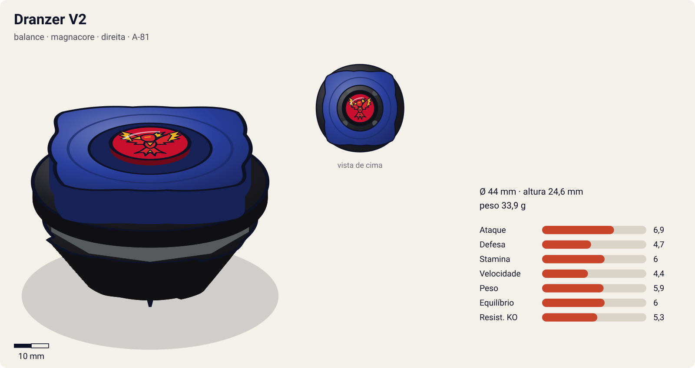
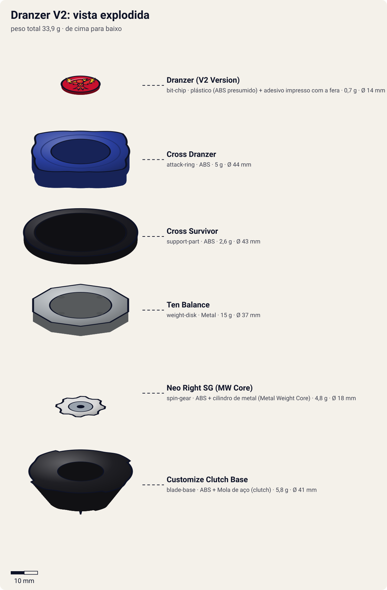

# Dranzer V2 (ドランザーV2 / Doranzā V2 — Borukēno Tsū, "Dranzer Volcano 2")

<!-- auto:inicio (gerado por npm run build:research; não edite este bloco) -->

| Ficha | |
|---|---|
| Dono | [Kai Hiwatari (火渡カイ / Hiwatari Kai)](../../README.md) |
| Tipo · sistema · rotação | balance · magnacore · direita |
| Código do produto | A-81 |
| Montada | Ø 44 mm · altura 24,6 mm · **33,9 g** (soma das peças) |
| Fera bit | [Dranzer](../../../../feras-bit/dranzer/) |
| Lançador | [Customize Grip (Gun Metallic / preto) - versão Kai](../../../../lancadores/customize-grip-kai/) |
| Ripcord | [winder-padrao](../../../../lancadores/ripcords/winder-padrao/) |

### Peças

| Camada | Peça | Material | Ø mm | Altura mm | Peso g | Estrelas Takara (A / D / S) | Desenho |
|---|---|---|---|---|---|---|---|
| Bit Chip | [Dranzer (V2 Version)](../../../../pecas/bit-chip/dranzer-v2/) | plástico (ABS presumido) + adesivo impresso com a fera | 14 estimado | 8 estimado | 0,7 comunidade | — | [ver](pecas/bit-chip.svg) |
| Attack Ring | [Cross Dranzer](../../../../pecas/attack-ring/cross-dranzer/) | ABS | 44 estimado | 6 estimado | 5 wiki | 2 / 2 / 1 | [ver](pecas/attack-ring.svg) |
| Support Part | [Cross Survivor](../../../../pecas/support-part/cross-survivor/) | ABS | 43 estimado | 3 estimado | 2,6 wiki | 2 / 0 / 2 | [ver](pecas/support-part.svg) |
| Weight Disk | [Ten Balance](../../../../pecas/weight-disk/ten-balance/) | Metal | 37 estimado | 3,6 estimado | 15 wiki | 1 / 2 / 3 | [ver](pecas/weight-disk.svg) |
| Spin Gear / Core | [Neo Right SG (MW Core)](../../../../pecas/spin-gear/neo-right-sg-mw-core/) | ABS + cilindro de metal (Metal Weight Core) | 18 estimado | 10 estimado | 4,8 wiki | — | [ver](pecas/spin-gear.svg) |
| Blade Base | [Customize Clutch Base](../../../../pecas/blade-base/customize-clutch-base/) | ABS + Mola de aço (clutch) | 41 estimado | 15 estimado | 5,8 wiki | 3 / 1 / 3 | [ver](pecas/blade-base.svg) |

Fonte de cada medida em subscrito (wiki, comunidade, estimado). Detalhes em cada ficha de peça.

### Atributos

| Atributo | Brinquedo (calculado) | Ajuste anime | Jogo |
|---|---|---|---|
| Ataque | 4,9 | +2 | **6,9** |
| Defesa | 4,7 | — | **4,7** |
| Stamina | 6 | — | **6** |
| Velocidade | 3,4 | +1 | **4,4** |
| Peso | 5,9 | — | **5,9** |
| Equilíbrio | 6 | — | **6** |
| Resistência a KO | 5,3 | — | **5,3** |

Calculado por `src/beyblade/stats.js` a partir de: ponta sharp (atrito 0,2), contato upper (recoil 0,4), peso do WD na equilibrado. Modelo em [docs/BEYBLADES.md](../../../../../docs/BEYBLADES.md).

### Fera bit em cima da bey

 

Sons: [invocacao](../../../../feras-bit/dranzer/sons/invocacao.wav) · [rugido](../../../../feras-bit/dranzer/sons/rugido.wav) · [ataque](../../../../feras-bit/dranzer/sons/ataque.wav). Animações: [invocação](../../../../feras-bit/dranzer/invocacao.svg) · [ataque](../../../../feras-bit/dranzer/ataque.svg).
<!-- auto:fim -->

| Campo | Valor |
|---|---|
| Dono | Kai Hiwatari |
| Código do produto | A-81 (Takara, out. 2002; também Hasbro) |
| Tipo | Balance |
| Sistema | Magnacore System (sem Magnecore: usa núcleo Metal Weight) |
| Rotação | Direita |
| Fera Bit (Bit-Beast) | Dranzer (fênix / Suzaku) |
| Série / temporada | V-Force (2002), e início de G-Revolution (2003) |
| Primeira aparição (anime) | V-Force ep. 43 "Kai's Royal Flush" |
| Antecessora → Sucessora | [Dranzer V](../dranzer-v/) → [Dranzer G](../dranzer-g/) |

## Formato e geometria
- Vista de cima: o [Cross Dranzer](../../../../pecas/attack-ring/cross-dranzer/) é oval e **totalmente simétrico**, com 2 asas em triângulo retângulo curto e a letra "V" entre elas dos dois lados (simetria de 2). Raio médio.
- O WD [Ten Balance](../../../../pecas/weight-disk/ten-balance/) de 15 g e o SP circular [Cross Survivor](../../../../pecas/support-part/cross-survivor/) distribuem o peso para fora: boa inércia rotacional.
- Perfil médio. As rampas curtas limitam o upper.
- **Por que as peças funcionam assim**:
  - Cross Dranzer: por ser simétrico, dá upper leve nas duas rotações (rampas curtas) e um smash discreto.
  - Cross Survivor: anel que leva peso para a periferia (stamina e life after death).
  - [Neo Right SG (MW Core)](../../../../pecas/spin-gear/neo-right-sg-mw-core/): núcleo de peso metálico, sem ímã; mais leve que os Magnecore.
  - [Customize Clutch Base](../../../../pecas/blade-base/customize-clutch-base/): ponta **sharp** exposta no lançamento, que **retrai** quando o RPM cai abaixo de um limiar (clutch centrífugo), expondo uma ponta mais larga. Começa em modo Survival (centro) e muda sozinha para modo Attack (flower pattern rápido). O momento da troca varia de base para base.

## Comportamento na arena
- **Padrão de movimento**: **duas fases**. Primeiro, centro estável com a ponta sharp. Quando a rotação cai, o clutch retrai a ponta e a bey passa a um flower pattern agressivo.
- **Ataque**: upper leve, mais forte na 2ª fase (movimento). Segundo a wiki, o modo Attack "não é eficaz" no toy.
- **Defesa**: média.
- **Stamina**: boa na fase 1. Ruim depois que o clutch ativa ("abismal em endurance" no modo Attack).
- **Pontos fortes**: o gimmick automático muda o comportamento no meio da luta. **Fracos**: o momento da troca é imprevisível e a fase final é fraca.
- **Matchups**: vence stamina medianas no começo da luta. Perde para attackers que a acertam na fase 2.
- **Gimmick**: Customize Clutch (troca automática sharp → attack por RPM).

## No anime
- **Ataques especiais**:
  - **Volcano Excellent Emission** (超爆炎放射 / Borukēno Ekuserento Emisshon). Estreia no V-Force ep. 47 "Deceit From Above": investida em altíssima velocidade com a bey envolta em chamas espessas. No mangá, explode como uma granada.
- **Batalhas**: V-Force ep. 43, contra King, sem resultado. Ep. 47, vence Marcos. Ep. 48, perde para Zeo (Cerberus) e a fera Dranzer é tomada (devolvida quando Tyson vence Zeo). Ep. 49, contra Tyson, sem resultado. G-Rev: ep. 5, vence nas eliminatórias; ep. 6, vence Daichi (bey provável: V2, já que a G estreia no ep. 11).
- **Substituição**: troca pela Dranzer G (Engine Gear) na G-Revolution.

## Mecânica no jogo
- **Movimento (IA)**: máquina de 2 estados, controlada pelo clutch.
  - **Fase 1 "survival"**: fica no centro com a ponta sharp (atrito ~0,1, velocidade baixa). A IA espera o oponente vir e só reage a golpes.
  - **Fase 2 "attack"**: quando a rotação cai abaixo de 55% (sorteio de ±10% por luta, porque cada base solta num ponto), a ponta larga aparece: flower pattern rápido (atrito ~0,5, +3 de velocidade efetiva) e perda de rotação 1,5× mais rápida.
- **Gimmick**: o clutch é automático e não volta atrás. O Cross Survivor dá +10% de inércia (life after death) só na fase 1.
- **Especiais** (efeito visual: [fera Dranzer](../../../../feras-bit/dranzer/ataque.svg), mergulho em chamas):
  - **Volcano Excellent Emission** (custo 100, recarga 22 s): investida em linha reta na velocidade máxima do jogo por 1,2 s, envolta em chamas; o golpe dá 2× de dano e 2× de empurrão. Se for usado na fase 1, força a troca para a fase 2 na hora (a ponta é "estourada" pela investida).

## Ajuste do anime

| Atributo | Delta | Justificativa (episódio/batalha) |
|---|---|---|
| Ataque | +2 | Vence Marcos com o Volcano Excellent Emission (V-Force ep. 47) e Daichi nas eliminatórias da G-Rev (ep. 6, bey provável) |
| Velocidade | +1 | O Volcano Excellent Emission é descrito como investida em "altíssima velocidade" (ep. 47) |

Resultado esperado: forte o bastante para vencer bladers secundários, mas abaixo da Cerberus de Zeo, que a derrota no ep. 48. Nota para o coordenador: a velocidade do brinquedo (2,8) sai baixa porque o cálculo usa só a ponta sharp da fase 1; a fase 2 do clutch não entra no modelo. O ajuste de +1 não tenta corrigir isso; a fase 2 fica na mecânica acima.

## Fontes
- https://beyblade.fandom.com/wiki/Dranzer_V2
- https://beyblade.fandom.com/wiki/Attack_Ring_-_Cross_Dranzer
- https://beyblade.fandom.com/wiki/Weight_Disk_-_Ten_Balance
- https://beyblade.fandom.com/wiki/Spin_Gear_-_Neo_Right_SG_(MW_Core)
- https://beyblade.fandom.com/wiki/Support_Parts_-_Cross_Survivor
- https://beyblade.fandom.com/wiki/Blade_Base_-_Customize_Clutch_Base
- https://beyblade.fandom.com/wiki/Volcano_Excellent_Emission
