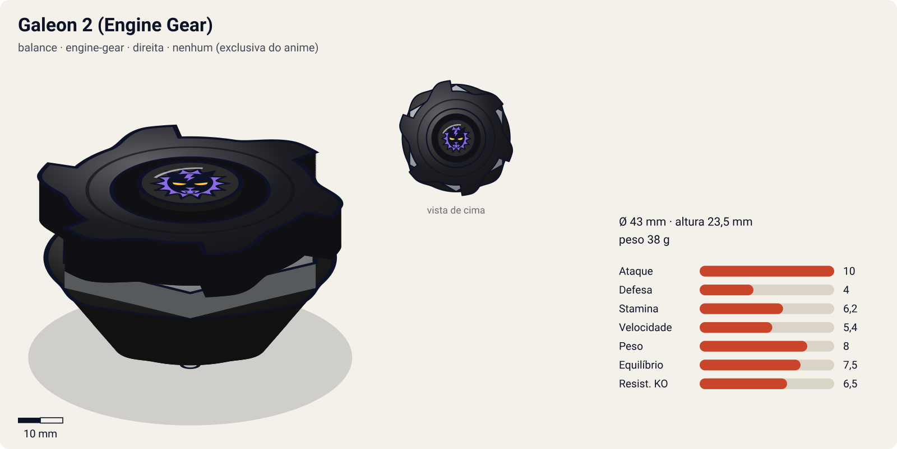
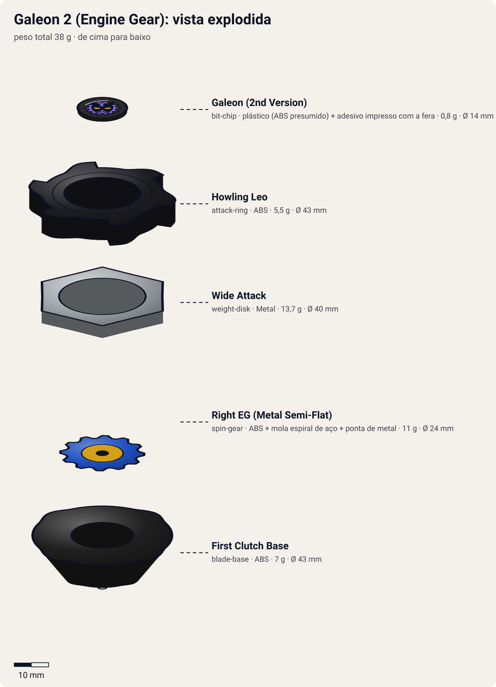
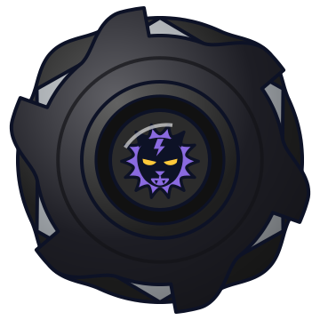

# Galeon 2 — Engine Gear (ガルオン2 / Garuon 2) — versão exclusiva do anime

<!-- auto:inicio (gerado por npm run build:research; não edite este bloco) -->

| Ficha | |
|---|---|
| Dono | [Lee (Rai Chen / ライ・チェン — "Lai"; às vezes citado como "Lee Wong")](../../README.md) |
| Tipo · sistema · rotação | balance · engine-gear · direita |
| Código do produto | nenhum (exclusiva do anime) |
| Montada | Ø 43 mm · altura 23,5 mm · **38 g** (soma das peças) |
| Fera bit | [Galeon](../../../../feras-bit/galeon/) |
| Lançador | [EZ Shooter (Easy Shooter, rotação direita)](../../../../lancadores/ez-shooter/) |
| Ripcord | [winder-padrao](../../../../lancadores/ripcords/winder-padrao/) |

### Peças

| Camada | Peça | Material | Ø mm | Altura mm | Peso g | Estrelas Takara (A / D / S) | Desenho |
|---|---|---|---|---|---|---|---|
| Bit Chip | [Galeon (2nd Version)](../../../../pecas/bit-chip/galeon-2/) | plástico (ABS presumido) + adesivo impresso com a fera | 14 estimado | 8 estimado | 0,8 comunidade | — | [ver](pecas/bit-chip.svg) |
| Attack Ring | [Howling Leo](../../../../pecas/attack-ring/howling-leo/) | ABS | 43 estimado | 6 estimado | 5,5 estimado | 2,5 / 1 / 1,5 | [ver](pecas/attack-ring.svg) |
| Weight Disk | [Wide Attack](../../../../pecas/weight-disk/wide-attack/) | Metal | 40 estimado | 3,5 estimado | 13,7 wiki | 2 / 1 / 3 | [ver](pecas/weight-disk.svg) |
| Spin Gear / Core | [Right EG (Metal Semi-Flat)](../../../../pecas/spin-gear/right-eg-metal-semi-flat/) | ABS + mola espiral de aço + ponta de metal | 24 estimado | 18 estimado | 11 wiki | 3 / 0 / 2 | [ver](pecas/spin-gear.svg) |
| Blade Base | [First Clutch Base](../../../../pecas/blade-base/first-clutch-base/) | ABS | 43 estimado | 14 estimado | 7 estimado | 3 / 1 / 1 | [ver](pecas/blade-base.svg) |

Fonte de cada medida em subscrito (wiki, comunidade, estimado). Detalhes em cada ficha de peça.

### Atributos

| Atributo | Brinquedo (calculado) | Ajuste anime | Jogo |
|---|---|---|---|
| Ataque | 8,2 | +2 | **10** |
| Defesa | 4 | — | **4** |
| Stamina | 6,2 | — | **6,2** |
| Velocidade | 5,4 | — | **5,4** |
| Peso | 8 | — | **8** |
| Equilíbrio | 7,5 | — | **7,5** |
| Resistência a KO | 6,5 | — | **6,5** |

Calculado por `src/beyblade/stats.js` a partir de: ponta metal-semi-flat (atrito 0,3), contato smash (recoil 0,5), peso do WD na equilibrado, Engine Gear (clutch). Modelo em [docs/BEYBLADES.md](../../../../../docs/BEYBLADES.md).

### Fera bit em cima da bey

 

Sons: [invocacao](../../../../feras-bit/galeon/sons/invocacao.wav) · [rugido](../../../../feras-bit/galeon/sons/rugido.wav) · [ataque](../../../../feras-bit/galeon/sons/ataque.wav). Animações: [invocação](../../../../feras-bit/galeon/invocacao.svg) · [ataque](../../../../feras-bit/galeon/ataque.svg).
<!-- auto:fim -->

Sem fotos de referência no repositório. Imagens de terceiros na galeria de https://beyblade.fandom.com/wiki/Galeon_2_(Engine_Gear) : `Galeon 2 G.jpg` (frame do anime da bey montada), `Galeon 2 G parts.jpg` (vista explodida mostrada numa tela no anime), `Galeon 2 G spins.jpg`. Não existe brinquedo, portanto não há foto de produto.

| Campo | Valor |
|---|---|
| Dono | Lee |
| Código do produto | — (não lançada como brinquedo) |
| Tipo | Balance (segundo a wiki) |
| Fera Bit (Bit-Beast) | Galeon, leão negro |
| Série / temporada | G-Revolution (2003) |
| Primeira aparição (anime) | G-Rev ep 10 "It's a Battle Royal...!" (segundo a infobox da wiki) |
| Antecessora → Sucessora | [Galeon 2 (Magnacore)](../galeon-2/) → — |

## Formato e geometria
- Mesma silhueta de 6 pontas da Galeon 2, com WD hexagonal de cantos ofensivos.
- Massa central alta (Engine Gear de 11 g).
- Perfil um pouco mais alto que a versão Magnacore (EG + base clutch); estimativa.

Análise das peças (conforme a infobox da wiki; modelo fictício):
- [Howling Leo](../../../../pecas/attack-ring/howling-leo/): 6 pontas de ataque, golpes frequentes.
- [Wide Attack](../../../../pecas/weight-disk/wide-attack/) ("Wide Attacker", 13,7 g): hexagonal com pontos de ataque nos cantos; um pouco menos largo e mais central que o Wide comum; soma ataque e mantém a stamina.
- [Right EG (Metal Semi-Flat)](../../../../pecas/spin-gear/right-eg-metal-semi-flat/) (11 g): motor de corda com ponta metálica quase plana; arrancada de velocidade quando liberado, ponta agressiva.
- [First Clutch Base](../../../../pecas/blade-base/first-clutch-base/) (Instant Release): libera o EG logo depois do pouso.

Fotos das peças: inexistentes como brinquedo; ver a referência `Galeon 2 G parts.jpg` acima.

## Comportamento na arena
Inferido das peças (não há brinquedo para testar):
- **Movimento**: arrancada rápida logo depois do pouso (EG instantâneo), depois órbita agressiva com ponta metálica plana.
- **Ataque**: alto no início da batalha.
- **Defesa/Stamina**: médias; o boost se esgota cedo.
- **Matchups**: forte contra beys que demoram a se posicionar; fraca contra stamina/defensivas que sobrevivem ao rush.
- **Gimmick**: Engine Gear.

## No anime
- **Spiral Lightning**: raios em espiral que desorientam e expulsam o oponente (estreia no ep 10 contra Tyson).
- A vista explodida mostrada numa tela no anime (`Galeon 2 G parts.jpg`) confirma a construção com Engine Gear.
- Batalhas: as páginas de episódio da wiki não distinguem as versões; as batalhas de Lee do ep 10 em diante (ver [Galeon 2](../galeon-2/)) podem ser atribuídas a esta versão: vitória em dupla sobre Tyson+Daichi (ep 10), derrotas para Miguel (ep 12), F-Dynasty (ep 15), Tala (ep 22) e Mystel (ep 34), vitória no battle royal (ep 19) e no treino contra Driger MS (ep 40).

## Mecânica no jogo
- **Movimento (IA)**: fase 1 (0–4 s) rush com +50% de velocidade; fase 2, órbita média com investidas (igual à Galeon 2).
- **Gimmick (First Clutch)**: o Engine Gear solta no pouso: +1 de velocidade e +0,5 de ataque pelo resto da luta (conforme o modelo) e o rush da fase 1. Uma vez por luta.
- **Especial**: *Spiral Lightning*. Igual à Galeon 2: desorienta o alvo por 1,5 s e o empurra para a borda; custo 130 de energia, recarga 26 s. Visual: o [ataque de Galeon](../../../../feras-bit/galeon/ataque.svg) em espiral.
- **Física**: massa relativa 1,10; raio 1,05; atrito da ponta 0,6; restituição 0,55 (estimativa).

## Ajuste do anime

| Atributo | Delta | Justificativa (episódio/batalha) |
|---|---|---|
| Ataque | +2 | Spiral Lightning elimina Dragoon G na dupla com Ray (ep 10) e vence o battle royal (ep 19). |

Resultado esperado: atacante de rush forte no início, que perde para quem aguenta o primeiro impacto (Wolborg 4 por desgaste no ep 22, Mystel no ep 34).

## Fontes
- https://beyblade.fandom.com/wiki/Galeon_2_(Engine_Gear)
- https://beyblade.fandom.com/wiki/Weight_Disk_-_Wide_Attack
- https://beyblade.fandom.com/wiki/Engine_Gear_-_Right_EG_(Metal_Semi-Flat)
- https://beyblade.fandom.com/wiki/Blade_Base_-_First_Clutch_Base
- https://beyblade.fandom.com/wiki/Spiral_Lightning
- https://beyblade.fandom.com/wiki/Beyblade:_G-Revolution_-_Episode_10
