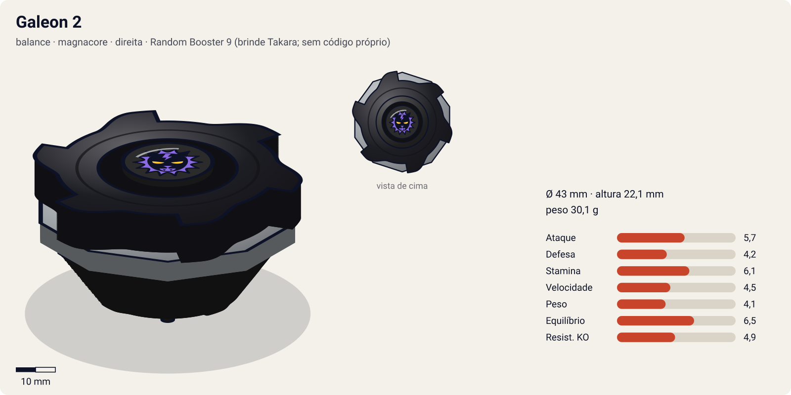
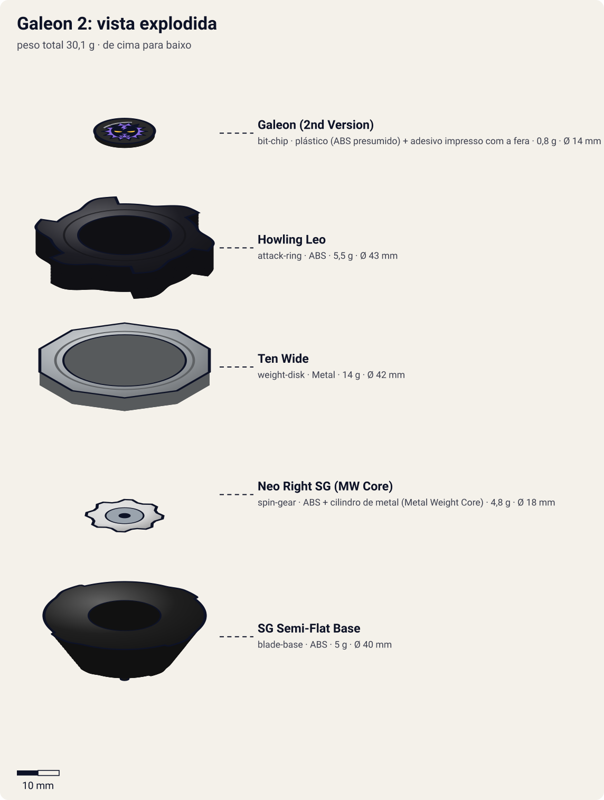
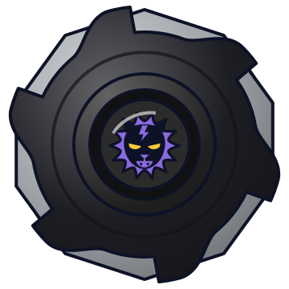

# Galeon 2 (ガルオン2 / Garuon 2) — versão Magnacore (brinquedo)

<!-- auto:inicio (gerado por npm run build:research; não edite este bloco) -->

| Ficha | |
|---|---|
| Dono | [Lee (Rai Chen / ライ・チェン — "Lai"; às vezes citado como "Lee Wong")](../../README.md) |
| Tipo · sistema · rotação | balance · magnacore · direita |
| Código do produto | Random Booster 9 (brinde Takara; sem código próprio) |
| Montada | Ø 43 mm · altura 22,1 mm · **30,1 g** (soma das peças) |
| Fera bit | [Galeon](../../../../feras-bit/galeon/) |
| Lançador | [EZ Shooter (Easy Shooter, rotação direita)](../../../../lancadores/ez-shooter/) |
| Ripcord | [winder-padrao](../../../../lancadores/ripcords/winder-padrao/) |

### Peças

| Camada | Peça | Material | Ø mm | Altura mm | Peso g | Estrelas Takara (A / D / S) | Desenho |
|---|---|---|---|---|---|---|---|
| Bit Chip | [Galeon (2nd Version)](../../../../pecas/bit-chip/galeon-2/) | plástico (ABS presumido) + adesivo impresso com a fera | 14 estimado | 8 estimado | 0,8 comunidade | — | [ver](pecas/bit-chip.svg) |
| Attack Ring | [Howling Leo](../../../../pecas/attack-ring/howling-leo/) | ABS | 43 estimado | 6 estimado | 5,5 estimado | 2,5 / 1 / 1,5 | [ver](pecas/attack-ring.svg) |
| Weight Disk | [Ten Wide](../../../../pecas/weight-disk/ten-wide/) | Metal | 42 estimado | 3,1 estimado | 14 wiki | 1 / 1,5 / 4 | [ver](pecas/weight-disk.svg) |
| Spin Gear / Core | [Neo Right SG (MW Core)](../../../../pecas/spin-gear/neo-right-sg-mw-core/) | ABS + cilindro de metal (Metal Weight Core) | 18 estimado | 10 estimado | 4,8 wiki | — | [ver](pecas/spin-gear.svg) |
| Blade Base | [SG Semi-Flat Base](../../../../pecas/blade-base/sg-semi-flat-base/) | ABS | 40 estimado | 13 estimado | 5 wiki | 2 / 2 / 2 | [ver](pecas/blade-base.svg) |

Fonte de cada medida em subscrito (wiki, comunidade, estimado). Detalhes em cada ficha de peça.

### Atributos

| Atributo | Brinquedo (calculado) | Ajuste anime | Jogo |
|---|---|---|---|
| Ataque | 4,7 | +1 | **5,7** |
| Defesa | 4,2 | — | **4,2** |
| Stamina | 6,1 | — | **6,1** |
| Velocidade | 4,5 | — | **4,5** |
| Peso | 4,1 | — | **4,1** |
| Equilíbrio | 6,5 | — | **6,5** |
| Resistência a KO | 4,9 | — | **4,9** |

Calculado por `src/beyblade/stats.js` a partir de: ponta semi-flat (atrito 0,3), contato smash (recoil 0,5), peso do WD na periferia. Modelo em [docs/BEYBLADES.md](../../../../../docs/BEYBLADES.md).

### Fera bit em cima da bey

 

Sons: [invocacao](../../../../feras-bit/galeon/sons/invocacao.wav) · [rugido](../../../../feras-bit/galeon/sons/rugido.wav) · [ataque](../../../../feras-bit/galeon/sons/ataque.wav). Animações: [invocação](../../../../feras-bit/galeon/invocacao.svg) · [ataque](../../../../feras-bit/galeon/ataque.svg).
<!-- auto:fim -->

Sem fotos de referência no repositório. Imagens de terceiros na wiki: `File:Galeon_2.jpg` (montada) e o frame `S03E10-145402 1.jpg` em https://beyblade.fandom.com/wiki/Galeon_2 ; `Spiral_Lightning-182818_1.jpg` em https://beyblade.fandom.com/wiki/Spiral_Lightning

| Campo | Valor |
|---|---|
| Dono | Lee |
| Código do produto | Sem código próprio: brinde (prize) do Random Booster 9 (Takara). A infobox da wiki diz "A-3", provável cópia errada da Galeon |
| Fera Bit (Bit-Beast) | Galeon, leão negro |
| Série / temporada | G-Revolution (2003) |
| Primeira aparição (anime) | G-Rev ep 7 "Take Your Best Shot" |
| Antecessora → Sucessora | [Galeon](../galeon/) → [Galeon 2 (Engine Gear)](../galeon-2-eg/) no anime (no mangá: Galeon MS) |

## Formato e geometria
- Silhueta com 6 pontas (simetria de 3/6 lados), raio médio-grande.
- O Ten Wide joga o peso para fora → boa inércia e resistência a empurrões.
- Perfil médio.

Análise das peças:
- [Howling Leo](../../../../pecas/attack-ring/howling-leo/): 6 pontas de ataque (formato de juba/garras); vários contatos → golpes frequentes (smash).
- [Ten Wide](../../../../pecas/weight-disk/ten-wide/) (14 g): 10 lados, o mais largo dos Wide; massa na periferia → inércia, stamina e estabilidade.
- [Neo Right SG (MW Core)](../../../../pecas/spin-gear/neo-right-sg-mw-core/): núcleo com peso metálico, não magnético (~5 g com o Neo SG); mais peso central.
- [SG Semi-Flat Base](../../../../pecas/blade-base/sg-semi-flat-base/): ponta aguda achatada na extremidade; centro em lançamento reto, órbita circular quando inclinada.

Fotos das peças: não há no repositório. Na galeria de https://beyblade.fandom.com/wiki/Galeon_2 : `Galeon 2 A.R.jpg` e `Galeon2AttackRing.jpg` (Howling Leo) e `CIMG0089.JPG` (brinquedo).

## Comportamento na arena
- **Movimento**: semi-flat; centro ou órbita circular, conforme o lançamento.
- **Ataque**: médio no brinquedo (6 pontas curtas; dados de desempenho competitivo não encontrados). No anime, Lee joga a Galeon com força total contra Wolborg e Dragoon.
- **Defesa/Stamina**: boas pelo Ten Wide.
- **Matchups**: equilibrada; sofre contra upper baixo e HMS.
- **Gimmick**: nenhum além do núcleo de peso metálico.

## No anime
- **Spiral Lightning**: Galeon dispara raios que desorientam a bey adversária e a lançam para fora do estádio. Estreia em G-Rev ep 10, eliminando Tyson (Dragoon G) na dupla com Ray.
- Batalhas: vs Ray (ep 7, derrota para o Gatling Claw); dupla com Ray vs Tyson+Daichi (ep 10, vitória); vs Miguel (ep 12, derrota); vs F-Dynasty (ep 15, derrota, colapso de Lee); battle royal (ep 19, vitória); vs Tala/Wolborg 4 (ep 22, derrota); battle royale (ep 28); vs Mystel (ep 34, derrota); vs Ray/Driger MS (ep 40, vitória); dupla (ep 41); com Rick vs Ming-Ming+Crusher (ep 50, sem resultado).
- Ver [Galeon 2 (Engine Gear)](../galeon-2-eg/): segundo a wiki, a Galeon 2 do anime tem Engine Gear a partir do ep 10. Esta ficha é a forma "brinquedo" (Magnacore) e cobre o ep 7.

## Mecânica no jogo
- **Movimento (IA)**: órbita média com investidas frontais repetidas; no modo "fúria" de Lee (abaixo de 40% de RPM), o intervalo entre investidas cai pela metade.
- **Gimmick**: núcleo de peso metálico (sem ímã): não interage com estádios ou beys magnéticas; +5% de resistência a empurrão pelo peso central.
- **Especial**: *Spiral Lightning*. Onda elétrica em espiral que desorienta o alvo (controles invertidos/embaralhados por 1,5 s) e o empurra para a borda; custo 130 de energia, recarga 26 s. Visual: os raios do [ataque de Galeon](../../../../feras-bit/galeon/ataque.svg) disparados em espiral.
- **Física**: massa relativa 1,0; raio 1,05; atrito da ponta 0,4; restituição 0,5 (estimativa).

## Ajuste do anime

| Atributo | Delta | Justificativa (episódio/batalha) |
|---|---|---|
| Ataque | +1 | Lee joga a Galeon com força total; o golpe forte do anime aparece já no ep 7 contra Driger G (derrota). |

Resultado esperado: balance comum, que perde para Driger G (ep 7). O desempenho completo do anime (Spiral Lightning) fica na [versão Engine Gear](../galeon-2-eg/).

Nota para o coordenador: o Howling Leo não tem estrelas no catálogo (`stats_oficiais: null`). A primeira pesquisa e um brief antigo tratavam a Galeon 2 como âncora de Ataque 10, o que não bate com um brinquedo Balance.

## Fontes
- https://beyblade.fandom.com/wiki/Galeon_2
- https://beyblade.fandom.com/wiki/Attack_Ring_-_Howling_Leo
- https://beyblade.fandom.com/wiki/Weight_Disk_-_Ten_Wide
- https://beyblade.fandom.com/wiki/Spin_Gear_-_Neo_Right_Spin_Gear_(Metal_Weight_Version)
- https://beyblade.fandom.com/wiki/Blade_Base_-_SG_Semi-Flat
- https://beyblade.fandom.com/wiki/Spiral_Lightning
- https://tokutakutoysbeycollection.blogspot.com/2015/04/rb9-galeon-2-rb.html (citada pela wiki)
- Episódios G-Rev 07, 10, 12, 19, 22, 28, 34, 40, 41, 50 (beyblade.fandom.com)
