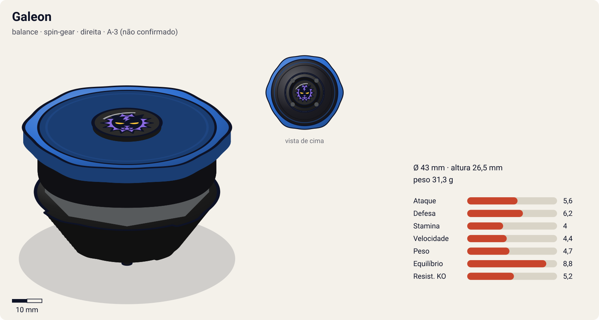
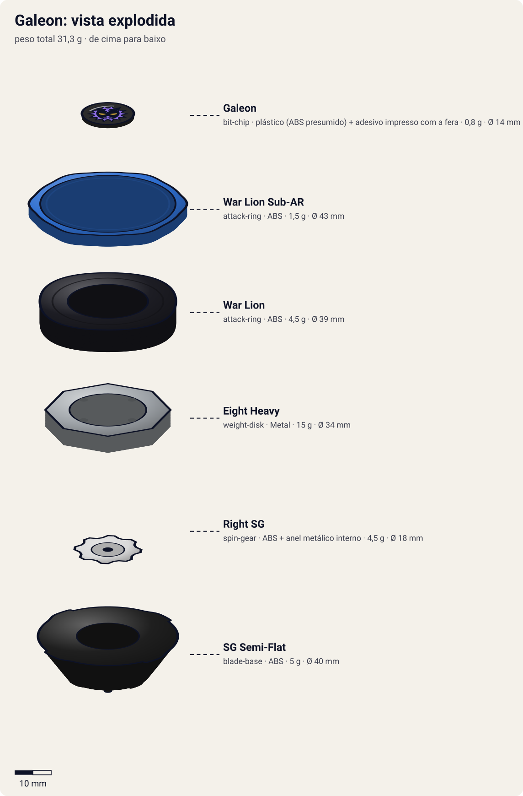
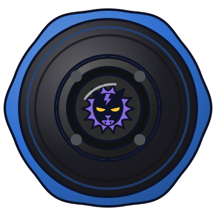

# Galeon (ガルオン / Garuon — Hasbro: "Galeon Attacker")

<!-- auto:inicio (gerado por npm run build:research; não edite este bloco) -->

| Ficha | |
|---|---|
| Dono | [Lee (Rai Chen / ライ・チェン — "Lai"; às vezes citado como "Lee Wong")](../../README.md) |
| Tipo · sistema · rotação | balance · spin-gear · direita |
| Código do produto | A-3 (não confirmado) |
| Montada | Ø 43 mm · altura 26,5 mm · **31,3 g** (soma das peças) |
| Fera bit | [Galeon](../../../../feras-bit/galeon/) |
| Lançador | [EZ Shooter (Easy Shooter, rotação direita)](../../../../lancadores/ez-shooter/) |
| Ripcord | [winder-padrao](../../../../lancadores/ripcords/winder-padrao/) |

### Peças

| Camada | Peça | Material | Ø mm | Altura mm | Peso g | Estrelas Takara (A / D / S) | Desenho |
|---|---|---|---|---|---|---|---|
| Bit Chip | [Galeon](../../../../pecas/bit-chip/galeon/) | plástico (ABS presumido) + adesivo impresso com a fera | 14 estimado | 8 estimado | 0,8 comunidade | — | [ver](pecas/bit-chip.svg) |
| Attack Ring | [War Lion](../../../../pecas/attack-ring/war-lion/) | ABS | 39 estimado | 6 estimado | 4,5 estimado | 2,5 / 2,5 / 1 | [ver](pecas/attack-ring.svg) |
| Attack Ring | [War Lion Sub-AR](../../../../pecas/attack-ring/war-lion-sub-ar/) | ABS | 43 estimado | 3 estimado | 1,5 estimado | — | [ver](pecas/attack-ring.svg) |
| Weight Disk | [Eight Heavy](../../../../pecas/weight-disk/eight-heavy/) | Metal | 34 estimado | 4,5 estimado | 15 wiki | 0,5 / 3 / 1,5 | [ver](pecas/weight-disk.svg) |
| Spin Gear / Core | [Right SG](../../../../pecas/spin-gear/right-sg/) | ABS + anel metálico interno | 18 estimado | 10 estimado | 4,5 estimado | — | [ver](pecas/spin-gear.svg) |
| Blade Base | [SG Semi-Flat](../../../../pecas/blade-base/sg-semi-flat/) | ABS | 40 estimado | 13 estimado | 5 wiki | 2 / 2 / 2 | [ver](pecas/blade-base.svg) |

Fonte de cada medida em subscrito (wiki, comunidade, estimado). Detalhes em cada ficha de peça.

### Atributos

| Atributo | Brinquedo (calculado) | Ajuste anime | Jogo |
|---|---|---|---|
| Ataque | 3,6 | +2 | **5,6** |
| Defesa | 6,2 | — | **6,2** |
| Stamina | 4 | — | **4** |
| Velocidade | 4,4 | — | **4,4** |
| Peso | 4,7 | — | **4,7** |
| Equilíbrio | 8,8 | — | **8,8** |
| Resistência a KO | 5,2 | — | **5,2** |

Calculado por `src/beyblade/stats.js` a partir de: ponta semi-flat (atrito 0,3), contato defesa (recoil 0,2), peso do WD na centro. Modelo em [docs/BEYBLADES.md](../../../../../docs/BEYBLADES.md).

### Fera bit em cima da bey

 

Sons: [invocacao](../../../../feras-bit/galeon/sons/invocacao.wav) · [rugido](../../../../feras-bit/galeon/sons/rugido.wav) · [ataque](../../../../feras-bit/galeon/sons/ataque.wav). Animações: [invocação](../../../../feras-bit/galeon/invocacao.svg) · [ataque](../../../../feras-bit/galeon/ataque.svg).
<!-- auto:fim -->

Sem fotos de referência no repositório. Imagens de terceiros na wiki: `File:510S9EB690L. SS500 .jpg` (infobox) e `File:Galeon1.jpg` (vista de cima) em https://beyblade.fandom.com/wiki/Galeon

| Campo | Valor |
|---|---|
| Dono | Lee |
| Código do produto | A-3 (segundo a wiki e listagens de varejo; outra listagem usa "#027"); não confirmado em catálogo oficial |
| Fera Bit (Bit-Beast) | Galeon, leão negro |
| Série / temporada | Bakuten Shoot (2001); ainda usada em G-Revolution ep 4 |
| Primeira aparição (anime) | S1 ep 13 "Crouching Lion, Hidden Tiger" |
| Antecessora → Sucessora | — → [Galeon 2](../galeon-2/) |

Outro nome: "Galeon Attacker" (Hasbro).

## Formato e geometria
- Silhueta compacta e quase circular (War Lion), com pequenas saliências; poucos pontos de recoil.
- Peso concentrado no centro (Eight Heavy) → velocidade de rotação alta.
- Perfil baixo e compacto.

Análise das peças:
- [War Lion](../../../../pecas/attack-ring/war-lion/) (6 g) + [Sub-AR livre](../../../../pecas/attack-ring/war-lion-sub-ar/): AR pequeno e quase perfeitamente redondo; o Sub-AR gira livre, absorve o golpe e o resto da bey continua girando → defesa e sobrevivência excelentes. Frágil (quebra fácil).
- [Eight Heavy](../../../../pecas/weight-disk/eight-heavy/) (15 g): 8 lados, massa central: RPM alto e peso para defesa.
- [Right SG](../../../../pecas/spin-gear/right-sg/): padrão, rotação direita.
- [SG Semi-Flat](../../../../pecas/blade-base/sg-semi-flat/) (5 g): ponta aguda achatada na extremidade. Reta = stamina no centro; inclinada = órbita circular de ataque; muito usada em compactos.

Fotos das peças: não há no repositório. Na galeria de https://beyblade.fandom.com/wiki/Galeon : `Galeon5.jpg` (War Lion), `Galeon6.jpg` (Sub-AR), `Galeon's WD, SG and BB.jpg`, `Galeon BOTTOM VIEW.jpg`, `Bey, 2002 Galeon Parts & Stats.png`; bit chip `GaleonBitChip.png` em https://beyblade.fandom.com/wiki/Bit_Chip_-_Galeon .

## Comportamento na arena
- **Movimento**: semi-flat; tende a ficar no centro e, se lançada inclinada, faz círculos de ataque.
- **Ataque**: baixo no brinquedo (AR redondo).
- **Defesa**: alta para a geração (o Sub-AR livre anula parte dos golpes).
- **Stamina**: alta (pouco recoil, o Sub-AR preserva a rotação).
- **Matchups**: vence atacantes leves por desgaste; perde para smash pesado que quebra ou ignora o Sub-AR e para upper baixo.
- **Gimmick**: Sub-Attack Ring de giro livre.

## No anime
- **Dark Lightning / Black Thunder**: Galeon se cobre de raios e qualquer bey que encosta é repelida com uma explosão para fora do estádio. Lee o aperfeiçoou a ponto de não precisar invocar a fera. Estreia S1 ep 17. Ray usa esse mesmo golpe contra Lee, somado ao Tiger Claw.
- **Tiger Claw**: a wiki lista Lee também usando o Tiger Claw com a Galeon Attacker.
- Batalhas: vs Bruno (ep 13, vitória); vs Tyson (ep 17: vitória, derrota, empate); vs Ray (ep 17, derrota); vs Michael (ep 41, empate); vs Kai/Black Dranzer (ep 44, derrota; Galeon capturado e a bey destruída segundo a página do episódio); G-Rev ep 4 vs Ray/Driger G (derrota) → troca para Galeon 2.

## Mecânica no jogo
- **Movimento (IA)**: fica no centro; quando o oponente se aproxima, faz pequenos círculos para encarar o golpe de frente.
- **Gimmick (Sub-AR livre, passivo)**: −30% de perda de RPM por impacto lateral e −15% de knockback recebido. Golpe muito forte (knockback > 2×) tem 10% de chance de "travar" o Sub-AR pelo resto da luta (frágil).
- **Especial**: *Black Thunder (Dark Lightning)*. Aura elétrica de 3 s: todo contato causa dano e repulsão forte (knockback 2×); custo 120 de energia, recarga 24 s. Visual: o [ataque de Galeon](../../../../feras-bit/galeon/ataque.svg) (Dark Lightning).
- **Física**: massa relativa 0,85; raio 0,9; atrito da ponta 0,35; restituição 0,4 (estimativa).

## Ajuste do anime

| Atributo | Delta | Justificativa (episódio/batalha) |
|---|---|---|
| Ataque | +2 | Black Thunder expulsa beys do estádio por contato: vence Bruno (ep 13), tira uma rodada de Tyson (ep 17) e empata com Michael (ep 41). |

Resultado esperado: contra-atacante defensiva que divide com Dragoon S, perde para Driger S (ep 17) e é destruída pelo Black Dranzer (ep 44).

Nota para o coordenador: o War Lion está no catálogo com 1 / 3 / 2 (Part Infobox da wiki), mas o ATRIBUTOS-ORIGEM.md mostra que esses números são da Tiger Defenser; a Takara dá 2,5 / 2,5 / 1. Isso explica a Defesa 8,7 e o Ataque 3 do brinquedo calculado. O catálogo também tem duas fichas para a mesma base: `blade-base/sg-semi-flat` (sem estrelas, usada aqui) e `blade-base/sg-semi-flat-base` (2 / 2 / 2, usada na Galeon 2).

## Fontes
- https://beyblade.fandom.com/wiki/Galeon (redirecionado de Galeon_Attacker)
- https://beyblade.fandom.com/wiki/Attack_Ring_-_War_Lion
- https://beyblade.fandom.com/wiki/Blade_Base_-_SG_Semi-Flat
- https://beyblade.fandom.com/wiki/Weight_Disk_-_Eight_Heavy
- https://beyblade.fandom.com/wiki/Dark_Lightning_(Black_Thunder) , https://beyblade.fandom.com/wiki/Tiger_Claw
- https://beyblade.fandom.com/wiki/Beyblade_-_Episode_17 , _44 ; https://beyblade.fandom.com/wiki/Beyblade:_G-Revolution_-_Episode_04
- Busca de código de produto: https://beywarehouse.com/collections/original-series-1999-2005
