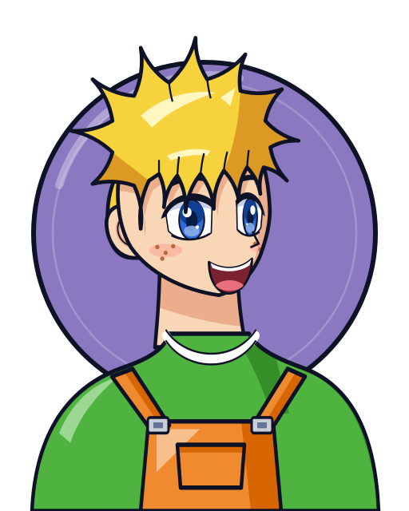
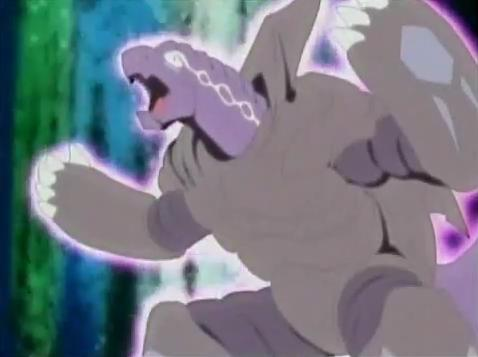

# Max Tate (Max Mizuhara / 水原 マックス)

Retrato original do jogo ([retrato.svg](retrato.svg)). Referência: [referencia/foto.jpg](referencia/foto.jpg) (arte promocional da S1).

Fera bit: 

| Campo | Valor |
|---|---|
| Nome JP | 水原 マックス (Mizuhara Max) |
| Equipe(s) por temporada | S1: Bladebreakers (BBA) / V-Force: Bladebreakers (BBA) / G-Rev: PPB All Starz (dupla com Rick Anderson) → depois G Revolutions (BBA Revolution) |
| Nacionalidade | Nipo-americano (pai japonês Taro Tate, mãe americana Judy Tate) |
| Idade (aprox.) | JP: 10 (S1) / 11 (V-Force) / 12 (G-Rev); dublagem EN: 13 / 14 / 15 |
| Fera Bit | Draciel (玄武 Genbu) – a Tartaruga Negra do Norte (Xuan Wu), uma das 4 Feras Sagradas; elemento água |
| Estilo de batalha | Defesa pura (o único defensor puro dos Bladebreakers) |
| Dublador(a) JP / EN / PT-BR | Ai Orikasa / Gage Knox / não confirmado |

## Visual

Padrão do retrato: visual da **temporada 1 (2001)**.

- **S1 (2001)**: cabelo **loiro**, espetado para cima e para os lados, com franja em mechas grossas sobre a testa. Olhos **azuis** grandes, pele clara, **sardas** nas bochechas e sorriso aberto. Veste **macacão laranja** (alças com fivelas e bolso no peito) preso por cinto preto, sobre uma **camiseta verde** com debrum branco na gola e nas mangas; munhequeiras verdes longas e tênis verde e branco (fora do busto). Correção: o macacão é **laranja**, não verde (o verde é a camiseta), conforme a foto de referência e a wiki.
- **V-Force (2002)**: cabelo loiro-escuro puxando para o laranja, olhos de azul mais escuro. Camiseta azul com estrelas amarelas por cima do macacão, que fica cinza; camiseta verde-clara por baixo, luvas vermelhas sem dedos, munhequeira azul na mão esquerda e tênis azul e vermelho.
- **G-Revolution (2003)**: cabelo loiro-claro. Camiseta raglã verde e creme com um "M" laranja no peito, blusa laranja amarrada na cintura, calça laranja, luvas verde-escuras e tênis verde, branco e laranja.
- Elementos obrigatórios no retrato: cabelo loiro espetado, sardas, olhos azuis, camiseta verde e macacão laranja com fivelas.

| Uso | Hex |
|---|---|
| Disco de fundo (Draciel, tartaruga cinza-violeta com aura roxa; proposta até existir `feras-bit/draciel/dados.json`) | `#8a78c0` (borda `#0d1226`) |
| Cabelo base / sombra / brilho | `#f6d23c` / `#dc9a24` / `#fff6c0` |
| Olhos (íris) | `#2d6bd9` |
| Pele base / sombra / sardas | `#f9d6b6` / `#eaae8c` / `#b86a3c` |
| Camiseta / debrum | `#4fb340` / `#ffffff` |
| Macacão | `#f08a2e` |
| Fivelas | `#c9ced8` |
| Contorno | `#0d1226` |

## Personalidade e papel na história
- Garoto alegre, otimista e muito esportivo; sempre sorrindo, raramente fica triste. Tempera macarrão com mostarda (maionese no original japonês) e mistura palavras em inglês na fala japonesa ("so cool").
- Aparece no ep. 3 da S1: recém-chegado ao bairro, salva um cachorro no rio, leva Tyson e Kenny à loja de Beyblade do pai (BB Shop) e vence Tyson na primeira batalha.
- S1: vence o Bloco B do torneio regional, perde para Kai na semifinal; no torneio americano luta para provar seu valor à mãe (técnica dos All Starz). Salva o time no Lago Baikal com a recém-recebida Draciel F, segurando o Black Dranzer de Kai. Perde Draciel para os Demolition Boys (recuperada quando Tyson vence Tala).
- V-Force: volta aos EUA com a mãe; perde para Mariam (Saint Shields) e cria laço com ela. Perde Draciel duas vezes (para Jim do Team Psykick e para Zeo), recuperando-a depois. Campeão do torneio de duplas com Tyson.
- G-Revolution: mais sério. Entra nos PPB All Starz com Rick no formato de duplas; empata em 4º com White Tiger X. Depois volta ao time (G Revolutions) para enfrentar a BEGA de Boris.
- Filosofia: "a chave está no blader, não na beyblade"; tem potencial oculto e surpreende adversários.

## Estilo de luta (como o jogo deve representá-lo)
- **Lançamento típico**: lançamento centralizado, sem pressa, deixando a beyblade fixa no centro do estádio.
- **Agressividade**: baixa. Absorve ataques, cansa o oponente e só contra-ataca no fim (ou quando o rival perde equilíbrio).
- **Preferências táticas**: ocupar o centro; aguentar o "rush" inicial dos atacantes; vencer por stamina/desgaste; em G-Rev, usa os especiais de água para tirar o equilíbrio do oponente (Gravity Control) ou amortecer especiais (Aqua Shield).
- **Frases de efeito**: "Draciel, he's back!", "We're a team!"; ao chamar a fera: "Draciel!" seguido do nome do especial (Viper Wall, Gravity Control...).

## Beyblades utilizadas no anime (ordem cronológica)
| # | Beyblade | Temporada | Episódio de estreia | Pasta | Miniatura | Lançador + ripcord |
|---|---|---|---|---|---|---|
| 1 | Draciel Metal Ball Defenser | Bakuten Shoot (S1) | S1 ep. 3 "Take It to the Max!" | [beyblades/draciel-metal-ball-defenser](beyblades/draciel-metal-ball-defenser/) |  | [EZ Shooter Grip (Easy Shooter Grip)](../../lancadores/ez-shooter-grip/) + [Winder padrão (Beyblade Winder)](../../lancadores/ripcords/winder-padrao/) |
| 2 | Draciel S (Shield) | Bakuten Shoot (S1) | S1 ep. 14 "The Race is On" | [beyblades/draciel-s](beyblades/draciel-s/) |  | [Marksmen Grip (Sniper Grip)](../../lancadores/marksmen-grip/) + [Winder padrão (Beyblade Winder)](../../lancadores/ripcords/winder-padrao/) |
| 3 | Draciel F (Fortress) | S1 (fim) e V-Force (início) | S1 ep. 45 "Breaking the Ice" | [beyblades/draciel-f](beyblades/draciel-f/) |  | [Marksmen Grip (Sniper Grip)](../../lancadores/marksmen-grip/) + [Winder padrão (Beyblade Winder)](../../lancadores/ripcords/winder-padrao/) |
| 4 | Draciel V (Viper) | V-Force (e filme Fierce Battle) | V-Force ep. 29 "Bad Seed in the Big Apple" | [beyblades/draciel-v](beyblades/draciel-v/) |  | [Marksmen Grip (Sniper Grip)](../../lancadores/marksmen-grip/) + [Winder padrão (Beyblade Winder)](../../lancadores/ripcords/winder-padrao/) |
| 5 | Draciel V2 (Viper 2) | V-Force (fim) e G-Rev (início) | V-Force ep. 47 "Deceit From Above" | [beyblades/draciel-v2](beyblades/draciel-v2/) |  | [Marksmen Grip (Sniper Grip)](../../lancadores/marksmen-grip/) + [Winder padrão (Beyblade Winder)](../../lancadores/ripcords/winder-padrao/) |
| 6 | Draciel G (Gravity) | G-Revolution | G-Rev ep. 16 "Fire and Water" | [beyblades/draciel-g](beyblades/draciel-g/) |  | [Customize Grip (Dark Green) - versão Max](../../lancadores/customize-grip-max/) + [Winder padrão (Beyblade Winder)](../../lancadores/ripcords/winder-padrao/) |
| 7 | Draciel MS (Metal Shield) | G-Revolution | G-Rev ep. 40 "Back to Basics" | [beyblades/draciel-ms](beyblades/draciel-ms/) |  | [Dual Shooter (HMS)](../../lancadores/dual-shooter/) + [G-Winder (HMS)](../../lancadores/ripcords/g-winder/) |

Fora do escopo (só mangá / outras séries): Draciel Shield Central Press, Draciel Fortress 10 Planet, Draciel Viper Around Orbit Metal (Burst). No mangá a primeira bey (sem bit chip) se chama "Protociel"/"Protoshell".

## Batalhas marcantes
| Temporada / ep. | Adversário | Beyblade | Resultado |
|---|---|---|---|
| S1 ep. 3 | Tyson (Dragoon S) | Draciel MBD | Vitória – estreia de Max |
| S1 ep. 5 | Kai (Dranzer S) | Draciel MBD | Uma vitória e uma derrota; Draciel aparece pela primeira vez |
| S1 ep. 14 | Chucky (Blade Hunters) | Draciel S | Vitória (enrola o tempo até Tyson chegar); dá a bey antiga aos Blade Hunters |
| S1 ep. 19 | Emily (All Starz) | Draciel S | Derrota |
| S1 ep. 28 | Michael (All Starz) | Draciel S | Vitória no torneio americano (final contra os All Starz) |
| S1 ep. 45 | Kai (Black Dranzer) | Draciel F | Vitória coletiva – defesa segura o Black Dranzer |
| S1 ep. 46 | Ian / Bryan & Spencer (Demolition Boys) | Draciel F | Vence Ian, depois perde Draciel |
| V-Force ep. 2 | Mariam | Draciel F | Derrota |
| V-Force ep. 22 | Jim (Team Psykick) | Draciel F | Derrota – Draciel é capturado |
| V-Force ep. 29 | Alan McKenzie | Draciel V | Empate e depois vitória (estreia de Viper Wall / Heavy Viper Wall) |
| V-Force ep. 47 | Queen (Burning Kerberous) | Draciel V2 | Vitória |
| V-Force ep. 50 | Zeo Zagart | Draciel V2 | Derrota – Draciel capturado de novo |
| G-Rev ep. 7 / 13 | Emily / Julia Fernandez | Draciel V2 | Vitórias com Heavy Viper Wall |
| G-Rev ep. 16 | Kai (Dranzer G) | Draciel G | Derrota apertada; estreia de Gravity Control |
| G-Rev ep. 40 | Michael | Draciel MS | Derrota |
| G-Rev ep. 44–45 | Mystel (Poseidon, BEGA) | Draciel MS | Empate; estreia de Aqua Shield |

## Perfil de IA sugerido para o jogo
- **Agressividade**: 2/10 (sobe para 5/10 no fim da luta quando o oponente perde RPM).
- **Posicionamento**: âncora no centro do estádio; raio de deslocamento pequeno; só se move para "espelhar" o atacante e manter o contato de frente.
- **Uso de especial**: defensivo e reativo – ativa o especial quando o oponente ativa o dele ou quando o HP/equilíbrio cai abaixo de ~40%. Especiais de Draciel reduzem velocidade/equilíbrio do rival ou aumentam massa/resistência temporariamente.
- **Lançamento**: força média-alta, ângulo reto (sem tilt), mira no centro.
- **Ponto fraco a explorar pelo jogador**: ataques upper e oponentes de stamina de alto nível (ele vence pouco por knockout).

## Fontes
- https://beyblade.fandom.com/wiki/Max_Tate
- https://beyblade.fandom.com/wiki/Draciel_Metal_Ball_Defenser
- https://beyblade.fandom.com/wiki/Draciel_S
- https://beyblade.fandom.com/wiki/Draciel_F
- https://beyblade.fandom.com/wiki/Draciel_V
- https://beyblade.fandom.com/wiki/Draciel_V2
- https://beyblade.fandom.com/wiki/Draciel_G
- https://beyblade.fandom.com/wiki/Draciel_MS
- https://beyblade.fandom.com/wiki/Beyblade_-_Episode_14
- https://beyblade.fandom.com/wiki/Beyblade_-_Episode_45
- https://beyblade.fandom.com/wiki/Heavy_Viper_Wall
- https://beyblade.fandom.com/wiki/Gravity_Control
- https://beyblade.fandom.com/wiki/Aqua_Shield
- Imagens: File:MaxSeason1.jpg, File:DracielShot.jpg (Beyblade Wiki)
