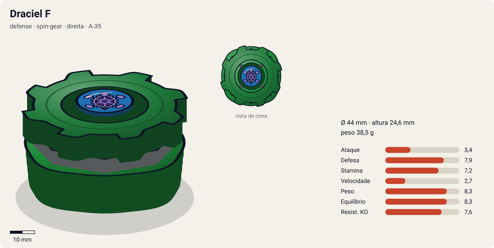
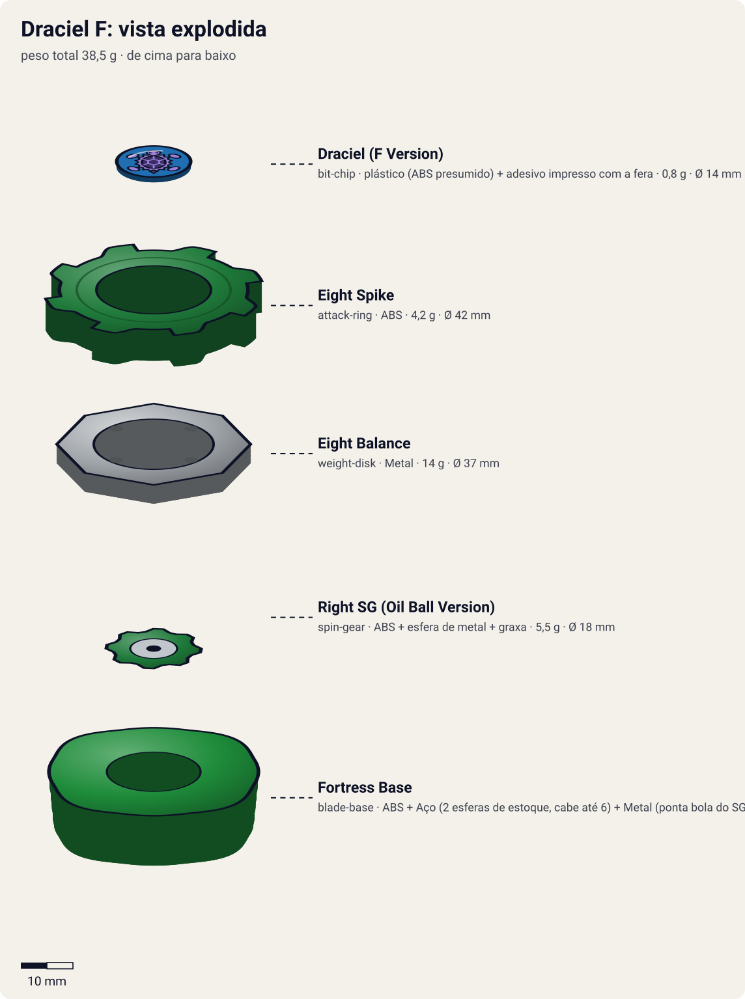
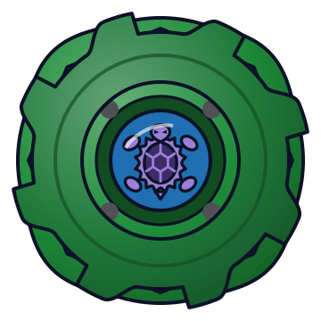

# Draciel F (Draciel Fortress / ドラシエルF)

<!-- auto:inicio (gerado por npm run build:research; não edite este bloco) -->

| Ficha | |
|---|---|
| Dono | [Max Tate (Max Mizuhara / 水原 マックス)](../../README.md) |
| Tipo · sistema · rotação | defense · spin-gear · direita |
| Código do produto | A-35 |
| Montada | Ø 44 mm · altura 24,6 mm · **38,5 g** (soma das peças) |
| Fera bit | [Draciel](../../../../feras-bit/draciel/) |
| Lançador | [Marksmen Grip (Sniper Grip)](../../../../lancadores/marksmen-grip/) |
| Ripcord | [winder-padrao](../../../../lancadores/ripcords/winder-padrao/) |

### Peças

| Camada | Peça | Material | Ø mm | Altura mm | Peso g | Estrelas Takara (A / D / S) | Desenho |
|---|---|---|---|---|---|---|---|
| Bit Chip | [Draciel (F Version)](../../../../pecas/bit-chip/draciel-f/) | plástico (ABS presumido) + adesivo impresso com a fera | 14 estimado | 8 estimado | 0,8 comunidade | — | [ver](pecas/bit-chip.svg) |
| Attack Ring | [Eight Spike](../../../../pecas/attack-ring/eight-spike/) | ABS | 42 estimado | 6 estimado | 4,2 wiki | 3 / 2 / 2 | [ver](pecas/attack-ring.svg) |
| Weight Disk | [Eight Balance](../../../../pecas/weight-disk/eight-balance/) | Metal | 37 estimado | 3,6 estimado | 14 wiki | 0,5 / 2 / 2,5 | [ver](pecas/weight-disk.svg) |
| Spin Gear / Core | [Right SG (Oil Ball Version)](../../../../pecas/spin-gear/right-sg-oil-ball-version/) | ABS + esfera de metal + graxa | 18 estimado | 12 estimado | 5,5 estimado | — | [ver](pecas/spin-gear.svg) |
| Blade Base | [Fortress Base](../../../../pecas/blade-base/fortress-base/) | ABS + Aço (2 esferas de estoque, cabe até 6) + Metal (ponta bola do SG Oil Ball) | 44 estimado | 15 estimado | 14 wiki | 1 / 3,5 / 3,5 | [ver](pecas/blade-base.svg) |

Fonte de cada medida em subscrito (wiki, comunidade, estimado). Detalhes em cada ficha de peça.

### Atributos

| Atributo | Brinquedo (calculado) | Ajuste anime | Jogo |
|---|---|---|---|
| Ataque | 3,4 | — | **3,4** |
| Defesa | 6,9 | +1 | **7,9** |
| Stamina | 7,2 | — | **7,2** |
| Velocidade | 2,7 | — | **2,7** |
| Peso | 8,3 | — | **8,3** |
| Equilíbrio | 8,3 | — | **8,3** |
| Resistência a KO | 6,6 | +1 | **7,6** |

Calculado por `src/beyblade/stats.js` a partir de: ponta metal-ball (atrito 0,2), contato defesa (recoil 0,4), peso do WD na equilibrado. Modelo em [docs/BEYBLADES.md](../../../../../docs/BEYBLADES.md).

### Fera bit em cima da bey

 

Sons: [invocacao](../../../../feras-bit/draciel/sons/invocacao.wav) · [rugido](../../../../feras-bit/draciel/sons/rugido.wav) · [ataque](../../../../feras-bit/draciel/sons/ataque.wav). Animações: [invocação](../../../../feras-bit/draciel/invocacao.svg) · [ataque](../../../../feras-bit/draciel/ataque.svg).

Fotos de referência (terceiros, só para estudo)

[anime.jpg](referencia/anime.jpg) · [imagem.jpg](referencia/imagem.jpg) · [pecas-attack-ring.gif](referencia/pecas-attack-ring.gif) · [pecas-blade-base.gif](referencia/pecas-blade-base.gif) · [pecas-pecas-desmontadas.jpg](referencia/pecas-pecas-desmontadas.jpg) · [pecas-spin-gear.gif](referencia/pecas-spin-gear.gif) · [pecas-weight-disk.gif](referencia/pecas-weight-disk.gif)

<!-- auto:fim -->

Anime: 

| Campo | Valor |
|---|---|
| Dono | Max Tate |
| Código do produto | A-35 (Takara) |
| Fera Bit (Bit-Beast) | Draciel (Genbu, tartaruga negra) |
| Série / temporada | Bakuten Shoot (2001): fim da S1 e primeira metade de V-Force (2002) |
| Primeira aparição (anime) | S1 ep. 45 "Breaking the Ice" (バイカル湖の決闘, Duelo no Lago Baikal) |
| Antecessora → Sucessora | [Draciel S](../draciel-s/) → [Draciel V](../draciel-v/) |

## Formato e geometria
- Silhueta circular com 8 pequenas projeções: simetria de 8 lados, raio médio; mais "redonda" que as Draciel anteriores.
- Peso concentrado na base (até 3 jogos de bolas de metal) e no centro → CG baixo.
- Perfil médio.

Análise das peças:
- [Eight Spike](../../../../pecas/attack-ring/eight-spike/) (4,2 g): circular com 8 projeções. Fraco em todos os campos (sem uso competitivo), mas mais redondo que o Cross Spike → menos recoil.
- [Eight Balance](../../../../pecas/weight-disk/eight-balance/) (14 g): octogonal, peso intermediário.
- [Right SG (Oil Ball Version)](../../../../pecas/spin-gear/right-sg-oil-ball-version/): SG direito; a base aceita SGs com rolamento (bearing).
- [Fortress Base](../../../../pecas/blade-base/fortress-base/) (12 g; 14 g com 1 jogo de bolas; até 18 g com 3): ponta de bola de metal com reservatório de óleo (a Takara manda graxa e espátula); bolsões para 2 jogos de bolas + 2 furos extras. Excelente base de defesa: fica no centro, o óleo reduz o atrito (stamina) e o peso ajustável evita ser empurrada.

Fotos das peças (terceiros): [AR](referencia/pecas-attack-ring.gif), [WD](referencia/pecas-weight-disk.gif), [SG](referencia/pecas-spin-gear.gif), [base](referencia/pecas-blade-base.gif), [desmontada](referencia/pecas-pecas-desmontadas.jpg).

## Comportamento na arena
- **Movimento**: centro fixo, ponta de bola lubrificada que gira com pouquíssimo atrito.
- **Ataque**: mínimo.
- **Defesa**: alta: bem pesada e com contorno mais circular, desvia golpes.
- **Stamina**: boa para a época (ponta de bola com óleo).
- **Matchups**: segura atacantes da S1 (no anime, segura o Black Dranzer); perde para upper/smash de alto nível e para defensores que a vencem no desgaste.
- **Gimmick**: ponta de metal com reservatório de óleo + bolas de metal ajustáveis.

## No anime
- Ep. 45: Max recebe a bey atualizada ao se despedir da mãe e chega ao Lago Baikal a tempo; a defesa da Draciel F segura o Black Dranzer de Kai até as 4 feras sagradas o derrotarem.
- Ep. 46: vence Ian, mas perde para Bryan & Spencer (Demolition Boys) e tem Draciel capturado; recuperado após Tyson vencer Tala.
- V-Force (ep. 1–28): perde para Mariam (ep. 2), vence Chameleon (ep. 9), luta em duplas contra Mariam & Joseph (ep. 13), Torre de Batalha (ep. 21) e perde Draciel para Jim do Team Psykick (ep. 22).
- Especial: *Fortress Defense*: Draciel usa as bolas de metal para criar uma barreira ao redor de si (V-Force ep. 21).
- Substituída pela Draciel V (Magnacore) no V-Force ep. 29.

## Mecânica no jogo
- **Movimento (IA)**: padrão "centro"; rotação no lugar, vira a frente para o atacante.
- **Gimmick**: reservatório de óleo: a perda de RPM por atrito com o piso é 15% menor que a de uma ponta de bola comum. Peso ajustável como na Draciel S (até 3 jogos de bolas).
- **Especial**: *Fortress Defense*. Escudo de 6 s que absorve 50% do dano de colisão e devolve 20% como recoil ao atacante; custo 100 de energia, recarga 22 s. Visual: anel de bolas de metal girando em volta de [Draciel](../../../../feras-bit/draciel/), com a fera em pose de [invocação](../../../../feras-bit/draciel/invocacao.svg).
- **Física**: massa relativa 1,15; raio 1,0; atrito da ponta 0,15; restituição 0,4.

## Ajuste do anime

| Atributo | Delta | Justificativa (episódio/batalha) |
|---|---|---|
| Defesa | +1 | Segura o Black Dranzer no Lago Baikal (S1 ep. 45), a bey mais forte da temporada. |
| Resistência a KO | +1 | Fortress Defense: a barreira mantém Draciel no estádio (V-Force ep. 21). |

Resultado esperado: a melhor defensora da S1; ainda perde por desgaste e por combinação de golpes (Bryan & Spencer, Mariam, Jim), por isso a stamina fica como no brinquedo.

## Fontes
- https://beyblade.fandom.com/wiki/Draciel_F
- https://beyblade.fandom.com/wiki/Fortress_Defense
- https://beyblade.fandom.com/wiki/Beyblade_-_Episode_45
- https://beyblade.fandom.com/wiki/Max_Tate
- Imagens: File:Draciel F.jpg, File:Draciel Fortress Anime.jpg, File:Draciel Fortress attack ring.gif, File:Eight Balance weight disk.gif, File:Draciel F Ball Bearing spin gear.gif, File:Draciel Fortress Ball Bearing base.gif, File:DracielFParts.jpg
