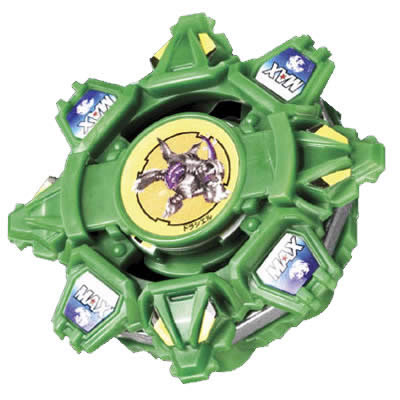

# Draciel F (Draciel Fortress / ドラシエルF)

Anime: 

| Campo | Valor |
|---|---|
| Dono | Max Tate |
| Código do produto | A-35 (Takara) |
| Tipo | Defense |
| Sistema | Spin Gear System |
| Rotação | Direita |
| Fera Bit (Bit-Beast) | Draciel (Genbu – tartaruga negra) |
| Série / temporada | Bakuten Shoot (2001) – fim da S1 e primeira metade de V-Force (2002) |
| Primeira aparição (anime) | S1 ep. 45 "Breaking the Ice" (バイカル湖の決闘 – Duelo no Lago Baikal) |
| Antecessora → Sucessora | Draciel S → Draciel V |

## 1. Peças (de cima para baixo)

| Camada | Peça | Descrição física | Função em batalha |
|---|---|---|---|
| Bit Chip | Draciel (versão F) | Chip da tartaruga | identidade / fera bit |
| Attack Ring (AR) | Eight Spike (4,2 g) | Circular com 8 projeções | Fraco em todos os campos (sem uso competitivo), mas mais redondo que o Cross Spike → menos recoil |
| Weight Disk (WD) | Eight Balance (14 g) | Octogonal, peso intermediário | Massa equilibrada |
| Spin Gear (SG) / Core | Right SG (Oil Ball / Ball Bearing ver.) | SG direito; a base aceita SGs com rolamento (bearing) | Rotação direita |
| Support Part / Sub Ring | — | — | — |
| Blade Base (BB) | Fortress Base (12 g; 14 g com 1 jogo de bolas; até 18 g com 3) | Ponta de bola de metal com reservatório de óleo (vem graxa + espátula na Takara); bolsões para 2 jogos de bolas + 2 furos extras | Excelente base de defesa: fica no centro; o óleo reduz atrito (stamina) e o peso ajustável evita ser empurrada |

Fotos das peças: `pecas/attack-ring.gif`, `pecas/weight-disk.gif`, `pecas/spin-gear.gif`, `pecas/blade-base.gif` (diagramas oficiais), `pecas/pecas-desmontadas.jpg`.

## 2. Formato e geometria
- Silhueta circular com 8 pequenas projeções: simetria de 8 lados, raio médio; mais "redonda" que as Draciel anteriores.
- Peso concentrado na base (até 3 jogos de bolas de metal) e no centro → CG baixo.
- Perfil médio.

## 3. Comportamento na arena
- **Movimento**: centro fixo, ponta de bola lubrificada que gira com pouquíssimo atrito.
- **Ataque**: mínimo.
- **Defesa**: alta — bem pesada e com contorno mais circular, desvia golpes.
- **Stamina**: boa para a época (ponta de bola com óleo).
- **Matchups**: segura atacantes da S1 (no anime, segura o Black Dranzer); perde para upper/smash de alto nível e para defensores que a vencem no desgaste.
- **Gimmick**: ponta de metal com reservatório de óleo + bolas de metal ajustáveis.

## 4. No anime
- Ep. 45: Max recebe a bey atualizada ao se despedir da mãe e chega ao Lago Baikal a tempo; a defesa da Draciel F segura o Black Dranzer de Kai até as 4 feras sagradas o derrotarem.
- Ep. 46: vence Ian, mas perde para Bryan & Spencer (Demolition Boys) e tem Draciel capturado; recuperado após Tyson vencer Tala.
- V-Force (ep. 1–28): perde para Mariam (ep. 2), vence Chameleon (ep. 9), luta em duplas contra Mariam & Joseph (ep. 13), Torre de Batalha (ep. 21) e perde Draciel para Jim do Team Psykick (ep. 22).
- Especial: *Fortress Defense* – Draciel usa as bolas de metal para criar uma barreira ao redor de si (V-Force ep. 21).
- Substituída pela Draciel V (Magnacore) no V-Force ep. 29.

## 5. Tradução para o jogo

| Atributo | Valor | Justificativa |
|---|---|---|
| Ataque | 2 | Eight Spike sem pontas ofensivas |
| Defesa | 9 | Base mais pesada até então + AR mais redondo; segura o Black Dranzer |
| Stamina | 7 | Ponta de bola com óleo, baixo atrito |
| Velocidade | 2 | Fica no centro |
| Peso | 8 | Até 3 jogos de bolas de metal |
| Equilíbrio | 7 | CG baixo e contorno circular |
| Burst/Knockout-resist | 9 | Pesada, redonda, centro fixo |

- **Movimento em IA**: "centro"; rotação no lugar, gira a frente para o atacante.
- **Especiais (no jogo)**: *Fortress Defense*: escudo de 6 s que absorve 50% do dano de colisão e devolve 20% como recoil ao atacante; custo 100, cooldown 22 s.
- **Física sugerida**: massa relativa 1,15; raio 1,0; atrito da ponta 0,15; restituição 0,4.

Os mesmos dados ficam em `dados.json`.

## 6. Fontes
- https://beyblade.fandom.com/wiki/Draciel_F
- https://beyblade.fandom.com/wiki/Fortress_Defense
- https://beyblade.fandom.com/wiki/Beyblade_-_Episode_45
- https://beyblade.fandom.com/wiki/Max_Tate
- Imagens: File:Draciel F.jpg, File:Draciel Fortress Anime.jpg, File:Draciel Fortress attack ring.gif, File:Eight Balance weight disk.gif, File:Draciel F Ball Bearing spin gear.gif, File:Draciel Fortress Ball Bearing base.gif, File:DracielFParts.jpg
