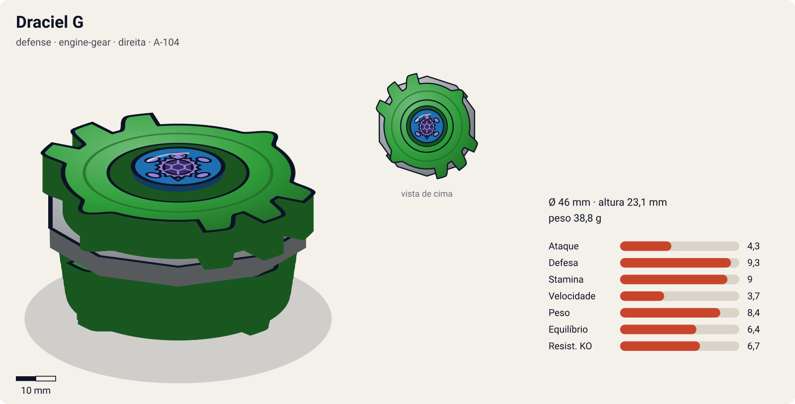
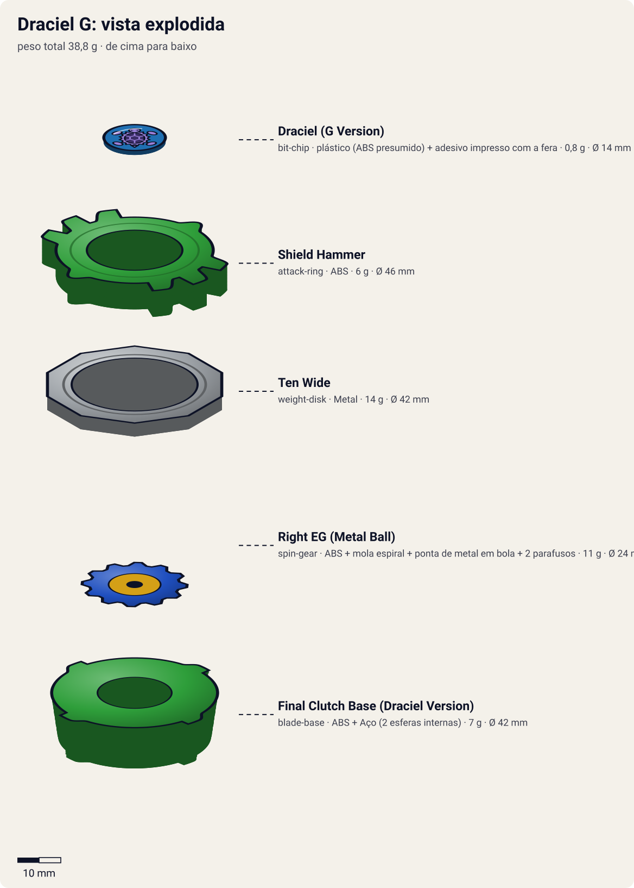
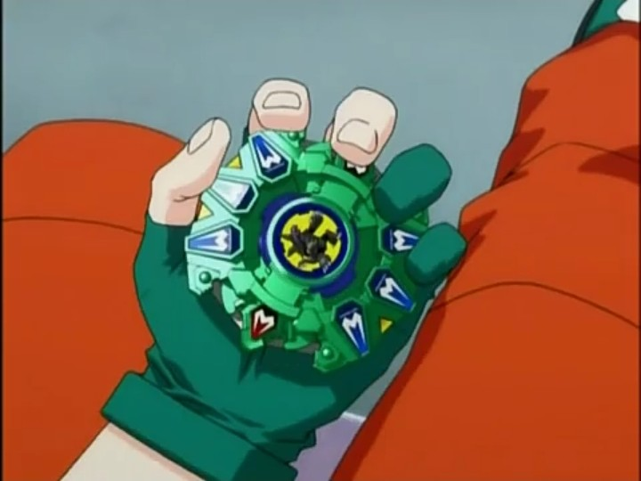

# Draciel G (Draciel Gravity / ドラシエルG)

<!-- auto:inicio (gerado por npm run build:research; não edite este bloco) -->

| Ficha | |
|---|---|
| Dono | [Max Tate (Max Mizuhara / 水原 マックス)](../../README.md) |
| Tipo · sistema · rotação | defense · engine-gear · direita |
| Código do produto | A-104 |
| Montada | Ø 46 mm · altura 23,1 mm · **38,8 g** (soma das peças) |
| Fera bit | [Draciel](../../../../feras-bit/draciel/) |
| Lançador | [Customize Grip (Dark Green) - versão Max](../../../../lancadores/customize-grip-max/) |
| Ripcord | [winder-padrao](../../../../lancadores/ripcords/winder-padrao/) |

### Peças

| Camada | Peça | Material | Ø mm | Altura mm | Peso g | Estrelas Takara (A / D / S) | Desenho |
|---|---|---|---|---|---|---|---|
| Bit Chip | [Draciel (G Version)](../../../../pecas/bit-chip/draciel-g/) | plástico (ABS presumido) + adesivo impresso com a fera | 14 estimado | 8 estimado | 0,8 comunidade | — | [ver](pecas/bit-chip.svg) |
| Attack Ring | [Shield Hammer](../../../../pecas/attack-ring/shield-hammer/) | ABS | 46 estimado | 6 estimado | 6 wiki | 2 / 4 / 2 | [ver](pecas/attack-ring.svg) |
| Weight Disk | [Ten Wide](../../../../pecas/weight-disk/ten-wide/) | Metal | 42 estimado | 3,1 estimado | 14 wiki | 1 / 1,5 / 4 | [ver](pecas/weight-disk.svg) |
| Spin Gear / Core | [Right EG (Metal Ball)](../../../../pecas/spin-gear/right-eg-metal-ball/) | ABS + mola espiral + ponta de metal em bola + 2 parafusos | 24 estimado | 18 estimado | 11 wiki | 1 / 1 / 3 | [ver](pecas/spin-gear.svg) |
| Blade Base | [Final Clutch Base (Draciel Version)](../../../../pecas/blade-base/final-clutch-base-draciel/) | ABS + Aço (2 esferas internas) | 42 estimado | 14 estimado | 7 estimado | 1 / 2 / 1 | [ver](pecas/blade-base.svg) |

Fonte de cada medida em subscrito (wiki, comunidade, estimado). Detalhes em cada ficha de peça.

### Atributos

| Atributo | Brinquedo (calculado) | Ajuste anime | Jogo |
|---|---|---|---|
| Ataque | 4,3 | — | **4,3** |
| Defesa | 7,3 | +2 | **9,3** |
| Stamina | 8 | +1 | **9** |
| Velocidade | 3,7 | — | **3,7** |
| Peso | 8,4 | — | **8,4** |
| Equilíbrio | 6,4 | — | **6,4** |
| Resistência a KO | 6,7 | — | **6,7** |

Calculado por `src/beyblade/stats.js` a partir de: ponta metal-ball (atrito 0,2), contato defesa (recoil 0,5), peso do WD na periferia, Engine Gear (clutch). Modelo em [docs/BEYBLADES.md](../../../../../docs/BEYBLADES.md).

### Fera bit em cima da bey

 

Sons: [invocacao](../../../../feras-bit/draciel/sons/invocacao.wav) · [rugido](../../../../feras-bit/draciel/sons/rugido.wav) · [ataque](../../../../feras-bit/draciel/sons/ataque.wav). Animações: [invocação](../../../../feras-bit/draciel/invocacao.svg) · [ataque](../../../../feras-bit/draciel/ataque.svg).

Fotos de referência (terceiros, só para estudo)

[anime.jpg](referencia/anime.jpg) · [imagem.png](referencia/imagem.png) · [pecas-attack-ring.jpg](referencia/pecas-attack-ring.jpg) · [pecas-blade-base.jpg](referencia/pecas-blade-base.jpg) · [pecas-engine-gear.jpg](referencia/pecas-engine-gear.jpg)

<!-- auto:fim -->

Anime: 

| Campo | Valor |
|---|---|
| Dono | Max Tate |
| Código do produto | A-104 (Takara) |
| Fera Bit (Bit-Beast) | Draciel (Genbu, tartaruga negra) |
| Série / temporada | G-Revolution (2003) |
| Primeira aparição (anime) | G-Rev ep. 16 "Fire and Water" |
| Antecessora → Sucessora | [Draciel V2](../draciel-v2/) → [Draciel MS](../draciel-ms/) |

## Formato e geometria
- Silhueta oval/retangular com 2 cabeças e 2 garras largas; simetria de 2 lados; raio grande (o AR é bem largo).
- Ten Wide joga o peso para a borda (boa inércia); Engine Gear pesado no centro.
- Perfil médio-alto (Engine Gear + ponta de bola).

Análise das peças:
- [Shield Hammer](../../../../pecas/attack-ring/shield-hammer/) (6 g): 2 pequenas cabeças de tartaruga opostas + 2 "garras" opostas, cada uma com 3 hexágonos em losango ligeiramente salientes. Feito para defesa; contorno razoavelmente arredondado, mas com algum recoil e sem capacidade de ataque.
- [Ten Wide](../../../../pecas/weight-disk/ten-wide/) (14 g): 10 lados, peso na periferia → resiste a mudanças de rotação, ajuda a stamina.
- [Right EG (Metal Ball)](../../../../pecas/spin-gear/right-eg-metal-ball/): Engine Gear (mola que recebe corda no lançamento) com ponta de bola de metal que entra num cone. Libera um "segundo fôlego" de rotação; a ponta pode se autodestabilizar quando a bey já está inclinada (o cone empurra para o lado).
- [Final Clutch Base (Draciel Version)](../../../../pecas/blade-base/final-clutch-base-draciel/) ("Hit Release"): a mais leve das bases Final Clutch; tem bolas de metal internas (efeito pequeno). Solta o Engine Gear perto do fim da batalha, dando uma arrancada quando o rival já está cansado.

Fotos das peças (terceiros): [AR](referencia/pecas-attack-ring.jpg), [Engine Gear](referencia/pecas-engine-gear.jpg), [base](referencia/pecas-blade-base.jpg).

## Comportamento na arena
- **Movimento**: centro na maior parte da luta; no "final clutch" o EG solta e a bey ganha rotação e arranque no fim.
- **Ataque**: muito baixo.
- **Defesa**: alta no anime; no brinquedo, o AR com recoil e a ponta de cone limitam.
- **Stamina**: boa graças ao Ten Wide + segundo fôlego do Engine Gear.
- **Matchups**: no anime perde por pouco para Kai (Dranzer G) apesar do Gravity Control; combate longo favorece Draciel.
- **Gimmick**: Engine Gear + Final Clutch.

## No anime
- Estreia em G-Rev ep. 16 contra Kai (Dranzer G), derrota apertada; usada também nos ep. 19 (vs Ray, Lee & Rick), 25 (vs Tyson), 28 (battle royale), 31 (vence Daichi) e 32 (vs banda de Ming Ming, com Tyson e Daichi).
- Especiais:
  - *Gravity Control*: Draciel carrega energia pela arena e circula o oponente criando uma tromba-d'água gravitacional; depois gira pelo estádio no sentido oposto ao da bey presa, que perde equilíbrio, energia e stamina (Dragoon e Dranzer ficam presos nos ep. 16 e 25).
  - *Ultra Gravity Control*: versão mais forte (sem descrição detalhada na wiki).
  - *Tidal Wave*: citado na página de Max; descrição não confirmada.
- Substituída pela Draciel MS (Hard Metal System) no ep. 40.

## Mecânica no jogo
- **Movimento (IA)**: padrão "centro". Depois do Engine Gear, 2 s de deslocamento orbital curto e volta ao centro.
- **Gimmick (Final Clutch)**: quando o RPM cai abaixo de 35%, o Engine Gear solta sozinho: +25% de RPM na hora (+1 de velocidade e +0,5 de ataque pelo resto da luta, conforme o modelo). Uma vez por luta.
- **Especiais**:
  - *Gravity Control*: vórtice de 5 s em volta do oponente: −30% de equilíbrio e dreno de 2% de RPM/s; custo 100 de energia, recarga 22 s.
  - *Ultra Gravity Control*: vórtice de 7 s: −45% de equilíbrio e dreno de 3% de RPM/s; custo 150, recarga 35 s.
  - Visual: tromba-d'água girando em volta do alvo, com [Draciel](../../../../feras-bit/draciel/) na pose de [invocação](../../../../feras-bit/draciel/invocacao.svg); o golpe final reaproveita o [ataque](../../../../feras-bit/draciel/ataque.svg).
- **Física**: massa relativa 1,2; raio 1,1; atrito da ponta 0,2; restituição 0,45.

## Ajuste do anime

| Atributo | Delta | Justificativa (episódio/batalha) |
|---|---|---|
| Defesa | +2 | Segura Dranzer G quase até o fim (ep. 16) e vence Daichi (ep. 31). |
| Stamina | +1 | Gravity Control e o segundo fôlego do Engine Gear: as lutas de Max em G-Rev se decidem no desgaste (ep. 16, 25). |

Resultado esperado: defensora muito forte que perde por pouco para Dranzer G (Kai vence no ataque final) e vence Gaia Dragoon G no desgaste.

## Fontes
- https://beyblade.fandom.com/wiki/Draciel_G
- https://beyblade.fandom.com/wiki/Gravity_Control
- https://beyblade.fandom.com/wiki/Ultra_Gravity_Control
- https://beyblade.fandom.com/wiki/Engine_Gear_System
- https://beyblade.fandom.com/wiki/Max_Tate
- Imagens: File:Draciel G.png, File:Screenshot 20190829-104225 1.jpg, File:DracielG 0002.jpg (AR), File:DracielG 0003.jpg (EG), File:DracielG 0000.jpg (BB)
