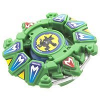

# Draciel G (Draciel Gravity / ドラシエルG)

Anime: 

| Campo | Valor |
|---|---|
| Dono | Max Tate |
| Código do produto | A-104 (Takara) |
| Tipo | Defense |
| Sistema | Engine Gear System |
| Rotação | Direita |
| Fera Bit (Bit-Beast) | Draciel (Genbu – tartaruga negra) |
| Série / temporada | G-Revolution (2003) |
| Primeira aparição (anime) | G-Rev ep. 16 "Fire and Water" |
| Antecessora → Sucessora | Draciel V2 → Draciel MS |

## 1. Peças (de cima para baixo)

| Camada | Peça | Descrição física | Função em batalha |
|---|---|---|---|
| Bit Chip | Draciel (versão G) | Chip da tartaruga | identidade / fera bit |
| Attack Ring (AR) | Shield Hammer (6 g) | 2 pequenas cabeças de tartaruga opostas + 2 "garras" opostas, cada uma com 3 hexágonos em losango ligeiramente salientes | Feito para defesa; contorno razoavelmente arredondado, mas com algum recoil e sem capacidade de ataque |
| Weight Disk (WD) | Ten Wide (14 g) | 10 lados, peso na periferia | Inércia periférica → resiste a mudanças de rotação, ajuda stamina |
| Spin Gear (SG) / Core | Right Engine Gear (Metal Ball) | Engine Gear (mola que dá corda ao lançar) com ponta de bola de metal; a bola entra num cone | Rotação direita; o EG libera um "segundo fôlego" de rotação. A ponta pode se autodestabilizar quando a bey já está inclinada (cone empurra para o lado) |
| Support Part / Sub Ring | — | — | — |
| Blade Base (BB) | Hit Release (versão Draciel) / Final Clutch | A mais leve das bases Final Clutch; tem bolas de metal internas (efeito pequeno) | Gimmick: o Engine Gear é solto perto do fim da batalha (final clutch), dando uma arrancada de rotação/movimento quando o rival já está cansado |

Fotos das peças: `pecas/attack-ring.jpg` (Shield Hammer), `pecas/engine-gear.jpg` (Right EG Metal Ball), `pecas/blade-base.jpg` (Hit Release). Fotos da galeria "DracielG 000x" da wiki.

## 2. Formato e geometria
- Silhueta oval/retangular com 2 cabeças e 2 garras largas; simetria de 2 lados; raio grande (o AR é bem largo).
- Ten Wide joga o peso para a borda (boa inércia), engine gear pesado no centro.
- Perfil médio-alto (engine gear + ponta de bola).

## 3. Comportamento na arena
- **Movimento**: centro na maior parte da luta; no "final clutch" o EG solta e a bey ganha rotação/arranque extra no fim.
- **Ataque**: muito baixo.
- **Defesa**: alta no anime (âncora do BRIEF: "Defesa 10 ≈ Draciel G"); no brinquedo, o AR com recoil e a ponta de cone limitam.
- **Stamina**: boa graças ao Ten Wide + segundo fôlego do Engine Gear.
- **Matchups**: anime – perde por pouco para Kai (Dranzer G) apesar do Gravity Control; combate de longa duração favorece Draciel.
- **Gimmick**: Engine Gear + Hit Release (Final Clutch).

## 4. No anime
- Estreia em G-Rev ep. 16 contra Kai (Dranzer G) – derrota apertada; usada também nos ep. 19 (vs Ray, Lee & Rick), 25 (vs Tyson), 28 (battle royale), 31 (vence Daichi) e 32 (vs banda de Ming Ming, com Tyson e Daichi).
- Especiais:
  - *Gravity Control* – Draciel carrega energia pela arena e circula o oponente criando uma tromba-d'água gravitacional; depois gira pelo estádio no sentido oposto ao da bey presa, fazendo-a perder equilíbrio, energia e stamina (Dragoon e Dranzer ficam presos no ep. 16/25).
  - *Ultra Gravity Control* – versão mais forte (sem descrição detalhada na wiki).
  - *Tidal Wave* – citado na página de Max; descrição não confirmada.
- Substituída pela Draciel MS (Hard Metal System) no ep. 40.

## 5. Tradução para o jogo

| Atributo | Valor | Justificativa |
|---|---|---|
| Ataque | 3 | Shield Hammer sem ataque; especial é de controle |
| Defesa | 10 | Âncora do BRIEF; AR largo + Ten Wide |
| Stamina | 8 | Ten Wide + "segundo fôlego" do Engine Gear |
| Velocidade | 3 | Centro; pico breve com o final clutch |
| Peso | 8 | Engine gear + WD 14 g + bolas de metal na base |
| Equilíbrio | 6 | Ponta de cone pode piorar wobble |
| Burst/Knockout-resist | 9 | Pesada e larga |

- **Movimento em IA**: "centro"; quando RPM < 35% dispara o *final clutch* automático (+25% de RPM instantâneo e 2 s de deslocamento orbital curto).
- **Especiais (no jogo)**:
  - *Gravity Control*: cria vórtice de 5 s ao redor do oponente que reduz o equilíbrio dele em 30% e drena 2% de RPM/s; custo 100, cooldown 22 s.
  - *Ultra Gravity Control*: versão de 7 s com −45% de equilíbrio; custo 150, cooldown 35 s.
- **Física sugerida**: massa relativa 1,2; raio 1,1; atrito da ponta 0,2; restituição 0,45; evento "engine gear" no fim.

Os mesmos dados ficam em `dados.json`.

## 6. Fontes
- https://beyblade.fandom.com/wiki/Draciel_G
- https://beyblade.fandom.com/wiki/Gravity_Control
- https://beyblade.fandom.com/wiki/Ultra_Gravity_Control
- https://beyblade.fandom.com/wiki/Engine_Gear_System
- https://beyblade.fandom.com/wiki/Max_Tate
- Imagens: File:Draciel G.png, File:Screenshot 20190829-104225 1.jpg, File:DracielG 0002.jpg (AR), File:DracielG 0003.jpg (EG), File:DracielG 0000.jpg (BB)
