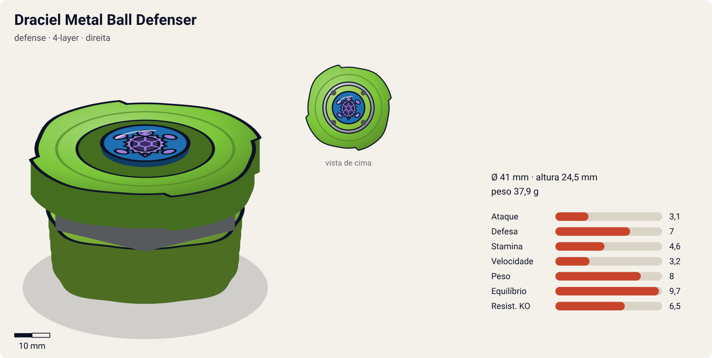
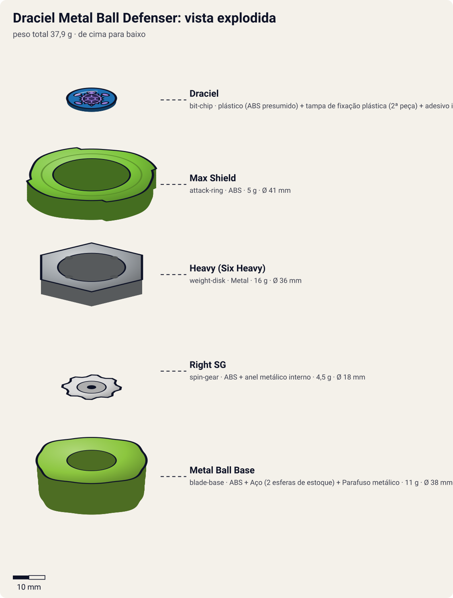
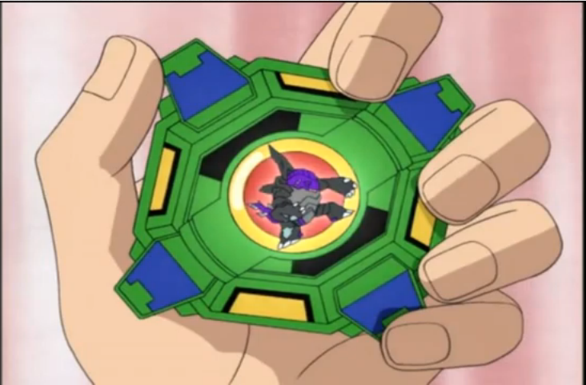

# Draciel Metal Ball Defenser (ドラシエルメタルボールディフェンサー / Dorashieru Metaru Bōru Difensā)

<!-- auto:inicio (gerado por npm run build:research; não edite este bloco) -->

| Ficha | |
|---|---|
| Dono | [Max Tate (Max Mizuhara / 水原 マックス)](../../README.md) |
| Tipo · sistema · rotação | defense · 4-layer · direita |
| Montada | Ø 41 mm · altura 24,5 mm · **37,9 g** (soma das peças) |
| Fera bit | [Draciel](../../../../feras-bit/draciel/) |
| Lançador | [EZ Shooter Grip (Easy Shooter Grip)](../../../../lancadores/ez-shooter-grip/) |
| Ripcord | [winder-padrao](../../../../lancadores/ripcords/winder-padrao/) |

### Peças

| Camada | Peça | Material | Ø mm | Altura mm | Peso g | Estrelas Takara (A / D / S) | Desenho |
|---|---|---|---|---|---|---|---|
| Bit Chip | [Draciel](../../../../pecas/bit-chip/draciel/) | plástico (ABS presumido) + tampa de fixação plástica (2ª peça) + adesivo impresso com a fera | 15 estimado | 5 estimado | 1,4 comunidade | — | [ver](pecas/bit-chip.svg) |
| Attack Ring | [Max Shield](../../../../pecas/attack-ring/max-shield/) | ABS | 41 estimado | 6 estimado | 5 wiki | 2 / 2 / 1 | [ver](pecas/attack-ring.svg) |
| Weight Disk | [Heavy (Six Heavy)](../../../../pecas/weight-disk/heavy/) | Metal | 36 estimado | 4,5 estimado | 16 wiki | 1 / 3 / 1 | [ver](pecas/weight-disk.svg) |
| Spin Gear / Core | [Right SG](../../../../pecas/spin-gear/right-sg/) | ABS + anel metálico interno | 18 estimado | 10 estimado | 4,5 estimado | — | [ver](pecas/spin-gear.svg) |
| Blade Base | [Metal Ball Base](../../../../pecas/blade-base/metal-ball-base/) | ABS + Aço (2 esferas de estoque) + Parafuso metálico | 38 estimado | 14 estimado | 11 wiki | 1 / 3 / 3 | [ver](pecas/blade-base.svg) |

Fonte de cada medida em subscrito (wiki, comunidade, estimado). Detalhes em cada ficha de peça.

### Atributos

| Atributo | Brinquedo (calculado) | Ajuste anime | Jogo |
|---|---|---|---|
| Ataque | 3,1 | — | **3,1** |
| Defesa | 7 | — | **7** |
| Stamina | 4,6 | — | **4,6** |
| Velocidade | 3,2 | — | **3,2** |
| Peso | 8 | — | **8** |
| Equilíbrio | 9,7 | — | **9,7** |
| Resistência a KO | 6,5 | — | **6,5** |

Calculado por `src/beyblade/stats.js` a partir de: ponta ball (atrito 0,3), contato defesa (recoil 0,5), peso do WD na centro. Modelo em [docs/BEYBLADES.md](../../../../../docs/BEYBLADES.md).

### Fera bit em cima da bey

 

Sons: [invocacao](../../../../feras-bit/draciel/sons/invocacao.wav) · [rugido](../../../../feras-bit/draciel/sons/rugido.wav) · [ataque](../../../../feras-bit/draciel/sons/ataque.wav). Animações: [invocação](../../../../feras-bit/draciel/invocacao.svg) · [ataque](../../../../feras-bit/draciel/ataque.svg).

Fotos de referência (terceiros, só para estudo)

[anime.png](referencia/anime.png) · [imagem.jpg](referencia/imagem.jpg) · [pecas-attack-ring.gif](referencia/pecas-attack-ring.gif) · [pecas-blade-base.gif](referencia/pecas-blade-base.gif) · [pecas-pecas-desmontadas.jpg](referencia/pecas-pecas-desmontadas.jpg) · [pecas-weight-disk.gif](referencia/pecas-weight-disk.gif)

<!-- auto:fim -->

Anime: 

| Campo | Valor |
|---|---|
| Dono | Max Tate (construída pelo pai, Taro Tate) |
| Código do produto | Sem código "A-" (linha anterior "Next Generation Beigoma Battle: Beyblade", base lançada em maio de 2000) |
| Sistema | 4-Layer System (pré-Spin Gear; a página da wiki também a cita como Spin Gear System) |
| Fera Bit (Bit-Beast) | Draciel (Genbu, tartaruga negra) |
| Série / temporada | Bakuten Shoot (2001) |
| Primeira aparição (anime) | S1 ep. 3 "Take It to the Max!" (Draciel, a fera, surge no ep. 5) |
| Antecessora → Sucessora | — → [Draciel S](../draciel-s/) |

Outros nomes: "Draciel Metal Ball Defendor"; no mangá, antes do bit chip, "Protociel" (JP) / "Protoshell" (EN).

## Formato e geometria
- Silhueta quase quadrada (4 painéis), raio pequeno; simetria de 4 lados.
- Peso concentrado no centro (Heavy WD + bolas de metal) → muita inércia de rotação e boa estabilidade; pouco alcance de contato.
- Perfil baixo e compacto.

Análise das peças:
- [Max Shield](../../../../pecas/attack-ring/max-shield/) (5 g): 4 painéis quase retos ao redor. Pouco eficiente em defesa (os painéis retos geram atrito e recoil); pequeno o bastante para customização de "weight disk attack".
- [Heavy (Six Heavy)](../../../../pecas/weight-disk/heavy/) (16 g): hexagonal, peso perto do centro → massa alta e compacta, mais RPM e resistência a empurrões.
- [Right SG](../../../../pecas/spin-gear/right-sg/): segundo o infobox; na prática a base é de encaixe por rosca estilo 4-layer.
- [Metal Ball Base](../../../../pecas/blade-base/metal-ball-base/) (9 g; 11 g com 1 jogo de bolas; até 13 g com 2): ponta de bola e compartimento com bolas de metal sobre rampas internas. Em alta rotação as bolas sobem as rampas (peso para fora → estabilidade); ao desacelerar voltam ao centro (mais tempo de giro). Base sólida de defesa.

Fotos das peças (terceiros): [AR](referencia/pecas-attack-ring.gif), [WD](referencia/pecas-weight-disk.gif), [base](referencia/pecas-blade-base.gif), [desmontada](referencia/pecas-pecas-desmontadas.jpg).

## Comportamento na arena
- **Movimento**: fica parada no centro (ponta de bola); quase não se desloca.
- **Ataque**: praticamente nulo; vence por desgaste.
- **Defesa**: boa pela massa e centro de gravidade baixo; os painéis retos do AR geram algum recoil.
- **Stamina**: média-boa; as bolas descem ao centro no fim, prolongando o giro (mas reduzindo equilíbrio).
- **Pontos fortes**: peso, ficar no centro. **Fracos**: AR ruim, alcance pequeno; perde para smash de elite e upper.
- **Gimmick**: bolas de metal móveis (sobem/descem as rampas conforme a rotação).

## No anime
- Primeira bey de Max. Vence Tyson (Dragoon S) na loja do pai (ep. 3); vence o Bloco B do regional (ep. 4); no ep. 5 Draciel aparece pela 1ª vez contra Kai (uma vitória e uma derrota na semifinal); vence Waylan e o "Charming Prince" no ep. 10.
- Especiais: nenhum com nome confirmado nesta bey.
- Substituída por Draciel S (presente de Kenny, ep. 14); Max dá a bey antiga aos Blade Hunters.

## Mecânica no jogo
- **Movimento (IA)**: padrão "centro". Segura o meio do estádio com raio de deriva mínimo e só gira a frente para receber o atacante de frente; não persegue.
- **Gimmick**: bolas de metal móveis. Acima de 60% de RPM, +10% de equilíbrio (bolas para fora); abaixo disso as bolas voltam ao centro: −10% de equilíbrio e −15% na perda de RPM por segundo.
- **Especial**: *Metal Ball Guard* (nome de jogo; o anime não dá nome a um especial desta bey). Por 5 s, +30% de massa efetiva e −20% de recoil recebido; custo 80 de energia, recarga 20 s. Visual: casco de [Draciel](../../../../feras-bit/draciel/) da [invocação](../../../../feras-bit/draciel/invocacao.svg), sem a onda d'água do ataque.
- **Física**: massa relativa 1,05; raio 0,9; atrito da ponta 0,2; restituição 0,45.

## Ajuste do anime

| Atributo | Delta | Justificativa (episódio/batalha) |
|---|---|---|
| — | 0 | Bey de início de série, sem especial nomeado; vence Tyson (ep. 3) e divide com Kai (ep. 5), resultados que o brinquedo já explica (Def 8, Equil 9,7). |

Resultado esperado: defensora sólida de começo de jogo, vence atacantes fracos por desgaste e perde para Dranzer S e para as Draciel posteriores.

Nota para o coordenador: o brinquedo calculado tem Defesa 8, acima da Draciel S (6) e quase igual à Draciel F (7,7), apesar de o AR Max Shield ser descrito como ruim. Pode ser efeito do contato "defesa" (recoil baixo) atribuído ao Max Shield, quando o texto fala de painéis retos com recoil.

## Fontes
- https://beyblade.fandom.com/wiki/Draciel_Metal_Ball_Defenser
- https://beyblade.fandom.com/wiki/Blade_Base_-_Metal_Ball_Base
- https://beyblade.fandom.com/wiki/Weight_Disk_-_Heavy
- https://beyblade.fandom.com/wiki/Max_Tate (tabela de batalhas)
- https://beyblade.fandom.com/wiki/Beyblade_-_Episode_14
- Imagens: File:Draciel Metal Ball Defense 01.jpg, File:Ep5.52.PNG, File:Draciel Metal Ball Defender attack ring.gif, File:Six Heavy Weight Disk.gif, File:Draciel M.B.D Metal Ball base.gif, File:DC M.B.D parts 1.jpg
