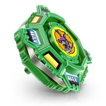

# Draciel Metal Ball Defenser (ドラシエルメタルボールディフェンサー / Dorashieru Metaru Bōru Difensā)

Anime: 

| Campo | Valor |
|---|---|
| Dono | Max Tate (construída pelo pai, Taro Tate) |
| Código do produto | Sem código "A-" (linha anterior "Next Generation Beigoma Battle: Beyblade", base lançada em maio de 2000) |
| Tipo | Defense |
| Sistema | 4-Layer System (pré-Spin Gear; a página da wiki também a cita como Spin Gear System – ver nota) |
| Rotação | Direita |
| Fera Bit (Bit-Beast) | Draciel (Genbu – tartaruga negra) |
| Série / temporada | Bakuten Shoot (2001) |
| Primeira aparição (anime) | S1 ep. 3 "Take It to the Max!" (Draciel, a fera, surge no ep. 5) |
| Antecessora → Sucessora | — → Draciel S |

Outros nomes: "Draciel Metal Ball Defendor"; no mangá, antes do bit chip, "Protociel" (JP) / "Protoshell" (EN).

## 1. Peças (de cima para baixo)

| Camada | Peça | Descrição física | Função em batalha |
|---|---|---|---|
| Bit Chip | Draciel | Chip com a tartaruga | identidade / fera bit |
| Attack Ring (AR) | Max Shield (5 g) | Pequeno, 4 painéis quase retos ao redor | Pouco eficiente em defesa (os painéis retos geram atrito/recoil); pequeno o bastante para customização de "weight disk attack" |
| Weight Disk (WD) | Heavy ("Six Heavy", 16 g) | Hexagonal, peso concentrado perto do centro | Massa alta e compacta → mais RPM e resistência a empurrões |
| Spin Gear (SG) / Core | Right SG (segundo o infobox; na prática a base é de encaixe por rosca estilo 4-layer) | — | Rotação direita |
| Support Part / Sub Ring | — | — | — |
| Blade Base (BB) | Metal Ball Base (9 g; 11 g com 1 jogo de bolas; até 13 g com 2) | Base de rosca estilo 4-layer, ponta de bola, compartimento com bolas de metal sobre rampas internas | Gimmick: em alta rotação as bolas sobem as rampas (peso para fora → estabilidade); ao desacelerar voltam ao centro (mais tempo de giro). Base sólida de defesa |

Fotos das peças: `pecas/attack-ring.gif`, `pecas/weight-disk.gif`, `pecas/blade-base.gif` (diagramas oficiais), `pecas/pecas-desmontadas.jpg`.

## 2. Formato e geometria
- Silhueta quase quadrada (4 painéis), raio pequeno; simetria de 4 lados.
- Peso concentrado no centro (Heavy WD + bolas de metal) → muita inércia de rotação e boa estabilidade; pouco alcance de contato.
- Perfil baixo e compacto.

## 3. Comportamento na arena
- **Movimento**: fica parada no centro (ponta de bola); quase não se desloca.
- **Ataque**: praticamente nulo; vence por desgaste.
- **Defesa**: boa pela massa e centro de gravidade baixo; os painéis retos do AR geram algum recoil.
- **Stamina**: média-boa; as bolas descem ao centro no fim, prolongando o giro (mas reduzindo equilíbrio).
- **Pontos fortes**: peso, ficar no centro. **Fracos**: AR ruim, alcance pequeno; perde para smash de elite e upper.
- **Gimmick**: bolas de metal móveis (sobem/descem as rampas conforme a rotação).

## 4. No anime
- Primeira bey de Max. Vence Tyson (Dragoon S) na loja do pai (ep. 3); vence o Bloco B do regional (ep. 4); no ep. 5 Draciel aparece pela 1ª vez contra Kai (uma vitória e uma derrota na semifinal); vence Waylan e o "Charming Prince" no ep. 10.
- Especiais: nenhum com nome confirmado nesta bey.
- Substituída por Draciel S (presente de Kenny, ep. 14); Max dá a bey antiga aos Blade Hunters.

## 5. Tradução para o jogo

| Atributo | Valor | Justificativa |
|---|---|---|
| Ataque | 2 | AR de 4 painéis retos sem pontas de ataque |
| Defesa | 7 | Massa central + base de bolas de metal; abaixo das Draciel posteriores |
| Stamina | 6 | Gimmick das bolas ajuda no fim do giro; AR com atrito atrapalha |
| Velocidade | 2 | Ponta de bola, quase estática |
| Peso | 7 | Heavy WD (16 g) + bolas de metal |
| Equilíbrio | 6 | Bom no início, piora quando as bolas voltam ao centro |
| Burst/Knockout-resist | 7 | Pesada e baixa, difícil de expulsar |

- **Movimento em IA**: "centro" – permanece no meio; pequenas correções para manter contato frontal.
- **Especiais (no jogo)**: *Metal Ball Guard* (nome de jogo, não do anime): durante 5 s +30% de massa efetiva e −20% de recoil recebido; custo 80, cooldown 20 s.
- **Física sugerida**: massa relativa 1,05; raio 0,9; atrito da ponta 0,2; restituição 0,45.

Os mesmos dados ficam em `dados.json`.

## 6. Fontes
- https://beyblade.fandom.com/wiki/Draciel_Metal_Ball_Defenser
- https://beyblade.fandom.com/wiki/Blade_Base_-_Metal_Ball_Base
- https://beyblade.fandom.com/wiki/Weight_Disk_-_Heavy
- https://beyblade.fandom.com/wiki/Max_Tate (tabela de batalhas)
- https://beyblade.fandom.com/wiki/Beyblade_-_Episode_14
- Imagens: File:Draciel Metal Ball Defense 01.jpg, File:Ep5.52.PNG, File:Draciel Metal Ball Defender attack ring.gif, File:Six Heavy Weight Disk.gif, File:Draciel M.B.D Metal Ball base.gif, File:DC M.B.D parts 1.jpg
