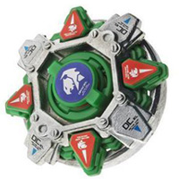

# Draciel MS (Draciel Metal Shield / ドラシエルMS（メタルシールド） – Dorashieru MS (Metaru Shīrudo))

Anime: 

| Campo | Valor |
|---|---|
| Dono | Max Tate |
| Código do produto | A-125 (Takara) |
| Tipo | Defense |
| Sistema | Hard Metal System (HMS / Heavy Metal System) |
| Rotação | Ambas (dual-spin – o lançador HMS lança para os dois lados; no anime gira para a direita) |
| Fera Bit (Bit-Beast) | Draciel (Genbu – tartaruga negra) |
| Série / temporada | G-Revolution (2003) |
| Primeira aparição (anime) | G-Rev ep. 40 "Back to Basics" |
| Antecessora → Sucessora | Draciel G → — (última Draciel do anime) |

## 1. Peças (de cima para baixo)

| Camada | Peça | Descrição física | Função em batalha |
|---|---|---|---|
| Bit Chip | Bit Protector "Draciel Emblem" | Protetor de plástico verde (ABS) com adesivo do emblema de Draciel ou da fera | identidade / fera bit |
| Attack Ring (AR) | Metal Defense (20 g) – Metal Frame "Cross Shield" + ABS Caul "Draciel" | Anel com estrutura de metal em cruz recoberta por capa plástica; contorno arredondado | Defesa ★★★, ataque ★★, stamina ★★ (estrelas oficiais); o metal concentra muita massa na periferia |
| Weight Disk (WD) | Circle Wide (14 g; a versão Takara de Draciel MS é 0,5–0,7 g mais pesada) | Círculo perfeito, o maior e mais leve dos 3 WDs HMS originais | Massa periférica → favorece stamina |
| Spin Gear (SG) / Core | Running Core: Sharp Core (2 g) | Ponta afiada de baixo atrito (HMS não usa SG) | Gira muito com pouco atrito; quase não se move; fácil de desequilibrar se atingido de lado |
| Support Part / Sub Ring | — | — | — |
| Blade Base (BB) | (integrada ao Running Core – sistema HMS) | — | — |

Fotos das peças: `pecas/bit-protector.jpg`, `pecas/attack-ring.jpg` (Metal Defense), `pecas/weight-disk.jpg` (Circle Wide), `pecas/running-core.jpg` (Sharp Core) – fotos grandes (~2 MB) da galeria da wiki.

## 2. Formato e geometria
- Silhueta circular/hexagonal com proteções em cruz; simetria de 4 lados; raio pequeno (~75% de uma bey plástica, como todo HMS).
- Muita massa no AR de metal (20 g) e no Circle Wide → altíssima inércia para o tamanho; peso total ~35 g (fonte de varejo).
- Perfil baixo e compacto.

## 3. Comportamento na arena
- **Movimento**: fica no centro (ponta sharp), quase imóvel.
- **Ataque**: baixo; contato metálico pesado pode causar recoil no atacante.
- **Defesa**: muito alta pelo metal e pelo tamanho compacto (difícil de acertar "por baixo").
- **Stamina**: boa (ponta sharp + Circle Wide), mas sujeita a perder equilíbrio quando empurrada lateralmente.
- **Matchups**: segura atacantes HMS pesados; perde em choques fortes que a tiram do eixo (no anime perde para Michael).
- **Gimmick**: estrutura de metal do HMS; rotação para os dois lados.

## 4. No anime
- Estreia em G-Rev ep. 40 contra Michael (derrota); usada no 4×4 do ep. 41, contra Mystel da BEGA (empate, ep. 44–45), contra Tyson com Daichi (vitória, ep. 46) e na batalha final de treino com o time (ep. 49).
- Especial: *Aqua Shield* – Max e Draciel erguem uma enorme muralha de água que desacelera e reduz a intensidade do golpe do oponente, permitindo contra-atacá-lo quando ele atravessa a parede (contra o Ocean Javelin de Poseidon, de Mystel).
- Última Draciel do anime.

## 5. Tradução para o jogo

| Atributo | Valor | Justificativa |
|---|---|---|
| Ataque | 4 | Contato metálico pesado gera algum dano; sem formato ofensivo |
| Defesa | 10 | AR de metal de 20 g + perfil compacto; Aqua Shield |
| Stamina | 8 | Sharp Core + Circle Wide |
| Velocidade | 2 | Ponta sharp, quase imóvel |
| Peso | 9 | Metal Defense (20 g) + WD; ~35 g total (não oficial) |
| Equilíbrio | 6 | Sharp Core desequilibra com golpes laterais |
| Burst/Knockout-resist | 9 | Pesada, compacta e baixa |

- **Movimento em IA**: "centro"; não persegue; só ajusta a orientação. Pode lançar em rotação esquerda ou direita (escolha do jogador / IA escolhe oposta ao rival).
- **Especiais (no jogo)**: *Aqua Shield*: muralha de água por 4 s que reduz em 60% o dano e a velocidade de um especial ou investida que a atravesse; ao sair dela, o atacante fica 1 s vulnerável (contra-ataque +50% knockback); custo 120, cooldown 26 s.
- **Física sugerida**: massa relativa 1,25; raio 0,8; atrito da ponta 0,1; restituição 0,35 (metal); wobble alto se atingida lateralmente.

Os mesmos dados ficam em `dados.json`.

## 6. Fontes
- https://beyblade.fandom.com/wiki/Draciel_MS
- https://beyblade.fandom.com/wiki/Aqua_Shield
- https://beyblade.fandom.com/wiki/Hard_Metal_System
- https://beyblade.fandom.com/wiki/Max_Tate
- https://www.etsy.com/listing/4457499579 (anúncio de varejo: confirma Metal Defense / Circle Wide / Sharp Core e peso ~35 g – não oficial)
- Imagens: File:Draciel MS.JPG, File:S03E45-202841 1.jpg, File:DSC04565.JPG–DSC04568.JPG
