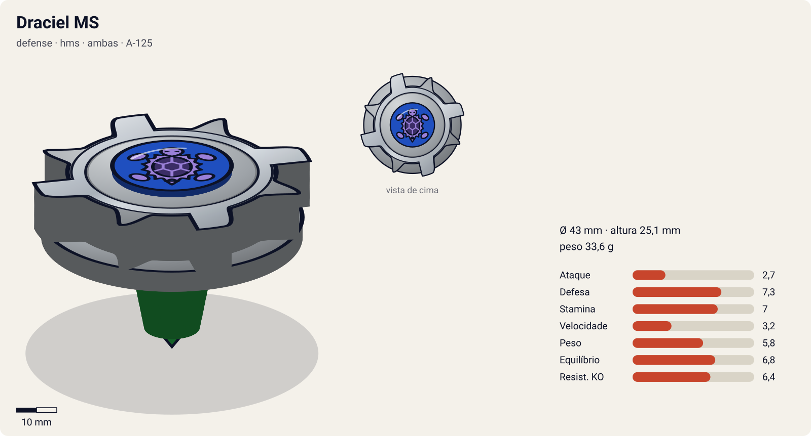
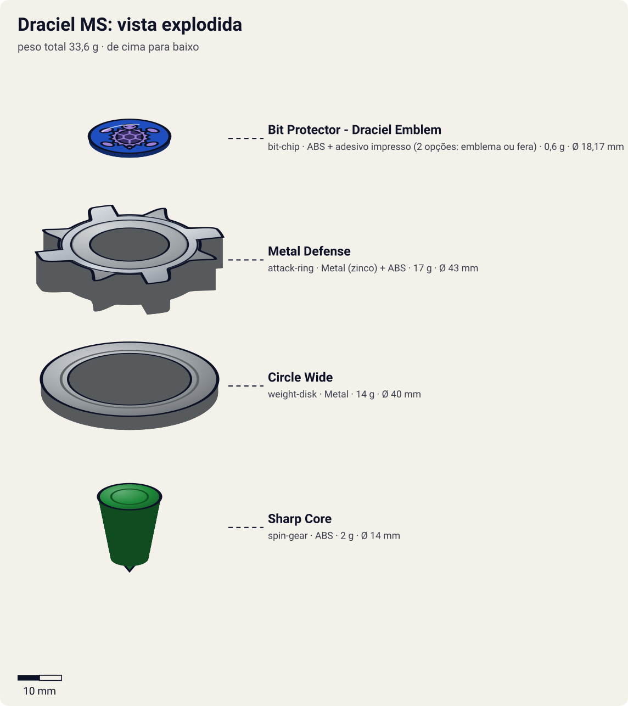
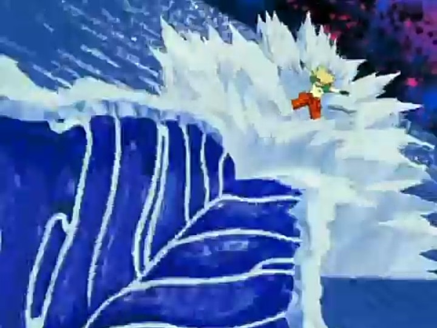

# Draciel MS (Draciel Metal Shield / ドラシエルMS（メタルシールド） – Dorashieru MS (Metaru Shīrudo))

<!-- auto:inicio (gerado por npm run build:research; não edite este bloco) -->

| Ficha | |
|---|---|
| Dono | [Max Tate (Max Mizuhara / 水原 マックス)](../../README.md) |
| Tipo · sistema · rotação | defense · hms · ambas |
| Código do produto | A-125 |
| Montada | Ø 43 mm · altura 25,1 mm · **33,6 g** (soma das peças) |
| Fera bit | [Draciel](../../../../feras-bit/draciel/) |
| Lançador | [Dual Shooter (HMS)](../../../../lancadores/dual-shooter/) |
| Ripcord | [g-winder](../../../../lancadores/ripcords/g-winder/) |

### Peças

| Camada | Peça | Material | Ø mm | Altura mm | Peso g | Estrelas Takara (A / D / S) | Desenho |
|---|---|---|---|---|---|---|---|
| Bit Chip | [Bit Protector - Draciel Emblem](../../../../pecas/bit-chip/draciel-emblem/) | ABS + adesivo impresso (2 opções: emblema ou fera) | 18,2 comunidade | 6,7 comunidade | 0,6 comunidade | — | [ver](pecas/bit-chip.svg) |
| Attack Ring | [Metal Defense](../../../../pecas/attack-ring/metal-defense/) | Metal (zinco) + ABS | 43 estimado | 8 estimado | 17 wiki | 2 / 3 / 2 | [ver](pecas/attack-ring.svg) |
| Weight Disk | [Circle Wide](../../../../pecas/weight-disk/circle-wide/) | Metal | 40 estimado | 3,1 estimado | 14 wiki | 1 / 1 / 3 | [ver](pecas/weight-disk.svg) |
| Spin Gear / Core | [Sharp Core](../../../../pecas/spin-gear/sharp-core/) | ABS | 14 estimado | 14 estimado | 2 wiki | 1 / 1 / 3 | [ver](pecas/spin-gear.svg) |

Fonte de cada medida em subscrito (wiki, comunidade, estimado). Detalhes em cada ficha de peça.

### Atributos

| Atributo | Brinquedo (calculado) | Ajuste anime | Jogo |
|---|---|---|---|
| Ataque | 2,7 | — | **2,7** |
| Defesa | 4,3 | +3 | **7,3** |
| Stamina | 7 | — | **7** |
| Velocidade | 3,2 | — | **3,2** |
| Peso | 5,8 | — | **5,8** |
| Equilíbrio | 5,8 | +1 | **6,8** |
| Resistência a KO | 4,4 | +2 | **6,4** |

Calculado por `src/beyblade/stats.js` a partir de: ponta sharp (atrito 0,1), contato defesa (recoil 0,7), peso do WD na periferia. Modelo em [docs/BEYBLADES.md](../../../../../docs/BEYBLADES.md).

### Fera bit em cima da bey

 

Sons: [invocacao](../../../../feras-bit/draciel/sons/invocacao.wav) · [rugido](../../../../feras-bit/draciel/sons/rugido.wav) · [ataque](../../../../feras-bit/draciel/sons/ataque.wav). Animações: [invocação](../../../../feras-bit/draciel/invocacao.svg) · [ataque](../../../../feras-bit/draciel/ataque.svg).

Fotos de referência (terceiros, só para estudo)

[anime.jpg](referencia/anime.jpg) · [imagem.jpg](referencia/imagem.jpg) · [pecas-attack-ring.jpg](referencia/pecas-attack-ring.jpg) · [pecas-bit-protector.jpg](referencia/pecas-bit-protector.jpg) · [pecas-running-core.jpg](referencia/pecas-running-core.jpg) · [pecas-weight-disk.jpg](referencia/pecas-weight-disk.jpg)

<!-- auto:fim -->

Anime: 

| Campo | Valor |
|---|---|
| Dono | Max Tate |
| Código do produto | A-125 (Takara) |
| Sistema | Hard Metal System (HMS / Heavy Metal System) |
| Rotação | Ambas (dual-spin: o lançador HMS lança para os dois lados; no anime gira para a direita) |
| Fera Bit (Bit-Beast) | Draciel (Genbu, tartaruga negra) |
| Série / temporada | G-Revolution (2003) |
| Primeira aparição (anime) | G-Rev ep. 40 "Back to Basics" |
| Antecessora → Sucessora | [Draciel G](../draciel-g/) → — (última Draciel do anime) |

## Formato e geometria
- Silhueta circular/hexagonal com proteções em cruz; simetria de 4 lados; raio pequeno (~75% de uma bey plástica, como todo HMS).
- Muita massa no AR de metal e no Circle Wide → inércia alta para o tamanho; peso total ~35 g (fonte de varejo).
- Perfil baixo e compacto.

Análise das peças:
- [Bit Protector - Draciel Emblem](../../../../pecas/bit-chip/draciel-emblem/): protetor de plástico verde (ABS) com adesivo do emblema ou da fera; no HMS é a trava das camadas.
- [Metal Defense](../../../../pecas/attack-ring/metal-defense/): Metal Frame "Cross Shield" + capa ABS "Draciel"; estrutura de metal em cruz recoberta de plástico, contorno arredondado. Estrelas oficiais: ataque 2, defesa 3, stamina 2. O metal concentra massa na periferia.
- [Circle Wide](../../../../pecas/weight-disk/circle-wide/) (14 g; o molde Takara da Draciel MS pesa 0,5–0,7 g a mais): círculo perfeito, o maior e mais leve dos 3 WDs HMS originais; massa periférica que favorece a stamina.
- [Sharp Core](../../../../pecas/spin-gear/sharp-core/) (2 g): Running Core de ponta afiada e baixo atrito (o HMS não usa SG nem Blade Base separada). Gira muito com pouco atrito e quase não se move; fácil de desequilibrar se atingido de lado.

Fotos das peças (terceiros): [Bit Protector](referencia/pecas-bit-protector.jpg), [AR](referencia/pecas-attack-ring.jpg), [WD](referencia/pecas-weight-disk.jpg), [Running Core](referencia/pecas-running-core.jpg).

## Comportamento na arena
- **Movimento**: fica no centro (ponta sharp), quase imóvel.
- **Ataque**: baixo; o contato metálico pesado pode causar recoil no atacante.
- **Defesa**: muito alta pelo metal e pelo tamanho compacto (difícil de acertar por baixo).
- **Stamina**: boa (ponta sharp + Circle Wide), mas perde equilíbrio quando empurrada de lado.
- **Matchups**: segura atacantes HMS pesados; perde em choques fortes que a tiram do eixo (no anime perde para Michael).
- **Gimmick**: estrutura de metal do HMS; rotação para os dois lados.

## No anime
- Estreia em G-Rev ep. 40 contra Michael (derrota); usada no 4×4 do ep. 41, contra Mystel da BEGA (empate, ep. 44–45), contra Tyson com Daichi (vitória, ep. 46) e na batalha final de treino com o time (ep. 49).
- Especial: *Aqua Shield*: Max e Draciel erguem uma enorme muralha de água que desacelera e enfraquece o golpe do oponente, permitindo contra-atacar quando ele atravessa a parede (contra o Ocean Javelin de Poseidon, de Mystel).
- Última Draciel do anime.

## Mecânica no jogo
- **Movimento (IA)**: padrão "centro"; não persegue, só ajusta a orientação. Lança em rotação esquerda ou direita (escolha do jogador; a IA escolhe a oposta à do rival para tentar roubar rotação).
- **Gimmick (dual-spin)**: em rotação oposta à do oponente, cada contato transfere 1% de RPM do mais lento para o mais rápido (spin stealing). Golpe lateral forte (knockback > 1,5×) causa 1 s de wobble com −20% de equilíbrio (ponta sharp).
- **Especial**: *Aqua Shield*. Muralha de água por 4 s que reduz em 60% o dano e a velocidade de um especial ou investida que a atravesse; o atacante fica 1 s vulnerável (contra-ataque com +50% de knockback); custo 120 de energia, recarga 26 s. Visual: parede de água semicircular na frente de [Draciel](../../../../feras-bit/draciel/), reaproveitando as ondas do [ataque](../../../../feras-bit/draciel/ataque.svg).
- **Física**: massa relativa 1,25; raio 0,8; atrito da ponta 0,1; restituição 0,35 (metal).

## Ajuste do anime

| Atributo | Delta | Justificativa (episódio/batalha) |
|---|---|---|
| Defesa | +3 | Aqua Shield segura o Ocean Javelin de Poseidon e empata com Mystel da BEGA (ep. 44–45); versão final de Max. |
| Resistência a KO | +2 | Não sai do estádio contra Mystel nem na vitória em dupla sobre Tyson (ep. 46). |
| Equilíbrio | +1 | Aguenta a luta longa contra Mystel sem cair, apesar da ponta sharp. |

Resultado esperado: a defensora mais forte do jogo no anime, capaz de empatar com beys de chefe da BEGA; ainda perde para um atacante de elite que a tire do eixo (Michael, ep. 40).

Nota para o coordenador: o brinquedo calculado tem Defesa 4,8 e Res. KO 4,4, baixos para uma defensora com AR de metal. O README antigo dava 20 g ao Metal Defense; o catálogo usa 17 g (wiki). Com 17 g + 14 g + 2 g + 0,6 g a soma (33,6 g) fica abaixo do ~35 g do anúncio de varejo. Conferir o peso do AR e a estabilidade do Sharp Core no catálogo. O cálculo também usou estrelas de só 2 peças (`partes: 2`): o Sharp Core tem `stats_oficiais` 1 / 1 / 3 no catálogo, mas parece não entrar na soma (Running Core em `spin_gear`).

## Fontes
- https://beyblade.fandom.com/wiki/Draciel_MS
- https://beyblade.fandom.com/wiki/Aqua_Shield
- https://beyblade.fandom.com/wiki/Hard_Metal_System
- https://beyblade.fandom.com/wiki/Max_Tate
- https://www.etsy.com/listing/4457499579 (anúncio de varejo: confirma Metal Defense / Circle Wide / Sharp Core e peso ~35 g; não oficial)
- Imagens: File:Draciel MS.JPG, File:S03E45-202841 1.jpg, File:DSC04565.JPG–DSC04568.JPG
