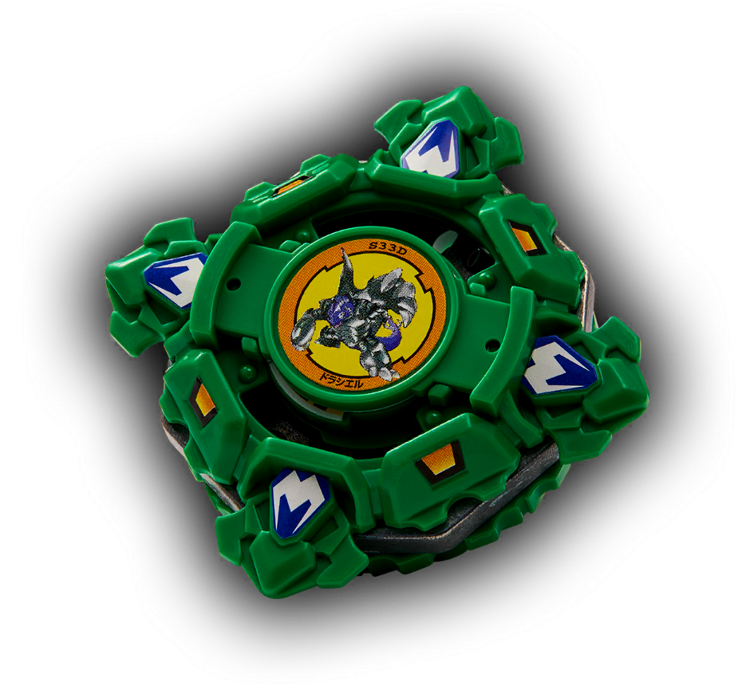

# Draciel S (Draciel Shield / ドラシエルS)

Anime: 

| Campo | Valor |
|---|---|
| Dono | Max Tate (construída por Kenny) |
| Código do produto | A-14 (Takara) / H-14 |
| Tipo | Defense |
| Sistema | Spin Gear System |
| Rotação | Direita |
| Fera Bit (Bit-Beast) | Draciel (Genbu – tartaruga negra) |
| Série / temporada | Bakuten Shoot (2001) |
| Primeira aparição (anime) | S1 ep. 14 "The Race is On" (不戦敗? 分断のBBAチーム) |
| Antecessora → Sucessora | Draciel Metal Ball Defenser → Draciel F |

## 1. Peças (de cima para baixo)

| Camada | Peça | Descrição física | Função em batalha |
|---|---|---|---|
| Bit Chip | Draciel | Dois adesivos: "Death Draciel" e Draciel normal | identidade / fera bit |
| Attack Ring (AR) | Cross Spike (5 g) | Formato quadrado com 4 cabeças de tartaruga projetadas e várias pontas planas | Pouco útil: as pontas planas tiram o equilíbrio ao girar e geram recoil |
| Weight Disk (WD) | Eight Balance (14 g) | Octogonal, peso intermediário | Massa equilibrada |
| Spin Gear (SG) / Core | Right SG | SG básico de rotação direita (estreou com Driger S) | Rotação direita |
| Support Part / Sub Ring | — | — | — |
| Blade Base (BB) | SG Metal Ball (8 g; 10 g com 1 jogo de bolas; 12 g com 2) | Ponta de bola de metal redonda; compartimento para até 2 jogos de bolas de metal + aceita Heavy Metal Core (pode passar de 20 g) | Uma das melhores bases de defesa da era: fica no centro, baixo atrito compensado pelo peso extra |

Fotos das peças: `pecas/attack-ring.gif`, `pecas/weight-disk.gif`, `pecas/spin-gear.gif`, `pecas/blade-base.gif` (diagramas oficiais), `pecas/pecas-desmontadas.jpg`.

## 2. Formato e geometria
- Silhueta quadrada com 4 "cabeças" salientes; simetria de 4 lados; raio médio.
- Peso concentrado embaixo/centro (bolas de metal na base + ponta de metal) → centro de gravidade baixo e estável.
- Perfil médio-baixo.

## 3. Comportamento na arena
- **Movimento**: fixa no centro (ponta de bola de metal), pouca deriva.
- **Ataque**: quase nenhum; apenas recoil passivo das pontas planas.
- **Defesa**: boa — massa da base e ponta de metal seguram investidas; o AR quadrado é o ponto fraco (recoil).
- **Stamina**: média; ponta de metal de baixo atrito ajuda.
- **Matchups**: vence atacantes leves e de recoil alto que se cansam; perde para smash pesado e upper que levantam o AR quadrado.
- **Gimmick**: bolas de metal removíveis (peso ajustável).

## 4. No anime
- Presente de Kenny no ep. 14, junto do lançador Marksmen Grip; Max a estreia contra Chucky (Blade Hunters), enrolando o tempo até Tyson e Ray chegarem.
- Usada no restante do torneio asiático e no americano: Gary (ep. 15), Emily (derrota, ep. 19), Pedro/Fernando/Luiz (ep. 23–25), Michael (vitória, ep. 28), e na Europa (citada no ep. 39).
- Especial: *Metal Ball Defense* – usa as bolas de metal para criar uma defesa forte em que o oponente bate até perder rotação e parar.
- Substituída pela Draciel F, que Max recebe no ep. 45 ao se despedir da mãe (Judy) na Rússia.

## 5. Tradução para o jogo

| Atributo | Valor | Justificativa |
|---|---|---|
| Ataque | 2 | Cross Spike não tem contatos de ataque úteis |
| Defesa | 8 | SG Metal Ball pesada; abaixo de F/V2/G |
| Stamina | 6 | Ponta de metal de baixo atrito, AR com recoil |
| Velocidade | 2 | Ponta de bola, fica no centro |
| Peso | 8 | Base com bolas de metal (até 2 jogos) |
| Equilíbrio | 6 | CG baixo, mas AR quadrado desestabiliza |
| Burst/Knockout-resist | 8 | Peso + centro fixo |

- **Movimento em IA**: "centro"; gira em volta do próprio eixo, desvia minimamente para receber o golpe de frente.
- **Especiais (no jogo)**: *Metal Ball Defense*: 6 s com +40% de massa efetiva e o atacante perde 5% de RPM por colisão; custo 100, cooldown 22 s.
- **Física sugerida**: massa relativa 1,1; raio 1,0; atrito da ponta 0,2; restituição 0,45.

Os mesmos dados ficam em `dados.json`.

## 6. Fontes
- https://beyblade.fandom.com/wiki/Draciel_S
- https://beyblade.fandom.com/wiki/Metal_Ball_Defense
- https://beyblade.fandom.com/wiki/Beyblade_-_Episode_14
- https://beyblade.fandom.com/wiki/Beyblade_-_Episode_45
- https://beyblade.fandom.com/wiki/Max_Tate
- Imagens: File:Draciel Shield.png, File:Draciel Anime.jpg, File:Draciel Shield Attack Ring.gif, File:Eight Balance weight disk.gif, File:Right Spin Gear.gif, File:Draciel Shield SG Metal Ball base.gif, File:Draciel S Parts.JPG
