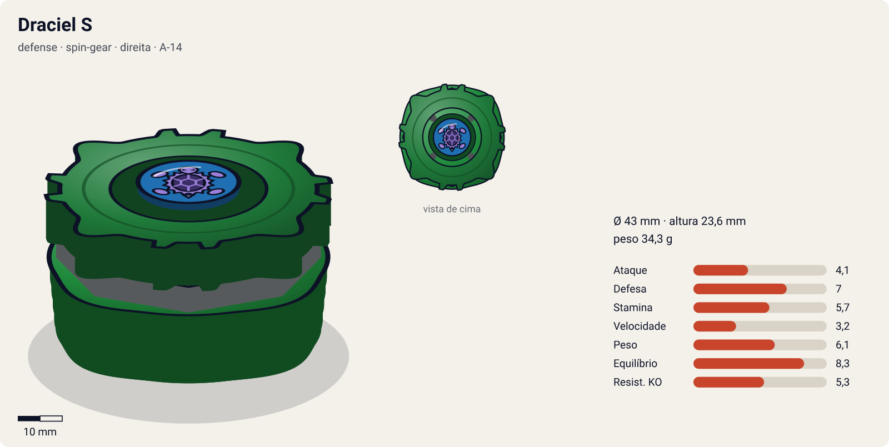
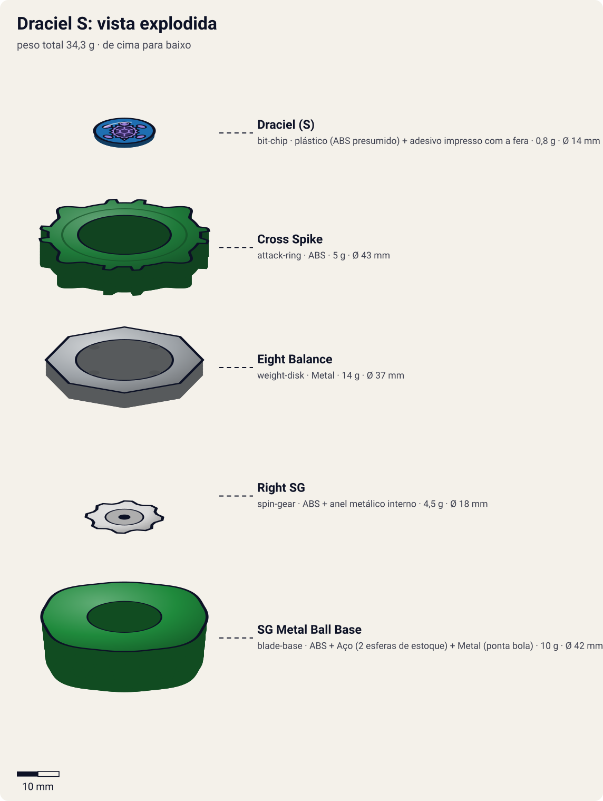
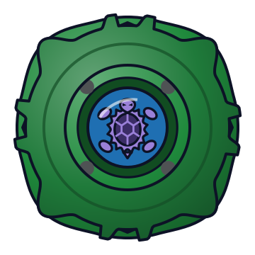
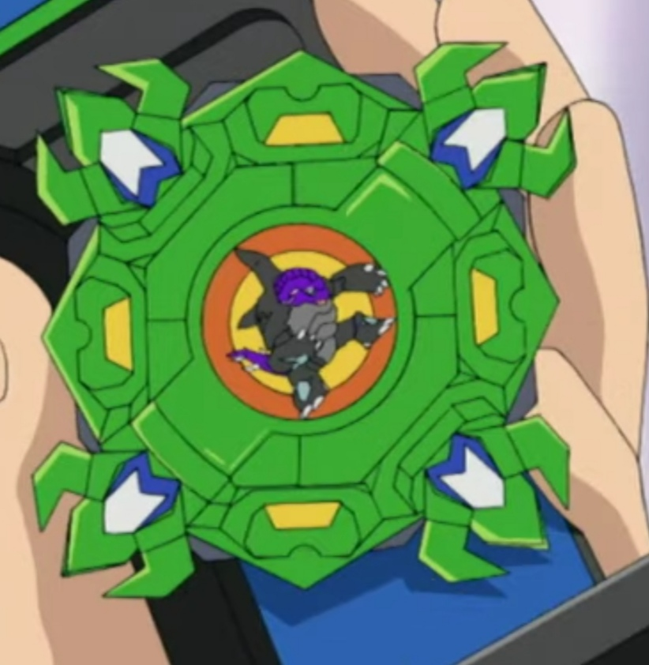

# Draciel S (Draciel Shield / ドラシエルS)

<!-- auto:inicio (gerado por npm run build:research; não edite este bloco) -->

| Ficha | |
|---|---|
| Dono | [Max Tate (Max Mizuhara / 水原 マックス)](../../README.md) |
| Tipo · sistema · rotação | defense · spin-gear · direita |
| Código do produto | A-14 |
| Montada | Ø 43 mm · altura 23,6 mm · **34,3 g** (soma das peças) |
| Fera bit | [Draciel](../../../../feras-bit/draciel/) |
| Lançador | [Marksmen Grip (Sniper Grip)](../../../../lancadores/marksmen-grip/) |
| Ripcord | [winder-padrao](../../../../lancadores/ripcords/winder-padrao/) |

### Peças

| Camada | Peça | Material | Ø mm | Altura mm | Peso g | Estrelas Takara (A / D / S) | Desenho |
|---|---|---|---|---|---|---|---|
| Bit Chip | [Draciel (S)](../../../../pecas/bit-chip/draciel-s/) | plástico (ABS presumido) + adesivo impresso com a fera | 14 estimado | 8 estimado | 0,8 comunidade | — | [ver](pecas/bit-chip.svg) |
| Attack Ring | [Cross Spike](../../../../pecas/attack-ring/cross-spike/) | ABS | 43 estimado | 6 estimado | 5 wiki | 3 / 2 / 1 | [ver](pecas/attack-ring.svg) |
| Weight Disk | [Eight Balance](../../../../pecas/weight-disk/eight-balance/) | Metal | 37 estimado | 3,6 estimado | 14 wiki | 0,5 / 2 / 2,5 | [ver](pecas/weight-disk.svg) |
| Spin Gear / Core | [Right SG](../../../../pecas/spin-gear/right-sg/) | ABS + anel metálico interno | 18 estimado | 10 estimado | 4,5 estimado | — | [ver](pecas/spin-gear.svg) |
| Blade Base | [SG Metal Ball Base](../../../../pecas/blade-base/sg-metal-ball-base/) | ABS + Aço (2 esferas de estoque) + Metal (ponta bola) | 42 estimado | 14 estimado | 10 wiki | 1 / 3 / 3,5 | [ver](pecas/blade-base.svg) |

Fonte de cada medida em subscrito (wiki, comunidade, estimado). Detalhes em cada ficha de peça.

### Atributos

| Atributo | Brinquedo (calculado) | Ajuste anime | Jogo |
|---|---|---|---|
| Ataque | 4,1 | — | **4,1** |
| Defesa | 6 | +1 | **7** |
| Stamina | 5,7 | — | **5,7** |
| Velocidade | 3,2 | — | **3,2** |
| Peso | 6,1 | — | **6,1** |
| Equilíbrio | 8,3 | — | **8,3** |
| Resistência a KO | 5,3 | — | **5,3** |

Calculado por `src/beyblade/stats.js` a partir de: ponta metal-ball (atrito 0,2), contato spike (recoil 0,7), peso do WD na equilibrado. Modelo em [docs/BEYBLADES.md](../../../../../docs/BEYBLADES.md).

### Fera bit em cima da bey

 

Sons: [invocacao](../../../../feras-bit/draciel/sons/invocacao.wav) · [rugido](../../../../feras-bit/draciel/sons/rugido.wav) · [ataque](../../../../feras-bit/draciel/sons/ataque.wav). Animações: [invocação](../../../../feras-bit/draciel/invocacao.svg) · [ataque](../../../../feras-bit/draciel/ataque.svg).

Fotos de referência (terceiros, só para estudo)

[anime.jpg](referencia/anime.jpg) · [imagem.png](referencia/imagem.png) · [pecas-attack-ring.gif](referencia/pecas-attack-ring.gif) · [pecas-blade-base.gif](referencia/pecas-blade-base.gif) · [pecas-pecas-desmontadas.jpg](referencia/pecas-pecas-desmontadas.jpg) · [pecas-spin-gear.gif](referencia/pecas-spin-gear.gif) · [pecas-weight-disk.gif](referencia/pecas-weight-disk.gif)

<!-- auto:fim -->

Anime: 

| Campo | Valor |
|---|---|
| Dono | Max Tate (construída por Kenny) |
| Código do produto | A-14 (Takara) / H-14 |
| Fera Bit (Bit-Beast) | Draciel (Genbu, tartaruga negra) |
| Série / temporada | Bakuten Shoot (2001) |
| Primeira aparição (anime) | S1 ep. 14 "The Race is On" |
| Antecessora → Sucessora | [Draciel Metal Ball Defenser](../draciel-metal-ball-defenser/) → [Draciel F](../draciel-f/) |

## Formato e geometria
- Silhueta quadrada com 4 "cabeças" salientes; simetria de 4 lados; raio médio.
- Peso concentrado embaixo/centro (bolas de metal na base + ponta de metal) → centro de gravidade baixo e estável.
- Perfil médio-baixo.

Análise das peças:
- Bit chip [Draciel (S)](../../../../pecas/bit-chip/draciel-s/): dois adesivos, "Death Draciel" e Draciel normal.
- [Cross Spike](../../../../pecas/attack-ring/cross-spike/) (5 g): formato quadrado com 4 cabeças de tartaruga e várias pontas planas. Pouco útil: as pontas planas tiram o equilíbrio ao girar e geram recoil.
- [Eight Balance](../../../../pecas/weight-disk/eight-balance/) (14 g): octogonal, peso intermediário, massa equilibrada.
- [Right SG](../../../../pecas/spin-gear/right-sg/): SG básico de rotação direita (estreou com Driger S).
- [SG Metal Ball Base](../../../../pecas/blade-base/sg-metal-ball-base/) (8 g; 10 g com 1 jogo de bolas; 12 g com 2): ponta de bola de metal; compartimento para até 2 jogos de bolas e aceita Heavy Metal Core (pode passar de 20 g). Uma das melhores bases de defesa da era: fica no centro, o baixo atrito é compensado pelo peso extra.

Fotos das peças (terceiros): [AR](referencia/pecas-attack-ring.gif), [WD](referencia/pecas-weight-disk.gif), [SG](referencia/pecas-spin-gear.gif), [base](referencia/pecas-blade-base.gif), [desmontada](referencia/pecas-pecas-desmontadas.jpg).

## Comportamento na arena
- **Movimento**: fixa no centro (ponta de bola de metal), pouca deriva.
- **Ataque**: quase nenhum; apenas recoil passivo das pontas planas.
- **Defesa**: boa: massa da base e ponta de metal seguram investidas; o AR quadrado é o ponto fraco (recoil).
- **Stamina**: média; a ponta de metal de baixo atrito ajuda.
- **Matchups**: vence atacantes leves e de recoil alto que se cansam; perde para smash pesado e upper que levantam o AR quadrado.
- **Gimmick**: bolas de metal removíveis (peso ajustável).

## No anime
- Presente de Kenny no ep. 14, junto do lançador Marksmen Grip; Max a estreia contra Chucky (Blade Hunters), enrolando o tempo até Tyson e Ray chegarem.
- Usada no restante do torneio asiático e no americano: Gary (ep. 15), Emily (derrota, ep. 19), Pedro/Fernando/Luiz (ep. 23–25), Michael (vitória, ep. 28), e na Europa (citada no ep. 39).
- Especial: *Metal Ball Defense*: usa as bolas de metal para criar uma defesa forte em que o oponente bate até perder rotação e parar.
- Substituída pela Draciel F, que Max recebe no ep. 45 ao se despedir da mãe (Judy) na Rússia.

## Mecânica no jogo
- **Movimento (IA)**: padrão "centro"; gira em volta do próprio eixo e desvia o mínimo para receber o golpe de frente.
- **Gimmick**: peso ajustável. Na montagem o jogador escolhe 0, 1 ou 2 jogos de bolas (+2 g cada): cada jogo dá +0,3 de peso e defesa e −0,2 de velocidade.
- **Especial**: *Metal Ball Defense*. Por 6 s, +40% de massa efetiva, e cada colisão tira 5% de RPM do atacante; custo 100 de energia, recarga 22 s. Visual: [Draciel](../../../../feras-bit/draciel/) recolhida no casco ([invocação](../../../../feras-bit/draciel/invocacao.svg)) com brilho metálico.
- **Física**: massa relativa 1,1; raio 1,0; atrito da ponta 0,2; restituição 0,45.

## Ajuste do anime

| Atributo | Delta | Justificativa (episódio/batalha) |
|---|---|---|
| Defesa | +1 | Metal Ball Defense cansa Chucky (ep. 14) e segura Michael na final americana (ep. 28) até ele parar. |

Resultado esperado: defensora média-alta da S1, vence atacantes de recoil alto (Michael) e ainda perde para a Trygator de Emily, que é mais equilibrada.

## Fontes
- https://beyblade.fandom.com/wiki/Draciel_S
- https://beyblade.fandom.com/wiki/Metal_Ball_Defense
- https://beyblade.fandom.com/wiki/Beyblade_-_Episode_14
- https://beyblade.fandom.com/wiki/Beyblade_-_Episode_45
- https://beyblade.fandom.com/wiki/Max_Tate
- Imagens: File:Draciel Shield.png, File:Draciel Anime.jpg, File:Draciel Shield Attack Ring.gif, File:Eight Balance weight disk.gif, File:Right Spin Gear.gif, File:Draciel Shield SG Metal Ball base.gif, File:Draciel S Parts.JPG
