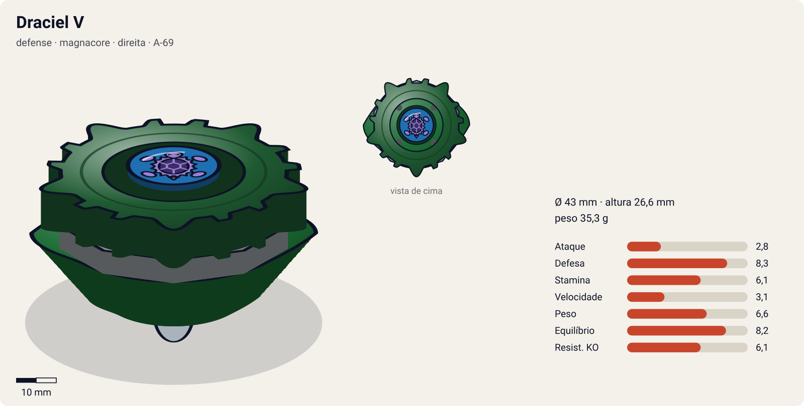
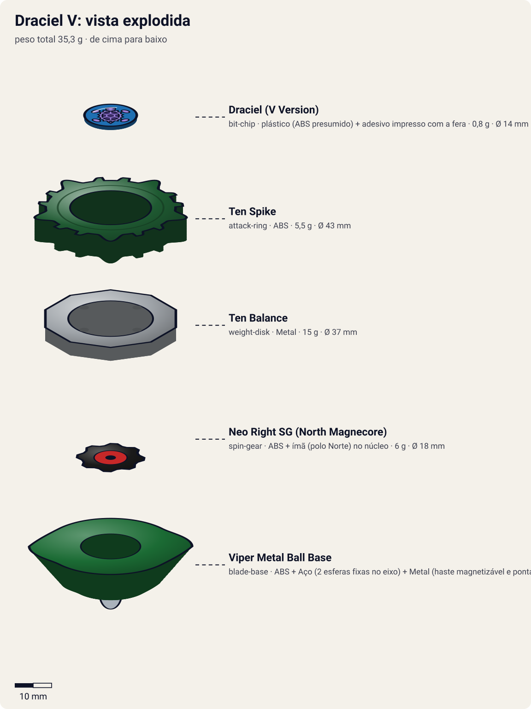

# Draciel V (Draciel Viper / ドラシエルV)

<!-- auto:inicio (gerado por npm run build:research; não edite este bloco) -->

| Ficha | |
|---|---|
| Dono | [Max Tate (Max Mizuhara / 水原 マックス)](../../README.md) |
| Tipo · sistema · rotação | defense · magnacore · direita |
| Código do produto | A-69 |
| Montada | Ø 43 mm · altura 26,6 mm · **35,3 g** (soma das peças) |
| Fera bit | [Draciel](../../../../feras-bit/draciel/) |
| Lançador | [Marksmen Grip (Sniper Grip)](../../../../lancadores/marksmen-grip/) |
| Ripcord | [winder-padrao](../../../../lancadores/ripcords/winder-padrao/) |

### Peças

| Camada | Peça | Material | Ø mm | Altura mm | Peso g | Estrelas Takara (A / D / S) | Desenho |
|---|---|---|---|---|---|---|---|
| Bit Chip | [Draciel (V Version)](../../../../pecas/bit-chip/draciel-v/) | plástico (ABS presumido) + adesivo impresso com a fera | 14 estimado | 8 estimado | 0,8 comunidade | — | [ver](pecas/bit-chip.svg) |
| Attack Ring | [Ten Spike](../../../../pecas/attack-ring/ten-spike/) | ABS | 43 estimado | 6 estimado | 5,5 estimado | 2 / 2 / 2 | [ver](pecas/attack-ring.svg) |
| Weight Disk | [Ten Balance](../../../../pecas/weight-disk/ten-balance/) | Metal | 37 estimado | 3,6 estimado | 15 wiki | 1 / 2 / 3 | [ver](pecas/weight-disk.svg) |
| Spin Gear / Core | [Neo Right SG (North Magnecore)](../../../../pecas/spin-gear/neo-right-sg-north-magnecore/) | ABS + ímã (polo Norte) no núcleo | 18 estimado | 10 estimado | 6 wiki | — | [ver](pecas/spin-gear.svg) |
| Blade Base | [Viper Metal Ball Base](../../../../pecas/blade-base/viper-metal-ball-base/) | ABS + Aço (2 esferas fixas no eixo) + Metal (haste magnetizável e ponta bola) | 42 estimado | 17 estimado | 8 estimado | 1 / 3,5 / 2,5 | [ver](pecas/blade-base.svg) |

Fonte de cada medida em subscrito (wiki, comunidade, estimado). Detalhes em cada ficha de peça.

### Atributos

| Atributo | Brinquedo (calculado) | Ajuste anime | Jogo |
|---|---|---|---|
| Ataque | 2,8 | — | **2,8** |
| Defesa | 6,3 | +2 | **8,3** |
| Stamina | 6,1 | — | **6,1** |
| Velocidade | 3,1 | — | **3,1** |
| Peso | 6,6 | — | **6,6** |
| Equilíbrio | 8,2 | — | **8,2** |
| Resistência a KO | 5,1 | +1 | **6,1** |

Calculado por `src/beyblade/stats.js` a partir de: ponta metal-ball (atrito 0,2), contato defesa (recoil 0,7), peso do WD na equilibrado. Modelo em [docs/BEYBLADES.md](../../../../../docs/BEYBLADES.md).

### Fera bit em cima da bey

 

Sons: [invocacao](../../../../feras-bit/draciel/sons/invocacao.wav) · [rugido](../../../../feras-bit/draciel/sons/rugido.wav) · [ataque](../../../../feras-bit/draciel/sons/ataque.wav). Animações: [invocação](../../../../feras-bit/draciel/invocacao.svg) · [ataque](../../../../feras-bit/draciel/ataque.svg).

Fotos de referência (terceiros, só para estudo)

[anime.png](referencia/anime.png) · [imagem.png](referencia/imagem.png) · [pecas-attack-ring.gif](referencia/pecas-attack-ring.gif) · [pecas-blade-base.gif](referencia/pecas-blade-base.gif) · [pecas-pecas-desmontadas.jpg](referencia/pecas-pecas-desmontadas.jpg) · [pecas-spin-gear.gif](referencia/pecas-spin-gear.gif) · [pecas-weight-disk.gif](referencia/pecas-weight-disk.gif)

<!-- auto:fim -->

Anime: 

| Campo | Valor |
|---|---|
| Dono | Max Tate |
| Código do produto | A-69 (Takara) |
| Fera Bit (Bit-Beast) | Draciel (Genbu, tartaruga negra entrelaçada com serpente) |
| Série / temporada | V-Force (2002); também no filme "Fierce Battle" |
| Primeira aparição (anime) | V-Force ep. 29 "Bad Seed in the Big Apple" |
| Antecessora → Sucessora | [Draciel F](../draciel-f/) → [Draciel V2](../draciel-v2/) |

## Formato e geometria
- Silhueta de estrela de 5 pontas com 10 contatos; simetria de 5 lados; raio médio-grande.
- Peso no WD (Ten Balance) e nas bolas de metal no eixo inferior → CG baixo, mas o eixo longo deixa a bey alta.
- Perfil alto (eixo comprido) → vulnerável a upper e a perder equilíbrio.

Análise das peças:
- [Ten Spike](../../../../pecas/attack-ring/ten-spike/): verde-escuro metálico; 10 projeções planas (5 grandes "cabeças" + 5 pares menores de "patas") formando uma estrela. Muito recoil (projeções planas e desiguais); considerado o pior AR de Draciel.
- [Ten Balance](../../../../pecas/weight-disk/ten-balance/) (15 g): 10 lados, o mais pesado da família Balance.
- [Neo Right SG (North Magnecore)](../../../../pecas/spin-gear/neo-right-sg-north-magnecore/): SG oco que aceita núcleos; o ímã polo Norte magnetiza o eixo da base.
- [Viper Metal Ball Base](../../../../pecas/blade-base/viper-metal-ball-base/): eixo longo com 2 bolas de metal fixas e ponta de bola parcialmente livre; a haste adota a polaridade do Magnecore e "gruda" as bolas. Gimmick magnético, mas o eixo alto e os entalhes da base pioram o equilíbrio e o LAD: base ruim para defesa no brinquedo.

Fotos das peças (terceiros): [AR](referencia/pecas-attack-ring.gif), [WD](referencia/pecas-weight-disk.gif), [SG](referencia/pecas-spin-gear.gif), [base](referencia/pecas-blade-base.gif), [desmontada](referencia/pecas-pecas-desmontadas.jpg).

## Comportamento na arena
- **Movimento**: centro; a ponta de bola não é totalmente livre, então desliza um pouco.
- **Ataque**: baixo; o recoil das 10 projeções pode empurrar atacantes leves.
- **Defesa**: no anime, altíssima (paredes de água); no brinquedo, prejudicada pela altura e pelo AR irregular.
- **Stamina**: média.
- **Matchups**: no anime, vence atacantes agressivos (Alan); no brinquedo perde para upper e smash consistentes.
- **Gimmick**: Magnacore: a força magnética mantém as bolas de metal no eixo e pode interagir com estádios e beys magnéticos.

## No anime
- Estreia no V-Force ep. 29 contra Alan McKenzie (ex-amigo de Max): empate e depois vitória.
- Especiais: *Viper Wall* (tempestade de serpentes/água, referência à serpente enroscada em Genbu) e *Heavy Viper Wall* (ondas de água que "afogam" o oponente e o arremessam), ambos estreando no ep. 29.
- Usada ainda contra Tyson (empate, ep. 34), Dennis (ep. 36), Mariam (vitória, ep. 37) e Ray (derrota, ep. 40).
- No filme "Fierce Battle", Draciel V aparece com o adesivo do bit chip da Draciel F (erro de animação registrado na wiki).
- Substituída pela Draciel V2 (ep. 47).

## Mecânica no jogo
- **Movimento (IA)**: padrão "centro" com deslize lento (raio de deriva ~10% do estádio); ao ativar especial, cria uma zona de controle ao redor.
- **Gimmick (Magnecore Norte)**: em estádio magnético, ou contra bey com Magnecore Sul, atração de 15% em direção ao oponente quando estão a menos de 1/4 do estádio; contra polo Norte, repulsão equivalente (ajuda a não ser empurrada).
- **Especiais**:
  - *Viper Wall*: zona de 4 s em volta de Draciel que reduz em 40% a velocidade de quem entra; custo 80 de energia, recarga 18 s.
  - *Heavy Viper Wall*: onda de água radial que empurra o oponente para a borda (knockback 1,8×, dano baixo); custo 120, recarga 28 s. Visual: o [ataque de Draciel](../../../../feras-bit/draciel/ataque.svg) (Heavy Viper Wall).
- **Física**: massa relativa 1,15; raio 1,05; atrito da ponta 0,2; restituição 0,5; equilíbrio baixo contra golpes de baixo para cima.

## Ajuste do anime

| Atributo | Delta | Justificativa (episódio/batalha) |
|---|---|---|
| Defesa | +2 | Viper Wall e Heavy Viper Wall seguram Alan (ep. 29) e vencem Mariam (ep. 37); empata com Tyson (ep. 34). |
| Resistência a KO | +1 | As paredes de água mantêm Draciel no estádio contra atacantes agressivos (ep. 29). |

Resultado esperado: defensora de controle que segura atacantes e vence por desgaste, mas cai contra Driger V (ep. 40), que tem ataque e equilíbrio para atravessar a parede.

Nota para o coordenador: o brinquedo calculado tem Equilíbrio 8,2, mas a wiki descreve a Viper Metal Ball Base como alta, com eixo longo e LAD ruim. Conferir altura/estabilidade da ponta registradas na ficha da base.

## Fontes
- https://beyblade.fandom.com/wiki/Draciel_V
- https://beyblade.fandom.com/wiki/Viper_Wall
- https://beyblade.fandom.com/wiki/Heavy_Viper_Wall
- https://beyblade.fandom.com/wiki/Spin_Gear_-_NEO_Right_SG
- https://beyblade.fandom.com/wiki/Max_Tate
- Imagens: File:Draciel V.png, File:DracielV Anime.PNG, File:Draciel Viper attack ring.gif, File:Ten Balance weight disk.gif, File:Neo Right N Magnet spin gear.gif, File:Draciel Viper Metal Ball base.gif, File:Draciel Viper.jpg
