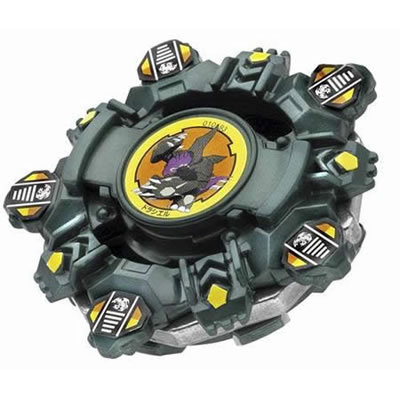
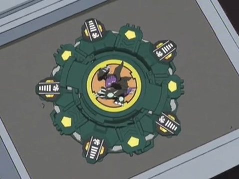

# Draciel V (Draciel Viper / ドラシエルV)

Anime: 

| Campo | Valor |
|---|---|
| Dono | Max Tate |
| Código do produto | A-69 (Takara) |
| Tipo | Defense |
| Sistema | Magnacore System |
| Rotação | Direita |
| Fera Bit (Bit-Beast) | Draciel (Genbu – tartaruga negra entrelaçada com serpente) |
| Série / temporada | V-Force (2002); também no filme "Fierce Battle" |
| Primeira aparição (anime) | V-Force ep. 29 "Bad Seed in the Big Apple" |
| Antecessora → Sucessora | Draciel F → Draciel V2 |

## 1. Peças (de cima para baixo)

| Camada | Peça | Descrição física | Função em batalha |
|---|---|---|---|
| Bit Chip | Draciel (versão V) | Chip da tartaruga | identidade / fera bit |
| Attack Ring (AR) | Ten Spike | Verde-escuro metálico; 10 projeções planas (5 grandes + 5 pares menores) formando uma estrela – cada grande é uma "cabeça" e as pequenas são "patas" | Muito recoil (projeções planas e desiguais); considerado o pior AR de Draciel |
| Weight Disk (WD) | Ten Balance (15 g) | 10 lados, peso intermediário (o mais pesado da família Balance) | Massa equilibrada |
| Spin Gear (SG) / Core | Neo Right SG (North Magnecore) | SG oco que aceita núcleos; vem com Magnecore polo Norte | Rotação direita; o ímã magnetiza o eixo da base |
| Support Part / Sub Ring | — | — | — |
| Blade Base (BB) | Viper Metal Ball Base | Eixo longo com 2 bolas de metal fixas (não removíveis) e ponta de bola de metal (parcialmente livre); haste magnética que adota a polaridade do Magnecore e "gruda" as bolas | Gimmick magnético; mas eixo alto e entalhes na base pioram equilíbrio e LAD – base ruim para defesa no brinquedo real |

Fotos das peças: `pecas/attack-ring.gif`, `pecas/weight-disk.gif`, `pecas/spin-gear.gif`, `pecas/blade-base.gif` (diagramas oficiais), `pecas/pecas-desmontadas.jpg`.

## 2. Formato e geometria
- Silhueta de estrela de 5 pontas com 10 contatos; simetria de 5 lados; raio médio-grande.
- Peso no WD (Ten Balance) e nas bolas de metal no eixo inferior → CG muito baixo, mas eixo longo deixa a bey alta.
- Perfil alto (eixo comprido) → vulnerável a upper e a perder equilíbrio.

## 3. Comportamento na arena
- **Movimento**: centro; a ponta de bola não é totalmente livre, então desliza um pouco.
- **Ataque**: baixo; recoil das 10 projeções pode empurrar atacantes leves.
- **Defesa**: no anime, altíssima (paredes de água); no brinquedo, prejudicada pela altura e pelo AR irregular.
- **Stamina**: média.
- **Matchups**: no anime, vence atacantes agressivos (Alan); no brinquedo perde para upper e smash consistentes.
- **Gimmick**: Magnacore – a força magnética mantém as bolas de metal no eixo e pode interagir com estádios/beys magnéticos.

## 4. No anime
- Estreia no V-Force ep. 29 contra Alan McKenzie (ex-amigo de Max): empate e depois vitória.
- Especiais: *Viper Wall* (cria uma tempestade de serpentes/água – referência à serpente enroscada em Genbu) e *Heavy Viper Wall* (ondas de água que "afogam" o oponente e o arremessam), ambos estreando no ep. 29.
- Usada ainda contra Tyson (empate, ep. 34), Dennis (ep. 36), Mariam (vitória, ep. 37) e Ray (derrota, ep. 40).
- No filme "Fierce Battle", Draciel V aparece com o adesivo do bit chip da Draciel F (erro de animação registrado na wiki).
- Substituída pela Draciel V2 (ep. 47).

## 5. Tradução para o jogo

| Atributo | Valor | Justificativa |
|---|---|---|
| Ataque | 3 | Ten Spike gera recoil, não ataque real; Heavy Viper Wall dá algum poder ofensivo no anime |
| Defesa | 9 | Defesa do anime (paredes de água); limitada pelo perfil alto do brinquedo |
| Stamina | 6 | Ponta de bola semi-livre, AR com atrito |
| Velocidade | 3 | Centro, com leve deslize |
| Peso | 8 | Ten Balance + bolas no eixo + Magnecore |
| Equilíbrio | 5 | Eixo longo/alto, LAD ruim (wiki) |
| Burst/Knockout-resist | 8 | Pesada e centrada, mas desestabiliza com upper |

- **Movimento em IA**: "centro"; ao ativar especial, cria zona de controle ao redor.
- **Especiais (no jogo)**:
  - *Viper Wall*: zona de 4 s ao redor de Draciel que reduz a velocidade de quem entra em 40%; custo 80, cooldown 18 s.
  - *Heavy Viper Wall*: onda de água radial que empurra o oponente para a borda (knockback forte, sem dano alto); custo 120, cooldown 28 s.
- **Física sugerida**: massa relativa 1,15; raio 1,05; atrito da ponta 0,2; restituição 0,5; equilíbrio baixo contra golpes de baixo para cima.

Os mesmos dados ficam em `dados.json`.

## 6. Fontes
- https://beyblade.fandom.com/wiki/Draciel_V
- https://beyblade.fandom.com/wiki/Viper_Wall
- https://beyblade.fandom.com/wiki/Heavy_Viper_Wall
- https://beyblade.fandom.com/wiki/Spin_Gear_-_NEO_Right_SG
- https://beyblade.fandom.com/wiki/Max_Tate
- Imagens: File:Draciel V.png, File:DracielV Anime.PNG, File:Draciel Viper attack ring.gif, File:Ten Balance weight disk.gif, File:Neo Right N Magnet spin gear.gif, File:Draciel Viper Metal Ball base.gif, File:Draciel Viper.jpg
