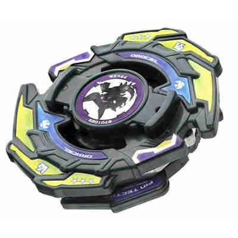

# Draciel V2 (Draciel Viper 2 / ドラシエルV2 (バイパー・ツー) – Dorashieru V2 (Baipā Tsū))

Anime: 

| Campo | Valor |
|---|---|
| Dono | Max Tate |
| Código do produto | A-85 (Takara, novembro de 2002) |
| Tipo | Defense |
| Sistema | Magnacore System |
| Rotação | Direita |
| Fera Bit (Bit-Beast) | Draciel (Genbu – tartaruga negra) |
| Série / temporada | V-Force (2002) – fim; G-Revolution (2003) – início |
| Primeira aparição (anime) | V-Force ep. 47 "Deceit From Above" |
| Antecessora → Sucessora | Draciel V → Draciel G |

## 1. Peças (de cima para baixo)

| Camada | Peça | Descrição física | Função em batalha |
|---|---|---|---|
| Bit Chip | Draciel (versão V) | Chip da tartaruga | identidade / fera bit |
| Attack Ring (AR) | Strike Turtle (6 g) | Elíptico; 3 pequenas "garras" de cada lado e uma "cabeça" logo atrás | Desempenho médio: garras pouco pronunciadas para smash; grande e com recoil para defesa/stamina (o mais "equilibrado" dos ARs de Draciel) |
| Weight Disk (WD) | Ten Heavy (17 g) | 10 lados, o mais pesado da família Heavy; peso compacto no centro | Massa máxima para defesa e mais RPM |
| Spin Gear (SG) / Core | Neo Right SG (MG Core / Magnecore) (6 g) | SG direito atualizado com núcleo magnético | Rotação direita |
| Support Part / Sub Ring | Fin Tector (2 g) | Peças reversíveis na base: modo Ataque (ótimo para smash em customização) ou modo Defesa | Ajuste de modo; frágil |
| Blade Base (BB) | Switch Metal Ball Base (6 g) | Ponta redonda e alta; 2 bolas de metal fixas que podem ser posicionadas para dentro ou para fora | Alterna distribuição de peso (dentro = mais RPM/estabilidade compacta; fora = mais inércia/defesa); ponta alta limita desempenho |

Fotos das peças: `pecas/attack-ring.jpg`, `pecas/support-part.jpg` (Fin Tector), `pecas/blade-base.jpg`, `pecas/pecas-desmontadas.jpg`. (Sem foto isolada do Ten Heavy/Neo Right SG na wiki.)

## 2. Formato e geometria
- Silhueta elíptica/ovalada com 2 "cabeças" e 6 garras; simetria de 2 lados; raio médio-grande.
- Peso fortemente central (Ten Heavy) + bolas de metal comutáveis (centro × periferia).
- Perfil alto (ponta redonda alta).

## 3. Comportamento na arena
- **Movimento**: centro; a ponta redonda alta oscila mais que as bases anteriores.
- **Ataque**: baixo-médio (garras pequenas; Fin Tector em modo ataque ajuda pouco no setup de série).
- **Defesa**: no anime é o auge do V-Force (âncora do BRIEF: "Defesa 10 ≈ Draciel V2"); no brinquedo, a altura da ponta enfraquece.
- **Stamina**: média.
- **Matchups**: anime – vence Queen (Burning Kerberous), Emily (Trygator) e Julia; perde para Zeo (Cerberus) e para Tyson (Dragoon V2).
- **Gimmick**: Switch Metal Ball (bolas internas/externas) + Fin Tector reversível + Magnecore.

## 4. No anime
- Estreia no V-Force ep. 47 contra Queen (vitória). Perde para Tyson (ep. 49) e para Zeo Zagart (ep. 50), que captura Draciel de novo.
- G-Revolution (ep. 1–15): continua sendo a bey de Max no torneio de duplas pelos PPB All Starz – vence Emily (ep. 7), Aaron (ep. 11) e Julia (ep. 13).
- Especial: *Heavy Viper Wall* (ondas de água que afogam e arremessam o rival), mais forte em G-Rev.
- Substituída pela Draciel G (G-Rev ep. 16).

## 5. Tradução para o jogo

| Atributo | Valor | Justificativa |
|---|---|---|
| Ataque | 4 | Strike Turtle médio; Heavy Viper Wall tem função ofensiva |
| Defesa | 10 | Âncora de defesa do BRIEF; Ten Heavy + bolas de metal; no anime segura Kerberous |
| Stamina | 6 | Ponta redonda alta, AR com recoil |
| Velocidade | 3 | Centro |
| Peso | 9 | Ten Heavy (17 g, o WD mais pesado) + bolas + Magnecore |
| Equilíbrio | 6 | Peso central ajuda; ponta alta atrapalha |
| Burst/Knockout-resist | 9 | Muito pesada |

- **Movimento em IA**: "centro"; alterna modo (bolas para fora = +defesa, −velocidade de rotação) via comando/IA quando o oponente está em fase de ataque.
- **Especiais (no jogo)**: *Heavy Viper Wall*: onda radial de água com knockback forte e −15% de equilíbrio no alvo; custo 120, cooldown 25 s.
- **Física sugerida**: massa relativa 1,25; raio 1,05; atrito da ponta 0,25; restituição 0,4.

Os mesmos dados ficam em `dados.json`.

## 6. Fontes
- https://beyblade.fandom.com/wiki/Draciel_V2
- https://beyblade.fandom.com/wiki/Heavy_Viper_Wall
- https://beyblade.fandom.com/wiki/Weight_Disk_-_Heavy
- https://beyblade.fandom.com/wiki/Max_Tate
- Imagens: File:DracielV2.jpg, File:Beyblade V Force Episode 47 -English Dub- -Full-.1 209776.jpg, File:Dracielv2parts1.jpg, File:Dracielv2attring1.jpg, File:Dracielv2sp1.jpg, File:Dracielv2bb1.jpg
