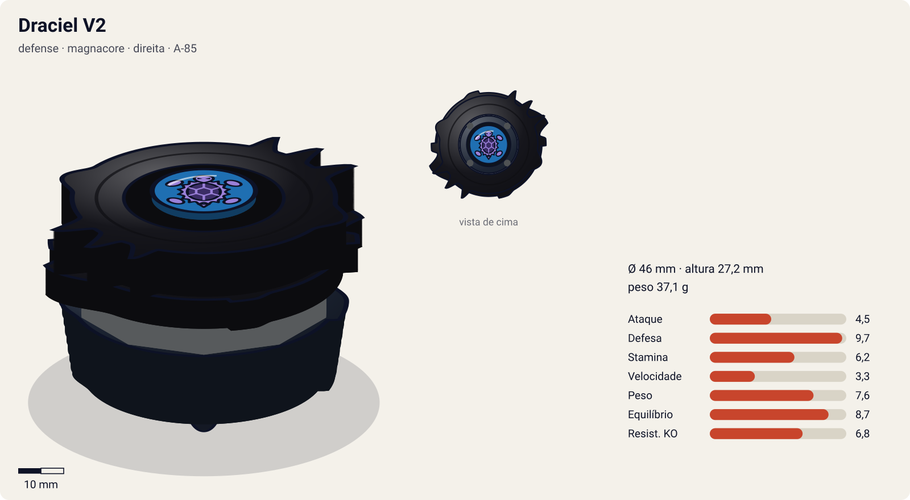
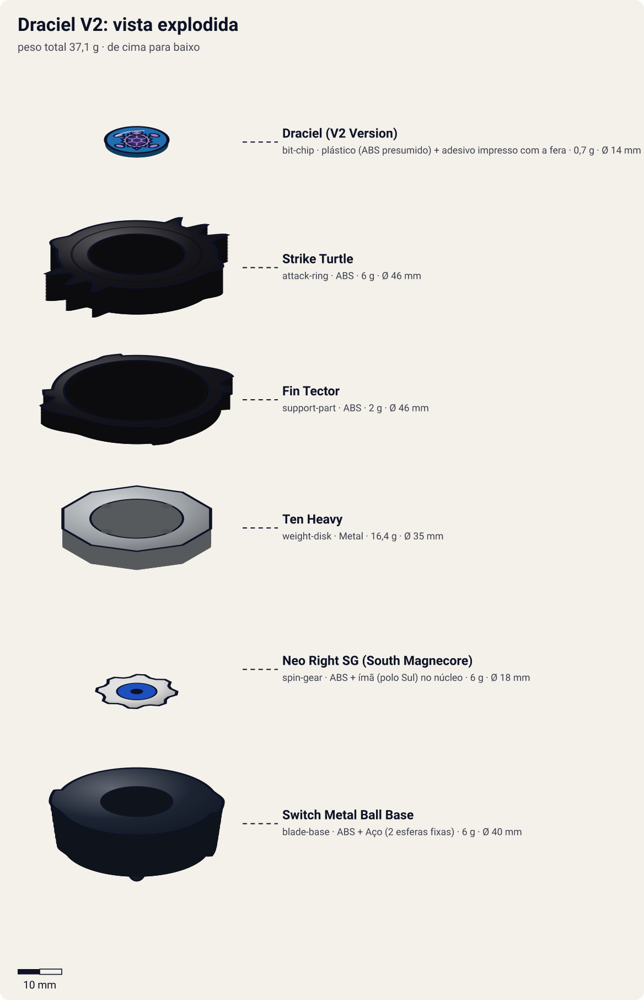
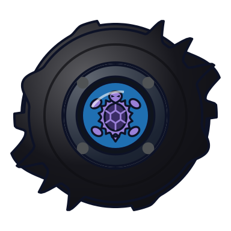
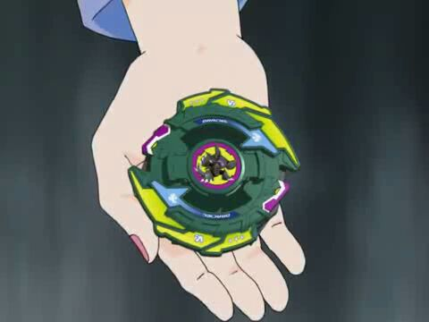

# Draciel V2 (Draciel Viper 2 / ドラシエルV2 (バイパー・ツー) – Dorashieru V2 (Baipā Tsū))

<!-- auto:inicio (gerado por npm run build:research; não edite este bloco) -->

| Ficha | |
|---|---|
| Dono | [Max Tate (Max Mizuhara / 水原 マックス)](../../README.md) |
| Tipo · sistema · rotação | defense · magnacore · direita |
| Código do produto | A-85 |
| Montada | Ø 46 mm · altura 27,2 mm · **37,1 g** (soma das peças) |
| Fera bit | [Draciel](../../../../feras-bit/draciel/) |
| Lançador | [Marksmen Grip (Sniper Grip)](../../../../lancadores/marksmen-grip/) |
| Ripcord | [winder-padrao](../../../../lancadores/ripcords/winder-padrao/) |

### Peças

| Camada | Peça | Material | Ø mm | Altura mm | Peso g | Estrelas Takara (A / D / S) | Desenho |
|---|---|---|---|---|---|---|---|
| Bit Chip | [Draciel (V2 Version)](../../../../pecas/bit-chip/draciel-v2/) | plástico (ABS presumido) + adesivo impresso com a fera | 14 estimado | 8 estimado | 0,7 comunidade | — | [ver](pecas/bit-chip.svg) |
| Attack Ring | [Strike Turtle](../../../../pecas/attack-ring/strike-turtle/) | ABS | 46 estimado | 6 estimado | 6 wiki | 2,5 / 2,5 / 2 | [ver](pecas/attack-ring.svg) |
| Support Part | [Fin Tector](../../../../pecas/support-part/fin-tector/) | ABS | 46 estimado | 4 estimado | 2 wiki | 1,5 / 1 / 0 | [ver](pecas/support-part.svg) |
| Weight Disk | [Ten Heavy](../../../../pecas/weight-disk/ten-heavy/) | Metal | 35 estimado | 4,2 estimado | 16,4 wiki | 1 / 3 / 2 | [ver](pecas/weight-disk.svg) |
| Spin Gear / Core | [Neo Right SG (South Magnecore)](../../../../pecas/spin-gear/neo-right-sg-south-magnecore/) | ABS + ímã (polo Sul) no núcleo | 18 estimado | 10 estimado | 6 wiki | — | [ver](pecas/spin-gear.svg) |
| Blade Base | [Switch Metal Ball Base](../../../../pecas/blade-base/switch-metal-ball-base/) | ABS + Aço (2 esferas fixas) | 40 estimado | 17 estimado | 6 wiki | 1 / 4 / 3,5 | [ver](pecas/blade-base.svg) |

Fonte de cada medida em subscrito (wiki, comunidade, estimado). Detalhes em cada ficha de peça.

### Atributos

| Atributo | Brinquedo (calculado) | Ajuste anime | Jogo |
|---|---|---|---|
| Ataque | 4,5 | — | **4,5** |
| Defesa | 7,7 | +2 | **9,7** |
| Stamina | 6,2 | — | **6,2** |
| Velocidade | 3,3 | — | **3,3** |
| Peso | 7,6 | — | **7,6** |
| Equilíbrio | 8,7 | — | **8,7** |
| Resistência a KO | 5,8 | +1 | **6,8** |

Calculado por `src/beyblade/stats.js` a partir de: ponta ball (atrito 0,3), contato smash (recoil 0,6), peso do WD na centro. Modelo em [docs/BEYBLADES.md](../../../../../docs/BEYBLADES.md).

### Fera bit em cima da bey

 

Sons: [invocacao](../../../../feras-bit/draciel/sons/invocacao.wav) · [rugido](../../../../feras-bit/draciel/sons/rugido.wav) · [ataque](../../../../feras-bit/draciel/sons/ataque.wav). Animações: [invocação](../../../../feras-bit/draciel/invocacao.svg) · [ataque](../../../../feras-bit/draciel/ataque.svg).

Fotos de referência (terceiros, só para estudo)

[anime.jpg](referencia/anime.jpg) · [imagem.jpg](referencia/imagem.jpg) · [pecas-attack-ring.jpg](referencia/pecas-attack-ring.jpg) · [pecas-blade-base.jpg](referencia/pecas-blade-base.jpg) · [pecas-pecas-desmontadas.jpg](referencia/pecas-pecas-desmontadas.jpg) · [pecas-support-part.jpg](referencia/pecas-support-part.jpg)

<!-- auto:fim -->

Anime: 

| Campo | Valor |
|---|---|
| Dono | Max Tate |
| Código do produto | A-85 (Takara, novembro de 2002) |
| Fera Bit (Bit-Beast) | Draciel (Genbu, tartaruga negra) |
| Série / temporada | V-Force (2002), fim; G-Revolution (2003), início |
| Primeira aparição (anime) | V-Force ep. 47 "Deceit From Above" |
| Antecessora → Sucessora | [Draciel V](../draciel-v/) → [Draciel G](../draciel-g/) |

## Formato e geometria
- Silhueta elíptica/ovalada com 2 "cabeças" e 6 garras; simetria de 2 lados; raio médio-grande.
- Peso fortemente central (Ten Heavy) + bolas de metal comutáveis (centro × periferia).
- Perfil alto (ponta redonda alta).

Análise das peças:
- [Strike Turtle](../../../../pecas/attack-ring/strike-turtle/) (6 g): elíptico; 3 pequenas "garras" de cada lado e uma "cabeça" logo atrás. Desempenho médio: garras pouco pronunciadas para smash, grande e com recoil para defesa/stamina (o mais equilibrado dos ARs de Draciel).
- [Fin Tector](../../../../pecas/support-part/fin-tector/) (2 g): peças reversíveis na base, modo Ataque (bom para smash em customização) ou modo Defesa; frágil.
- [Ten Heavy](../../../../pecas/weight-disk/ten-heavy/) (17 g): 10 lados, o mais pesado da família Heavy; massa compacta no centro para defesa e RPM.
- [Neo Right SG (South Magnecore)](../../../../pecas/spin-gear/neo-right-sg-south-magnecore/) (6 g): SG direito com núcleo magnético.
- [Switch Metal Ball Base](../../../../pecas/blade-base/switch-metal-ball-base/) (6 g): ponta redonda e alta; 2 bolas de metal fixas que podem ficar para dentro (mais RPM, estabilidade compacta) ou para fora (mais inércia e defesa). A ponta alta limita o desempenho.

Fotos das peças (terceiros): [AR](referencia/pecas-attack-ring.jpg), [Fin Tector](referencia/pecas-support-part.jpg), [base](referencia/pecas-blade-base.jpg), [desmontada](referencia/pecas-pecas-desmontadas.jpg).

## Comportamento na arena
- **Movimento**: centro; a ponta redonda alta oscila mais que as bases anteriores.
- **Ataque**: baixo-médio (garras pequenas; Fin Tector em modo ataque ajuda pouco na montagem de série).
- **Defesa**: no anime é o auge do V-Force; no brinquedo, a altura da ponta enfraquece.
- **Stamina**: média.
- **Matchups**: no anime vence Queen (Burning Kerberous), Emily (Trygator) e Julia; perde para Zeo (Cerberus) e para Tyson (Dragoon V2).
- **Gimmick**: Switch Metal Ball (bolas internas/externas) + Fin Tector reversível + Magnacore.

## No anime
- Estreia no V-Force ep. 47 contra Queen (vitória). Perde para Tyson (ep. 49) e para Zeo Zagart (ep. 50), que captura Draciel de novo.
- G-Revolution (ep. 1–15): continua sendo a bey de Max no torneio de duplas pelos PPB All Starz; vence Emily (ep. 7), Aaron (ep. 11) e Julia (ep. 13).
- Especial: *Heavy Viper Wall* (ondas de água que afogam e arremessam o rival), mais forte em G-Rev.
- Substituída pela Draciel G (G-Rev ep. 16).

## Mecânica no jogo
- **Movimento (IA)**: padrão "centro", com oscilação leve da ponta alta.
- **Gimmick (troca de modo)**: o jogador alterna as bolas de metal com um botão (a IA troca quando o oponente entra em fase de ataque). Bolas para fora: +1 de defesa e +10% de resistência a empurrão, −10% de RPM inicial. Bolas para dentro: +10% de RPM e +0,5 de equilíbrio. Fin Tector em modo ataque: +0,5 de ataque, −0,5 de defesa. Magnecore Sul atrai beys de polo Norte (ver Draciel V).
- **Especial**: *Heavy Viper Wall*. Onda radial de água com knockback forte (1,8×) e −15% de equilíbrio no alvo; custo 120 de energia, recarga 25 s. Visual: o [ataque de Draciel](../../../../feras-bit/draciel/ataque.svg).
- **Física**: massa relativa 1,25; raio 1,05; atrito da ponta 0,25; restituição 0,4.

## Ajuste do anime

| Atributo | Delta | Justificativa (episódio/batalha) |
|---|---|---|
| Defesa | +2 | Segura Burning Kerberous (V-Force ep. 47), Trygator (G-Rev ep. 7) e Julia (ep. 13) com Heavy Viper Wall. |
| Resistência a KO | +1 | Heavy Viper Wall mais forte em G-Rev: Draciel não sai do estádio nas vitórias de duplas (ep. 7–13). |

Resultado esperado: a defensora mais forte da era Magnacore; perde para Dragoon V2 (ep. 49) e para Cerberus de Zeo (ep. 50), que superam a defesa no ataque.

## Fontes
- https://beyblade.fandom.com/wiki/Draciel_V2
- https://beyblade.fandom.com/wiki/Heavy_Viper_Wall
- https://beyblade.fandom.com/wiki/Weight_Disk_-_Heavy
- https://beyblade.fandom.com/wiki/Max_Tate
- Imagens: File:DracielV2.jpg, File:Beyblade V Force Episode 47 -English Dub- -Full-.1 209776.jpg, File:Dracielv2parts1.jpg, File:Dracielv2attring1.jpg, File:Dracielv2sp1.jpg, File:Dracielv2bb1.jpg
