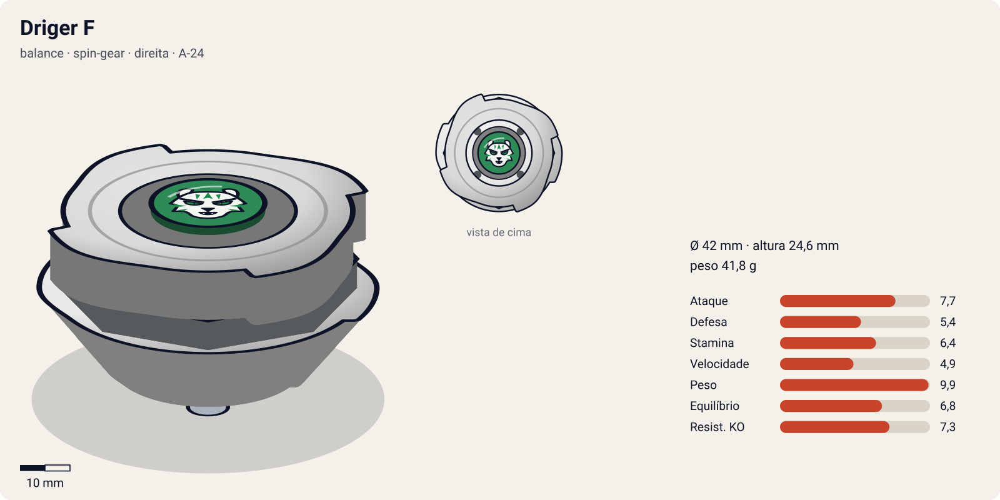
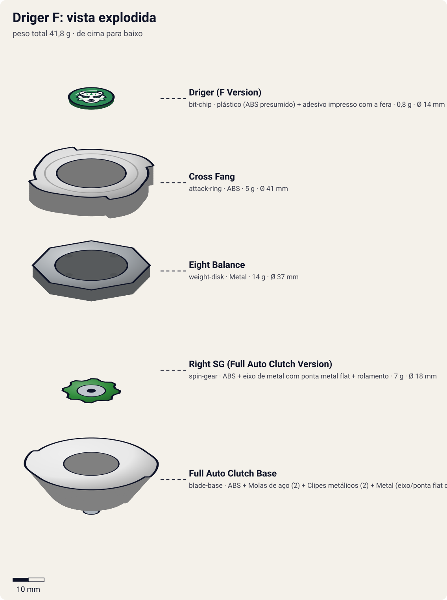

# Driger F (ドライガーF / Doraigā Fangu — "Driger Fang")

<!-- auto:inicio (gerado por npm run build:research; não edite este bloco) -->

| Ficha | |
|---|---|
| Dono | [Ray Kon (Rei Kon / 金李, Kon Rei)](../../README.md) |
| Tipo · sistema · rotação | balance · spin-gear · direita |
| Código do produto | A-24 |
| Montada | Ø 42 mm · altura 24,6 mm · **41,8 g** (soma das peças) |
| Fera bit | [Driger](../../../../feras-bit/driger/) |
| Lançador | [Driger Shooter DX](../../../../lancadores/driger-shooter-dx/) |
| Ripcord | [winder-padrao](../../../../lancadores/ripcords/winder-padrao/) |

### Peças

| Camada | Peça | Material | Ø mm | Altura mm | Peso g | Estrelas Takara (A / D / S) | Desenho |
|---|---|---|---|---|---|---|---|
| Bit Chip | [Driger (F Version)](../../../../pecas/bit-chip/driger-f/) | plástico (ABS presumido) + adesivo impresso com a fera | 14 estimado | 8 estimado | 0,8 comunidade | — | [ver](pecas/bit-chip.svg) |
| Attack Ring | [Cross Fang](../../../../pecas/attack-ring/cross-fang/) | ABS | 41 estimado | 6 estimado | 5 wiki | 2,5 / 2,5 / 1,5 | [ver](pecas/attack-ring.svg) |
| Weight Disk | [Eight Balance](../../../../pecas/weight-disk/eight-balance/) | Metal | 37 estimado | 3,6 estimado | 14 wiki | 0,5 / 2 / 2,5 | [ver](pecas/weight-disk.svg) |
| Spin Gear / Core | [Right SG (Full Auto Clutch Version)](../../../../pecas/spin-gear/right-sg-full-auto-clutch-version/) | ABS + eixo de metal com ponta metal flat + rolamento | 18 estimado | 13 estimado | 7 wiki | — | [ver](pecas/spin-gear.svg) |
| Blade Base | [Full Auto Clutch Base](../../../../pecas/blade-base/full-auto-clutch-base/) | ABS + Molas de aço (2) + Clipes metálicos (2) + Metal (eixo/ponta flat do SG) | 42 estimado | 15 estimado | 15 wiki | 3,5 / 1 / 3 | [ver](pecas/blade-base.svg) |

Fonte de cada medida em subscrito (wiki, comunidade, estimado). Detalhes em cada ficha de peça.

### Atributos

| Atributo | Brinquedo (calculado) | Ajuste anime | Jogo |
|---|---|---|---|
| Ataque | 5,7 | +2 | **7,7** |
| Defesa | 5,4 | — | **5,4** |
| Stamina | 6,4 | — | **6,4** |
| Velocidade | 4,9 | — | **4,9** |
| Peso | 9,9 | — | **9,9** |
| Equilíbrio | 6,8 | — | **6,8** |
| Resistência a KO | 7,3 | — | **7,3** |

Calculado por `src/beyblade/stats.js` a partir de: ponta metal-flat (atrito 0,4), contato smash (recoil 0,5), peso do WD na equilibrado. Modelo em [docs/BEYBLADES.md](../../../../../docs/BEYBLADES.md).

### Fera bit em cima da bey

 

Sons: [invocacao](../../../../feras-bit/driger/sons/invocacao.wav) · [rugido](../../../../feras-bit/driger/sons/rugido.wav) · [ataque](../../../../feras-bit/driger/sons/ataque.wav). Animações: [invocação](../../../../feras-bit/driger/invocacao.svg) · [ataque](../../../../feras-bit/driger/ataque.svg).
<!-- auto:fim -->

| Campo | Valor |
|---|---|
| Dono | Ray Kon |
| Código do produto | A-24 (Takara) |
| Tipo | Balance |
| Sistema | Spin Gear System (Spin Gear de gimmick: Full Auto Clutch) |
| Rotação | Direita |
| Fera Bit (Bit-Beast) | Driger – Tigre Branco |
| Série / temporada | Bakuten Shoot (2001), continua no início de V-Force (2002) |
| Primeira aparição (anime) | S1 ep 21 "Practice Makes Perfect" |
| Antecessora → Sucessora | [Driger S](../driger-s/) → [Driger V](../driger-v/) |

## Formato e geometria
- Silhueta em cruz de 4 tigres do [Cross Fang](../../../../pecas/attack-ring/cross-fang/) (simetria de 4 lados), raio médio.
- Peso total maior que a Driger S por causa da base pesada (molas + clipes metálicos), mas com distribuição irregular: tendência a wobble.
- Altura média; o eixo livre fica exposto embaixo.
- **Por que as peças funcionam assim**:
  - Cross Fang: pontas curtas e pouco afiadas; smash leve em rotação direita. No brinquedo é considerado fraco.
  - [Eight Balance](../../../../pecas/weight-disk/eight-balance/): 8 lados, massa intermediária entre Wide e Heavy; equilíbrio entre defesa e stamina.
  - [Right SG (Full Auto Clutch Version)](../../../../pecas/spin-gear/right-sg-full-auto-clutch-version/): eixo metálico livre sobre rolamento, terminando em ponta Metal Flat larga. O eixo livre reduz a perda de giro ao receber golpes; a ponta plana de metal dá movimento agressivo.
  - [Full Auto Clutch Base](../../../../pecas/blade-base/full-auto-clutch-base/): 2 molas travadas por 2 clipes metálicos; a embreagem automática muda o modo de desempenho durante a batalha. Muito desbalanceada no brinquedo.

## Comportamento na arena
- **Movimento**: a ponta Metal Flat larga dá movimento agressivo e difícil de controlar (testes do WBO); a embreagem automática altera o comportamento conforme a rotação cai.
- **Ataque**: a ponta é agressiva, mas o AR tem contatos fracos; no brinquedo o dano vem mais do movimento do que do anel.
- **Defesa**: o eixo livre absorve parte da perda de giro em impactos.
- **Stamina**: média; o desbalanceamento da base cobra seu preço.
- **Matchups**: vence beys leves de stamina que ficam paradas; sofre contra defensivas pesadas e attackers com AR melhor.
- **Gimmick**: Full Auto Clutch (embreagem automática + eixo livre).

## No anime
- **Tiger Claw** (continua usando no anime) e **Tiger Fang** (白虎牙撃 Taigā Fangu): no anime, Tiger Fang é basicamente a invocação de Driger atacando o oponente; estreia S1 ep 49 contra Bryan.
- Criada por Kenny para o torneio americano (ep 21); Ray troca também o lançador para o Driger Shooter.
- Batalhas: vs Oliver (ep 38, empate); vs Bryan/Falborg (ep 49, vitória com Ray ferido: "Driger salva Ray e derrota Bryan", segundo a wiki); início de V-Force: perde para Joseph (Vanishing Moot, V-Force ep 2).
- Substituída pela Driger V em V-Force ep 8 após a derrota para Vanishing Moot.

## Mecânica no jogo
- **Movimento (IA)**: órbita agressiva e um pouco errática (ruído de ±10° na direção a cada segundo, pelo desbalanceamento da base). Quando a rotação cai abaixo de ~40%, o clutch muda para movimento mais lento e central.
- **Gimmick**:
  - Full Auto Clutch: troca automática e irreversível de "agressivo" para "central" aos 40% de rotação (atrito 0,5 → 0,2, −2 de velocidade efetiva).
  - Eixo livre: −20% de perda de rotação em cada choque.
- **Especiais** (efeito visual: [fera Driger](../../../../feras-bit/driger/ataque.svg), garradas e investida do tigre):
  - **Tiger Claw** (custo 100, recarga 18 s): rajada de 4 golpes em 0,8 s, 0,5× de dano cada.
  - **Tiger Fang** (custo 140, recarga 28 s): a [fera Driger](../../../../feras-bit/driger/invocacao.svg) é invocada e a bey faz uma investida única com 2,5× de dano e 2× de empurrão. Se a rotação da Driger estiver abaixo de 30%, +20% de dano (vence Bryan ferido).

## Ajuste do anime

| Atributo | Delta | Justificativa (episódio/batalha) |
|---|---|---|
| Ataque | +2 | O Tiger Fang derrota a Falborg de Bryan na final da Rússia (S1 ep 49), luta que a wiki aponta como a vitória de fim de temporada de Ray; o Cross Fang do brinquedo é fraco |

Resultado esperado: capaz de vencer a Falborg num duelo desgastante, empatar com a Unicolyon de Oliver e perder para a Vanishing Moot no início da V-Force. Suspeita para o coordenador: o peso de jogo 9,9 (41,8 g somando as peças) é alto demais para uma Spin Gear da S1 (a Driger S dá 30,9 g). A [Full Auto Clutch Base](../../../../pecas/blade-base/full-auto-clutch-base/) tem 15 g pela wiki e o material dela já cita "eixo/ponta flat do SG", então o peso do eixo pode estar contado duas vezes (base + SG de 7 g). Não usei o ajuste para compensar.

## Fontes
- https://beyblade.fandom.com/wiki/Driger_F
- https://beyblade.fandom.com/wiki/Attack_Ring_-_Cross_Fang
- https://beyblade.fandom.com/wiki/Blade_Base_-_Full_Auto_Clutch_Base
- https://beyblade.fandom.com/wiki/Tiger_Fang , https://beyblade.fandom.com/wiki/Tiger_Claw
- https://beyblade.fandom.com/wiki/Beyblade_-_Episode_21 , https://beyblade.fandom.com/wiki/Beyblade:_V-Force_-_Episode_02
- https://beyblade.fandom.com/wiki/Ray_Kon
