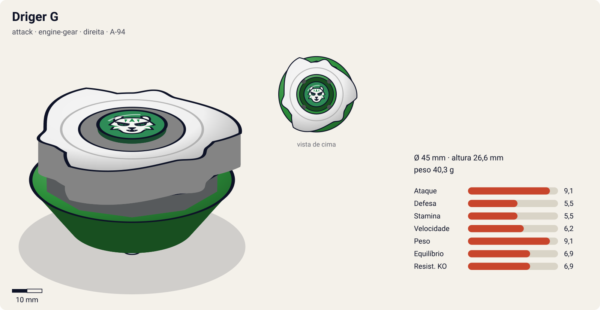
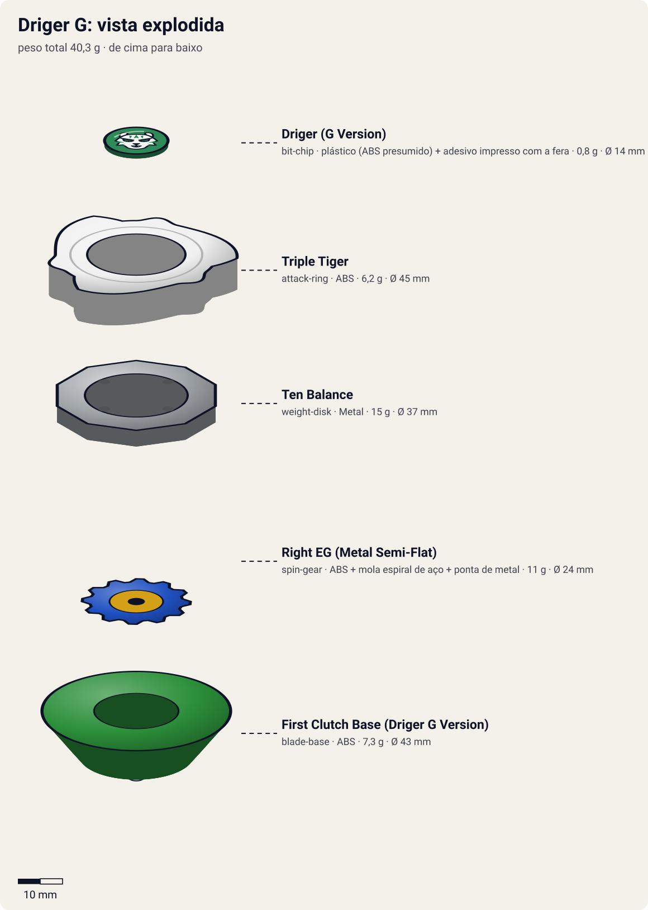

# Driger G (ドライガーG / Doraigā Gatoringu — "Driger Gatling")

<!-- auto:inicio (gerado por npm run build:research; não edite este bloco) -->

| Ficha | |
|---|---|
| Dono | [Ray Kon (Rei Kon / 金李, Kon Rei)](../../README.md) |
| Tipo · sistema · rotação | attack · engine-gear · direita |
| Código do produto | A-94 |
| Montada | Ø 45 mm · altura 26,6 mm · **40,3 g** (soma das peças) |
| Fera bit | [Driger](../../../../feras-bit/driger/) |
| Lançador | [Customize Grip (Sky Blue) - versão Ray](../../../../lancadores/customize-grip-ray/) |
| Ripcord | [winder-padrao](../../../../lancadores/ripcords/winder-padrao/) |

### Peças

| Camada | Peça | Material | Ø mm | Altura mm | Peso g | Estrelas Takara (A / D / S) | Desenho |
|---|---|---|---|---|---|---|---|
| Bit Chip | [Driger (G Version)](../../../../pecas/bit-chip/driger-g/) | plástico (ABS presumido) + adesivo impresso com a fera | 14 estimado | 8 estimado | 0,8 comunidade | — | [ver](pecas/bit-chip.svg) |
| Attack Ring | [Triple Tiger](../../../../pecas/attack-ring/triple-tiger/) | ABS | 45 estimado | 9 estimado | 6,2 wiki | 3 / 1 / 1 | [ver](pecas/attack-ring.svg) |
| Weight Disk | [Ten Balance](../../../../pecas/weight-disk/ten-balance/) | Metal | 37 estimado | 3,6 estimado | 15 wiki | 1 / 2 / 3 | [ver](pecas/weight-disk.svg) |
| Spin Gear / Core | [Right EG (Metal Semi-Flat)](../../../../pecas/spin-gear/right-eg-metal-semi-flat/) | ABS + mola espiral de aço + ponta de metal | 24 estimado | 18 estimado | 11 wiki | 3 / 0 / 2 | [ver](pecas/spin-gear.svg) |
| Blade Base | [First Clutch Base (Driger G Version)](../../../../pecas/blade-base/first-clutch-base-driger-g/) | ABS | 43 estimado | 14 estimado | 7,3 wiki | 1 / 2 / 0 | [ver](pecas/blade-base.svg) |

Fonte de cada medida em subscrito (wiki, comunidade, estimado). Detalhes em cada ficha de peça.

### Atributos

| Atributo | Brinquedo (calculado) | Ajuste anime | Jogo |
|---|---|---|---|
| Ataque | 7,1 | +2 | **9,1** |
| Defesa | 5,5 | — | **5,5** |
| Stamina | 5,5 | — | **5,5** |
| Velocidade | 5,2 | +1 | **6,2** |
| Peso | 9,1 | — | **9,1** |
| Equilíbrio | 6,9 | — | **6,9** |
| Resistência a KO | 6,9 | — | **6,9** |

Calculado por `src/beyblade/stats.js` a partir de: ponta metal-semi-flat (atrito 0,3), contato smash (recoil 0,3), peso do WD na equilibrado, Engine Gear (clutch). Modelo em [docs/BEYBLADES.md](../../../../../docs/BEYBLADES.md).

### Fera bit em cima da bey

 

Sons: [invocacao](../../../../feras-bit/driger/sons/invocacao.wav) · [rugido](../../../../feras-bit/driger/sons/rugido.wav) · [ataque](../../../../feras-bit/driger/sons/ataque.wav). Animações: [invocação](../../../../feras-bit/driger/invocacao.svg) · [ataque](../../../../feras-bit/driger/ataque.svg).
<!-- auto:fim -->

| Campo | Valor |
|---|---|
| Dono | Ray Kon |
| Código do produto | A-94 (Takara). Nome de desenvolvimento: Driger X |
| Tipo | Attack |
| Sistema | Engine Gear System (Type 1: EG + base de liberação imediata) |
| Rotação | Direita |
| Fera Bit (Bit-Beast) | Driger – Tigre Branco |
| Série / temporada | G-Revolution (2003) |
| Primeira aparição (anime) | G-Rev ep 4 "We Were Once Bladebreakers..." |
| Antecessora → Sucessora | [Driger V2](../driger-v2/) → [Driger MS](../driger-ms/) |

## Formato e geometria
- Silhueta triangular de 3 garras do [Triple Tiger](../../../../pecas/attack-ring/triple-tiger/) (simetria de 3 lados), raio médio-grande.
- Massa alta no centro (Engine Gear de 11 g) + WD [Ten Balance](../../../../pecas/weight-disk/ten-balance/).
- Os contatos do AR descem abaixo do nível normal do AR: acertam beys baixas e altas.
- **Por que as peças funcionam assim**:
  - Triple Tiger: 3 cabeças de tigre seguidas de rampas que descem até a base do WD e terminam em contatos verticais altos. Híbrido smash + upper de nível top; os contatos bem angulados dão pouco recuo em rotação direita e protegem contra attackers altos.
  - [Right EG (Metal Semi-Flat)](../../../../pecas/spin-gear/right-eg-metal-semi-flat/): motor de corda interno; ponta metálica relativamente plana de diâmetro menor. Ao liberar, dá uma explosão de velocidade; a ponta é agressiva, com boa sobrevivência para um attacker.
  - [First Clutch Base (Driger G Version)](../../../../pecas/blade-base/first-clutch-base-driger-g/) (Instant Release): base circular lisa, inclinada embaixo; ativa o Engine Gear logo após o pouso no estádio, e o formato redondo desvia golpes.

## Comportamento na arena
- **Movimento**: ao pousar, o EG dispara imediatamente: arrancada muito rápida e agressiva nos primeiros segundos; depois, órbita de attacker com ponta metálica.
- **Ataque**: smash forte + upper; um dos melhores ARs de ataque da geração em rotação direita.
- **Defesa**: baixa a média (a base redonda ajuda um pouco).
- **Stamina**: baixa/média; o boost do EG é gasto logo no início.
- **Matchups**: vence balance/stamina leves; sofre contra quem sobrevive ao rush inicial (defensivas pesadas, Dranzer G, Dragoon GT).
- **Gimmick**: Engine Gear com liberação imediata.

## No anime
- **Gatling Claw** (ガトリングクロー): explosão de eletricidade verde; a bey cria clones elétricos em forma de tigre que atacam em rajada. Estreia G-Rev ep 7 vs Lee; usado também nos eps 12, 19 e 23.
- **Gatling Claw Maximum**: Ray canaliza um raio verde que supercarrega a bey, que ataca em velocidade imperceptível. Eps 23 (vs Kai, perde para Blazing Gigs Tempest) e 37 (vs Tyson, perde para Galaxy Turbo Twister).
- Batalhas: vence o White Tiger X inteiro (ep 4) e Lee (ep 7); tag com Lee vence Tyson+Daichi (ep 10); vence Claude e perde para Miguel (ep 12, sabotagem); perde para Kai (ep 23); empata com Mystel (ep 34); perde para Tyson/Dragoon GT (ep 37) e troca para Driger MS.

## Mecânica no jogo
- **Movimento (IA)**: fase 1 (0–4 s depois do pouso): rush direto ao alvo, sem órbita. Fase 2: órbita agressiva normal, investindo pelo ângulo para usar o upper do Triple Tiger.
- **Gimmick (Engine Gear, Instant Release)**: o EG solta no pouso. Fase 1: +60% de velocidade e +1 de ataque por 4 s; ao fim, a bey já gastou 10% de rotação a mais que o normal. Não há segundo burst.
- **Especiais** (efeito visual: [fera Driger](../../../../feras-bit/driger/ataque.svg), com raios verdes):
  - **Gatling Claw** (custo 120, recarga 22 s): 3 clones elétricos de tigre atacam junto com a bey por 2 s; cada clone que toca o alvo causa 0,4× de dano (multi-hit) e um empurrão pequeno, por lados diferentes.
  - **Gatling Claw Maximum** (custo 180, recarga 40 s): velocidade 2× e +50% de dano por 3 s, mas consome 25% da própria rotação na hora. É cancelado por um especial de controle de área (ex.: Blazing Gigs Tempest), como no ep 23.

## Ajuste do anime

| Atributo | Delta | Justificativa (episódio/batalha) |
|---|---|---|
| Ataque | +2 | Vence o White Tiger X inteiro (ep 4), Lee com a estreia da Gatling Claw (ep 7) e Claude (ep 12); empata com Mystel (ep 34) |
| Velocidade | +1 | A Gatling Claw Maximum ataca "em velocidade imperceptível" (eps 23 e 37) |

Resultado esperado: attacker de elite, mas que perde para as duas versões de topo do meio da G-Rev: Dranzer G (ep 23) e Dragoon GT (ep 37). Por isso o ajuste fica abaixo do da Dranzer G. Nota: o bloco gerado mostra estrela de Defesa desconhecida ("?") no Engine Gear e na base.

## Fontes
- https://beyblade.fandom.com/wiki/Driger_G
- https://beyblade.fandom.com/wiki/Attack_Ring_-_Triple_Tiger
- https://beyblade.fandom.com/wiki/Engine_Gear_-_Right_Engine_Gear_(Metal_Semi-Flat)
- https://beyblade.fandom.com/wiki/Blade_Base_-_First_Clutch_Base_(Driger_G_version)
- https://beyblade.fandom.com/wiki/Gatling_Claw , https://beyblade.fandom.com/wiki/Gatling_Claw_Maximum
- https://beyblade.fandom.com/wiki/Beyblade:_G-Revolution_-_Episode_04 , _07 , _12 ; https://beyblade.fandom.com/wiki/Beyblade_G-Revolution_-_Episode_34
