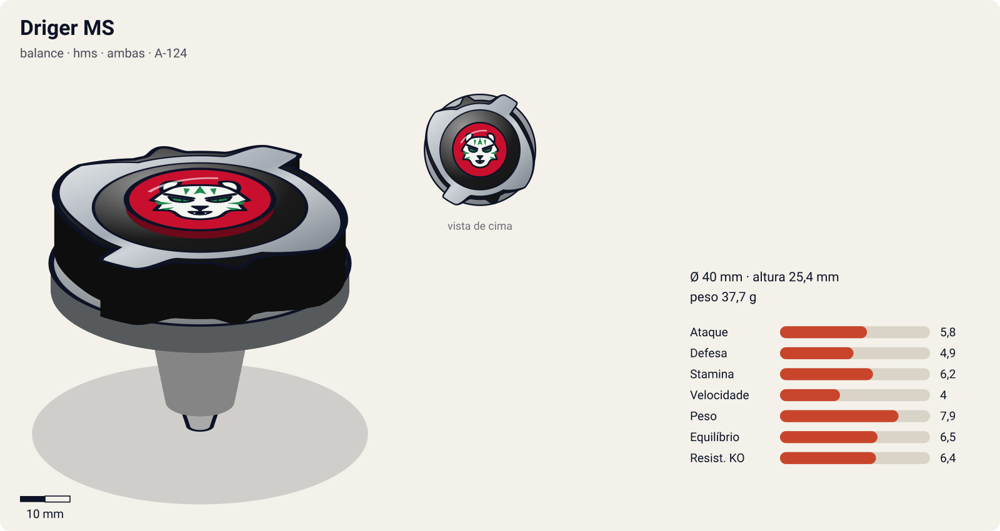
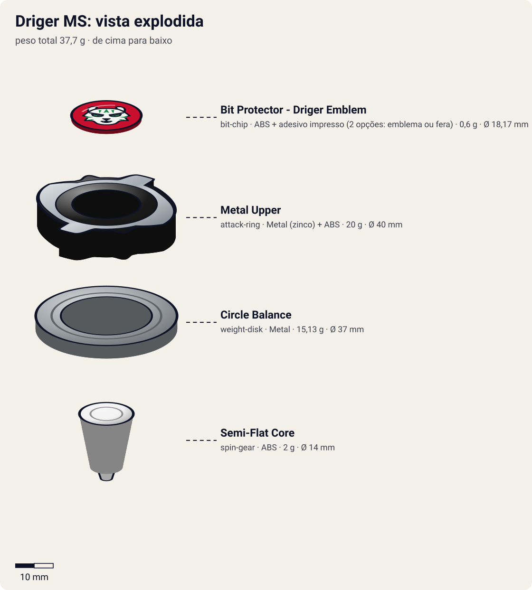
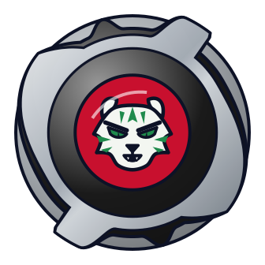

# Driger MS (ドライガーMS / Doraigā Metaru Surasshu — "Driger Metal Slash")

<!-- auto:inicio (gerado por npm run build:research; não edite este bloco) -->

| Ficha | |
|---|---|
| Dono | [Ray Kon (Rei Kon / 金李, Kon Rei)](../../README.md) |
| Tipo · sistema · rotação | balance · hms · ambas |
| Código do produto | A-124 |
| Montada | Ø 40 mm · altura 25,4 mm · **37,7 g** (soma das peças) |
| Fera bit | [Driger](../../../../feras-bit/driger/) |
| Lançador | [HMS Customize Grip (Ray: Dual Shooter preto + G-Winder azul)](../../../../lancadores/hms-customize-grip/) |
| Ripcord | [g-winder](../../../../lancadores/ripcords/g-winder/) |

### Peças

| Camada | Peça | Material | Ø mm | Altura mm | Peso g | Estrelas Takara (A / D / S) | Desenho |
|---|---|---|---|---|---|---|---|
| Bit Chip | [Bit Protector - Driger Emblem](../../../../pecas/bit-chip/driger-emblem/) | ABS + adesivo impresso (2 opções: emblema ou fera) | 18,2 comunidade | 6,7 comunidade | 0,6 comunidade | — | [ver](pecas/bit-chip.svg) |
| Attack Ring | [Metal Upper](../../../../pecas/attack-ring/metal-upper/) | Metal (zinco) + ABS | 40 estimado | 8 estimado | 20 wiki | 2 / 2 / 3 | [ver](pecas/attack-ring.svg) |
| Weight Disk | [Circle Balance](../../../../pecas/weight-disk/circle-balance/) | Metal | 37 estimado | 3,4 estimado | 15,1 wiki | 1,5 / 1,5 / 2 | [ver](pecas/weight-disk.svg) |
| Spin Gear / Core | [Semi-Flat Core](../../../../pecas/spin-gear/semi-flat-core/) | ABS | 14 estimado | 14 estimado | 2 wiki | 2 / 1 / 2 | [ver](pecas/spin-gear.svg) |

Fonte de cada medida em subscrito (wiki, comunidade, estimado). Detalhes em cada ficha de peça.

### Atributos

| Atributo | Brinquedo (calculado) | Ajuste anime | Jogo |
|---|---|---|---|
| Ataque | 4,8 | +1 | **5,8** |
| Defesa | 4,9 | — | **4,9** |
| Stamina | 6,2 | — | **6,2** |
| Velocidade | 4 | — | **4** |
| Peso | 7,9 | — | **7,9** |
| Equilíbrio | 6,5 | — | **6,5** |
| Resistência a KO | 6,4 | — | **6,4** |

Calculado por `src/beyblade/stats.js` a partir de: ponta semi-flat (atrito 0,3), contato upper (recoil 0,4), peso do WD na equilibrado. Modelo em [docs/BEYBLADES.md](../../../../../docs/BEYBLADES.md).

### Fera bit em cima da bey

 

Sons: [invocacao](../../../../feras-bit/driger/sons/invocacao.wav) · [rugido](../../../../feras-bit/driger/sons/rugido.wav) · [ataque](../../../../feras-bit/driger/sons/ataque.wav). Animações: [invocação](../../../../feras-bit/driger/invocacao.svg) · [ataque](../../../../feras-bit/driger/ataque.svg).
<!-- auto:fim -->

| Campo | Valor |
|---|---|
| Dono | Ray Kon |
| Código do produto | A-124 (Takara) |
| Tipo | Balance (primeiro Balance da linha HMS) |
| Sistema | Hard Metal System (HMS) |
| Rotação | Ambas (dual-spin); no anime, direita |
| Fera Bit (Bit-Beast) | Driger – Tigre Branco |
| Série / temporada | G-Revolution (2003) |
| Primeira aparição (anime) | G-Rev ep 40 "Back to Basics" |
| Antecessora → Sucessora | [Driger G](../driger-g/) → — (no mangá Rising: Driger Slash Heavy Fusion, fora do escopo) |

## Formato e geometria
- O [Metal Upper](../../../../pecas/attack-ring/metal-upper/) é compacto, baixo e de diâmetro pequeno (bom para compactos); simetria de 2 lados (cabeças de tigre).
- Massa muito maior que a das gerações plásticas (AR de metal de 20 g) e concentrada perto do centro: RPM e inércia altos.
- Perfil baixo: favorece entrar por baixo do oponente.
- **Por que as peças funcionam assim**:
  - Metal Upper: estrutura metálica com rampa + partes de ABS; as cabeças de tigre concentram o metal. Em rotação direita, upper attack sólido; em rotação esquerda, smash/spike com as cabeças de tigre.
  - [Circle Balance](../../../../pecas/weight-disk/circle-balance/): disco circular balanceado; estabilidade geral.
  - [Semi-Flat Core](../../../../pecas/spin-gear/semi-flat-core/) (Running Core): ponta semi-flat; movimento equilibrado, com algo de defesa e stamina.
  - [Bit Protector Driger Emblem](../../../../pecas/bit-chip/driger-emblem/): ABS preto com adesivo (emblema de Driger ou Driger de corpo inteiro).

## Comportamento na arena
- **Movimento**: o semi-flat dá padrão equilibrado: órbita moderada que tende a se estabilizar.
- **Ataque**: upper em rotação direita; smash em esquerda. O peso torna cada impacto mais forte.
- **Defesa**: boa pelo peso metálico.
- **Stamina**: média (core semi-flat simples).
- **Matchups**: supera plásticas/EG por peso; contra HMS pesados de ataque (Gigars) perde no empurrão/KO.
- **Gimmick**: dual-spin (anel metálico funciona nos dois sentidos).

## No anime
- **Thunder Slash** (サンダースラッシュ): Ray canaliza energia elétrica em Driger, que brilha e colide num golpe de corte devastador. Usado contra Gigars (Crusher) no ep 44.
- Batalhas: treino vs Lee (ep 40, derrota; Ray e Max "voltam ao básico" para dominar as HMS); tag vs Lee+Rick (ep 40, sem resultado); tag BBA vs White Tiger X/PPB/Barthez/F-Dynasty (ep 41, vitória); vs Crusher/Gigars (ep 44, derrota: Driger termina girando, mas fora do estádio); ep 49 tag vs Tyson.

## Mecânica no jogo
- **Movimento (IA)**: órbita média que se fecha em espiral sobre o alvo; prioriza contato por baixo (upper) contra alvos mais leves e evita choques de frente com beys mais pesadas.
- **Gimmick (dual-spin)**: o jogador escolhe o sentido no lançamento. Direita = upper (o golpe aplica "lift": −30% de estabilidade no alvo por 1 s); esquerda = smash/spike (+15% de empurrão, sem lift) e +20% de dano contra beys de rotação direita.
- **Especiais** (efeito visual: [fera Driger](../../../../feras-bit/driger/ataque.svg) com aura elétrica):
  - **Thunder Slash** (custo 160, recarga 35 s): carga de 1 s com aura elétrica (a Driger fica parada e vulnerável), depois um único golpe de corte com 3× de dano e 2× de empurrão. Se a carga for interrompida por um golpe, o especial é perdido e metade do custo volta.

## Ajuste do anime

| Atributo | Delta | Justificativa (episódio/batalha) |
|---|---|---|
| Ataque | +1 | O Thunder Slash é descrito como golpe de corte devastador contra a Gigars (ep 44); vence o tag da BBA (ep 41) |

Resultado esperado: quase o brinquedo. Ray perde o treino para Lee (ep 40) e perde para a Gigars de Crusher por ring out (ep 44), então a resistência a KO não ganha bônus.

## Fontes
- https://beyblade.fandom.com/wiki/Driger_MS
- https://beyblade.fandom.com/wiki/Thunder_Slash
- https://beyblade.fandom.com/wiki/Beyblade_G-Revolution_-_Episode_40 , _41 , _44
- https://beyblade.fandom.com/wiki/Ray_Kon
