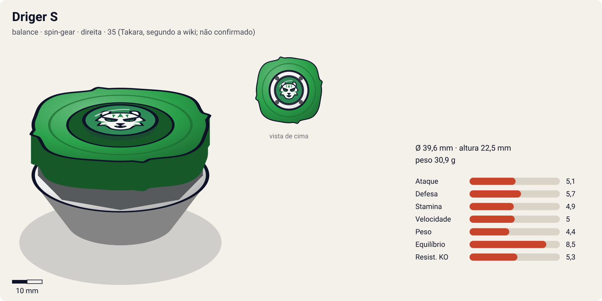
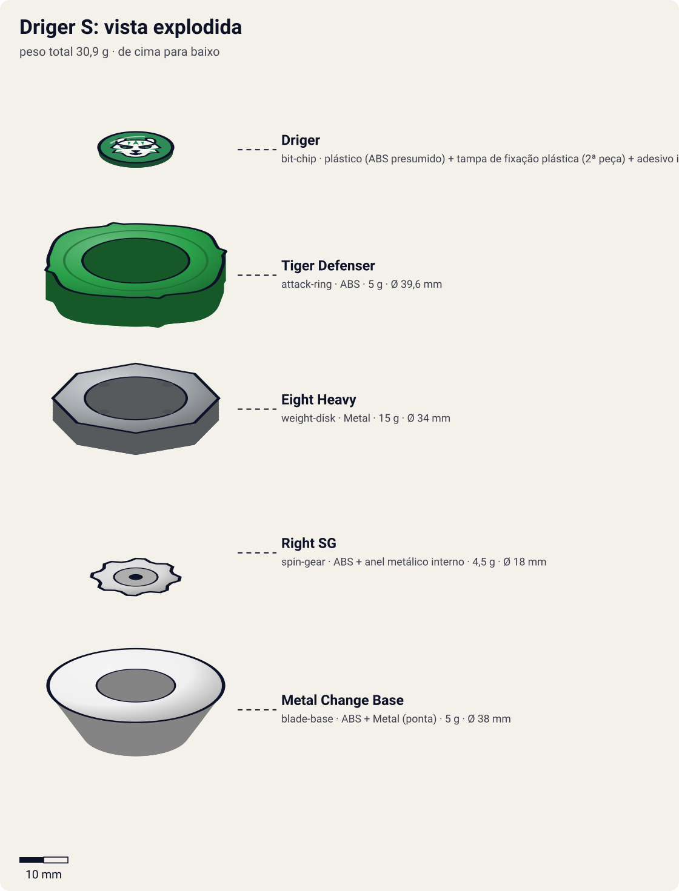

# Driger S (ドライガーS / Doraigā Surasshu — "Driger Slash")

<!-- auto:inicio (gerado por npm run build:research; não edite este bloco) -->

| Ficha | |
|---|---|
| Dono | [Ray Kon (Rei Kon / 金李, Kon Rei)](../../README.md) |
| Tipo · sistema · rotação | balance · spin-gear · direita |
| Código do produto | 35 (Takara, segundo a wiki; não confirmado) |
| Montada | Ø 39,6 mm · altura 22,5 mm · **30,9 g** (soma das peças) |
| Fera bit | [Driger](../../../../feras-bit/driger/) |
| Lançador | [EZ Shooter (Easy Shooter, rotação direita)](../../../../lancadores/ez-shooter/) |
| Ripcord | [winder-padrao](../../../../lancadores/ripcords/winder-padrao/) |

### Peças

| Camada | Peça | Material | Ø mm | Altura mm | Peso g | Estrelas Takara (A / D / S) | Desenho |
|---|---|---|---|---|---|---|---|
| Bit Chip | [Driger](../../../../pecas/bit-chip/driger-s/) | plástico (ABS presumido) + tampa de fixação plástica (2ª peça) + adesivo impresso com a fera | 15 estimado | 5 estimado | 1,4 comunidade | — | [ver](pecas/bit-chip.svg) |
| Attack Ring | [Tiger Defenser](../../../../pecas/attack-ring/tiger-defenser/) | ABS | 39,6 estimado | 6 estimado | 5 wiki | 1 / 3 / 2 | [ver](pecas/attack-ring.svg) |
| Weight Disk | [Eight Heavy](../../../../pecas/weight-disk/eight-heavy/) | Metal | 34 estimado | 4,5 estimado | 15 wiki | 0,5 / 3 / 1,5 | [ver](pecas/weight-disk.svg) |
| Spin Gear / Core | [Right SG](../../../../pecas/spin-gear/right-sg/) | ABS + anel metálico interno | 18 estimado | 10 estimado | 4,5 estimado | — | [ver](pecas/spin-gear.svg) |
| Blade Base | [Metal Change Base](../../../../pecas/blade-base/metal-change-base/) | ABS + Metal (ponta) | 38 estimado | 12 estimado | 5 wiki | 3 / 1 / 3 | [ver](pecas/blade-base.svg) |

Fonte de cada medida em subscrito (wiki, comunidade, estimado). Detalhes em cada ficha de peça.

### Atributos

| Atributo | Brinquedo (calculado) | Ajuste anime | Jogo |
|---|---|---|---|
| Ataque | 3,1 | +2 | **5,1** |
| Defesa | 5,7 | — | **5,7** |
| Stamina | 4,9 | — | **4,9** |
| Velocidade | 4 | +1 | **5** |
| Peso | 4,4 | — | **4,4** |
| Equilíbrio | 8,5 | — | **8,5** |
| Resistência a KO | 5,3 | — | **5,3** |

Calculado por `src/beyblade/stats.js` a partir de: ponta metal-sharp (atrito 0,2), contato survival (recoil 0,2), peso do WD na centro. Modelo em [docs/BEYBLADES.md](../../../../../docs/BEYBLADES.md).

### Fera bit em cima da bey

 

Sons: [invocacao](../../../../feras-bit/driger/sons/invocacao.wav) · [rugido](../../../../feras-bit/driger/sons/rugido.wav) · [ataque](../../../../feras-bit/driger/sons/ataque.wav). Animações: [invocação](../../../../feras-bit/driger/invocacao.svg) · [ataque](../../../../feras-bit/driger/ataque.svg).
<!-- auto:fim -->

| Campo | Valor |
|---|---|
| Dono | Ray Kon |
| Código do produto | "35" segundo a infobox da wiki (Takara); numeração A-xx não confirmada (há listagens de terceiros com outros números) |
| Tipo | Balance |
| Sistema | Spin Gear System |
| Rotação | Direita |
| Fera Bit (Bit-Beast) | Driger – Tigre Branco (Byakko, guardião do Oeste na mitologia chinesa) |
| Série / temporada | Bakuten Shoot (2001) |
| Primeira aparição (anime) | S1 ep 5 (1ª batalha, vs blader do Bloco D) / infobox da wiki: ep 6 "Dragoon Storm" |
| Antecessora → Sucessora | — → [Driger F](../driger-f/) |

## Formato e geometria
- Silhueta pequena e quase circular: o [Tiger Defenser](../../../../pecas/attack-ring/tiger-defenser/) tem contornos arredondados com 4 saliências suaves ("garras" curtas) e pequenas rampas de upper (simetria de 2/4 lados). Raio menor que a média das Spin Gear.
- Peso concentrado no centro ([Eight Heavy](../../../../pecas/weight-disk/eight-heavy/) + ponta de metal): alta velocidade de rotação, inércia periférica baixa.
- Perfil baixo e compacto: difícil de ser atingida por upper; boa para combos "compact".
- **Por que as peças funcionam assim**:
  - Tiger Defenser: pouco recuo, o que dá boa stamina e defesa; algum ataque leve com as pontas e rampas.
  - Eight Heavy: disco de 8 lados com a massa perto do centro; aumenta RPM e peso total e favorece combos compactos/defensivos.
  - [Right SG](../../../../pecas/spin-gear/right-sg/): engrenagem padrão de rotação direita, sem gimmick.
  - [Metal Change Base](../../../../pecas/blade-base/metal-change-base/): base pequena e redonda com ponta de metal larga, plana na maior parte e mais aguda no centro. Reta, gira no centro sobre a parte aguda (sobrevivência); inclinada, apoia na parte plana, anda rápido e ataca.

## Comportamento na arena
- **Movimento**: lançada reta, fica estável no centro em ponta aguda; lançada inclinada (ou ao ser atingida) cai na parte plana da ponta de metal e faz uma varredura rápida pelo estádio, depois volta ao modo de sobrevivência.
- **Ataque**: moderado; vem do contra-ataque quando inclina após um impacto (ataque de retorno) e do Sliding Shoot.
- **Defesa**: boa para o tamanho (pouco recuo, RPM alto), mas é leve.
- **Stamina**: boa; a ponta metálica gira muito com pouco atrito no modo central.
- **Pontos fortes**: versátil, "vence muita coisa sem customização" (wiki). **Fracos**: leve, perde para smash attackers pesados de alto alcance e para defensivas pesadas em empurrões.
- **Gimmick**: Metal Change (ponta de dois modos).

## No anime
- **Tiger Claw** (白虎爪撃 Taigā Kurō): Driger acelera a rotação e rasga o oponente com uma sequência de garradas; Driger costuma aparecer. Estreia S1 ep 6 contra Tyson.
- Batalhas: contra Tyson (ep 6) vence a 1ª rodada com Tiger Claw, perde a 2ª e desiste da decisiva; perde Driger para Kevin (ep 11) por falta de concentração e o recupera (ep 13); vence Mariah (ep 16) e Lee (ep 17) no Torneio Asiático usando Black Thunder + Tiger Claw.
- Substituída após perder para Steven (Tryhorn) no torneio americano; Kenny atualiza para Driger F no ep 21.

## Mecânica no jogo
- **Movimento (IA)**: estado "centro" (padrão), parada na ponta aguda com deriva mínima. Muda para "varredura" por 1–2 s sempre que recebe um impacto acima de um limiar ou quando é lançada com ângulo: atravessa o estádio em arco rápido e devolve o golpe (ataque de retorno). Depois volta ao centro.
- **Gimmick (Metal Change)**: não é troca de modo manual; o modo depende da inclinação. No centro, atrito ~0,1 (stamina); na varredura, atrito ~0,6 e +3 de velocidade efetiva.
- **Especiais** (efeito visual: [fera Driger](../../../../feras-bit/driger/ataque.svg), garradas do tigre branco):
  - **Tiger Claw** (custo 100, recarga 18 s): dash curto até o alvo e rajada de 4 golpes em 0,8 s, cada um com 0,5× de dano e empurrão pequeno; o último golpe tem 1,2× de empurrão. Bom para desgastar rotação, ruim para ring out.

## Ajuste do anime

| Atributo | Delta | Justificativa (episódio/batalha) |
|---|---|---|
| Ataque | +2 | O Tiger Claw vence a 1ª rodada contra Tyson (ep 6) e as finais contra Mariah e Lee no Torneio Asiático (eps 16–17); o brinquedo, com AR defensivo, quase não ataca |
| Velocidade | +1 | No anime as garradas do Tiger Claw são uma sequência rápida de investidas (ep 6), bem mais móvel que a ponta aguda do brinquedo |

Resultado esperado: uma balance que ganha de Galeon e Galux, mas perde no conjunto para a Dragoon S (ep 6) e para a Tryhorn de Steven.

## Fontes
- https://beyblade.fandom.com/wiki/Driger_S
- https://beyblade.fandom.com/wiki/Attack_Ring_-_Tiger_Defenser
- https://beyblade.fandom.com/wiki/Weight_Disk_-_Eight_Heavy
- https://beyblade.fandom.com/wiki/Spin_Gear_-_Right_SG
- https://beyblade.fandom.com/wiki/Blade_Base_-_Metal_Change_Base
- https://beyblade.fandom.com/wiki/Tiger_Claw
- https://beyblade.fandom.com/wiki/Beyblade_-_Episode_17 , https://beyblade.fandom.com/wiki/Beyblade_-_Episode_21
- https://beyblade.fandom.com/wiki/Ray_Kon (resultados de fim de temporada e lista de batalhas)
