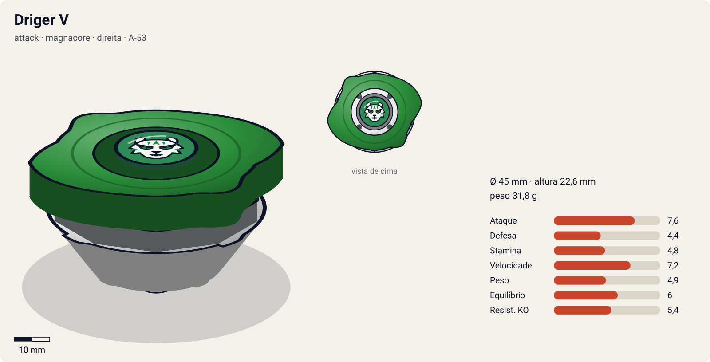
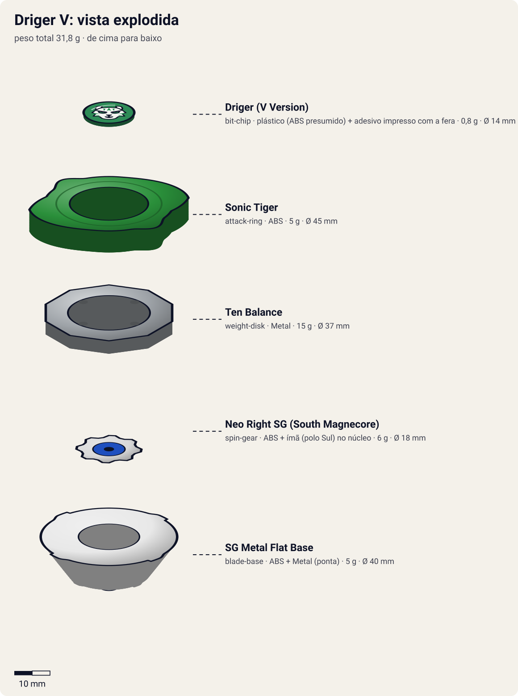

# Driger V (ドライガーV / Doraigā Barukan — "Driger Vulcan"; "Driger Five" no dub EN)

<!-- auto:inicio (gerado por npm run build:research; não edite este bloco) -->

| Ficha | |
|---|---|
| Dono | [Ray Kon (Rei Kon / 金李, Kon Rei)](../../README.md) |
| Tipo · sistema · rotação | attack · magnacore · direita |
| Código do produto | A-53 |
| Montada | Ø 45 mm · altura 22,6 mm · **31,8 g** (soma das peças) |
| Fera bit | [Driger](../../../../feras-bit/driger/) |
| Lançador | [Driger Shooter DX](../../../../lancadores/driger-shooter-dx/) |
| Ripcord | [winder-padrao](../../../../lancadores/ripcords/winder-padrao/) |

### Peças

| Camada | Peça | Material | Ø mm | Altura mm | Peso g | Estrelas Takara (A / D / S) | Desenho |
|---|---|---|---|---|---|---|---|
| Bit Chip | [Driger (V Version)](../../../../pecas/bit-chip/driger-v/) | plástico (ABS presumido) + adesivo impresso com a fera | 14 estimado | 8 estimado | 0,8 comunidade | — | [ver](pecas/bit-chip.svg) |
| Attack Ring | [Sonic Tiger](../../../../pecas/attack-ring/sonic-tiger/) | ABS | 45 estimado | 6 estimado | 5 wiki | 2,5 / 1,5 / 1,5 | [ver](pecas/attack-ring.svg) |
| Weight Disk | [Ten Balance](../../../../pecas/weight-disk/ten-balance/) | Metal | 37 estimado | 3,6 estimado | 15 wiki | 1 / 2 / 3 | [ver](pecas/weight-disk.svg) |
| Spin Gear / Core | [Neo Right SG (South Magnecore)](../../../../pecas/spin-gear/neo-right-sg-south-magnecore/) | ABS + ímã (polo Sul) no núcleo | 18 estimado | 10 estimado | 6 wiki | — | [ver](pecas/spin-gear.svg) |
| Blade Base | [SG Metal Flat Base](../../../../pecas/blade-base/sg-metal-flat-base/) | ABS + Metal (ponta) | 40 estimado | 13 estimado | 5 estimado | 2,5 / 1,5 / 1,5 | [ver](pecas/blade-base.svg) |

Fonte de cada medida em subscrito (wiki, comunidade, estimado). Detalhes em cada ficha de peça.

### Atributos

| Atributo | Brinquedo (calculado) | Ajuste anime | Jogo |
|---|---|---|---|
| Ataque | 4,6 | +3 | **7,6** |
| Defesa | 4,4 | — | **4,4** |
| Stamina | 4,8 | — | **4,8** |
| Velocidade | 6,2 | +1 | **7,2** |
| Peso | 4,9 | — | **4,9** |
| Equilíbrio | 6 | — | **6** |
| Resistência a KO | 5,4 | — | **5,4** |

Calculado por `src/beyblade/stats.js` a partir de: ponta metal-flat (atrito 0,4), contato slope (recoil 0,4), peso do WD na equilibrado. Modelo em [docs/BEYBLADES.md](../../../../../docs/BEYBLADES.md).

### Fera bit em cima da bey

 

Sons: [invocacao](../../../../feras-bit/driger/sons/invocacao.wav) · [rugido](../../../../feras-bit/driger/sons/rugido.wav) · [ataque](../../../../feras-bit/driger/sons/ataque.wav). Animações: [invocação](../../../../feras-bit/driger/invocacao.svg) · [ataque](../../../../feras-bit/driger/ataque.svg).
<!-- auto:fim -->

| Campo | Valor |
|---|---|
| Dono | Ray Kon |
| Código do produto | A-53 (Takara); A-48 (Sonokong); H-62 |
| Tipo | Attack |
| Sistema | Magnacore System |
| Rotação | Direita |
| Fera Bit (Bit-Beast) | Driger – Tigre Branco |
| Série / temporada | V-Force (2002); lançamento JP fev/2002 |
| Primeira aparição (anime) | V-Force ep 8 "Return of the Bladebreakers" |
| Antecessora → Sucessora | [Driger F](../driger-f/) → [Driger V2](../driger-v2/) |

## Formato e geometria
- Silhueta alongada de 2 lâminas opostas do [Sonic Tiger](../../../../pecas/attack-ring/sonic-tiger/) (2 lados); raio efetivo grande nas pontas das asas.
- Peso balanceado pelo [Ten Balance](../../../../pecas/weight-disk/ten-balance/); ponta metálica no centro.
- Perfil médio; as lâminas ficam na altura do AR (ataque "alto").
- **Por que as peças funcionam assim**:
  - Sonic Tiger: 2 "asas" grandes em lâmina + 2 cabeças de tigre. É o primeiro AR da linha para "ataque para todos os fins" (all-purpose): as asas atingem a parte de cima do oponente.
  - [Neo Right SG (South Magnecore)](../../../../pecas/spin-gear/neo-right-sg-south-magnecore/): núcleo magnético polo Sul; interage com os ímãs de estádios Magnacore (repele, junto com a ponta).
  - [SG Metal Flat Base](../../../../pecas/blade-base/sg-metal-flat-base/): ponta plana de metal, magnética (carga negativa); movimento rápido e agressivo e repulsão dos ímãs do estádio. Takara: ponta semi-flat; o 1º lote Hasbro saiu com ponta sharp (corrigido depois). No anime a base é flat.

## Comportamento na arena
- **Movimento**: órbita agressiva de attacker com ponta flat de metal; em estádios magnéticos o par South Core + ponta negativa repele os ímãs (deslocamento mais imprevisível).
- **Ataque**: smash com as duas lâminas; bom contra beys altas.
- **Defesa**: baixa (2 lados = recuo alto ao ser atingida).
- **Stamina**: média; a ponta metálica perde menos giro que borracha, mas o movimento agressivo gasta.
- **Matchups**: vence stamina/balance leves; sofre contra defensivas pesadas (Vortex Ape 2) e uppers baixos.
- **Gimmick**: Magnacore (núcleo magnético Sul).

## No anime
- **Vulcan Claw** (白虎連射爪 Barukan Kurō): cria garras orbitando a bey ("barreira cortante") para um smash de múltiplos acertos. Estreia V-Force ep 15 contra Vanishing Moot (Joseph): vitória.
- Outras batalhas: Dark Emperor Bat (ep 11, vitória), Salima/Cyber Driger (ep 23, vitória), Foxy (ep 31, vitória), Dunga/Vortex Ape 2 (ep 33, derrota; Driger é selado na pedra).
- Substituída pela Driger V2 (ep 38) depois de recuperar Driger.

## Mecânica no jogo
- **Movimento (IA)**: órbita agressiva rápida perto da borda, com investidas em linha reta contra o alvo a cada passagem (uma investida por volta).
- **Gimmick (Magnacore Sul)**: em estádios magnéticos, as zonas de polo Sul empurram a bey (força de repulsão proporcional à proximidade) e as de polo Norte a puxam; isso deixa o trajeto menos previsível para a IA adversária. Em estádio comum, sem efeito.
- **Especiais** (efeito visual: [fera Driger](../../../../feras-bit/driger/ataque.svg), garras em volta da bey):
  - **Vulcan Claw** (custo 120, recarga 22 s): aura de garras orbitando a bey por 3 s; todo contato nesse tempo causa 3 golpes rápidos (0,4× de dano cada) e 1,5× de empurrão. A Driger fica +20% mais rápida durante a aura.

## Ajuste do anime

| Atributo | Delta | Justificativa (episódio/batalha) |
|---|---|---|
| Ataque | +3 | Tipo Attack no anime: vence Dark Emperor Bat (ep 11), a Vanishing Moot que tinha derrotado a Driger F (ep 15), a Cyber Driger (ep 23) e Foxy (ep 31) |
| Velocidade | +1 | O Vulcan Claw é um smash de múltiplos acertos em sequência rápida (ep 15) |

Defesa fica sem ajuste: perde para a Vortex Ape 2 de Dunga (ep 33), uma defensiva pesada. Resultado esperado: a attacker mais perigosa da primeira metade da V-Force para Ray, que perde para defensivas pesadas. Suspeita para o coordenador: o bloco gerado mostra estrelas Takara 1 / 3 / 2 para o **Spin Gear** Neo Right SG (South Magnecore); Spin Gears normalmente não têm A/D/S (ver [ATRIBUTOS-ORIGEM](../../../../ATRIBUTOS-ORIGEM.md)) e a [SG Metal Flat Base](../../../../pecas/blade-base/sg-metal-flat-base/) está sem estrelas. Podem ser as estrelas da base gravadas na peça errada.

## Fontes
- https://beyblade.fandom.com/wiki/Driger_V
- https://beyblade.fandom.com/wiki/Attack_Ring_-_Sonic_Tiger
- https://beyblade.fandom.com/wiki/Blade_Base_-_SG_Metal_Flat_Base
- https://beyblade.fandom.com/wiki/Weight_Disk_-_Ten_Balance
- https://beyblade.fandom.com/wiki/Vulcan_Claw
- https://beyblade.fandom.com/wiki/Beyblade:_V-Force_-_Episode_08 , https://beyblade.fandom.com/wiki/Beyblade:_V-Force_-_Episode_33
