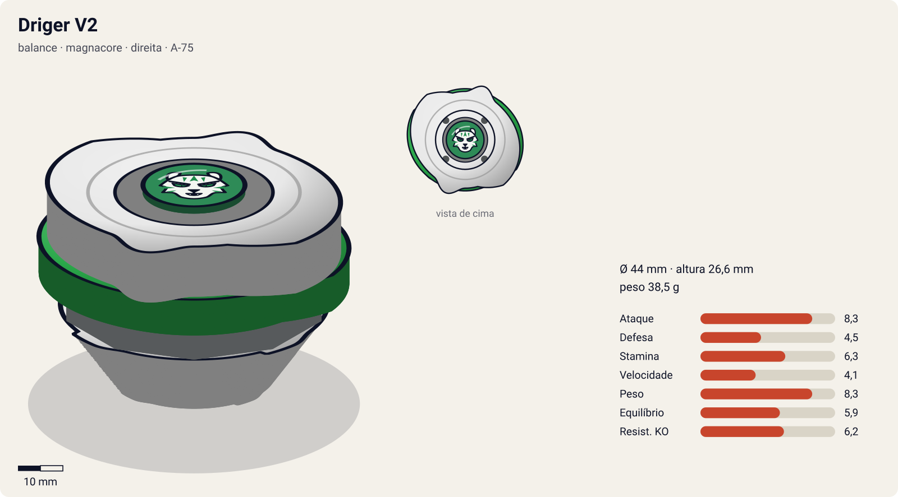
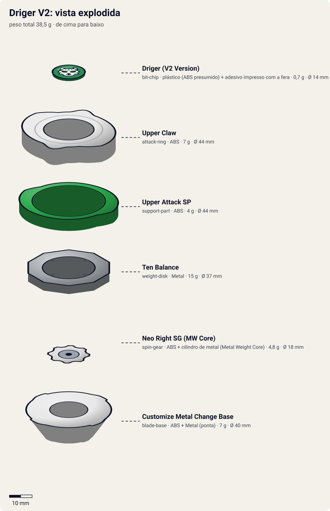

# Driger V2 (ドライガーV2 / Doraigā Barukan Tsū — "Driger Vulcan 2")

<!-- auto:inicio (gerado por npm run build:research; não edite este bloco) -->

| Ficha | |
|---|---|
| Dono | [Ray Kon (Rei Kon / 金李, Kon Rei)](../../README.md) |
| Tipo · sistema · rotação | balance · magnacore · direita |
| Código do produto | A-75 |
| Montada | Ø 44 mm · altura 26,6 mm · **38,5 g** (soma das peças) |
| Fera bit | [Driger](../../../../feras-bit/driger/) |
| Lançador | [Bey Ultimate Shooter (BeyUltimate Shooter)](../../../../lancadores/bey-ultimate-shooter/) |
| Ripcord | [ultimate-winder](../../../../lancadores/ripcords/ultimate-winder/) |

### Peças

| Camada | Peça | Material | Ø mm | Altura mm | Peso g | Estrelas Takara (A / D / S) | Desenho |
|---|---|---|---|---|---|---|---|
| Bit Chip | [Driger (V2 Version)](../../../../pecas/bit-chip/driger-v2/) | plástico (ABS presumido) + adesivo impresso com a fera | 14 estimado | 8 estimado | 0,7 comunidade | — | [ver](pecas/bit-chip.svg) |
| Attack Ring | [Upper Claw](../../../../pecas/attack-ring/upper-claw/) | ABS | 44 estimado | 9 estimado | 7 wiki | 3 / 1 / 2 | [ver](pecas/attack-ring.svg) |
| Support Part | [Upper Attack SP](../../../../pecas/support-part/upper-attack-sp/) | ABS | 44 estimado | 5 estimado | 4 wiki | 2 / 0 / 0 | [ver](pecas/support-part.svg) |
| Weight Disk | [Ten Balance](../../../../pecas/weight-disk/ten-balance/) | Metal | 37 estimado | 3,6 estimado | 15 wiki | 1 / 2 / 3 | [ver](pecas/weight-disk.svg) |
| Spin Gear / Core | [Neo Right SG (MW Core)](../../../../pecas/spin-gear/neo-right-sg-mw-core/) | ABS + cilindro de metal (Metal Weight Core) | 18 estimado | 10 estimado | 4,8 wiki | — | [ver](pecas/spin-gear.svg) |
| Blade Base | [Customize Metal Change Base](../../../../pecas/blade-base/customize-metal-change-base/) | ABS + Metal (ponta) | 40 estimado | 14 estimado | 7 wiki | 4 / 1 / 2 | [ver](pecas/blade-base.svg) |

Fonte de cada medida em subscrito (wiki, comunidade, estimado). Detalhes em cada ficha de peça.

### Atributos

| Atributo | Brinquedo (calculado) | Ajuste anime | Jogo |
|---|---|---|---|
| Ataque | 6,3 | +2 | **8,3** |
| Defesa | 4,5 | — | **4,5** |
| Stamina | 6,3 | — | **6,3** |
| Velocidade | 3,1 | +1 | **4,1** |
| Peso | 8,3 | — | **8,3** |
| Equilíbrio | 5,9 | — | **5,9** |
| Resistência a KO | 6,2 | — | **6,2** |

Calculado por `src/beyblade/stats.js` a partir de: ponta metal-sharp (atrito 0,2), contato upper (recoil 0,4), peso do WD na equilibrado. Modelo em [docs/BEYBLADES.md](../../../../../docs/BEYBLADES.md).

### Fera bit em cima da bey

 

Sons: [invocacao](../../../../feras-bit/driger/sons/invocacao.wav) · [rugido](../../../../feras-bit/driger/sons/rugido.wav) · [ataque](../../../../feras-bit/driger/sons/ataque.wav). Animações: [invocação](../../../../feras-bit/driger/invocacao.svg) · [ataque](../../../../feras-bit/driger/ataque.svg).
<!-- auto:fim -->

| Campo | Valor |
|---|---|
| Dono | Ray Kon |
| Código do produto | A-75 (Takara), ¥580; lançamento JP ago/2002 |
| Tipo | Balance |
| Sistema | Magnacore System |
| Rotação | Direita |
| Fera Bit (Bit-Beast) | Driger – Tigre Branco |
| Série / temporada | V-Force (2002); usada também no início de G-Revolution |
| Primeira aparição (anime) | V-Force ep 38 "The Fate of the Spark Battle" |
| Antecessora → Sucessora | [Driger V](../driger-v/) → [Driger G](../driger-g/) |

## Formato e geometria
- Silhueta de 2 lados (2 cabeças de tigre + 2 rampas longas do [Upper Claw](../../../../pecas/attack-ring/upper-claw/)), simetria rotacional de 180°.
- Peso balanceado ([Ten Balance](../../../../pecas/weight-disk/ten-balance/) + [MW Core](../../../../pecas/spin-gear/neo-right-sg-mw-core/)); o [Upper Attack SP](../../../../pecas/support-part/upper-attack-sp/) baixo aumenta a massa na periferia inferior.
- Perfil: rampas muito baixas (graças ao SP), ótimas para upper; a base mais alta ajuda a não raspar, mas a bey raspa quando perde equilíbrio.
- **Por que as peças funcionam assim**:
  - Upper Claw: as rampas descem até o nível do WD e mudam de ângulo em 2 pontos; upper attack (levanta o oponente) + "upward smash". Só eficaz em rotação direita.
  - Upper Attack SP: partes baixas com rampa que se alinham à rampa do AR, dobrando o comprimento dela. A rampa começa mais baixa que em qualquer AR e entra embaixo até de beys baixas; pode raspar no chão.
  - Neo Right SG (MW Core): núcleo de peso metálico, não magnético; mais peso central que um SG comum.
  - [Customize Metal Change Base](../../../../pecas/blade-base/customize-metal-change-base/): versão atualizada da Metal Change da Driger S, com ponta metálica um pouco mais aguda, base mais alta e encaixe para SP. 2 modos (reta = sobrevivência, inclinada = ataque), menos agressiva que a da Driger S.
- Divergência: a página Weight Disk - Ten Wide lista a Driger V2 entre seus produtos, mas a infobox da Driger V2 diz Ten Balance. Adotado Ten Balance (infobox).

## Comportamento na arena
- **Movimento**: lançada inclinada, varredura agressiva pelo estádio; reta, fica no centro com a ponta metálica. Alterna modos ao ser atingida.
- **Ataque**: upper attack; entra por baixo, levanta, e o degrau entre AR e SP finaliza o KO.
- **Defesa/Stamina**: médias; ponta metálica dá sobrevivência.
- **Pontos fortes**: "vence uma grande variedade de oponentes com pouca ou nenhuma customização" (wiki). **Fracos**: SP raspam no chão em ângulos fortes; inútil em rotação esquerda.
- **Gimmick**: Upper Attack SP + Change Base de 2 modos.

## No anime
- **Vulcan Power Claw** (バルカンパワークロー): Driger é invocado, a bey brilha (aura vermelha) e investe com um upper attack poderoso enquanto Driger rasga a fera inimiga. Usado só 2 vezes: V-Force ep 40 (vs Max) e ep 48 (vs Gordo, sem efeitos especiais).
- Batalhas: estreia no tag Ray+Kai vs Dunga+Joseph (ep 38, vitória); vs Max (ep 40, vitória); tag com Zeo vs Denny (ep 40); vs Sanchez (ep 47, vitória); vs Gordo/Blizzard Orthrus (ep 48, empate); G-Rev ep 2 (tag com Tyson vs Daichi/Jin, sem resultado) e G-Rev ep 3 vs Jin of the Gale (Metal Driger): derrota, que motiva a troca para Driger G.

## Mecânica no jogo
- **Movimento (IA)**: alterna "centro" e "varredura", como a [Driger S](../driger-s/). Na varredura procura contato **lateral e baixo** (aproxima-se pelo lado do alvo, não de frente).
- **Gimmick**:
  - Change Base: centro com atrito ~0,1; varredura (depois de um impacto forte ou lançamento inclinado) com atrito ~0,6 por 1,5 s.
  - Upper (AR + SP): todo golpe da Driger acertado de lado aplica "lift" ao alvo: −30% de estabilidade por 1 s, e o próximo empurrão no alvo nesse tempo é 1,5× maior. Se a Driger perder estabilidade (rotação < 20%), o SP raspa no chão: −10% de velocidade.
- **Especiais** (efeito visual: [fera Driger](../../../../feras-bit/driger/ataque.svg) com aura; [invocação](../../../../feras-bit/driger/invocacao.svg) da fera):
  - **Vulcan Power Claw** (custo 130, recarga 25 s): aura vermelha por 2 s com +30% de velocidade; o primeiro impacto nesse tempo aplica lift máximo (alvo sem estabilidade por 1,5 s) e 2× de empurrão, com chance alta de ring out se o alvo estiver a menos de 30% do raio da borda.

## Ajuste do anime

| Atributo | Delta | Justificativa (episódio/batalha) |
|---|---|---|
| Ataque | +2 | O Vulcan Power Claw vence a Draciel de Max (V-Force ep 40); vence Sanchez (ep 47) e o tag contra Dunga e Joseph (ep 38) |
| Velocidade | +1 | No anime ataca em investidas o tempo todo; o brinquedo sai lento (2,1) porque o cálculo usa a ponta metal sharp do modo central |

Resultado esperado: vence a defensiva de Max e empata com a Blizzard Orthrus de Gordo (ep 48), mas perde para a Metal Driger de Jin (G-Rev ep 3). Nota para o coordenador: como na Dranzer V2, o modo de varredura da Change Base não entra na velocidade calculada; ficou na mecânica acima, não no ajuste.

## Fontes
- https://beyblade.fandom.com/wiki/Driger_V2
- https://beyblade.fandom.com/wiki/Attack_Ring_-_Upper_Claw
- https://beyblade.fandom.com/wiki/Weight_Disk_-_Ten_Wide , https://beyblade.fandom.com/wiki/Weight_Disk_-_Ten_Balance
- https://beyblade.fandom.com/wiki/Vulcan_Power_Claw
- https://beyblade.fandom.com/wiki/Beyblade:_V-Force_-_Episode_38 , _48 ; https://beyblade.fandom.com/wiki/Beyblade:_G-Revolution_-_Episode_02 , _03
- https://beyblade.fandom.com/wiki/Ray_Kon
