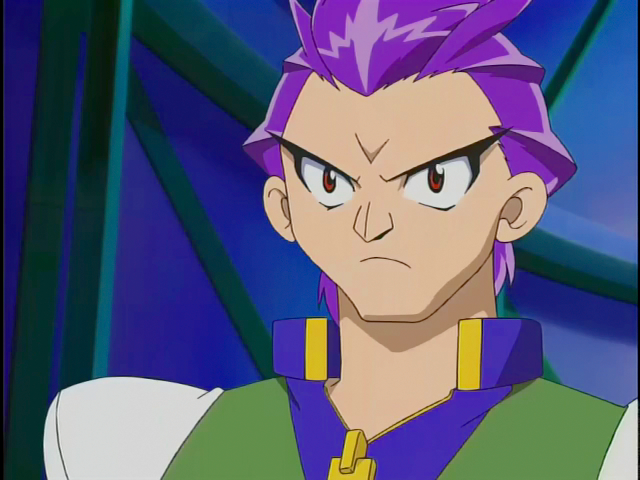
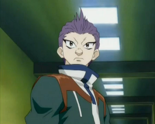

# Robert Jürgens (Ralph Jürgens / ラルフ・ユルゲンス)

Visual em G-Revolution: 

> Grafia: a Beyblade Wiki usa "Robert **Jürgens**" (com "s"); a pasta mantém o slug `robert-jurgen` pedido no projeto.

| Campo | Valor |
|---|---|
| Nome JP | ラルフ・ユルゲンス (Rarufu Yurugensu – "Ralph Jürgens") |
| Equipe(s) por temporada | S1: Majestics (capitão) / V-Force: não aparece / G-Rev: Majestics (capitão; eliminados nas preliminares europeias) |
| Nacionalidade | Alemão (nobreza; dono de um castelo/fortaleza na Alemanha, com o mordomo Gustav) |
| Idade (aprox.) | 17 (S1) / 19 (G-Rev) |
| Fera Bit | Griffolyon (grifo – leão com cabeça e asas de águia); elemento vento |
| Estilo de batalha | Ataque (smash) poderoso e "aéreo"; pressão de espírito de luta herdado da família |
| Dublador(a) JP / EN / PT-BR | Yuki Matsuda / Vince Corazza (S1; Robert Tinkler no ep. 33), Robert Smith (G-Rev) / não confirmado |

## Personalidade e papel na história
- Aristocrata orgulhoso que valoriza a honra e o jogo limpo, mas é arrogante na estreia: no navio para a Europa (S1 ep. 30) destrói as beys de vários bladers e humilha Tyson, mostrando que existem bladers fortíssimos fora do Campeonato Mundial.
- Não vê sentido em enfrentar o mesmo adversário duas vezes; considera "trabalho em equipe" algo ridículo até perder para Tyson no confronto Bladebreakers × Majestics no Coliseu de Olympia (ep. 39).
- A pedido de Mr. Dickenson, enfrenta Tyson de novo nas ruínas da Rússia (ep. 47) para ensiná-lo a canalizar o "poder interior" junto da fera bit; ajuda no treino para a final contra os Demolition Boys e participa da batalha dos capitães (ep. 50).
- G-Rev: mais maduro e cordial com Tyson; os Majestics caem nas preliminares por trapaça da Barthez Battalion. Usa um mangual (flail) como lançador/arma. Bom no xadrez; empresário (construiu estádio próprio).

## Estilo de luta (como o jogo deve representá-lo)
- **Lançamento típico**: lançamento forte e "de cima", fazendo a beyblade descer em investida; o anime mostra o Griffolyon gigante pairando sobre o estádio.
- **Agressividade**: alta desde o primeiro segundo – busca knockout rápido e "esmagador" (destrói beys fracas com um golpe).
- **Preferências táticas**: smash attack frontal, pressão contínua, especiais aéreos (penas/lâminas de vento). Confia no poder de espírito superior; não gosta de batalhas longas.
- **Frases de efeito**: "The name is Robert."; "No, alas I am talking to trash." (para Tyson).

## Beyblades utilizadas no anime (ordem cronológica)
| # | Beyblade | Temporada | Episódio de estreia | Pasta |
|---|---|---|---|---|
| 1 | Griffolyon (A-28) | Bakuten Shoot (S1); reaparece em G-Revolution | S1 ep. 30 "Cruising for a Bruising" | [beyblades/griffolyon](beyblades/griffolyon/) |

Verificado na wiki: Robert só usa **Griffolyon** no anime. Não há "Griffolyon 2" no anime – "Griffolyon 2" é apenas um recolor roxo da Hasbro (brinquedo), e "Bakutenryu Etanzel" (2004) é um relançamento vermelho da Takara; ambos fora do escopo.

## Batalhas marcantes
| Temporada / ep. | Adversário | Resultado |
|---|---|---|
| S1 ep. 33 (flashback) | Sanguinex (Dark Bladers) | Vitória |
| S1 ep. 30 | Bladers anônimos, Bolt e Tyson (Dragoon F) | Vitórias – Tyson é arremessado para fora com facilidade |
| S1 ep. 39 | Tyson (Dragoon F) | Derrota – Majestics aprendem sobre trabalho em equipe |
| S1 ep. 47 | Tyson (Dragoon F) | Vence a 1ª, perde a 2ª (lição do "poder interior") |
| S1 ep. 50 | Tyson (com Kai, Michael e Lee) | Sem resultado (batalha dos capitães) |
| G-Rev ep. 7 | Miguel (possivelmente; Barthez Battalion) | Derrota (fora de cena / não confirmado) |
| G-Rev (encerramento JP) | Mathilda & Aaron (dupla com Oliver) | Sem resultado |

## Perfil de IA sugerido para o jogo
- **Agressividade**: 9/10.
- **Posicionamento**: órbita ampla e rápida pela borda, cortando para o centro em investidas diretas contra o oponente (smash), recuando para nova volta.
- **Uso de especial**: cedo e ofensivo – usa Wing Dagger assim que tem energia, buscando knockout; Wind Swords como finalizador quando o rival está perto da borda.
- **Ponto fraco a explorar pelo jogador**: stamina e equilíbrio ruins (ponta alta e estreita do Griffolyon Base); defensores pesados no centro (Draciel) e batalhas longas o desgastam.

## Fontes
- https://beyblade.fandom.com/wiki/Robert_J%C3%BCrgens
- https://beyblade.fandom.com/wiki/Griffolyon
- https://beyblade.fandom.com/wiki/Majestics
- https://beyblade.fandom.com/wiki/Beyblade_-_Episode_30
- https://beyblade.fandom.com/wiki/Beyblade_-_Episode_39
- https://beyblade.fandom.com/wiki/Beyblade_-_Episode_47
- https://beyblade.fandom.com/wiki/Wing_Dagger
- Imagens: File:Robert Season 1.png, File:Robert.png (Beyblade Wiki)
