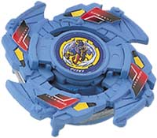
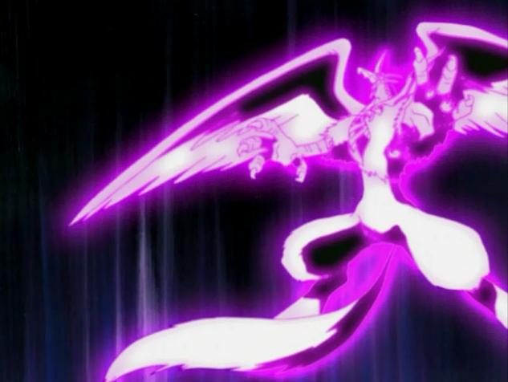

# Griffolyon (グリフォリオン / Guriforion)

Anime:  · Fera bit: 

| Campo | Valor |
|---|---|
| Dono | Robert Jürgens (Ralph Jürgens) |
| Código do produto | A-28 (Takara, booster, julho de 2001) |
| Tipo | Attack |
| Sistema | Spin Gear System (linha "Hidden Spirits" – vem com figura do grifo que encaixa na bey; SG integrado à base) |
| Rotação | Direita |
| Fera Bit (Bit-Beast) | Griffolyon – grifo (leão com cabeça/asas de águia); herança da família de Robert; elemento vento |
| Série / temporada | Bakuten Shoot (2001); reaparece em G-Revolution (2003) |
| Primeira aparição (anime) | S1 ep. 30 "Cruising for a Bruising" (聖獣を従える者) |
| Antecessora → Sucessora | — → — (única bey de Robert no anime) |

## 1. Peças (de cima para baixo)

| Camada | Peça | Descrição física | Função em batalha |
|---|---|---|---|
| Bit Chip | Griffolyon | Chip com a ilustração do grifo | identidade / fera bit (vento) |
| Attack Ring (AR) | Cross Griffon (6 g) | 4 conjuntos de cabeça + asa de grifo; AR grosso; 4 pontas de asa afiadas e bem espaçadas como contatos principais; sem rampas (slopes) | Smash attack fortíssimo em rotação direita (comparável ao Triple Wing do Trygle), grande alcance e enorme "stopping power" (golpes que freiam a rotação do rival); um pouco mais de recoil que o Triple Wing |
| Weight Disk (WD) | Eight Balance (14 g) | Octogonal, peso intermediário entre Wide e Heavy | Equilíbrio geral de massa |
| Spin Gear (SG) / Core | Integrado à base (direita) | Sem SG removível – estilo 4-layer | Rotação direita fixa |
| Support Part / Sub Ring | — | Figura "Hidden Spirit" do grifo encaixa na bey só para exibição (não lançável) | — |
| Blade Base (BB) | Griffolyon Base | Ponta alta, estreita e arredondada presa a um cilindro com leve free-spin; hastes para a figura projetam-se para baixo e para fora do perímetro (versão Takara) | Pouca movimentação, péssimo equilíbrio, quase nenhuma defesa e stamina; as hastes raspam no chão e geram muito recoil (a wiki a chama de candidata a "pior base da geração plástica") |

Fotos das peças: `pecas/attack-ring.jpg` (Cross Griffon), `pecas/weight-disk.gif` (Eight Balance, diagrama), `pecas/blade-base.jpg` (vista inferior), `pecas/bit-chip.png`, `pecas/pecas-desmontadas.jpg`.

## 2. Formato e geometria
- Silhueta em "cruz alada": 4 contatos principais (pontas das asas), simetria de 4 lados, raio grande para a época (AR grosso e largo).
- Peso concentrado na periferia pelo AR largo + Eight Balance; centro leve. Boa inércia para golpes, mas a base estreita e alta gera instabilidade.
- Perfil alto (ponta alta + hastes da figura): vulnerável a upper attack e a perder equilíbrio quando atingido.

## 3. Comportamento na arena
- **Movimento**: no brinquedo de série, pouco deslocamento (ponta arredondada estreita) e muito wobble; no anime, voa/investe em arcos amplos e despenca sobre o rival ("high flying blading style").
- **Ataque**: smash puro com as 4 pontas de asa; golpes que interrompem a rotação adversária.
- **Defesa**: ruim – hastes salientes geram recoil e facilitam KO por oponentes até passivos.
- **Stamina**: muito ruim no brinquedo de série (perde até para bases notoriamente fracas em stamina).
- **Matchups**: vence atacantes leves e beys "comuns" (no anime destrói beys genéricas com um golpe); sofre contra defensores pesados de centro e contra stamina se não resolver cedo. Em customização competitiva, o AR Cross Griffon é excelente (com Wide Defense + SG Metal Flat Base).
- **Gimmick**: figura Hidden Spirit (decorativa) e ponta com leve free-spin.

## 4. No anime
- **Especiais**: *Wing Dagger* – Griffolyon dispara penas das asas que chovem sobre o oponente; *Wind Swords* (citado no infobox da wiki; descrição visual não confirmada – lâminas de vento).
- **Batalhas marcantes**: S1 ep. 30 – destrói beys de bladers no navio e arremessa o Dragoon F de Tyson para fora com facilidade (Griffolyon aparece gigante, "fazendo Dragoon parecer um lagarto"); ep. 39 – perde para Tyson no Coliseu de Olympia; ep. 47 – vence Tyson e depois perde na revanche (lição do "poder interior"); ep. 50 – batalha dos capitães. Em G-Rev perde nas preliminares (ep. 7, possivelmente para Miguel).
- **Evolução**: não foi substituída; no encerramento japonês de G-Rev aparece com o Griffolyon Base sem a figura. Na 1ª temporada é desenhada com a figura encaixada embaixo (configuração Takara).

## 5. Tradução para o jogo
Valores 1–10 (ver `pesquisa-bakuten/_template/BRIEF-AGENTES.md` → "Escala de atributos").

| Atributo | Valor | Justificativa |
|---|---|---|
| Ataque | 9 | Cross Griffon é smash de elite (≈ Triple Wing) e no anime humilha Tyson; fica 1 abaixo de Dragoon V2/Galeon 2 pela era S1 |
| Defesa | 4 | Hastes e perfil alto geram recoil; defesa ruim no brinquedo; anime mostra que aguenta um pouco pelo "espírito" de Robert |
| Stamina | 3 | Base com uma das piores stamina da geração plástica (estimativa ancorada no texto da wiki) |
| Velocidade | 7 | Brinquedo se move pouco, mas o anime mostra investidas aéreas rápidas; peso maior para o anime (estimativa) |
| Peso | 5 | Eight Balance (14 g) + AR grosso (6 g); sem metal extra — médio |
| Equilíbrio | 3 | Ponta alta/estreita e hastes que raspam no chão |
| Burst/Knockout-resist | 4 | Fácil de expulsar quando atingido (recoil), compensado em parte pelo AR largo |

- **Movimento em IA**: órbita rápida de raio grande + investidas retas em direção ao oponente a cada ~1,5 s (padrão "agressivo"); após cada colisão, recua para a borda e reinicia.
- **Especiais (no jogo)**:
  - *Wing Dagger*: dispara 5–6 projéteis (penas) em leque que causam dano de rotação e empurrão leve; custo 100, cooldown 18 s.
  - *Wind Swords*: investida aérea com dano ×1,8 e knockback alto num único golpe (ignora parte da massa do alvo); custo 100, cooldown 25 s.
- **Física sugerida**: massa relativa 0,95; raio relativo 1,1 (AR largo); atrito da ponta 0,35 (ponta arredondada estreita); restituição 0,75 (muito recoil); wobble alto quando RPM < 50%.

Os mesmos dados ficam em `dados.json` (formato em `_template/dados.schema.json`).

## 6. Fontes
- https://beyblade.fandom.com/wiki/Griffolyon
- https://beyblade.fandom.com/wiki/Attack_Ring_-_Cross_Griffon
- https://beyblade.fandom.com/wiki/Blade_Base_-_Griffolyon_Base
- https://beyblade.fandom.com/wiki/Bit_Chip_-_Griffolyon
- https://beyblade.fandom.com/wiki/Weight_Disk_-_Eight_Balance (via página do Draciel F, peso 14 g)
- https://beyblade.fandom.com/wiki/Wing_Dagger
- https://beyblade.fandom.com/wiki/Robert_J%C3%BCrgens
- https://beyblade.fandom.com/wiki/Beyblade_-_Episode_30 · _39 · _47
- Imagens: File:GriffolyonBey.jpg, File:Griff sup.jpg, File:GriffolyonShot.jpg, File:GriffoylonBitChip.png, File:Griffolyon AR View.JPG, File:Bottom View.JPG, File:Griffolyon Parts.jpg, File:Eight Balance weight disk.gif
