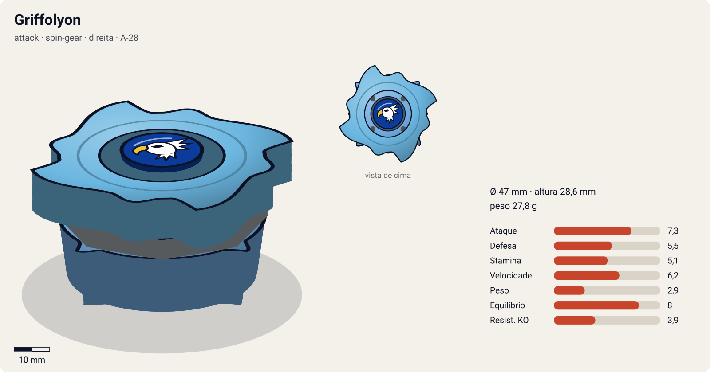
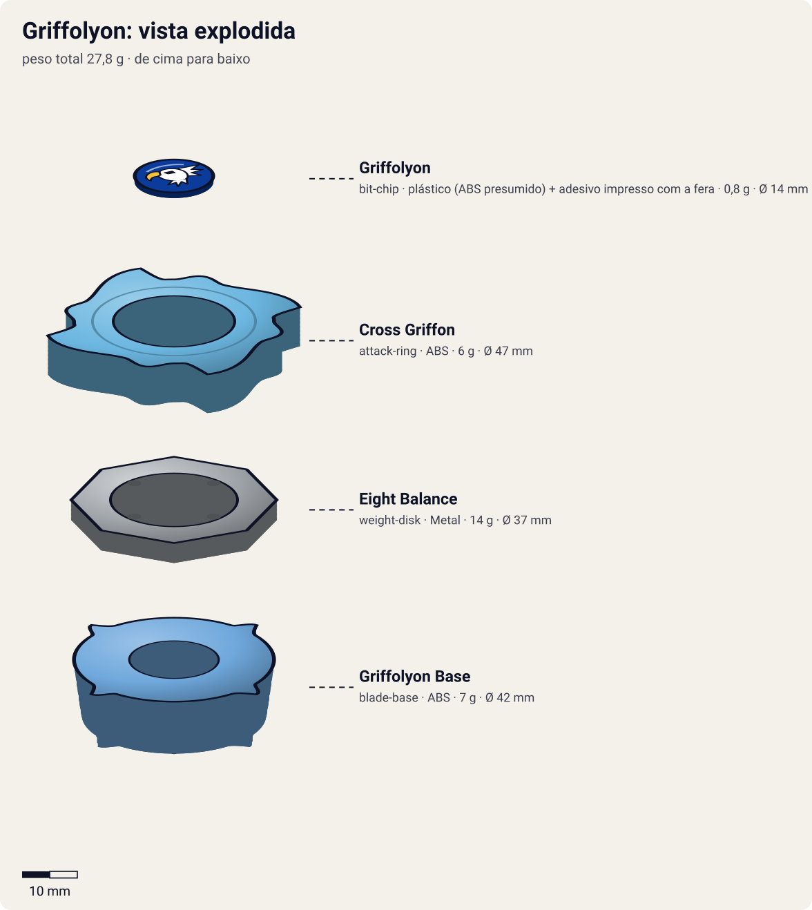
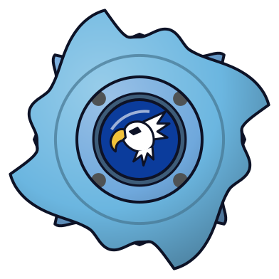
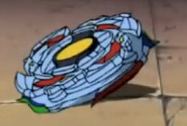

# Griffolyon (グリフォリオン / Guriforion)

<!-- auto:inicio (gerado por npm run build:research; não edite este bloco) -->

| Ficha | |
|---|---|
| Dono | [Robert Jürgens (Ralph Jürgens / ラルフ・ユルゲンス)](../../README.md) |
| Tipo · sistema · rotação | attack · spin-gear · direita |
| Código do produto | A-28 |
| Montada | Ø 47 mm · altura 28,6 mm · **27,8 g** (soma das peças) |
| Fera bit | [Griffolyon](../../../../feras-bit/griffolyon/) |
| Lançador | [Mangual-lançador do Robert (anime)](../../../../lancadores/griffolyon-flail/) |
| Ripcord | [winder-padrao](../../../../lancadores/ripcords/winder-padrao/) |

### Peças

| Camada | Peça | Material | Ø mm | Altura mm | Peso g | Estrelas Takara (A / D / S) | Desenho |
|---|---|---|---|---|---|---|---|
| Bit Chip | [Griffolyon](../../../../pecas/bit-chip/griffolyon/) | plástico (ABS presumido) + adesivo impresso com a fera | 14 estimado | 8 estimado | 0,8 comunidade | — | [ver](pecas/bit-chip.svg) |
| Attack Ring | [Cross Griffon](../../../../pecas/attack-ring/cross-griffon/) | ABS | 47 estimado | 7 estimado | 6 wiki | 3 / 2 / 2,5 | [ver](pecas/attack-ring.svg) |
| Weight Disk | [Eight Balance](../../../../pecas/weight-disk/eight-balance/) | Metal | 37 estimado | 3,6 estimado | 14 wiki | 0,5 / 2 / 2,5 | [ver](pecas/weight-disk.svg) |
| Blade Base | [Griffolyon Base](../../../../pecas/blade-base/griffolyon-base/) | ABS | 42 estimado | 18 estimado | 7 estimado | 3 / 2,5 / 1 | [ver](pecas/blade-base.svg) |

Fonte de cada medida em subscrito (wiki, comunidade, estimado). Detalhes em cada ficha de peça.

### Atributos

| Atributo | Brinquedo (calculado) | Ajuste anime | Jogo |
|---|---|---|---|
| Ataque | 5,3 | +2 | **7,3** |
| Defesa | 5,5 | — | **5,5** |
| Stamina | 5,1 | — | **5,1** |
| Velocidade | 5,2 | +1 | **6,2** |
| Peso | 2,9 | — | **2,9** |
| Equilíbrio | 8 | — | **8** |
| Resistência a KO | 3,9 | — | **3,9** |

Calculado por `src/beyblade/stats.js` a partir de: ponta ball (atrito 0,3), contato smash (recoil 0,4), peso do WD na equilibrado. Modelo em [docs/BEYBLADES.md](../../../../../docs/BEYBLADES.md).

### Fera bit em cima da bey

 

Sons: [invocacao](../../../../feras-bit/griffolyon/sons/invocacao.wav) · [rugido](../../../../feras-bit/griffolyon/sons/rugido.wav) · [ataque](../../../../feras-bit/griffolyon/sons/ataque.wav). Animações: [invocação](../../../../feras-bit/griffolyon/invocacao.svg) · [ataque](../../../../feras-bit/griffolyon/ataque.svg).

Fotos de referência (terceiros, só para estudo)

[anime.jpg](referencia/anime.jpg) · [fera-bit.jpg](referencia/fera-bit.jpg) · [imagem.jpg](referencia/imagem.jpg) · [pecas-attack-ring.jpg](referencia/pecas-attack-ring.jpg) · [pecas-bit-chip.png](referencia/pecas-bit-chip.png) · [pecas-blade-base.jpg](referencia/pecas-blade-base.jpg) · [pecas-pecas-desmontadas.jpg](referencia/pecas-pecas-desmontadas.jpg) · [pecas-weight-disk.gif](referencia/pecas-weight-disk.gif)

<!-- auto:fim -->

Anime:  · Fera bit: 

| Campo | Valor |
|---|---|
| Dono | Robert Jürgens (Ralph Jürgens) |
| Código do produto | A-28 (Takara, booster, julho de 2001) |
| Sistema | Spin Gear System (linha "Hidden Spirits": vem com figura do grifo que encaixa na bey; SG integrado à base) |
| Fera Bit (Bit-Beast) | Griffolyon, grifo (leão com cabeça/asas de águia); herança da família de Robert; elemento vento |
| Série / temporada | Bakuten Shoot (2001); reaparece em G-Revolution (2003) |
| Primeira aparição (anime) | S1 ep. 30 "Cruising for a Bruising" (聖獣を従える者) |
| Antecessora → Sucessora | — → — (única bey de Robert no anime) |

## Formato e geometria
- Silhueta em "cruz alada": 4 contatos principais (pontas das asas), simetria de 4 lados, raio grande para a época (AR grosso e largo).
- Peso na periferia pelo AR largo + Eight Balance; centro leve. Boa inércia para golpes, mas a base estreita e alta gera instabilidade.
- Perfil alto (ponta alta + hastes da figura): vulnerável a upper e a perder o equilíbrio quando atingido.

Análise das peças:
- Bit chip [Griffolyon](../../../../pecas/bit-chip/griffolyon/): ilustração do grifo (vento).
- [Cross Griffon](../../../../pecas/attack-ring/cross-griffon/) (6 g): 4 conjuntos de cabeça + asa de grifo; AR grosso com 4 pontas de asa afiadas e bem espaçadas, sem rampas. Smash fortíssimo em rotação direita (comparável ao Triple Wing do Trygle), grande alcance e enorme "stopping power" (golpes que freiam a rotação do rival); um pouco mais de recoil que o Triple Wing.
- [Eight Balance](../../../../pecas/weight-disk/eight-balance/) (14 g): octogonal, peso intermediário entre Wide e Heavy.
- Spin Gear: integrado à base (direita), sem SG removível, estilo 4-layer.
- [Griffolyon Base](../../../../pecas/blade-base/griffolyon-base/): ponta alta, estreita e arredondada presa a um cilindro com leve free-spin; as hastes da figura projetam-se para baixo e para fora do perímetro (versão Takara). Pouco movimento, péssimo equilíbrio, quase nenhuma defesa e stamina; as hastes raspam no chão e geram muito recoil (a wiki a chama de candidata a "pior base da geração plástica").
- A figura "Hidden Spirit" do grifo encaixa na bey só para exibição (não lançável).

Fotos das peças (terceiros): [AR](referencia/pecas-attack-ring.jpg), [WD](referencia/pecas-weight-disk.gif) (diagrama), [base por baixo](referencia/pecas-blade-base.jpg), [bit chip](referencia/pecas-bit-chip.png), [desmontada](referencia/pecas-pecas-desmontadas.jpg).

## Comportamento na arena
- **Movimento**: no brinquedo de série, pouco deslocamento (ponta arredondada estreita) e muito wobble; no anime, voa e investe em arcos amplos e despenca sobre o rival ("high flying blading style").
- **Ataque**: smash puro com as 4 pontas de asa; golpes que interrompem a rotação adversária.
- **Defesa**: ruim: as hastes salientes geram recoil e facilitam o KO até por oponentes passivos.
- **Stamina**: muito ruim no brinquedo de série (perde até para bases notoriamente fracas em stamina).
- **Matchups**: vence atacantes leves e beys "comuns" (no anime destrói beys genéricas com um golpe); sofre contra defensores pesados de centro e contra stamina se não resolver cedo. Em customização competitiva, o Cross Griffon é excelente (com Wide Defense + SG Metal Flat Base).
- **Gimmick**: figura Hidden Spirit (decorativa) e ponta com leve free-spin.

## No anime
- **Especiais**: *Wing Dagger*: Griffolyon dispara penas das asas que chovem sobre o oponente; *Wind Swords* (citado na infobox da wiki; descrição visual não confirmada, lâminas de vento).
- **Batalhas**: S1 ep. 30, destrói beys de bladers no navio e arremessa o Dragoon de Tyson para fora com facilidade (Griffolyon aparece gigante, "fazendo Dragoon parecer um lagarto"); ep. 39, perde para Tyson no Coliseu de Olympia; ep. 47, vence Tyson e depois perde na revanche (lição do "poder interior"); ep. 50, batalha dos capitães. Em G-Rev perde nas preliminares (ep. 7, possivelmente para Miguel).
- **Evolução**: não foi substituída; no encerramento japonês de G-Rev aparece com a Griffolyon Base sem a figura. Na 1ª temporada é desenhada com a figura encaixada embaixo (configuração Takara).

## Mecânica no jogo
- **Movimento (IA)**: "agressivo": órbita rápida de raio grande + investida reta no oponente a cada ~1,5 s; depois de cada colisão, recua para a borda e recomeça.
- **Gimmick**: hastes da figura: em inclinação acima de 15° (wobble ou golpe forte) raspam no piso: −3% de RPM e +20% de recoil no próximo contato. Wobble alto abaixo de 50% de RPM. "Stopping power" do Cross Griffon: cada golpe frontal tira 1,5% de RPM extra do alvo.
- **Especiais**:
  - *Wing Dagger*: dispara 5–6 penas em leque que tiram rotação e empurram de leve; custo 100 de energia, recarga 18 s. Visual: o [ataque de Griffolyon](../../../../feras-bit/griffolyon/ataque.svg) (leque de penas-adaga em vento roxo).
  - *Wind Swords*: investida aérea com dano 1,8× e knockback alto num único golpe (ignora parte da massa do alvo); custo 100, recarga 25 s. Visual: as lâminas de vento do fim do mesmo [ataque](../../../../feras-bit/griffolyon/ataque.svg).
- **Física**: massa relativa 0,95; raio 1,1 (AR largo); atrito da ponta 0,35 (ponta arredondada estreita); restituição 0,75 (muito recoil).

## Ajuste do anime

| Atributo | Delta | Justificativa (episódio/batalha) |
|---|---|---|
| Ataque | +2 | Destrói beys no navio e arremessa o Dragoon de Tyson para fora com facilidade (S1 ep. 30); vence a 1ª rodada contra Tyson (ep. 47). |
| Velocidade | +1 | "High flying blading style": investidas aéreas rápidas que o brinquedo (ponta estreita, pouco movimento) não tem. |

Resultado esperado: atacante de elite da S1, frágil em defesa e stamina; vence beys comuns de um golpe e perde para Dragoon quando Tyson resiste (ep. 39, 2ª rodada do ep. 47).

## Fontes
- https://beyblade.fandom.com/wiki/Griffolyon
- https://beyblade.fandom.com/wiki/Attack_Ring_-_Cross_Griffon
- https://beyblade.fandom.com/wiki/Blade_Base_-_Griffolyon_Base
- https://beyblade.fandom.com/wiki/Bit_Chip_-_Griffolyon
- https://beyblade.fandom.com/wiki/Weight_Disk_-_Eight_Balance (via página do Draciel F, peso 14 g)
- https://beyblade.fandom.com/wiki/Wing_Dagger
- https://beyblade.fandom.com/wiki/Robert_J%C3%BCrgens
- https://beyblade.fandom.com/wiki/Beyblade_-_Episode_30 · _39 · _47
- Imagens: File:GriffolyonBey.jpg, File:Griff sup.jpg, File:GriffolyonShot.jpg, File:GriffoylonBitChip.png, File:Griffolyon AR View.JPG, File:Bottom View.JPG, File:Griffolyon Parts.jpg, File:Eight Balance weight disk.gif
