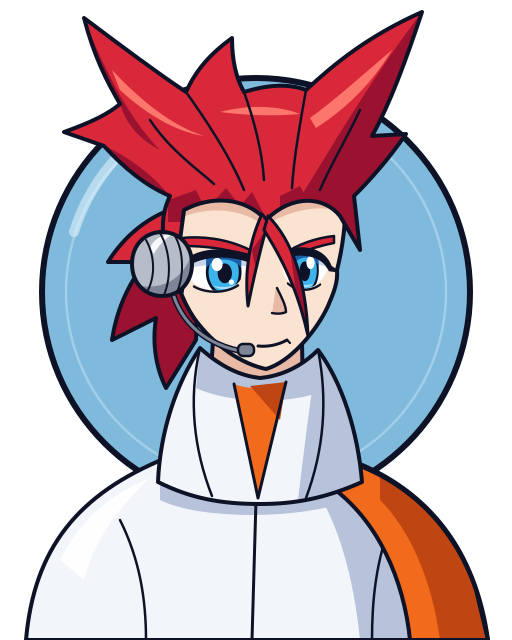
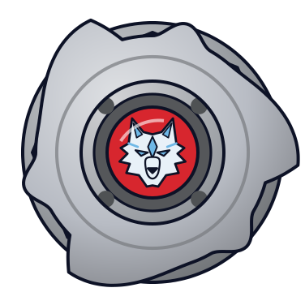
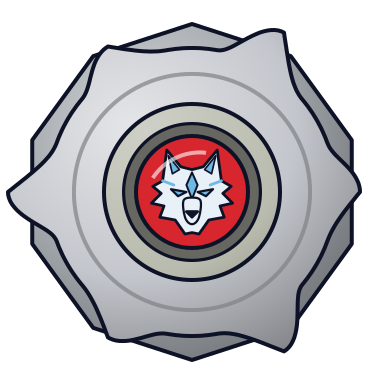

# Tala (Yuriy Ivanov / ユーリ・イヴァノーフ)

Retrato original do jogo ([retrato.svg](retrato.svg)). Referências: [referencia/foto.jpg](referencia/foto.jpg) (S1) e [referencia/foto-grev.jpg](referencia/foto-grev.jpg) (visual de G-Revolution).

| Campo | Valor |
|---|---|
| Nome JP | ユーリ・イヴァノーフ (Yūri Ivanōfu) — no Japão é "Yuriy Ivanov"; no dub EN às vezes "Tala Valkov" |
| Equipe(s) por temporada | S1: Demolition Boys (ボーグ / Borg), capitão / V-Force: não aparece no anime / G-Rev: Blitzkrieg Boys (ネオボーグ / Neo Borg), capitão |
| Nacionalidade | Russo (criado na Abadia Balkov / Biovolt) |
| Idade (aprox.) | não confirmada pela wiki (adolescente; aniversário 8 de fevereiro, signo Aquário) |
| Fera Bit | Wolborg (ウルボーグ) — lobo prateado (銀狼) de gelo, fera bit **artificial** criada por Boris/Volkov |
| Estilo de batalha | Stamina/resistência com controle de gelo; desgasta o adversário e finaliza com o especial |
| Dublador(a) JP / EN / PT-BR | Chiaki Morita (森田チアキ) / Jamie Haydon-Devlin / não confirmado |

## Visual

Padrão do retrato: visual da **primeira aparição (S1, 2001)**.

- **S1 (2001)**: cabelo **ruivo/vermelho vivo** puxado para cima e para trás em duas grandes pontas laterais, como chifres (JP: 髪型は左右に尖らせた独特の赤い髪), com bico de viúva na testa e **duas mechas finas soltas** caindo sobre o rosto (wiki EN: "two strands hanging loose from a widow's peak"). Olhos **azul-gelo**, pele bem clara, expressão fria e sarcástica (sobrancelhas baixas, olhar semicerrado). Usa um **fone de ouvido com microfone** (concha cinza arredondada sobre a orelha e haste até a boca) e um **casaco branco de gola alta** com forro/painéis **laranja** (uniforme dos Demolition Boys/Abadia).
- **G-Revolution (2003)**: mesmo penteado em chifres, um pouco mais curto e de vermelho mais escuro; a wiki registra olhos **violeta** nessa temporada. Troca o casaco por um macacão justo **laranja e branco com faixas azul-marinho**, luvas sem dedos e botas (Blitzkrieg Boys). Sem o fone.
- Elementos obrigatórios no retrato: chifres de cabelo, mechas sobre o rosto, fone com microfone, gola branca alta com laranja.

| Uso | Hex |
|---|---|
| Disco de fundo (Wolborg, lobo prateado de gelo; proposta até existir `feras-bit/wolborg/dados.json`) | `#7fb9dc` (borda `#0d1226`, brilho `#e6f6ff`) |
| Cabelo base / sombra / brilho | `#d8283a` / `#9a1230` / `#ff7a6e` |
| Pele base / sombra | `#fbe3d2` / `#e8b9a4` |
| Íris base / sombra | `#3bb4ec` / `#1a5fa8` |
| Casaco branco base / sombra | `#f2f5fa` / `#b7c3da` |
| Laranja base / sombra | `#f26a1b` / `#bf4512` |
| Fone (metal) base / sombra | `#b6bcc8` / `#7d8597` |
| Contorno | `#0d1226` |

## Personalidade e papel na história
- **S1 (2001)**: ás e capitão dos Demolition Boys, chamado de "arma final" de Boris (fica numa incubadora; no dub EN é "Cyber Tala", aprimoramento cibernético que **não existe** no original japonês). Frio, sarcástico, orgulhoso e com ciúme do favoritismo de Boris por Kai. Vence Eddy (All Starz) num golpe só (ep. 43). Na final do Mundial (eps. 50–51) enfrenta Tyson usando todas as feras bit roubadas (Dranzer, Draciel, All Starz, White Tigers), cria uma dimensão de gelo dentro de um iceberg, vence a 2ª rodada e perde a 3ª. Aperta a mão de Tyson no fim.
- **G-Revolution (2003)**: mais maduro e protetor, mas ainda arrogante em batalha (o JP descreve um lado "insano" próximo ao mangá). Lidera os Blitzkrieg Boys, aceita Kai como parceiro. Perde para Daichi (ep. 14) depois que Kenny descobre a fraqueza de Wolborg 4, perde para Rick (ep. 16), empata com Daichi na final (ep. 28). Invade a BEGA com Bryan e Spencer, arranca um empate contra Garland mas Wolborg 4 é destruída e ele vai em coma para o hospital (ep. 36). Desperta no confronto final Tyson x Brooklyn e empresta o poder de Wolborg (o ataque de água de Draciel vira gelo).

## Estilo de luta (como o jogo deve representá-lo)
- Lançamento firme e central; a bey ocupa o centro e deixa o adversário gastar energia contra ela (ex.: contra Lee, ep. 22, "está desperdiçando energia").
- Agressividade média-baixa no começo, alta no final: espera o adversário perder rotação, depois usa o especial para encerrar rápido.
- Especiais de gelo: congelam o oponente/estádio (S1: Blizzalog, dimensão de gelo; G-Rev: Novae Rog, congela e esmaga). Às vezes surge uma *Yuki-onna* (mulher das neves) no lugar do lobo.
- Fraqueza canônica (G-Rev): logo depois de usar o especial Wolborg fica **vulnerável** (no ep. 14 ela salta, erra e fica no ar; Daichi contra-ataca).
- Frases/atitude: confiança gélida, menospreza adversários "fracos" (Kenny, Daichi).

## Beyblades utilizadas no anime (ordem cronológica)
| # | Beyblade | Temporada | Episódio de estreia | Pasta | Miniatura | Lançador + ripcord |
|---|---|---|---|---|---|---|
| 1 | Wolborg 2 (ウルボーグ2) | S1 (2001) e início de G-Rev | S1 ep. 42 (flashback) / ep. 43 (batalha vs. Eddy) | [beyblades/wolborg-2](beyblades/wolborg-2/README.md) |  | [EZ Shooter (Easy Shooter, rotação direita)](../../lancadores/ez-shooter/) + [Winder padrão (Beyblade Winder)](../../lancadores/ripcords/winder-padrao/) |
| 2 | Wolborg 4 (ウルボーグ4) | G-Revolution | G-Rev ep. 13 "Kenny's Big Battle" | [beyblades/wolborg-4](beyblades/wolborg-4/README.md) |  | [EZ Shooter (Easy Shooter, rotação direita)](../../lancadores/ez-shooter/) + [Winder padrão (Beyblade Winder)](../../lancadores/ripcords/winder-padrao/) |

**Correções em relação à lista inicial** (verificado na Beyblade Wiki e na Wikipedia JP):
- **Wolborg (A-11, a 1ª)** — só no **mangá** (e no mangá *Rising*). No anime S1 Tala já usa Wolborg 2. Não documentada como bey de batalha.
- **Wolborg MS (MA-08, HMS)** e **Wolborg MS (versão do mangá)** — só no **mangá**. No anime, Tala fica em coma antes da era HMS; ele nunca batalha com Wolborg MS no anime.
- **Wolborg 3** (Hasbro, Magnacore, B-102) — só brinquedo; Tala aparece na caixa mas nunca a usou. "Wolborg 03 (Uriel)" é outra bey da Takara, não do Tala.
- Wolborg 8 Bearing (Burst) — só no mangá *Rising*.
- Na final da S1 Tala usa as **feras bit roubadas** dentro da própria Wolborg 2 (não é outra bey).

## Batalhas marcantes
| Episódio | Adversário | Bey | Resultado |
|---|---|---|---|
| S1 ep. 43 | Eddy (Trypio) | Wolborg 2 | Vitória instantânea |
| S1 eps. 50–51 | Tyson (Dragoon F → V) | Wolborg 2 + feras roubadas | Derrota 1–2 (final do Mundial) |
| G-Rev ep. 7 | Spencer (Seaborg 2) | Wolborg 2 | Vitória (seletiva russa) |
| G-Rev eps. 13–14 | Kenny (Hopper) | Wolborg 4 | Vitória (Novae Rog destrói Hopper) |
| G-Rev ep. 14 | Daichi (Strata Dragoon) | Wolborg 4 | Derrota (Daichi foge e contra-ataca após o especial) |
| G-Rev ep. 16 | Rick (Rock Bison) | Wolborg 4 | Derrota |
| G-Rev ep. 18 | Aaron (Rushing Boar) | Wolborg 4 | Vitória |
| G-Rev eps. 22–23 | Lee (Galeon 2) | Wolborg 4 | Vitória (por resistência) |
| G-Rev ep. 28 | Daichi (Strata Dragoon G) | Wolborg 4 | Empate (choque Novae Rog x Great Cutter) |
| G-Rev ep. 35 | BEGA Training Squad (com Bryan e Spencer) | Wolborg 4 | Vitória |
| G-Rev ep. 36 | Garland (Apollon) | Wolborg 4 | Empate; Wolborg 4 destruída, Tala hospitalizado |

## Perfil de IA sugerido para o jogo
- **Agressividade**: 4/10 nos primeiros 60% da luta; 8/10 quando o adversário estiver com rotação < 40%.
- **Uso de especial**: guarda o especial para o final; dispara quando o adversário estiver lento ou encostado na parede. Depois do especial, aplicar janela de vulnerabilidade de ~1,5 s (estabilidade e defesa reduzidas) — fiel ao anime.
- **Posicionamento**: prefere o centro do estádio; movimento curto em órbita fechada; evita trocas longas de golpe.
- **Personalidade na IA**: "esperar e congelar" — prioriza vencer por stamina; se estiver perdendo em rotação, arrisca o especial mais cedo.

## Fontes
- https://beyblade.fandom.com/wiki/Tala
- https://beyblade.fandom.com/wiki/Wolborg (A-11, só mangá)
- https://beyblade.fandom.com/wiki/Wolborg_2
- https://beyblade.fandom.com/wiki/Wolborg_4
- https://beyblade.fandom.com/wiki/Wolborg_MS e https://beyblade.fandom.com/wiki/Wolborg_MS_(manga)
- https://beyblade.fandom.com/wiki/Wolborg_3
- https://beyblade.fandom.com/wiki/Novae_Rog , https://beyblade.fandom.com/wiki/Blizzalog
- Episódios: https://beyblade.fandom.com/wiki/Beyblade_-_Episode_42 , _43, _46, _50, _51; https://beyblade.fandom.com/wiki/Beyblade:_G-Revolution_-_Episode_07 , _13, _14, _16; https://beyblade.fandom.com/wiki/Beyblade_G-Revolution_-_Episode_18 , _22, _28, _35, _36
- https://ja.wikipedia.org/wiki/爆転シュート_ベイブレード_(アニメ) (seção ロシアチーム（ボーグ）)
- https://ja.wikipedia.org/wiki/爆転シュート_ベイブレード_(漫画) (tabela de beys/especiais do mangá)
